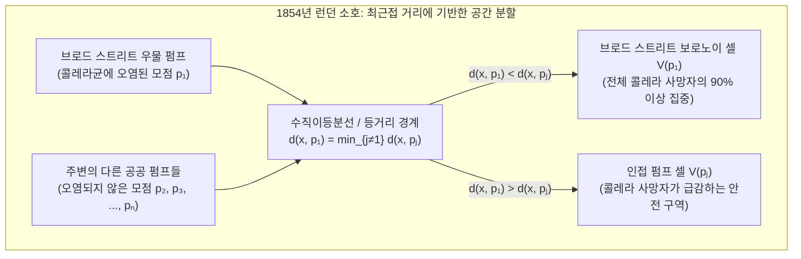

스마트폰을 들고 도심을 걸을 때, 단말기는 밀리초 단위로 어느 이동통신 기지국의 전파 경로가 가장 짧은지 계산하며 인접 기지국의 경계를 넘어 끊김 없는 핸드오버(Handover)를 수행한다. 응급 신고가 접수되는 순간 관제 시스템은 도로망과 병원 위치를 바탕으로 어느 구급차가 최단 시간에 현장에 도착할 수 있는지 판별한다. 또한 기린의 그물망 무늬, 잠자리 날개의 시맥, 현무암 주상절리, 나아가 우주 거대 구조의 은하 필라멘트와 거대 공동(Cosmic Voids)에 이르기까지 자연계는 놀라울 정도로 유사한 다각형 모자이크로 가득 차 있다.

역학 조사, 도시 인프라 설계, 5G 무선 셀 계획, 유한요소법(FEM) 수치해석 메쉬 생성, 고체물리학 및 생물 형태형성(Morphogenesis)을 관통하는 이 보편적 질서의 중심에는 계산기하학(Computational Geometry)의 가장 아름다운 쌍대 구조인 <strong>보로노이 다이어그램(Voronoi Diagram)</strong>과 그 평면 쌍대 그래프인 <strong>들로네 삼각분할(Delaunay Triangulation)</strong>이 자리 잡고 있다.

---

## 1. 1854년 런던 소호의 콜레라 지도와 '보이지 않는 경계선'의 탄생

1854년 8월 말, 영국 런던 중심부 소호(Soho) 지역의 브로드 스트리트(Broad Street) 주변에서 치명적인 콜레라가 창궐하여 열흘 만에 500명 이상(최종 616명)의 주민이 사망했다. 당시 의학계는 나쁜 공기(독기)를 마셔서 병이 옮는다는 '미아즈마설(Miasma Theory)'을 신봉했으나, 의사 <strong>존 스노(Dr. John Snow, 1813–1858)</strong>는 초기 증상이 호흡기가 아닌 소화기에 집중된다는 점에 주목하여 오염된 <strong>식수</strong>가 원인이라는 수인성 전염 가설을 제기했다.

스노는 사망자가 발생한 모든 건물을 지도 위에 검은 막대로 표시하고, 주민들이 식수를 길어 쓰던 거리의 공공 우물 펌프 위치를 함께 기록했다. 회의론자들을 설득하고 브로드 스트리트 바로 옆의 구빈원(자체 우물 보유)과 라이언 양조장(무료 맥주 배급 및 자체 심정 보유)에서 사망자가 거의 나오지 않은 이유를 증명하기 위해, 스노는 지도 위에 결정적인 기하학적 경계선을 그었다. 바로 <strong>"브로드 스트리트 펌프까지의 도보 거리와 다른 인접 펌프까지의 도보 거리가 정확히 같아지는 등거리 경계선"</strong>이었다.



이 다각형 영역이 바로 브로드 스트리트 펌프의 <strong>보로노이 영역(Voronoi Cell)</strong>이었으며, 콜레라 사망자의 90% 이상이 이 경계선 내부에 정확히 들어맞았다. 스노의 건의로 9월 8일 펌프 손잡이가 제거되자 유행은 즉시 멈추었다. 이 개념은 1644년 <strong>르네 데카르트(René Descartes)</strong>의 우주 소용돌이(*tourbillons*) 성간 영역 분할, 1850년 <strong>디리클레(Dirichlet)</strong>의 격자 영역(고체물리학의 위그너-자이츠 셀), 1908년 <strong>게오르기 보로노이(Georgy Voronoi)</strong>의 $d$차원 일반화, 1911년 <strong>티센(Thiessen)</strong>의 강수량 산정 다각형을 거쳐 현대 계산기하학의 핵심 이론으로 정립되었다.

---

## 2. 보로노이 다이어그램 $\text{Vor}(P)$의 수학적 정의와 선형 복잡도 증명

### 2.1 반평면의 교집합과 볼록 다각형 성질

유클리드 평면 $\mathbb{R}^2$ 위에 서로 다른 $n$개의 모점(Site / Generator) 집합 $P = \{p_1, p_2, \dots, p_n\} \subset \mathbb{R}^2$ ($n \ge 3$)가 주어졌다고 하자. 두 모점 $p_i, p_j$ ($i \ne j$)에 대해 $p_j$보다 $p_i$에 더 가깝거나 같은 점들의 닫힌 반평면(Dominance Half-Plane) $H(p_i, p_j)$는 수직이등분선 $B(p_i, p_j)$에 의해 다음과 같이 정의된다.

$$H(p_i, p_j) = \left\{ x \in \mathbb{R}^2 \;\middle|\; \|x - p_i\|_2 \le \|x - p_j\|_2 \right\} = \left\{ x \in \mathbb{R}^2 \;\middle|\; 2(p_j - p_i)^\top x \le \|p_j\|_2^2 - \|p_i\|_2^2 \right\}$$

모점 $p_i$의 <strong>보로노이 셀(Voronoi Cell)</strong> $\mathcal{V}(p_i)$는 나머지 모든 모점 $p_j$ ($j \ne i$)에 대한 $n-1$개 닫힌 반평면의 교집합이다.

$$\mathcal{V}(p_i) = \left\{ x \in \mathbb{R}^2 \;\middle|\; \|x - p_i\|_2 \le \|x - p_j\|_2 \;\;\forall j \ne i \right\} = \bigcap_{j \ne i} H(p_i, p_j)$$

반평면은 볼록 집합(Convex Set)이고 볼록 집합들의 교집합은 항상 볼록하므로, 모든 유클리드 보로노이 셀은 최대 $n-1$개의 변을 갖는 <strong>볼록 다각형</strong>이다. 또한 $\mathcal{V}(p_i)$가 무한히 뻗어 나가는 비유계(Unbounded) 영역일 필요충분조건은 모점 $p_i$가 전체 점 집합의 볼록 껍질(Convex Hull) $\text{CH}(P)$의 경계 위에 놓이는 것이다.

### 2.2 오일러 공식에 의한 조합 복잡도 증명: $V \le 2n - 5$, $E \le 3n - 6$

$n$개 모점 쌍의 개수는 $\binom{n}{2} = \Theta(n^2)$개이지만, 실제 보로노이 정점 수 $V$와 변의 수 $E$는 엄격하게 $O(n)$으로 제한된다.
<strong>【증명】</strong>: 평면 $\mathbb{R}^2$에 무한원점 $v_\infty$를 추가하여 모든 비유계 보로노이 반직선을 $v_\infty$에 연결하면, 위상적 구면 $\mathbb{S}^2$ 위의 연결 평면 그래프 $G' = (V', E', F')$를 얻는다. 여기서 정점 수는 $V' = V + 1$, 변의 수는 $E' = E$, 면의 수는 $F' = n$이다. <strong>오일러 다면체 정리</strong> $V' - E' + F' = 2$를 적용하면:

$$(V + 1) - E + n = 2 \iff E = V + n - 1$$

모든 유한 보로노이 정점과 무한원점 $v_\infty$는 최소 3개의 영역이 만나는 점이므로 모든 정점의 차수는 $\deg(v) \ge 3$을 만족한다. 악수 보조정리(Handshaking Lemma)에 의해:

$$2E = \sum_{v \in V \cup \{v_\infty\}} \deg(v) \ge 3(V + 1) \implies V \le \frac{2}{3}E - 1$$

이를 오일러 관계식에 대입하면 $E \le 3n - 6$ 및 $V \le 2n - 5$가 도출된다. 특히 각 변은 정확히 2개의 셀에 공유되므로, 보로노이 셀 하나가 가지는 평균 변의 개수 $\bar{k}$는 다음과 같다.

$$\bar{k} = \frac{2E}{n} \le \frac{2(3n - 6)}{n} = 6 - \frac{12}{n} < 6$$

즉, 평면 위에 모점이 몇억 개가 있든 상관없이 <strong>보로노이 셀의 평균 변의 수는 절대 6을 넘지 않는다!</strong>

| 보로노이 변형 모델 | 거리 함수 $d(x, p_i)$ | 이등분선 기하학적 형태 | 셀의 볼록성 및 연결성 | 최악 공간 복잡도 | 주요 공학 및 과학 응용 분야 |
| :--- | :--- | :--- | :--- | :--- | :--- |
| 표준 유클리드 ($L_2$) | $\|x - p_i\|_2$ | 직선 (수직이등분선) | 항상 볼록, 단일 연결 | $\Theta(n)$ | 응급 병원 관할, 기상학 티센 다각형, 최근접 탐색 |
| 맨해튼 거리 ($L_1$) | $\|x_1 - x_i\| + \|x_2 - y_i\|$ | 수평·수직 및 $\pm 45^\circ$ 꺾은선 | 별 모양 (비볼록 가능) | $\Theta(n)$ | 격자형 도시 물류 배차, VLSI 칩 배선 설계 |
| 체비쇼프 거리 ($L_\infty$) | $\max(\|x_1 - x_i\|, \|x_2 - y_i\|)$ | 수평·수직 및 $\pm 45^\circ$ 꺾은선 | 별 모양 (비볼록 가능) | $\Theta(n)$ | 자동화 창고 크레인 제어, 로봇 경로 계획 |
| <strong>가법 가중치 (Johnson-Mehl)</strong> | $\|x - p_i\|_2 - w_i$ | 쌍곡선 호 (Hyperbola) | 별 모양, 단일 연결 | $\Theta(n)$ | 비동기 핵생성 결정 성장 모델, TDOA 위치 추정 |
| <strong>승법 가중치 (아폴로니우스)</strong> | $\|x - p_i\|_2 / w_i$ | 원호 (아폴로니우스의 원) | 비볼록, 분리 가능 | $\Theta(n^2)$ | 송신 출력이 다른 5G 기지국 셀, 상권 분석 |
| <strong>파워 다이어그램 (Laguerre)</strong> | $\|x - p_i\|_2^2 - r_i^2$ | 직선 (두 원의 근축) | 항상 볼록 (빈 셀 가능) | $\Theta(n)$ | 다결정 금속 조직, 거품 물리, 최적 수송 이론(OT) |

---

## 3. 쌍대 그래프: 들로네 삼각분할 $\text{DT}(P)$과 3대 동치 정리

1934년 러시아의 수학자 <strong>보리스 들로네(Boris Delaunay)</strong>는 보로노이 셀들이 변을 공유할 때 두 모점을 선분으로 연결한 평면 쌍대 그래프인 <strong>들로네 삼각분할 $\text{DT}(P)$</strong>을 정의하고 다음 3대 동치 정리를 확립했다.

1. <strong>빈 외접원 조건(Empty Circumcircle Property)</strong>: 삼각분할 $\mathcal{T}$가 들로네 삼각분할일 필요충분조건은 모든 삼각형 $\triangle p_i p_j p_k$의 외접원 내부에 $P$의 다른 어떤 모점 $p_l$도 포함되지 않는 것이다(외접원의 중심이 곧 세 보로노이 셀이 만나는 보로노이 정점이기 때문). 이는 $4 \times 4$ 행렬식 $\text{InCircle}(p_i, p_j, p_k, p_l) > 0$으로 판별된다.
2. <strong>최소각 최대화 정리(Max-Min Angle Optimality, Sibson 1978 & Lawson 1972)</strong>: 유한요소법(FEM)에서 납작한 슬리버 삼각형(Sliver Triangle)은 강성 행렬의 조건수 $\kappa(K) \propto 1/\sin(\theta_{\min})$를 폭증시킨다. 들로네 삼각분할은 가능한 모든 삼각분할 중에서 내각 벡터 $\alpha(\mathcal{T})$를 사전식 순서로 최대화하며, 특히 최소 내각 $\theta_{\min}$을 최대화한다! 빈 외접원 조건을 위반하는 사각형 대각선에 <strong>로슨의 에지 플립(Lawson's Edge Flip)</strong>을 반복 적용하면 최대 $O(n^2)$회 내에 $\text{DT}(P)$로 수렴한다.
3. <strong>3차원 포물면 리프팅 사상(3D Paraboloid Lifting Map, Edelsbrunner & Seidel 1986)</strong>: 2차원 점 $(x, y)$를 3차원 회전포물면 $z = x^2 + y^2$ 위로 들어 올리는 사상 $\Phi(x, y) = (x, y, x^2 + y^2)$를 정의하면, 2차원 원의 방정식 $(x-a)^2 + (y-b)^2 = R^2$은 3차원 평면 방정식 $z = 2ax + 2by - (a^2 + b^2 - R^2)$으로 변환된다. 따라서 들어 올려진 3차원 점 집합 $\Phi(P)$의 하부 볼록 껍질(Lower Convex Hull)을 $xy$ 평면에 정사영한 것이 곧 들로네 삼각분할 $\text{DT}(P)$이다!

---

## 4. 포춘의 스위프 라인 및 비치 라인 알고리즘(1986): 최적 $\Theta(n \log n)$ 구축

1986년 벨 연구소의 <strong>스티븐 포춘(Steven Fortune)</strong>은 수평 스위프 라인 $\ell: y = y_{\text{sweep}}$이 내려갈 때, 이미 방문한 모점 $p_i$(초점)까지의 거리와 스위프 라인 $\ell$(준선)까지의 거리가 같은 점들의 자취인 <strong>포물선</strong>들의 하부 포락선, 즉 <strong>비치 라인(Beach Line)</strong>을 유지함으로써 인과율 역전 문제를 해결했다.

$$y = \frac{(x - x_i)^2}{2(y_i - y_{\text{sweep}})} + \frac{y_i + y_{\text{sweep}}}{2}$$

비치 라인 위에서 인접한 두 포물선 호가 만나는 꺾임점(Breakpoint)은 두 모점과 준선으로부터 등거리에 있으므로 정확히 보로노이 변을 따라 이동한다. 균형 이진 탐색 트리(최대 $2n-1$개 포물선 호 저장)와 우선순위 큐를 사용하여 $n$개의 <strong>모점 이벤트(Site Event)</strong>와 최대 $2n-5$개의 <strong>원 이벤트(Circle Event: 세 호가 외접원 최하단에서 만나 보로노이 정점을 생성)</strong>를 처리함으로써 최악의 경우에도 최적의 $\Theta(n \log n)$ 시간과 $\Theta(n)$ 공간을 달성한다.

---

## 5. 로이드 완화법(Lloyd's Relaxation)과 무게중심 보로노이 분할(CVT)

공간 밀도 $\rho(x)$가 주어졌을 때 공간 양자화 왜곡 에너지($k$-Means 목적 범함수):

$$\mathcal{E}(P, \{\Omega_i\}) = \sum_{i=1}^n \int_{\Omega_i} \|x - p_i\|_2^2 \, \rho(x) \, dx$$

를 최소화하려면 각 영역 $\Omega_i$는 보로노이 셀 $\mathcal{V}(p_i)$여야 하고, 각 모점 $p_i$는 해당 보로노이 셀의 <strong>무게중심(Centroid)</strong> $c_i$와 일치해야 한다($p_i = c_i$). 이를 만족하는 분할을 <strong>무게중심 보로노이 분할(CVT)</strong>이라 부른다. <strong>로이드 알고리즘(Stuart Lloyd, 1957)</strong>은 보로노이 분할 계산과 무게중심으로의 모점 이동($p_i^{(t+1)} \leftarrow c_i^{(t)}$)을 반복하여 에너지를 단조 감소시키며, 균일 밀도에서 Fejes Tóth 정리에 의해 전역 최적해인 <strong>정육각형 벌집 격자(Honeycomb Lattice)</strong>로 수렴한다.

다음은 Sutherland-Hodgman 반평면 클리핑과 그린 정리(신발끈 공식)를 이용해 로이드 완화법을 구현한 독립 실행형 Python 코드이다.

```python
import math
import random
from typing import List, Tuple

Point = Tuple[float, float]
Polygon = List[Point]

def clip_polygon_by_halfplane(poly: Polygon, p_i: Point, p_j: Point) -> Polygon:
    if not poly:
        return []
    xi, yi = p_i
    xj, yj = p_j
    a = 2.0 * (xj - xi)
    b = 2.0 * (yj - yi)
    c = (xj * xj + yj * yj) - (xi * xi + yi * yi)

    def signed_dist(pt: Point) -> float:
        return a * pt[0] + b * pt[1] - c

    out: Polygon = []
    m = len(poly)
    for k in range(m):
        cur_pt = poly[k]
        nxt_pt = poly[(k + 1) % m]
        d_cur = signed_dist(cur_pt)
        d_nxt = signed_dist(nxt_pt)
        if d_cur <= 1e-12:
            out.append(cur_pt)
            if d_nxt > 1e-12:
                t = d_cur / (d_cur - d_nxt)
                out.append((cur_pt[0] + t * (nxt_pt[0] - cur_pt[0]),
                            cur_pt[1] + t * (nxt_pt[1] - cur_pt[1])))
        elif d_nxt <= 1e-12:
            t = d_cur / (d_cur - d_nxt)
            out.append((cur_pt[0] + t * (nxt_pt[0] - cur_pt[0]),
                        cur_pt[1] + t * (nxt_pt[1] - cur_pt[1])))
    return out

def compute_clipped_voronoi(sites: List[Point], bbox: Tuple[float, float, float, float]) -> List[Polygon]:
    xmin, ymin, xmax, ymax = bbox
    base_rect: Polygon = [(xmin, ymin), (xmax, ymin), (xmax, ymax), (xmin, ymax)]
    cells: List[Polygon] = []
    for i in range(len(sites)):
        cell = base_rect
        for j in range(len(sites)):
            if i != j:
                cell = clip_polygon_by_halfplane(cell, sites[i], sites[j])
        cells.append(cell)
    return cells

def exact_polygon_moments(poly: Polygon, site: Point) -> Tuple[float, Point, float]:
    m = len(poly)
    if m < 3:
        return 0.0, site, 0.0
    area2, cx6, cy6, ixx12, iyy12 = 0.0, 0.0, 0.0, 0.0, 0.0
    for k in range(m):
        x0, y0 = poly[k]
        x1, y1 = poly[(k + 1) % m]
        cross = x0 * y1 - x1 * y0
        area2 += cross
        cx6 += (x0 + x1) * cross
        cy6 += (y0 + y1) * cross
        ixx12 += (x0 * x0 + x0 * x1 + x1 * x1) * cross
        iyy12 += (y0 * y0 + y0 * y1 + y1 * y1) * cross
    area = 0.5 * area2
    if abs(area) < 1e-15:
        return 0.0, site, 0.0
    cx, cy = cx6 / (3.0 * area2), cy6 / (3.0 * area2)
    i_origin = (ixx12 + iyy12) / 12.0
    sx, sy = site
    energy = i_origin - 2.0 * area * (cx * sx + cy * sy) + area * (sx * sx + sy * sy)
    return area, (cx, cy), energy

def simulate_lloyd_relaxation(n_sites: int = 25, iterations: int = 30) -> None:
    random.seed(42)
    bbox = (0.0, 0.0, 1.0, 1.0)
    sites = [(random.uniform(0.05, 0.95), random.uniform(0.05, 0.95)) for _ in range(n_sites)]
    for it in range(iterations + 1):
        cells = compute_clipped_voronoi(sites, bbox)
        total_energy, next_sites = 0.0, []
        for i, cell in enumerate(cells):
            _, centroid, energy = exact_polygon_moments(cell, sites[i])
            total_energy += energy
            next_sites.append(centroid)
        if it in (0, 5, 15, 30):
            print(f"Iter {it:2d}: Energy E = {total_energy:.8f}")
        sites = next_sites

if __name__ == "__main__":
    simulate_lloyd_relaxation()
```
