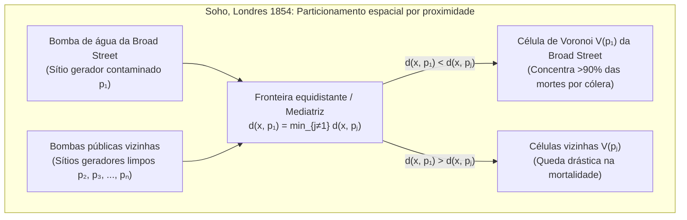

A cada milissegundo em que caminhamos por uma cidade com um smartphone no bolso, protocolos sem fio avaliam qual estação rádio-base oferece o menor caminho de sinal e executam transferências (*handovers*) invisíveis. Quando uma chamada de emergência é feita, os sistemas de despacho dividem instantaneamente a malha viária para determinar qual ambulância ou hospital pode alcançar o paciente no tempo mínimo. E em toda a natureza — dos padrões reticulados das girafas, nervuras das asas de libélulas e colunas basálticas da Calçada dos Gigantes até a teia cósmica de superaglomerados de galáxias cercando imensos vazios intergalácticos — a matéria se auto-organiza em mosaicos poligonais surpreendentemente semelhantes.

Por trás de todos esses fenômenos na epidemiologia espacial, planejamento urbano, redes celulares 5G, geração de malhas para o Método dos Elementos Finitos (MEF), física do estado sólido e morfogênese biológica está a estrutura dual mais fundamental da geometria computacional: o <strong>Diagrama de Voronoi</strong> e seu grafo dual planar, a <strong>Triangulação de Delaunay</strong>.

---

## 1. O surto de cólera da Broad Street em Londres (1854) e o nascimento das fronteiras invisíveis

No final de agosto de 1854, um devastador surto de cólera atingiu o distrito do Soho, em Londres, ao redor da Broad Street, matando mais de 500 moradores em dez dias (616 no total). Enquanto a medicina oficial defendia a *teoria miasmática* (transmissão pelo ar fétido), o médico <strong>Dr. John Snow (1813–1858)</strong> observou que os sintomas atacavam primeiro o trato gastrointestinal e postulou que a cólera era transmitida por <strong>água potável</strong> contaminada.

Snow mapeou cada óbito como uma barra preta nas ruas do Soho e marcou todas as bombas de água públicas. Para refutar os céticos e explicar por que o abrigo vizinho (*Workhouse*, com poço próprio) e a cervejaria Lion (onde os trabalhadores bebiam cerveja gratuita e tinham poço profundo) quase não tiveram mortes, Snow traçou uma linha geométrica decisiva: <strong>o lugar geométrico dos pontos onde a distância a pé até a bomba da Broad Street era exatamente igual à distância até a bomba pública alternativa mais próxima</strong>.



Esse polígono — a <strong>célula de Voronoi</strong> da bomba da Broad Street — englobava mais de 90% de todas as mortes por cólera! Com a remoção da alavanca da bomba em 8 de setembro de 1854, a epidemia cessou imediatamente. Esse conceito geométrico foi redescoberto de forma independente por <strong>René Descartes (1644)</strong> em seus vórtices cósmicos (*Principia Philosophiae*), <strong>Peter Gustav Lejeune Dirichlet (1850)</strong> em formas quadráticas (domínios de Dirichlet ou células de Wigner-Seitz), <strong>Georgy Voronoi (1908)</strong> em dimensões arbitrárias $\mathbb{R}^d$, e <strong>Alfred H. Thiessen (1911)</strong> na meteorologia.

---

## 2. Definição matemática e complexidade linear do Diagrama de Voronoi $\text{Vor}(P)$

### 2.1 Interseção de semiplanos fechados e convexidade

Seja $P = \{p_1, p_2, \dots, p_n\} \subset \mathbb{R}^2$ ($n \ge 3$) um conjunto finito de $n$ pontos distintos (chamados <strong>sítios</strong> ou <strong>geradores</strong>) no plano euclidiano. Para dois sítios distintos $p_i, p_j \in P$ ($i \ne j$), a mediatriz $B(p_i, p_j) = \{x \in \mathbb{R}^2 \mid \|x - p_i\|_2 = \|x - p_j\|_2\}$ divide o plano em dois semiplanos fechados. O semiplano de dominância $H(p_i, p_j)$ é:

$$H(p_i, p_j) = \left\{ x \in \mathbb{R}^2 \;\middle|\; \|x - p_i\|_2 \le \|x - p_j\|_2 \right\} = \left\{ x \in \mathbb{R}^2 \;\middle|\; 2(p_j - p_i)^\top x \le \|p_j\|_2^2 - \|p_i\|_2^2 \right\}$$

A <strong>Célula de Voronoi</strong> $\mathcal{V}(p_i)$ associada ao sítio $p_i$ é a interseção dos $n-1$ semiplanos fechados em relação a todos os outros sítios $p_j$ ($j \ne i$):

$$\mathcal{V}(p_i) = \left\{ x \in \mathbb{R}^2 \;\middle|\; \|x - p_i\|_2 \le \|x - p_j\|_2 \;\;\forall j \ne i \right\} = \bigcap_{j \ne i} H(p_i, p_j)$$

Como a interseção de conjuntos convexos é convexa, toda célula de Voronoi euclidiana $\mathcal{V}(p_i)$ é um <strong>polígono convexo</strong> (limitado ou ilimitado). Além disso, $\mathcal{V}(p_i)$ é ilimitada se e somente se $p_i$ pertence à fronteira do fecho convexo $\text{CH}(P)$.

### 2.2 Prova da complexidade linear pela fórmula de Euler: $V \le 2n - 5$, $E \le 3n - 6$

Embora existam $\binom{n}{2} = \Theta(n^2)$ pares de sítios, o número de vértices $V$ e arestas $E$ de $\text{Vor}(P)$ é estritamente linear em $n$.
<strong>【Demonstração】</strong>: Compactificamos $\mathbb{R}^2$ na esfera topológica $\mathbb{S}^2$ adicionando um <strong>vértice no infinito</strong> $v_\infty$ ao qual se conectam todas as semirretas ilimitadas. Obtemos um grafo planar conexo $G' = (V', E', F')$ com $V' = V + 1$ vértices, $E' = E$ arestas e $F' = n$ faces. Pela <strong>Fórmula de Euler</strong> $V' - E' + F' = 2$:

$$(V + 1) - E + n = 2 \iff E = V + n - 1$$

Como cada vértice finito de Voronoi e $v_\infty$ encontram pelo menos 3 células, o grau de cada um dos $V + 1$ vértices satisfaz $\deg(v) \ge 3$. Pelo lema do aperto de mãos:

$$2E = \sum_{v \in V \cup \{v_\infty\}} \deg(v) \ge 3(V + 1) \implies V \le \frac{2}{3}E - 1$$

Substituindo em $E = V + n - 1$, obtemos $E \le 3n - 6$ e $V \le 2n - 5$. Como cada aresta é compartilhada por exatamente duas células, o <strong>número médio de arestas por célula de Voronoi</strong> é:

$$\bar{k} = \frac{2E}{n} \le \frac{2(3n - 6)}{n} = 6 - \frac{12}{n} < 6$$

Independentemente de quantos milhões de sítios existam no plano, <strong>uma célula de Voronoi tem em média estritamente menos de 6 lados!</strong>

| Variante de Voronoi | Função de distância $d(x, p_i)$ | Geometria da bissetriz | Convexidade e topologia | Tamanho (pior caso) | Aplicações científicas e de engenharia |
| :--- | :--- | :--- | :--- | :--- | :--- |
| Euclidiana padrão ($L_2$) | $\|x - p_i\|_2$ | Linha reta (mediatriz) | Sempre convexa e conexa | $\Theta(n)$ | Emergências médicas, meteorologia (Thiessen), vizinho mais próximo |
| Manhattan ($L_1$) | $\|x_1 - x_i\| + \|x_2 - y_i\|$ | Polilinha horizontal, vertical e $\pm 45^\circ$ | Estrelada (não convexa) | $\Theta(n)$ | Logística urbana em ruas ortogonais, roteamento VLSI |
| Chebyshev ($L_\infty$) | $\max(\|x_1 - x_i\|, \|x_2 - y_i\|)$ | Polilinha horizontal, vertical e $\pm 45^\circ$ | Estrelada | $\Theta(n)$ | Pontes rolantes automatizadas, planejamento robótico |
| <strong>Ponderado aditivo (AW)</strong> | $\|x - p_i\|_2 - w_i$ | Arcos de hipérbole | Estrelada e conexa | $\Theta(n)$ | Crescimento cristalino assíncrono (Johnson-Mehl), localização TDOA |
| <strong>Ponderado multiplicativo</strong> | $\|x - p_i\|_2 / w_i$ | Arcos circulares (Círculos de Apolônio) | Não convexa, pode desconectar | $\Theta(n^2)$ | Células 5G heterogêneas, áreas de influência comercial |
| <strong>Diagrama de potência (Laguerre)</strong> | $\|x - p_i\|_2^2 - r_i^2$ | Linha reta (eixo radical) | Sempre convexa (pode ser vazia) | $\Theta(n)$ | Policristais, física de espumas, Transporte Ótimo (OT) |

---

## 3. O grafo dual: Triangulação de Delaunay $\text{DT}(P)$ e os três teoremas de equivalência

Em 1934, o matemático russo <strong>Boris Delaunay (Delone)</strong> definiu o grafo dual planar de $\text{Vor}(P)$ conectando dois sítios $p_i, p_j \in P$ por um segmento se e somente se suas células $\mathcal{V}(p_i)$ e $\mathcal{V}(p_j)$ compartilham uma aresta de Voronoi. Em posição geral (sem quatro pontos cocíclicos), isso produz a <strong>Triangulação de Delaunay $\text{DT}(P)$</strong>, caracterizada por três teoremas equivalentes:

1. <strong>Propriedade do círculo circunscrito vazio (Empty Circumcircle Property)</strong>: Uma triangulação $\mathcal{T}$ é de Delaunay se e somente se o círculo circunscrito $C(\triangle p_i p_j p_k)$ de cada triângulo não contém nenhum outro sítio $p_l \in P$ em seu interior estrito (seu circuncentro é exatamente o vértice de Voronoi dual). Algebricamente, verifica-se pelo determinante $4 \times 4$ $\text{InCircle}(p_i, p_j, p_k, p_l) > 0$.
2. <strong>Otimalidade Max-Min de ângulos (Sibson 1978 e inversão de arestas de Lawson 1972)</strong>: No Método dos Elementos Finitos (MEF), triângulos degenerados (*sliver triangles*) degradam o número de condição $\kappa(K) \propto 1/\sin(\theta_{\min})$ da matriz de rigidez. Entre todas as triangulações possíveis de $P$, $\text{DT}(P)$ maximiza lexicograficamente o vetor ordenado de ângulos internos $\alpha(\mathcal{T})$, maximizando em particular o menor ângulo $\theta_{\min}$! O algoritmo de <strong>Lawson (*Edge Flip*)</strong> inverte iterativamente qualquer diagonal que viole a condição do círculo vazio e converge em no máximo $O(n^2)$ inversões.
3. <strong>Levantamento ao paraboloide 3D (Edelsbrunner & Seidel 1986)</strong>: Projetando verticalmente cada ponto 2D $(x, y)$ sobre o paraboloide de revolução $\mathcal{P}: z = x^2 + y^2$ em $\mathbb{R}^3$ via $\Phi(x, y) = (x, y, x^2 + y^2)$, a equação de um círculo $(x-a)^2 + (y-b)^2 = R^2$ transforma-se em um plano 3D $z = 2ax + 2by - (a^2 + b^2 - R^2)$. Portanto, a Triangulação de Delaunay $\text{DT}(P)$ é exatamente a projeção vertical no plano $xy$ do fecho convexo inferior (*Lower Convex Hull*) da nuvem de pontos levantada $\Phi(P)$ em $\mathbb{R}^3$!

---

## 4. Algoritmo de linha de varredura e «linha de praia» de Steven Fortune (1986) em $\Theta(n \log n)$

Uma varredura plana ingênua falha porque um ponto acima da linha de varredura $\ell: y = y_{\text{sweep}}$ pode estar mais próximo de um sítio ainda não visitado abaixo de $\ell$. Em 1986, <strong>Steven Fortune</strong> resolveu esse paradoxo mantendo a <strong>linha de praia (*Beach Line*)</strong>: a envoltória inferior das parábolas com foco em cada sítio visitado $p_i = (x_i, y_i)$ ($y_i > y_{\text{sweep}}$) e diretriz $\ell$:

$$y = \frac{(x - x_i)^2}{2(y_i - y_{\text{sweep}})} + \frac{y_i + y_{\text{sweep}}}{2}$$

Os pontos de quebra (*breakpoints*) entre dois arcos parabólicos adjacentes são equidistantes de ambos os focos e da diretriz, traçando exatamente as arestas de Voronoi à medida que $\ell$ desce. Usando uma árvore binária de busca balanceada (com no máximo $2n-1$ arcos) e uma fila de prioridade para processar $n$ <strong>eventos de sítio (*Site Events*)</strong> e no máximo $2n-5$ eventos de círculo (*Circle Events*, colapso de um arco no ponto mais baixo de um círculo circunscrito $y_{\text{sweep}} = y_c - R$ criando um vértice de Voronoi), o algoritmo atinge o tempo ótimo $\Theta(n \log n)$ e espaço $\Theta(n)$.

---

## 5. Relaxamento de Lloyd e Tesselagens de Voronoi Centroidais (CVT)

Para minimizar a energia de quantização espacial (funcional de $k$-médias) ponderada por uma densidade $\rho(x)$:

$$\mathcal{E}(P, \{\Omega_i\}) = \sum_{i=1}^n \int_{\Omega_i} \|x - p_i\|_2^2 \, \rho(x) \, dx$$

as regiões $\Omega_i$ devem ser células de Voronoi $\mathcal{V}(p_i)$ e cada gerador $p_i$ deve coincidir com o <strong>centroide (centro de massa)</strong> $c_i$ de sua própria célula ($p_i = c_i$), formando uma <strong>Tesselagem de Voronoi Centroidal (CVT)</strong>. O <strong>algoritmo de Lloyd (Stuart Lloyd, 1957)</strong> move iterativamente cada sítio para o centroide de sua célula ($p_i^{(t+1)} \leftarrow c_i^{(t)}$), reduzindo $\mathcal{E}$ monotonicamente rumo a uma <strong>rede hexagonal em favo de mel</strong> ótima (teorema de Fejes Tóth, 1953).

Abaixo está uma implementação completa em Python do recorte por semiplanos de Sutherland-Hodgman, integração exata pelo teorema de Green e relaxamento de Lloyd:

```python
import math
import random
from typing import List, Tuple

Point = Tuple[float, float]
Polygon = List[Point]

def clip_polygon_by_halfplane(poly: Polygon, p_i: Point, p_j: Point) -> Polygon:
    if not poly:
        return []
    xi, yi = p_i
    xj, yj = p_j
    a = 2.0 * (xj - xi)
    b = 2.0 * (yj - yi)
    c = (xj * xj + yj * yj) - (xi * xi + yi * yi)

    def signed_dist(pt: Point) -> float:
        return a * pt[0] + b * pt[1] - c

    out: Polygon = []
    m = len(poly)
    for k in range(m):
        cur_pt = poly[k]
        nxt_pt = poly[(k + 1) % m]
        d_cur = signed_dist(cur_pt)
        d_nxt = signed_dist(nxt_pt)
        if d_cur <= 1e-12:
            out.append(cur_pt)
            if d_nxt > 1e-12:
                t = d_cur / (d_cur - d_nxt)
                out.append((cur_pt[0] + t * (nxt_pt[0] - cur_pt[0]),
                            cur_pt[1] + t * (nxt_pt[1] - cur_pt[1])))
        elif d_nxt <= 1e-12:
            t = d_cur / (d_cur - d_nxt)
            out.append((cur_pt[0] + t * (nxt_pt[0] - cur_pt[0]),
                        cur_pt[1] + t * (nxt_pt[1] - cur_pt[1])))
    return out

def compute_clipped_voronoi(sites: List[Point], bbox: Tuple[float, float, float, float]) -> List[Polygon]:
    xmin, ymin, xmax, ymax = bbox
    base_rect: Polygon = [(xmin, ymin), (xmax, ymin), (xmax, ymax), (xmin, ymax)]
    cells: List[Polygon] = []
    for i in range(len(sites)):
        cell = base_rect
        for j in range(len(sites)):
            if i != j:
                cell = clip_polygon_by_halfplane(cell, sites[i], sites[j])
        cells.append(cell)
    return cells

def exact_polygon_moments(poly: Polygon, site: Point) -> Tuple[float, Point, float]:
    m = len(poly)
    if m < 3:
        return 0.0, site, 0.0
    area2, cx6, cy6, ixx12, iyy12 = 0.0, 0.0, 0.0, 0.0, 0.0
    for k in range(m):
        x0, y0 = poly[k]
        x1, y1 = poly[(k + 1) % m]
        cross = x0 * y1 - x1 * y0
        area2 += cross
        cx6 += (x0 + x1) * cross
        cy6 += (y0 + y1) * cross
        ixx12 += (x0 * x0 + x0 * x1 + x1 * x1) * cross
        iyy12 += (y0 * y0 + y0 * y1 + y1 * y1) * cross
    area = 0.5 * area2
    if abs(area) < 1e-15:
        return 0.0, site, 0.0
    cx, cy = cx6 / (3.0 * area2), cy6 / (3.0 * area2)
    i_origin = (ixx12 + iyy12) / 12.0
    sx, sy = site
    energy = i_origin - 2.0 * area * (cx * sx + cy * sy) + area * (sx * sx + sy * sy)
    return area, (cx, cy), energy

def simulate_lloyd_relaxation(n_sites: int = 25, iterations: int = 30) -> None:
    random.seed(42)
    bbox = (0.0, 0.0, 1.0, 1.0)
    sites = [(random.uniform(0.05, 0.95), random.uniform(0.05, 0.95)) for _ in range(n_sites)]
    for it in range(iterations + 1):
        cells = compute_clipped_voronoi(sites, bbox)
        total_energy, next_sites = 0.0, []
        for i, cell in enumerate(cells):
            _, centroid, energy = exact_polygon_moments(cell, sites[i])
            total_energy += energy
            next_sites.append(centroid)
        if it in (0, 5, 15, 30):
            print(f"Iter {it:2d}: Energy E = {total_energy:.8f}")
        sites = next_sites

if __name__ == "__main__":
    simulate_lloyd_relaxation()
```
