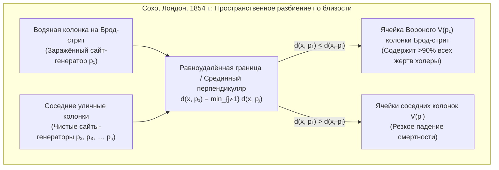

Каждую миллисекунду, пока мы идём по улице со смартфоном в кармане, беспроводные протоколы вычисляют, какая базовая станция обеспечивает кратчайший путь сигнала, и выполняют незаметное переключение (*handover*) на границах сот. Когда поступает вызов скорой помощи, диспетчерская система мгновенно разбивает дорожную сеть города, определяя, какая бригада доберётся до пациента за минимальное время. А в природе — от сетчатого окраса жирафов, жилкования крыльев стрекоз и базальтовых колонн «Мостовой гигантов» до крупномасштабной структуры Вселенной с галактическими нитями вокруг гигантских космических пустот (войдов) — материя самоорганизуется в поразительно похожие многоугольные мозаики.

За всеми этими явлениями в пространственной эпидемиологии, градостроительстве, сотовых сетях 5G, генерации сеток для метода конечных элементов (МКЭ), физике твёрдого тела и биологическом морфогенезе стоит фундаментальная двойственная структура вычислительной геометрии: <strong>диаграмма Вороного (Voronoi Diagram)</strong> и её планарный двойственный граф — <strong>триангуляция Делоне (Delaunay Triangulation)</strong>.

---

## 1. Вспышка холеры на Брод-стрит в Лондоне (1854) и рождение невидимых границ

В конце августа 1854 года в лондонского районе Сохо вокруг улицы Брод-стрит вспыхнула катастрофическая эпидемия холеры, унёсшая за десять дней более 500 жизней (всего 616 погибших). В то время в медицине господствовала *теория миазмов* (заражение через дурной воздух), однако врач <strong>Джон Сноу (Dr. John Snow, 1813–1858)</strong> заметил, что болезнь поражает исключительно пищеварительный тракт, и выдвинул гипотезу о передаче холеры через заражённую <strong>питьевую воду</strong>.

Сноу нанёс на карту Сохо каждый случай смерти в виде чёрной полоски и отметил все уличные водоразборные колонки. Чтобы опровергнуть скептиков и объяснить, почему в соседнем работном доме (*Workhouse*, имевшем собственный колодец) и на пивоварне Lion (где рабочие пили бесплатное пиво) почти никто не умер, Сноу провёл на карте решающую геометрическую границу: <strong>геометрическое место точек, от которых пеший путь до колонки на Брод-стрит в точности равен пути до ближайшей альтернативной колонки</strong>.



Этот многоугольник — <strong>ячейка Вороного</strong> колонки на Брод-стрит — вместил более 90 % всех смертей! Когда 8 сентября 1854 года рукоятку насоса сняли, эпидемия мгновенно прекратилась. В истории науки эта конструкция переоткрывалась неоднократно: в 1644 году <strong>Рене Декартом</strong> в теории космических вихрей (*Principia Philosophiae*), в 1850 году <strong>Петером Густавом Лежёном Дирихле</strong> в теории квадратичных форм (области Дирихле или ячейки Вигнера — Зейтца), в 1908 году выдающимся математиком <strong>Георгием Феодосьевичем Вороным</strong> для произвольной размерности $\mathbb{R}^d$, и в 1911 году метеорологом <strong>Альфредом Тиссеном</strong>.

---

## 2. Математическое определение и линейная сложность диаграммы Вороного $\text{Vor}(P)$

### 2.1 Пересечение замкнутых полуплоскостей и выпуклость

Пусть $P = \{p_1, p_2, \dots, p_n\} \subset \mathbb{R}^2$ ($n \ge 3$) — конечное множество из $n$ различных точек (называемых <strong>сайтами</strong> или <strong>генераторами</strong>) на евклидовой плоскости. Для любых двух сайтов $p_i, p_j \in P$ ($i \ne j$) срединный перпендикуляр $B(p_i, p_j) = \{x \in \mathbb{R}^2 \mid \|x - p_i\|_2 = \|x - p_j\|_2\}$ делит плоскость на две замкнутые полуплоскости. Полуплоскость доминирования $H(p_i, p_j)$ имеет вид:

$$H(p_i, p_j) = \left\{ x \in \mathbb{R}^2 \;\middle|\; \|x - p_i\|_2 \le \|x - p_j\|_2 \right\} = \left\{ x \in \mathbb{R}^2 \;\middle|\; 2(p_j - p_i)^\top x \le \|p_j\|_2^2 - \|p_i\|_2^2 \right\}$$

<strong>Ячейка Вороного</strong> $\mathcal{V}(p_i)$ сайта $p_i$ определяется как пересечение $n-1$ замкнутых полуплоскостей относительно всех остальных сайтов $p_j$ ($j \ne i$):

$$\mathcal{V}(p_i) = \left\{ x \in \mathbb{R}^2 \;\middle|\; \|x - p_i\|_2 \le \|x - p_j\|_2 \;\;\forall j \ne i \right\} = \bigcap_{j \ne i} H(p_i, p_j)$$

Поскольку пересечение выпуклых множеств выпукло, каждая евклидова ячейка Вороного $\mathcal{V}(p_i)$ представляет собой (возможно, неограниченный) <strong>выпуклый многоугольник</strong>. При этом $\mathcal{V}(p_i)$ неограничена тогда и только тогда, когда сайт $p_i$ лежит на границе выпуклой оболочки $\text{CH}(P)$.

### 2.2 Доказательство линейной сложности через формулу Эйлера: $V \le 2n - 5$, $E \le 3n - 6$

Хотя существует $\binom{n}{2} = \Theta(n^2)$ пар сайтов, число вершин $V$ и рёбер $E$ плоской диаграммы Вороного строго линейно по $n$.
<strong>【Доказательство】</strong>: Компактифицируем плоскость $\mathbb{R}^2$ в топологическую сферу $\mathbb{S}^2$, добавив <strong>бесконечно удалённую вершину</strong> $v_\infty$, в которую входят все неограниченные лучи Вороного. Получим связный планарный граф $G' = (V', E', F')$ с $V' = V + 1$ вершинами, $E' = E$ рёбрами и $F' = n$ гранями. По <strong>формуле Эйлера</strong> $V' - E' + F' = 2$:

$$(V + 1) - E + n = 2 \iff E = V + n - 1$$

Так как в каждой конечной вершине Вороного и в $v_\infty$ сходятся не менее 3 ячеек, степень каждой из $V + 1$ вершин удовлетворяет неравенству $\deg(v) \ge 3$. По лемме о рукопожатиях:

$$2E = \sum_{v \in V \cup \{v_\infty\}} \deg(v) \ge 3(V + 1) \implies V \le \frac{2}{3}E - 1$$

Подставляя это в $E = V + n - 1$, получаем $E \le 3n - 6$ и $V \le 2n - 5$. Поскольку каждое ребро разделяет ровно две ячейки, <strong>среднее число сторон одной ячейки Вороного</strong> равно:

$$\bar{k} = \frac{2E}{n} \le \frac{2(3n - 6)}{n} = 6 - \frac{12}{n} < 6$$

Независимо от того, сколько миллионов точек расположено на плоскости, <strong>среднее число рёбер ячейки Вороного всегда строго меньше 6!</strong>

| Вариант диаграммы Вороного | Метрика $d(x, p_i)$ | Геометрия биссектрис | Выпуклость и связность | Сложность (худший случай) | Применение в науке и технике |
| :--- | :--- | :--- | :--- | :--- | :--- |
| Евклидова ($L_2$) | $\|x - p_i\|_2$ | Прямая (срединный перпендикуляр) | Всегда выпукла и связна | $\Theta(n)$ | Скорая помощь, метеорология (Тиссен), поиск ближайшего соседа |
| Манхэттенская ($L_1$) | $\|x_1 - x_i\| + \|x_2 - y_i\|$ | Ломаная (горизонталь, вертикаль, $\pm 45^\circ$) | Звёздная (не обязательно выпукла) | $\Theta(n)$ | Городская логистика на прямоугольной сетке улиц, трассировка СБИС |
| Чебышёва ($L_\infty$) | $\max(\|x_1 - x_i\|, \|x_2 - y_i\|)$ | Ломаная (горизонталь, вертикаль, $\pm 45^\circ$) | Звёздная | $\Theta(n)$ | Автоматизированные складские краны, робототехника |
| <strong>Аддитивно взвешенная</strong> | $\|x - p_i\|_2 - w_i$ | Дуги гипербол | Звёздная и связная | $\Theta(n)$ | Асинхронный рост кристаллов (Джонсон — Мел), навигация TDOA |
| <strong>Мультипликативная (Аполлония)</strong> | $\|x - p_i\|_2 / w_i$ | Дуги окружностей (окружности Аполлония) | Невыпукла, возможна несвязность | $\Theta(n^2)$ | Базовые станции 5G разной мощности, анализ торговых зон |
| <strong>Силовая (Лагерра / Power)</strong> | $\|x - p_i\|_2^2 - r_i^2$ | Прямая (радикальная ось окружностей) | Всегда выпукла (может быть пустой) | $\Theta(n)$ | Поликристаллы, физика пен, оптимальный транспорт (OT) |

---

## 3. Двойственный граф: триангуляция Делоне $\text{DT}(P)$ и три теоремы эквивалентности

В 1934 году выдающийся советский математик <strong>Борис Николаевич Делоне (Delaunay, 1890–1980)</strong> определил планарный двойственный граф для $\text{Vor}(P)$: два сайта $p_i, p_j \in P$ соединяются отрезком тогда и только тогда, когда их ячейки Вороного $\mathcal{V}(p_i)$ и $\mathcal{V}(p_j)$ имеют общее ребро положительной длины. В общем положении (никакие четыре точки не лежат на одной окружности) этот граф образует <strong>триангуляцию Делоне $\text{DT}(P)$</strong>, обладающую тремя фундаментальными эквивалентными свойствами:

1. <strong>Условие пустой описанной окружности (Empty Circumcircle Property)</strong>: Триангуляция $\mathcal{T}$ является триангуляцией Делоне тогда и только тогда, когда строго внутри описанной окружности $C(\triangle p_i p_j p_k)$ каждого треугольника не содержится ни одного другого сайта $p_l \in P$ (так как центр описанной окружности есть двойственная вершина Вороного). Алгебраически проверяется знаком определителя $4 \times 4$: $\text{InCircle}(p_i, p_j, p_k, p_l) > 0$.
2. <strong>Максимизация минимального угла (теорема Сибсона 1978 и флипы Лоусона 1972)</strong>: В методе конечных элементов (МКЭ) узкие «вырожденные треугольники» (*sliver triangles*) приводят к взрывному росту числа обусловленности матрицы жёсткости $\kappa(K) \propto 1/\sin(\theta_{\min})$. Среди всех возможных триангуляций множества $P$ триангуляция Делоне $\text{DT}(P)$ лексикографически максимизирует отсортированный вектор всех внутренних углов $\alpha(\mathcal{T})$, в частности максимизируя минимальный угол $\theta_{\min}$! Алгоритм <strong>переброски рёбер Лоусона (*Edge Flip*)</strong> заменяет любую диагональ, нарушающую условие пустой окружности, и сходится к $\text{DT}(P)$ не более чем за $O(n^2)$ шагов.
3. <strong>Подъём на 3D-параболоид вращения (Edelsbrunner & Seidel 1986)</strong>: При вертикальном проектировании каждой 2D-точки $(x, y)$ на параболоид вращения $\mathcal{P}: z = x^2 + y^2$ в $\mathbb{R}^3$ посредством отображения $\Phi(x, y) = (x, y, x^2 + y^2)$ уравнение окружности $(x-a)^2 + (y-b)^2 = R^2$ переходит в линейное уравнение 3D-плоскости $z = 2ax + 2by - (a^2 + b^2 - R^2)$. Следовательно, триангуляция Делоне $\text{DT}(P)$ есть в точности вертикальная проекция на плоскость $xy$ нижней выпуклой оболочки (*Lower Convex Hull*) поднятого множества точек $\Phi(P)$ в $\mathbb{R}^3$!

---

## 4. Алгоритм заметающей прямой и «береговой линии» Стивена Форчуна (1986) за $\Theta(n \log n)$

Наивный метод заметающей прямой $\ell: y = y_{\text{sweep}}$ не работает, так как точка над прямой $\ell$ может оказаться ближе к ещё не открытому сайту под $\ell$. В 1986 году <strong>Стивен Форчун (Steven Fortune)</strong> решил этот парадокс, введя <strong>береговую линию (*Beach Line*)</strong> — нижнюю огибающую парабол с фокусами в уже пройденных сайтах $p_i = (x_i, y_i)$ ($y_i > y_{\text{sweep}}$) и директрисой $\ell$:

$$y = \frac{(x - x_i)^2}{2(y_i - y_{\text{sweep}})} + \frac{y_i + y_{\text{sweep}}}{2}$$

Точки излома (*breakpoints*) между соседними параболическими дугами равноудалены от обоих фокусов и директрисы, поэтому при движении $\ell$ вниз они в точности вычерчивают рёбра Вороного! Поддерживая не более $2n-1$ дуг в сбалансированном дереве поиска и обрабатывая в очереди с приоритетами $n$ <strong>событий сайтов (*Site Events*)</strong> и не более $2n-5$ событий окружностей (*Circle Events* — схлопывание дуги в нижней точке описанной окружности $y_{\text{sweep}} = y_c - R$ с рождением вершины Вороного), алгоритм достигает оптимального времени $\Theta(n \log n)$ и памяти $\Theta(n)$.

---

## 5. Релаксация Ллойда и центроидальные разбиения Вороного (CVT)

Для минимизации функционала энергии пространственного квантования ($k$-средних) с плотностью $\rho(x)$:

$$\mathcal{E}(P, \{\Omega_i\}) = \sum_{i=1}^n \int_{\Omega_i} \|x - p_i\|_2^2 \, \rho(x) \, dx$$

области $\Omega_i$ должны быть ячейками Вороного $\mathcal{V}(p_i)$, а каждый сайт $p_i$ должен совпадать с <strong>центром масс (центроидом)</strong> $c_i$ своей ячейки ($p_i = c_i$), образуя <strong>центроидальное разбиение Вороного (CVT)</strong>. <strong>Алгоритм Ллойда (Stuart Lloyd, 1957)</strong> итеративно перемещает каждый сайт в центроид его текущей ячейки ($p_i^{(t+1)} \leftarrow c_i^{(t)}$), монотонно уменьшая $\mathcal{E}$ и сходясь при однородной плотности к глобально оптимальной <strong>правильной шестиугольной сотовой решётке</strong> (теорема Фейеша Тота, 1953).

Ниже приведена автономная реализация на Python отсечения полуплоскостями Сазерленда — Ходжмана, точного интегрирования по формуле Грина и релаксации Ллойда:

```python
import math
import random
from typing import List, Tuple

Point = Tuple[float, float]
Polygon = List[Point]

def clip_polygon_by_halfplane(poly: Polygon, p_i: Point, p_j: Point) -> Polygon:
    if not poly:
        return []
    xi, yi = p_i
    xj, yj = p_j
    a = 2.0 * (xj - xi)
    b = 2.0 * (yj - yi)
    c = (xj * xj + yj * yj) - (xi * xi + yi * yi)

    def signed_dist(pt: Point) -> float:
        return a * pt[0] + b * pt[1] - c

    out: Polygon = []
    m = len(poly)
    for k in range(m):
        cur_pt = poly[k]
        nxt_pt = poly[(k + 1) % m]
        d_cur = signed_dist(cur_pt)
        d_nxt = signed_dist(nxt_pt)
        if d_cur <= 1e-12:
            out.append(cur_pt)
            if d_nxt > 1e-12:
                t = d_cur / (d_cur - d_nxt)
                out.append((cur_pt[0] + t * (nxt_pt[0] - cur_pt[0]),
                            cur_pt[1] + t * (nxt_pt[1] - cur_pt[1])))
        elif d_nxt <= 1e-12:
            t = d_cur / (d_cur - d_nxt)
            out.append((cur_pt[0] + t * (nxt_pt[0] - cur_pt[0]),
                        cur_pt[1] + t * (nxt_pt[1] - cur_pt[1])))
    return out

def compute_clipped_voronoi(sites: List[Point], bbox: Tuple[float, float, float, float]) -> List[Polygon]:
    xmin, ymin, xmax, ymax = bbox
    base_rect: Polygon = [(xmin, ymin), (xmax, ymin), (xmax, ymax), (xmin, ymax)]
    cells: List[Polygon] = []
    for i in range(len(sites)):
        cell = base_rect
        for j in range(len(sites)):
            if i != j:
                cell = clip_polygon_by_halfplane(cell, sites[i], sites[j])
        cells.append(cell)
    return cells

def exact_polygon_moments(poly: Polygon, site: Point) -> Tuple[float, Point, float]:
    m = len(poly)
    if m < 3:
        return 0.0, site, 0.0
    area2, cx6, cy6, ixx12, iyy12 = 0.0, 0.0, 0.0, 0.0, 0.0
    for k in range(m):
        x0, y0 = poly[k]
        x1, y1 = poly[(k + 1) % m]
        cross = x0 * y1 - x1 * y0
        area2 += cross
        cx6 += (x0 + x1) * cross
        cy6 += (y0 + y1) * cross
        ixx12 += (x0 * x0 + x0 * x1 + x1 * x1) * cross
        iyy12 += (y0 * y0 + y0 * y1 + y1 * y1) * cross
    area = 0.5 * area2
    if abs(area) < 1e-15:
        return 0.0, site, 0.0
    cx, cy = cx6 / (3.0 * area2), cy6 / (3.0 * area2)
    i_origin = (ixx12 + iyy12) / 12.0
    sx, sy = site
    energy = i_origin - 2.0 * area * (cx * sx + cy * sy) + area * (sx * sx + sy * sy)
    return area, (cx, cy), energy

def simulate_lloyd_relaxation(n_sites: int = 25, iterations: int = 30) -> None:
    random.seed(42)
    bbox = (0.0, 0.0, 1.0, 1.0)
    sites = [(random.uniform(0.05, 0.95), random.uniform(0.05, 0.95)) for _ in range(n_sites)]
    for it in range(iterations + 1):
        cells = compute_clipped_voronoi(sites, bbox)
        total_energy, next_sites = 0.0, []
        for i, cell in enumerate(cells):
            _, centroid, energy = exact_polygon_moments(cell, sites[i])
            total_energy += energy
            next_sites.append(centroid)
        if it in (0, 5, 15, 30):
            print(f"Iter {it:2d}: Energy E = {total_energy:.8f}")
        sites = next_sites

if __name__ == "__main__":
    simulate_lloyd_relaxation()
```
