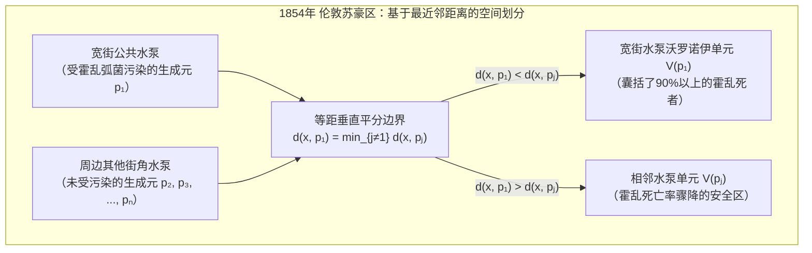

当我们带着智能手机在城市街道上行走时，手机在毫秒之间不断计算哪个通信基站的信号路径最短，并在相邻基站的覆盖边界上实现无缝切换（Handover）。当城市某处响起急救电话时，调度系统必须立即根据道路网与医院分布判断哪辆救护车能以最短时间抵达现场。而在自然界中，从长颈鹿的网状斑纹、蜻蜓翅膀的翅脉网络、干涸河床的龟裂、玄武岩柱状节理，到宇宙大尺度结构中的星系丝状体与巨型空洞（Cosmic Voids），物质自发组织成惊人相似的多边形网格。

在这些横跨流行病学、城市规划、5G无线通信、有限元法（FEM）数值网格生成、凝聚态物理与生物形态发生学的现象背后，隐藏着计算几何学（Computational Geometry）中最核心的对偶结构：<strong>沃罗诺伊图（Voronoi Diagram）</strong>及其平面图对偶——<strong>德劳内三角剖分（Delaunay Triangulation）</strong>。

---

## 1. 1854年伦敦苏豪区霍乱地图与“无形边界”的诞生

1854年8月底，英国伦敦中心苏豪区（Soho）的宽街（Broad Street）附近爆发了惨烈的霍乱疫情，短短10天内超过500名居民丧生。当时的医学界深信“瘴气理论（Miasma Theory）”，认为霍乱是通过吸入腐败污物散发的恶臭空气传播的。然而，先驱流行病学家<strong>约翰·斯诺医生（Dr. John Snow, 1813–1858）</strong>敏锐地注意到，患者的首发症状始终集中在消化道而非呼吸道，从而提出了霍乱通过受污染的<strong>饮用水</strong>传播的假说。

斯诺走访了苏豪区的每一条街道，在地图上用黑色短横线标记每一位死者的住宅位置，同时标出了居民日常取水的街角公共水泵。为了反驳怀疑论者并解释为何紧邻宽街的救济院（拥有独立水井）和狮子啤酒厂（工人每天饮用免费麦芽酒且厂内有深井）几乎无人死亡，斯诺在地图上画出了一条决定性的几何边界：<strong>到宽街水泵的步行距离与到周围任何其他水泵的步行距离相等的轨迹线</strong>。



这条多边形边界正是宽街水泵的<strong>沃罗诺伊单元（Voronoi Cell）</strong>。全区90%以上的霍乱死者都严格落在这条等距边界内部！斯诺用纯粹的几何空间分割锁定了传染源，促使教区委员会于9月8日拆除了宽街水泵的手柄，从而平息了疫情。

这一几何思想在科学史上曾被多次独立发现：1644年<strong>笛卡尔（René Descartes）</strong>在《哲学原理》中用多边形宇宙涡旋（*tourbillons*）划分恒星的引力领地；1850年<strong>狄利克雷（Peter Gustav Lejeune Dirichlet）</strong>在二次型约化理论中定义了格点的狄利克雷域（即固体物理中的维格纳-赛茨原胞 Wigner-Seitz Cell）；1908年乌克兰数学家<strong>格奥尔基·沃罗诺伊（Georgy Voronoi）</strong>将其推广至任意 $d$ 维欧氏空间 $\mathbb{R}^d$；1911年气象学家<strong>泰森（Alfred H. Thiessen）</strong>则提出了用于估算区域平均降雨量的泰森多边形。

---

## 2. 沃罗诺伊图 $\text{Vor}(P)$ 的严格数学定义与欧拉公式线性复杂度证明

### 2.1 闭半平面的交集与凸多边形性质

设欧氏平面 $\mathbb{R}^2$ 上给定 $n$ 个互不相同的生成元（站点，Sites）集合 $P = \{p_1, p_2, \dots, p_n\} \subset \mathbb{R}^2$（$n \ge 3$）。对于任意两个不同站点 $p_i, p_j \in P$（$i \ne j$），其垂直平分线 $B(p_i, p_j) = \{x \in \mathbb{R}^2 \mid \|x - p_i\|_2 = \|x - p_j\|_2\}$ 将平面分为两个闭半平面。点 $x$ 到 $p_i$ 的距离不大于到 $p_j$ 的距离的<strong>优超半平面（Dominance Half-Plane）</strong> $H(p_i, p_j)$ 为：

$$H(p_i, p_j) = \left\{ x \in \mathbb{R}^2 \;\middle|\; \|x - p_i\|_2 \le \|x - p_j\|_2 \right\} = \left\{ x \in \mathbb{R}^2 \;\middle|\; 2(p_j - p_i)^\top x \le \|p_j\|_2^2 - \|p_i\|_2^2 \right\}$$

站点 $p_i$ 的<strong>沃罗诺伊单元（Voronoi Cell）</strong> $\mathcal{V}(p_i)$ 定义为相对于所有其他站点 $p_j$（$j \ne i$）的 $n-1$ 个闭半平面的交集：

$$\mathcal{V}(p_i) = \left\{ x \in \mathbb{R}^2 \;\middle|\; \|x - p_i\|_2 \le \|x - p_j\|_2 \;\;\forall j \ne i \right\} = \bigcap_{j \ne i} H(p_i, p_j)$$

由于半平面是凸集，任意多个凸集的交集依然是凸集，因此每个欧氏沃罗诺伊单元 $\mathcal{V}(p_i)$ 都是一个（可能无界的）<strong>凸多边形</strong>。且 $\mathcal{V}(p_i)$ 无界当且仅当站点 $p_i$ 位于点集凸包 $\text{CH}(P)$ 的边界上。

### 2.2 组合复杂度定理：为什么边数是 $O(n)$ 而不是 $O(n^2)$？

$n$ 个站点共有 $\binom{n}{2} = \Theta(n^2)$ 条两两垂直平分线，但绝大多数平分线都被更近的站点屏蔽了。我们用<strong>欧拉多面体公式（Euler's Planar Graph Formula）</strong>严格证明平面沃罗诺伊图的顶点数 $V$ 与边数 $E$ 具有严格的线性上界：

$$V \le 2n - 5, \qquad E \le 3n - 6$$

<strong>【证明】</strong>：在平面 $\mathbb{R}^2$ 中引入一个虚拟的<strong>无穷远顶点</strong> $v_\infty$，将所有无界沃罗诺伊射线连接到 $v_\infty$，从而将平面紧化为拓扑球面 $\mathbb{S}^2$ 上的连通平面图 $G' = (V', E', F')$，其中顶点数 $V' = V + 1$，边数 $E' = E$，面数 $F' = n$。由欧拉公式 $V' - E' + F' = 2$ 得：

$$(V + 1) - E + n = 2 \iff E = V + n - 1$$

由于每个有限沃罗诺伊顶点至少是 3 个单元的交点（度数 $\deg(v) \ge 3$），且非共线点集的凸包至少有 3 条边（故 $\deg(v_\infty) \ge 3$），图 $G'$ 中所有 $V + 1$ 个顶点的度数均满足 $\deg(v) \ge 3$。由图论握手引理（Handshaking Lemma）：

$$2E = \sum_{v \in V \cup \{v_\infty\}} \deg(v) \ge 3(V + 1) \implies V \le \frac{2}{3}E - 1$$

代入 $E = V + n - 1$ 即得 $E \le \frac{2}{3}E + n - 2 \implies E \le 3n - 6$，进而 $V = E - n + 1 \le 2n - 5$。
由此立即推出<strong>平均边数推论</strong>：每条边被 2 个单元共享，因此任意沃罗诺伊单元的平均边数为：

$$\bar{k} = \frac{2E}{n} \le \frac{2(3n - 6)}{n} = 6 - \frac{12}{n} < 6$$

无论平面上有多少亿个站点，<strong>平均每个沃罗诺伊单元的边数严格小于 6</strong>！

| 沃罗诺伊图变体 | 距离度量 $d(x, p_i)$ | 边界线几何形状 | 单元凸性与连通性 | 最坏空间复杂度 | 典型科学与工程应用 |
| :--- | :--- | :--- | :--- | :--- | :--- |
| 标准欧氏 ($L_2$) | $\|x - p_i\|_2$ | 直线（垂直平分线） | 恒为凸且连通 | $\Theta(n)$ | 医疗急救辖区、气象泰森多边形、最近邻检索 |
| 曼哈顿距离 ($L_1$) | $\|x_1 - x_i\| + \|x_2 - y_i\|$ | 水平、垂直与 $\pm 45^\circ$ 折线 | 星形（未必凸） | $\Theta(n)$ | 网格城市物流调度、VLSI 芯片布线 |
| 切比雪夫距离 ($L_\infty$) | $\max(\|x_1 - x_i\|, \|x_2 - y_i\|)$ | 水平、垂直与 $\pm 45^\circ$ 折线 | 星形（未必凸） | $\Theta(n)$ | 自动化立体仓库天车控制、数控机床路径 |
| <strong>加性权重 (Johnson-Mehl)</strong> | $\|x - p_i\|_2 - w_i$ | 双曲线弧（Hyperbola） | 星形且连通 | $\Theta(n)$ | 异步形核晶体生长模型、TDOA 卫星定位 |
| <strong>乘性权重 (阿波罗尼奥斯)</strong> | $\|x - p_i\|_2 / w_i$ | 圆弧（阿波罗尼奥斯圆） | 非凸、可能不连通 | $\Theta(n^2)$ | 不同发射功率 5G 基站覆盖、商业零售商圈分析 |
| <strong>幂图 (Laguerre / Power)</strong> | $\|x - p_i\|_2^2 - r_i^2$ | 直线（两圆根轴） | 恒为凸（可能为空） | $\Theta(n)$ | 多晶金属晶粒建模、泡沫物理、半离散最优传输(OT) |

---

## 3. 对偶图——德劳内三角剖分 $\text{DT}(P)$ 与三大等价定理

1934年，苏联数学家<strong>鲍里斯·德劳内（Boris Delaunay / Delone）</strong>定义了 $\text{Vor}(P)$ 的平面图对偶：将每个生成元 $p_i$ 作为顶点，若两个单元 $\mathcal{V}(p_i)$ 与 $\mathcal{V}(p_j)$ 共享一条沃罗诺伊边，则在 $p_i$ 与 $p_j$ 之间连接一条直线段。在一般位置假设（无四点共圆）下，该对偶图将凸包 $\text{CH}(P)$ 精确剖分为三角形网格，称为<strong>德劳内三角剖分 $\text{DT}(P)$</strong>，且满足三大等价定理：

1. <strong>空外接圆定理（Empty Circumcircle Property）</strong>：三角剖分 $\mathcal{T}$ 是德劳内三角剖分，当且仅当每个三角形 $\triangle p_i p_j p_k$ 的外接圆内部严格不包含 $P$ 中的任何其他站点 $p_l$（因为该三角形的外心正是与 $p_i, p_j, p_k$ 等距的对偶沃罗诺伊顶点！）。其代数判定由 $4 \times 4$ 行列式给出：
   $$\text{InCircle}(p_i, p_j, p_k, p_l) = \det \begin{pmatrix} x_i & y_i & x_i^2 + y_i^2 & 1 \\ x_j & y_j & x_j^2 + y_j^2 & 1 \\ x_k & y_k & x_k^2 + y_k^2 & 1 \\ x_l & y_l & x_l^2 + y_l^2 & 1 \end{pmatrix} > 0$$
2. <strong>最大最小角最优性定理（Max-Min Angle Theorem, Sibson 1978 & Lawson 1972）</strong>：在有限元法（FEM）偏微分方程求解中，狭长的“狭片三角形（Sliver Triangles）”会导致刚度矩阵条件数 $\kappa(K) \propto 1/\sin(\theta_{\min})$ 恶化并引发数值发散。在点集 $P$ 的所有可能三角剖分中，<strong>德劳内三角剖分按字典序最大化所有内角构成的递增向量 $\alpha(\mathcal{T}) = (\theta_1, \theta_2, \dots, \theta_{3m})$，从而严格最大化最小内角 $\theta_{\min}$</strong>！对任意违反空外接圆条件的凸四边形对角线执行<strong>Lawson 边翻转（Edge Flip）</strong>，都会使六个内角的最小值严格增大，并在至多 $O(n^2)$ 次翻转内收敛到 $\text{DT}(P)$。
3. <strong>三维旋转抛物面提升映射（3D Paraboloid Lifting Map, Edelsbrunner & Seidel 1986）</strong>：将二维点 $(x, y)$ 垂直投影到三维旋转抛物面 $\mathcal{P}: z = x^2 + y^2$ 上：
   $$\Phi(x, y) = (x, \; y, \; x^2 + y^2)$$
   由于平面圆方程 $(x - a)^2 + (y - b)^2 = R^2$ 展开后代入 $z = x^2 + y^2$ 即变为三维线性平面方程 $z = 2ax + 2by - (a^2 + b^2 - R^2)$，点在圆内等价于提升点位于该三维平面下方。因此，<strong>提升点集 $\Phi(P)$ 在 $\mathbb{R}^3$ 中的下凸包（Lower Convex Hull）向 $xy$ 平面的垂直投影，精确等于二维德劳内三角剖分 $\text{DT}(P)$</strong>！

---

## 4. Fortune 扫描线与海滩线算法（1986）：最优 $\Theta(n \log n)$ 构建

由于一维实数排序可归约为沃罗诺伊图构建，其时间复杂度下界为 $\Omega(n \log n)$。直接应用水平扫描线 $\ell: y = y_{\text{sweep}}$ 面临“因果律悖论”：扫描线上方的点可能距离扫描线下方的未发现站点更近。

1986年，贝尔实验室的 <strong>Steven Fortune</strong> 提出维护扫描线上方“绝对不受未来下方站点影响的确定区域边界”。到已访问站点 $p_i = (x_i, y_i)$（焦点）的距离等于到水平扫描线 $\ell: y = y_{\text{sweep}}$（准线）的距离的轨迹是一条开口向上的<strong>抛物线</strong>：

$$y = \frac{(x - x_i)^2}{2(y_i - y_{\text{sweep}})} + \frac{y_i + y_{\text{sweep}}}{2}$$

所有已访问站点抛物线的下包络线构成了<strong>海滩线（Beach Line）</strong>。相邻两段抛物线弧的交点（断点，Breakpoint）同时与两个焦点和准线等距，因此在扫描线下降过程中，断点精确描绘出沃罗诺伊边！算法仅需用平衡二叉搜索树（维护至多 $2n-1$ 段抛物线弧）和优先队列处理两类离散事件：
- <strong>站点事件（Site Event）</strong>：扫描线触及新站点 $p_k$，插入新抛物线弧并将原弧一分为三，产生两个追踪新沃罗诺伊边的断点（共 $n$ 次）。
- <strong>圆事件（Circle Event）</strong>：相邻三段弧 $(\alpha_i, \alpha_j, \alpha_k)$ 的中间弧 $\alpha_j$ 在扫描线触及外接圆最低点 $y_{\text{sweep}} = y_c - R$ 时收缩为零并消失，两个断点在外心 $(x_c, y_c)$ 处碰撞，生成<strong>沃罗诺伊顶点</strong>（至多 $2n - 5$ 次有效事件）。
总时间复杂度严格达到最优的 $\Theta(n \log n)$，空间复杂度为 $\Theta(n)$。

---

## 5. 劳埃德松弛法（Lloyd's Relaxation）与质心沃罗诺伊剖分（CVT）

给定密度函数 $\rho(x)$，为了最小化全区域的量化畸变能量（$k$-Means 目标泛函）：

$$\mathcal{E}(P, \{\Omega_i\}) = \sum_{i=1}^n \int_{\Omega_i} \|x - p_i\|_2^2 \, \rho(x) \, dx$$

最优解必须同时满足两个必要条件：(1) 区域划分为沃罗诺伊单元 $\Omega_i = \mathcal{V}(p_i)$；(2) 每个生成元 $p_i$ 位于其自身沃罗诺伊单元的<strong>质心（Centroid）</strong> $c_i$ 处。满足 $p_i = c_i$ 的剖分称为<strong>质心沃罗诺伊剖分（CVT）</strong>。
<strong>劳埃德松弛算法（Stuart Lloyd, 1957）</strong>通过交替执行“计算沃罗诺伊图”与“将站点移动至单元质心 $p_i^{(t+1)} \leftarrow c_i^{(t)}$”，使能量 $\mathcal{E}$ 单调递减，并在均匀密度下根据 Fejes Tóth 定理自组织收敛到能量全局最小的<strong>正六边形蜂窝晶格（Honeycomb Lattice）</strong>。

下面给出基于 Sutherland-Hodgman 半平面裁剪与格林公式（鞋带公式）精确计算多边形面积、质心与量化能量的自包含 Python 实现：

```python
import math
import random
from typing import List, Tuple

Point = Tuple[float, float]
Polygon = List[Point]

def clip_polygon_by_halfplane(poly: Polygon, p_i: Point, p_j: Point) -> Polygon:
    if not poly:
        return []
    xi, yi = p_i
    xj, yj = p_j
    a = 2.0 * (xj - xi)
    b = 2.0 * (yj - yi)
    c = (xj * xj + yj * yj) - (xi * xi + yi * yi)

    def signed_dist(pt: Point) -> float:
        return a * pt[0] + b * pt[1] - c

    out: Polygon = []
    m = len(poly)
    for k in range(m):
        cur_pt = poly[k]
        nxt_pt = poly[(k + 1) % m]
        d_cur = signed_dist(cur_pt)
        d_nxt = signed_dist(nxt_pt)
        if d_cur <= 1e-12:
            out.append(cur_pt)
            if d_nxt > 1e-12:
                t = d_cur / (d_cur - d_nxt)
                out.append((cur_pt[0] + t * (nxt_pt[0] - cur_pt[0]),
                            cur_pt[1] + t * (nxt_pt[1] - cur_pt[1])))
        elif d_nxt <= 1e-12:
            t = d_cur / (d_cur - d_nxt)
            out.append((cur_pt[0] + t * (nxt_pt[0] - cur_pt[0]),
                        cur_pt[1] + t * (nxt_pt[1] - cur_pt[1])))
    return out

def compute_clipped_voronoi(sites: List[Point], bbox: Tuple[float, float, float, float]) -> List[Polygon]:
    xmin, ymin, xmax, ymax = bbox
    base_rect: Polygon = [(xmin, ymin), (xmax, ymin), (xmax, ymax), (xmin, ymax)]
    cells: List[Polygon] = []
    for i in range(len(sites)):
        cell = base_rect
        for j in range(len(sites)):
            if i != j:
                cell = clip_polygon_by_halfplane(cell, sites[i], sites[j])
        cells.append(cell)
    return cells

def exact_polygon_moments(poly: Polygon, site: Point) -> Tuple[float, Point, float]:
    m = len(poly)
    if m < 3:
        return 0.0, site, 0.0
    area2, cx6, cy6, ixx12, iyy12 = 0.0, 0.0, 0.0, 0.0, 0.0
    for k in range(m):
        x0, y0 = poly[k]
        x1, y1 = poly[(k + 1) % m]
        cross = x0 * y1 - x1 * y0
        area2 += cross
        cx6 += (x0 + x1) * cross
        cy6 += (y0 + y1) * cross
        ixx12 += (x0 * x0 + x0 * x1 + x1 * x1) * cross
        iyy12 += (y0 * y0 + y0 * y1 + y1 * y1) * cross
    area = 0.5 * area2
    if abs(area) < 1e-15:
        return 0.0, site, 0.0
    cx, cy = cx6 / (3.0 * area2), cy6 / (3.0 * area2)
    i_origin = (ixx12 + iyy12) / 12.0
    sx, sy = site
    energy = i_origin - 2.0 * area * (cx * sx + cy * sy) + area * (sx * sx + sy * sy)
    return area, (cx, cy), energy

def simulate_lloyd_relaxation(n_sites: int = 25, iterations: int = 30) -> None:
    random.seed(42)
    bbox = (0.0, 0.0, 1.0, 1.0)
    sites = [(random.uniform(0.05, 0.95), random.uniform(0.05, 0.95)) for _ in range(n_sites)]
    for it in range(iterations + 1):
        cells = compute_clipped_voronoi(sites, bbox)
        total_energy, next_sites = 0.0, []
        for i, cell in enumerate(cells):
            _, centroid, energy = exact_polygon_moments(cell, sites[i])
            total_energy += energy
            next_sites.append(centroid)
        if it in (0, 5, 15, 30):
            print(f"Iter {it:2d}: Energy E = {total_energy:.8f}")
        sites = next_sites

if __name__ == "__main__":
    simulate_lloyd_relaxation()
```
