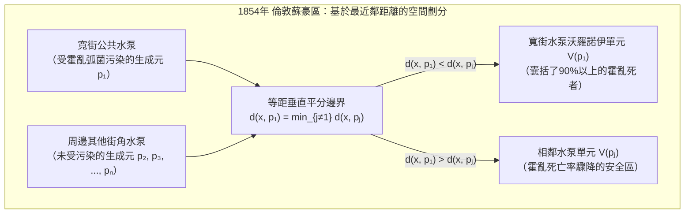

當我們帶著智慧型手機在城市街道上行走時，手機在毫秒之間不斷計算哪個通訊基地台的訊號路徑最短，並在相鄰基地台的覆蓋邊界上實現無縫切換（Handover）。當城市某處響起急救電話時，調度系統必須立即根據道路網與醫院分佈判斷哪輛救護車能以最短時間抵達現場。而在自然界中，從長頸鹿的網狀斑紋、蜻蜓翅膀的翅脈網路、乾涸河床的龜裂、玄武岩柱狀節理，到宇宙大尺度結構中的星系絲狀體與巨型空洞（Cosmic Voids），物質自發組織成驚人相似的多邊形網格。

在這些橫跨流行病學、都市計畫、5G無線通訊、有限元素法（FEM）數值網格生成、凝態物理與生物形態發生學的現象背後，隱藏著計算幾何學（Computational Geometry）中最核心的對偶結構：<strong>沃羅諾伊圖（Voronoi Diagram）</strong>及其平面圖對偶——<strong>德勞內三角剖分（Delaunay Triangulation）</strong>。

---

## 1. 1854年倫敦蘇豪區霍亂地圖與「無形邊界」的誕生

1854年8月底，英國倫敦中心蘇豪區（Soho）的寬街（Broad Street）附近爆發了慘烈的霍亂疫情，短短10天內超過500名居民喪生。當時的醫學界深信「瘴氣理論（Miasma Theory）」，認為霍亂是透過吸入腐敗污物散發的惡臭空氣傳播的。然而，先驅流行病學家<strong>約翰·斯諾醫師（Dr. John Snow, 1813–1858）</strong>敏銳地注意到，患者的首發症狀始終集中在消化道而非呼吸道，從而提出了霍亂透過受污染的<strong>飲用水</strong>傳播的假說。

斯諾走訪了蘇豪區的每一條街道，在地圖上用黑色短橫線標記每一位死者的住宅位置，同時標出了居民日常取水的街角公共水泵。為了反駁懷疑論者並解釋為何緊鄰寬街的救濟院（擁有獨立水井）和獅子啤酒廠（工人每天飲用免費麥芽酒且廠內有深井）幾乎無人死亡，斯諾在地圖上畫出了一條決定性的幾何邊界：<strong>到寬街水泵的步行距離與到周圍任何其他水泵的步行距離相等的軌跡線</strong>。



這條多邊形邊界正是寬街水泵的<strong>沃羅諾伊單元（Voronoi Cell）</strong>。全區90%以上的霍亂死者都嚴格落在這條等距邊界內部！斯諾用純粹的幾何空間分割鎖定了傳染源，促使教區委員會於9月8日拆除了寬街水泵的手柄，從而平息了疫情。

這一幾何思想在科學史上曾被多次獨立發現：1644年<strong>笛卡兒（René Descartes）</strong>在《哲學原理》中用多邊形宇宙渦旋（*tourbillons*）劃分恆星的引力領地；1850年<strong>狄利克雷（Peter Gustav Lejeune Dirichlet）</strong>在二次型約化理論中定義了格點的狄利克雷域（即固態物理中的維格納-賽茨原胞 Wigner-Seitz Cell）；1908年烏克蘭數學家<strong>格奧爾基·沃羅諾伊（Georgy Voronoi）</strong>將其推廣至任意 $d$ 維歐氏空間 $\mathbb{R}^d$；1911年氣象學家<strong>泰森（Alfred H. Thiessen）</strong>則提出了用於估算區域平均降雨量的泰森多邊形。

---

## 2. 沃羅諾伊圖 $\text{Vor}(P)$ 的嚴格數學定義與歐拉公式線性複雜度證明

### 2.1 閉半平面的交集與凸多邊形性質

設歐氏平面 $\mathbb{R}^2$ 上給定 $n$ 個互不相同的生成元（站點，Sites）集合 $P = \{p_1, p_2, \dots, p_n\} \subset \mathbb{R}^2$（$n \ge 3$）。對於任意兩個不同站點 $p_i, p_j \in P$（$i \ne j$），其垂直平分線 $B(p_i, p_j) = \{x \in \mathbb{R}^2 \mid \|x - p_i\|_2 = \|x - p_j\|_2\}$ 將平面分為兩個閉半平面。點 $x$ 到 $p_i$ 的距離不大於到 $p_j$ 的距離的<strong>優超半平面（Dominance Half-Plane）</strong> $H(p_i, p_j)$ 為：

$$H(p_i, p_j) = \left\{ x \in \mathbb{R}^2 \;\middle|\; \|x - p_i\|_2 \le \|x - p_j\|_2 \right\} = \left\{ x \in \mathbb{R}^2 \;\middle|\; 2(p_j - p_i)^\top x \le \|p_j\|_2^2 - \|p_i\|_2^2 \right\}$$

站點 $p_i$ 的<strong>沃羅諾伊單元（Voronoi Cell）</strong> $\mathcal{V}(p_i)$ 定義為相對於所有其他站點 $p_j$（$j \ne i$）的 $n-1$ 個閉半平面的交集：

$$\mathcal{V}(p_i) = \left\{ x \in \mathbb{R}^2 \;\middle|\; \|x - p_i\|_2 \le \|x - p_j\|_2 \;\;\forall j \ne i \right\} = \bigcap_{j \ne i} H(p_i, p_j)$$

由於半平面是凸集，任意多個凸集的交集依然是凸集，因此每個歐氏沃羅諾伊單元 $\mathcal{V}(p_i)$ 都是一個（可能無界的）<strong>凸多邊形</strong>。且 $\mathcal{V}(p_i)$ 無界若且唯若站點 $p_i$ 位於點集凸包 $\text{CH}(P)$ 的邊界上。

### 2.2 組合複雜度定理：為什麼邊數是 $O(n)$ 而不是 $O(n^2)$？

$n$ 個站點共有 $\binom{n}{2} = \Theta(n^2)$ 條兩兩垂直平分線，但絕大多數平分線都被更近的站點屏蔽了。我們用<strong>歐拉多面體公式（Euler's Planar Graph Formula）</strong>嚴格證明平面沃羅諾伊圖的頂點數 $V$ 與邊數 $E$ 具有嚴格的線性上界：

$$V \le 2n - 5, \qquad E \le 3n - 6$$

<strong>【證明】</strong>：在平面 $\mathbb{R}^2$ 中引入一個虛擬的<strong>無窮遠頂點</strong> $v_\infty$，將所有無界沃羅諾伊射線連接到 $v_\infty$，從而將平面緊化為拓撲球面 $\mathbb{S}^2$ 上的連通平面圖 $G' = (V', E', F')$，其中頂點數 $V' = V + 1$，邊數 $E' = E$，面數 $F' = n$。由歐拉公式 $V' - E' + F' = 2$ 得：

$$(V + 1) - E + n = 2 \iff E = V + n - 1$$

由於每個有限沃羅諾伊頂點至少是 3 個單元的交點（度數 $\deg(v) \ge 3$），且非共線點集的凸包至少有 3 條邊（故 $\deg(v_\infty) \ge 3$），圖 $G'$ 中所有 $V + 1$ 個頂點的度數均滿足 $\deg(v) \ge 3$。由圖論握手引理（Handshaking Lemma）：

$$2E = \sum_{v \in V \cup \{v_\infty\}} \deg(v) \ge 3(V + 1) \implies V \le \frac{2}{3}E - 1$$

代入 $E = V + n - 1$ 即得 $E \le \frac{2}{3}E + n - 2 \implies E \le 3n - 6$，進而 $V = E - n + 1 \le 2n - 5$。
由此立即推出<strong>平均邊數推論</strong>：每條邊被 2 個單元共享，因此任意沃羅諾伊單元的平均邊數為：

$$\bar{k} = \frac{2E}{n} \le \frac{2(3n - 6)}{n} = 6 - \frac{12}{n} < 6$$

無論平面上有多少億個站點，<strong>平均每個沃羅諾伊單元的邊數嚴格小於 6</strong>！

| 沃羅諾伊圖變體 | 距離度量 $d(x, p_i)$ | 邊界線幾何形狀 | 單元凸性與連通性 | 最壞空間複雜度 | 典型科學與工程應用 |
| :--- | :--- | :--- | :--- | :--- | :--- |
| 標準歐氏 ($L_2$) | $\|x - p_i\|_2$ | 直線（垂直平分線） | 恆為凸且連通 | $\Theta(n)$ | 醫療急救轄區、氣象泰森多邊形、最近鄰檢索 |
| 曼哈頓距離 ($L_1$) | $\|x_1 - x_i\| + \|x_2 - y_i\|$ | 水平、垂直與 $\pm 45^\circ$ 折線 | 星形（未必凸） | $\Theta(n)$ | 網格城市物流調度、VLSI 晶片佈線 |
| 切比雪夫距離 ($L_\infty$) | $\max(\|x_1 - x_i\|, \|x_2 - y_i\|)$ | 水平、垂直與 $\pm 45^\circ$ 折線 | 星形（未必凸） | $\Theta(n)$ | 自動化立體倉庫天車控制、數控工具機路徑 |
| <strong>加性權重 (Johnson-Mehl)</strong> | $\|x - p_i\|_2 - w_i$ | 雙曲線弧（Hyperbola） | 星形且連通 | $\Theta(n)$ | 非同步形核晶體生長模型、TDOA 衛星定位 |
| <strong>乘性權重 (阿波羅尼奧斯)</strong> | $\|x - p_i\|_2 / w_i$ | 圓弧（阿波羅尼奧斯圓） | 非凸、可能不連通 | $\Theta(n^2)$ | 不同發射功率 5G 基地台覆蓋、商業零售商圈分析 |
| <strong>冪圖 (Laguerre / Power)</strong> | $\|x - p_i\|_2^2 - r_i^2$ | 直線（兩圓根軸） | 恆為凸（可能為空） | $\Theta(n)$ | 多晶金屬晶粒建模、泡沫物理、半離散最優傳輸(OT) |

---

## 3. 對偶圖——德勞內三角剖分 $\text{DT}(P)$ 與三大等價定理

1934年，蘇聯數學家<strong>鮑里斯·德勞內（Boris Delaunay / Delone）</strong>定義了 $\text{Vor}(P)$ 的平面圖對偶：將每個生成元 $p_i$ 作為頂點，若兩個單元 $\mathcal{V}(p_i)$ 與 $\mathcal{V}(p_j)$ 共享一條沃羅諾伊邊，則在 $p_i$ 與 $p_j$ 之間連接一條直線段。在一般位置假設（無四點共圓）下，該對偶圖將凸包 $\text{CH}(P)$ 精確剖分為三角形網格，稱為<strong>德勞內三角剖分 $\text{DT}(P)$</strong>，且滿足三大等價定理：

1. <strong>空外接圓定理（Empty Circumcircle Property）</strong>：三角剖分 $\mathcal{T}$ 是德勞內三角剖分，若且唯若每個三角形 $\triangle p_i p_j p_k$ 的外接圓內部嚴格不包含 $P$ 中的任何其他站點 $p_l$（因為該三角形的外心正是與 $p_i, p_j, p_k$ 等距的對偶沃羅諾伊頂點！）。其代數判定由 $4 \times 4$ 行列式給出：
   $$\text{InCircle}(p_i, p_j, p_k, p_l) = \det \begin{pmatrix} x_i & y_i & x_i^2 + y_i^2 & 1 \\ x_j & y_j & x_j^2 + y_j^2 & 1 \\ x_k & y_k & x_k^2 + y_k^2 & 1 \\ x_l & y_l & x_l^2 + y_l^2 & 1 \end{pmatrix} > 0$$
2. <strong>最大最小角最優性定理（Max-Min Angle Theorem, Sibson 1978 & Lawson 1972）</strong>：在有限元素法（FEM）偏微分方程求解中，狹長的「狹片三角形（Sliver Triangles）」會導致勁度矩陣條件數 $\kappa(K) \propto 1/\sin(\theta_{\min})$ 惡化並引發數值發散。在點集 $P$ 的所有可能三角剖分中，<strong>德勞內三角剖分按字典序最大化所有內角構成的遞增向量 $\alpha(\mathcal{T}) = (\theta_1, \theta_2, \dots, \theta_{3m})$，從而嚴格最大化最小內角 $\theta_{\min}$</strong>！對任意違反空外接圓條件的凸四邊形對角線執行<strong>Lawson 邊翻轉（Edge Flip）</strong>，都會使六個內角的最小值嚴格增大，並在至多 $O(n^2)$ 次翻轉內收斂到 $\text{DT}(P)$。
3. <strong>三維旋轉拋物面提升映射（3D Paraboloid Lifting Map, Edelsbrunner & Seidel 1986）</strong>：將二維點 $(x, y)$ 垂直投影到三維旋轉拋物面 $\mathcal{P}: z = x^2 + y^2$ 上：
   $$\Phi(x, y) = (x, \; y, \; x^2 + y^2)$$
   由於平面圓方程 $(x - a)^2 + (y - b)^2 = R^2$ 展開後代入 $z = x^2 + y^2$ 即變為三維線性平面方程 $z = 2ax + 2by - (a^2 + b^2 - R^2)$，點在圓內等價於提升點位於該三維平面下方。因此，<strong>提升點集 $\Phi(P)$ 在 $\mathbb{R}^3$ 中的下凸包（Lower Convex Hull）向 $xy$ 平面的垂直投影，精確等於二維德勞內三角剖分 $\text{DT}(P)$</strong>！

---

## 4. Fortune 掃描線與海灘線演算法（1986）：最優 $\Theta(n \log n)$ 構建

由於一維實數排序可歸約為沃羅諾伊圖構建，其時間複雜度下界為 $\Omega(n \log n)$。直接應用水平掃描線 $\ell: y = y_{\text{sweep}}$ 面臨「因果律悖論」：掃描線上方的點可能距離掃描線下方的未發現站點更近。

1986年，貝爾實驗室的 <strong>Steven Fortune</strong> 提出維護掃描線上方「絕對不受未來下方站點影響的確定區域邊界」。到已訪問站點 $p_i = (x_i, y_i)$（焦點）的距離等於到水平掃描線 $\ell: y = y_{\text{sweep}}$（準線）的距離的軌跡是一條開口向上的<strong>拋物線</strong>：

$$y = \frac{(x - x_i)^2}{2(y_i - y_{\text{sweep}})} + \frac{y_i + y_{\text{sweep}}}{2}$$

所有已訪問站點拋物線的下包絡線構成了<strong>海灘線（Beach Line）</strong>。相鄰兩段拋物線弧的交點（斷點，Breakpoint）同時與兩個焦點和準線等距，因此在掃描線下降過程中，斷點精確描繪出沃羅諾伊邊！演算法僅需用平衡二元搜尋樹（維護至多 $2n-1$ 段拋物線弧）和優先佇列處理兩類離散事件：
- <strong>站點事件（Site Event）</strong>：掃描線觸及新站點 $p_k$，插入新拋物線弧並將原弧一分為三，產生兩個追蹤新沃羅諾伊邊的斷點（共 $n$ 次）。
- <strong>圓事件（Circle Event）</strong>：相鄰三段弧 $(\alpha_i, \alpha_j, \alpha_k)$ 的中間弧 $\alpha_j$ 在掃描線觸及外接圓最低點 $y_{\text{sweep}} = y_c - R$ 時收縮為零並消失，兩個斷點在外心 $(x_c, y_c)$ 處碰撞，生成<strong>沃羅諾伊頂點</strong>（至多 $2n - 5$ 次有效事件）。
總時間複雜度嚴格達到最優的 $\Theta(n \log n)$，空間複雜度為 $\Theta(n)$。

---

## 5. 勞埃德鬆弛法（Lloyd's Relaxation）與質心沃羅諾伊剖分（CVT）

給定密度函數 $\rho(x)$，為了最小化全區域的量化畸變能量（$k$-Means 目標泛函）：

$$\mathcal{E}(P, \{\Omega_i\}) = \sum_{i=1}^n \int_{\Omega_i} \|x - p_i\|_2^2 \, \rho(x) \, dx$$

最優解必須同時滿足兩個必要條件：(1) 區域劃分為沃羅諾伊單元 $\Omega_i = \mathcal{V}(p_i)$；(2) 每個生成元 $p_i$ 位於其自身沃羅諾伊單元的<strong>質心（Centroid）</strong> $c_i$ 處。滿足 $p_i = c_i$ 的剖分稱為<strong>質心沃羅諾伊剖分（CVT）</strong>。
<strong>勞埃德鬆弛演算法（Stuart Lloyd, 1957）</strong>透過交替執行「計算沃羅諾伊圖」與「將站點移動至單元質心 $p_i^{(t+1)} \leftarrow c_i^{(t)}$」，使能量 $\mathcal{E}$ 單調遞減，並在均勻密度下根據 Fejes Tóth 定理自組織收斂到能量全域最小的<strong>正六邊形蜂巢晶格（Honeycomb Lattice）</strong>。

下面給出基於 Sutherland-Hodgman 半平面裁剪與格林公式（鞋帶公式）精確計算多邊形面積、質心與量化能量的自包含 Python 實作：

```python
import math
import random
from typing import List, Tuple

Point = Tuple[float, float]
Polygon = List[Point]

def clip_polygon_by_halfplane(poly: Polygon, p_i: Point, p_j: Point) -> Polygon:
    if not poly:
        return []
    xi, yi = p_i
    xj, yj = p_j
    a = 2.0 * (xj - xi)
    b = 2.0 * (yj - yi)
    c = (xj * xj + yj * yj) - (xi * xi + yi * yi)

    def signed_dist(pt: Point) -> float:
        return a * pt[0] + b * pt[1] - c

    out: Polygon = []
    m = len(poly)
    for k in range(m):
        cur_pt = poly[k]
        nxt_pt = poly[(k + 1) % m]
        d_cur = signed_dist(cur_pt)
        d_nxt = signed_dist(nxt_pt)
        if d_cur <= 1e-12:
            out.append(cur_pt)
            if d_nxt > 1e-12:
                t = d_cur / (d_cur - d_nxt)
                out.append((cur_pt[0] + t * (nxt_pt[0] - cur_pt[0]),
                            cur_pt[1] + t * (nxt_pt[1] - cur_pt[1])))
        elif d_nxt <= 1e-12:
            t = d_cur / (d_cur - d_nxt)
            out.append((cur_pt[0] + t * (nxt_pt[0] - cur_pt[0]),
                        cur_pt[1] + t * (nxt_pt[1] - cur_pt[1])))
    return out

def compute_clipped_voronoi(sites: List[Point], bbox: Tuple[float, float, float, float]) -> List[Polygon]:
    xmin, ymin, xmax, ymax = bbox
    base_rect: Polygon = [(xmin, ymin), (xmax, ymin), (xmax, ymax), (xmin, ymax)]
    cells: List[Polygon] = []
    for i in range(len(sites)):
        cell = base_rect
        for j in range(len(sites)):
            if i != j:
                cell = clip_polygon_by_halfplane(cell, sites[i], sites[j])
        cells.append(cell)
    return cells

def exact_polygon_moments(poly: Polygon, site: Point) -> Tuple[float, Point, float]:
    m = len(poly)
    if m < 3:
        return 0.0, site, 0.0
    area2, cx6, cy6, ixx12, iyy12 = 0.0, 0.0, 0.0, 0.0, 0.0
    for k in range(m):
        x0, y0 = poly[k]
        x1, y1 = poly[(k + 1) % m]
        cross = x0 * y1 - x1 * y0
        area2 += cross
        cx6 += (x0 + x1) * cross
        cy6 += (y0 + y1) * cross
        ixx12 += (x0 * x0 + x0 * x1 + x1 * x1) * cross
        iyy12 += (y0 * y0 + y0 * y1 + y1 * y1) * cross
    area = 0.5 * area2
    if abs(area) < 1e-15:
        return 0.0, site, 0.0
    cx, cy = cx6 / (3.0 * area2), cy6 / (3.0 * area2)
    i_origin = (ixx12 + iyy12) / 12.0
    sx, sy = site
    energy = i_origin - 2.0 * area * (cx * sx + cy * sy) + area * (sx * sx + sy * sy)
    return area, (cx, cy), energy

def simulate_lloyd_relaxation(n_sites: int = 25, iterations: int = 30) -> None:
    random.seed(42)
    bbox = (0.0, 0.0, 1.0, 1.0)
    sites = [(random.uniform(0.05, 0.95), random.uniform(0.05, 0.95)) for _ in range(n_sites)]
    for it in range(iterations + 1):
        cells = compute_clipped_voronoi(sites, bbox)
        total_energy, next_sites = 0.0, []
        for i, cell in enumerate(cells):
            _, centroid, energy = exact_polygon_moments(cell, sites[i])
            total_energy += energy
            next_sites.append(centroid)
        if it in (0, 5, 15, 30):
            print(f"Iter {it:2d}: Energy E = {total_energy:.8f}")
        sites = next_sites

if __name__ == "__main__":
    simulate_lloyd_relaxation()
```
