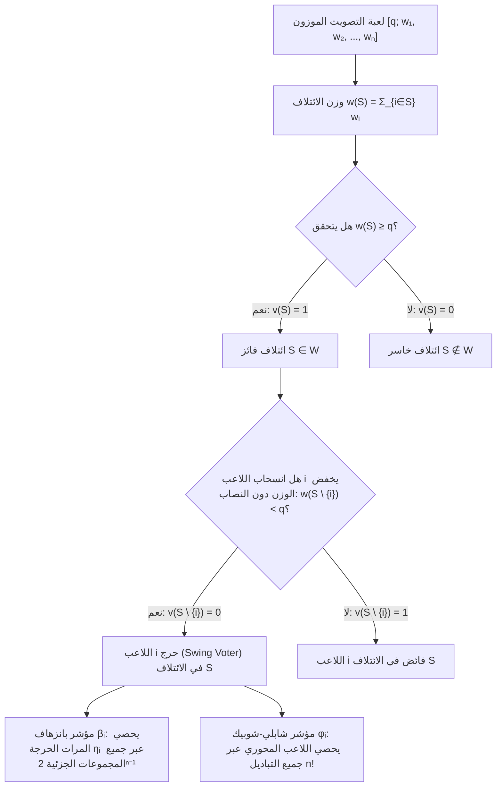
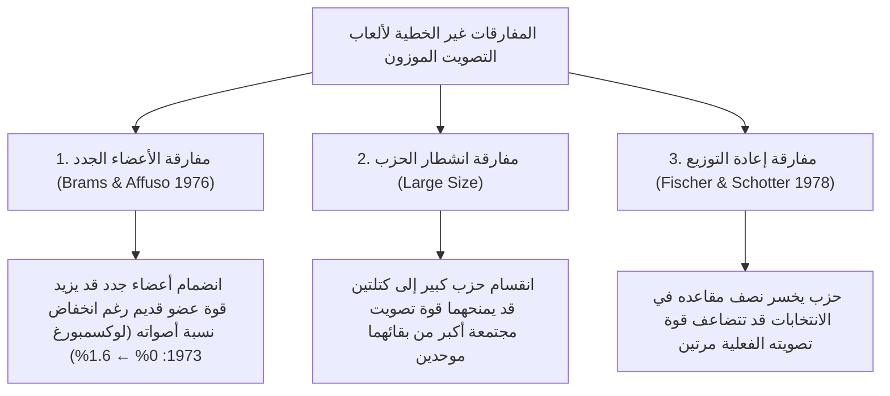

في البرلمانات الديمقراطية والمجالس الدولية ومجالس إدارات الشركات، غالباً ما يقع المراقبون في وهم حسابي بديهي لكنه خاطئ تماماً: افتراض أن <strong>حصة الحزب من المقاعد — أو نسبة ما يملكه المساهم من أسهم التصويت — تتناسب طردياً مع قوته الفعلية في صنع القرار (Voting Power)</strong>.

تخيل برلماناً يتألف من 100 مقعد ويتطلب تمرير أي قانون فيه أغلبية بسيطة قدرها $q = 51$ صوتاً. يمتلك الحزب A 49 مقعداً، ويمتلك الحزب B 49 مقعداً، بينما يمتلك حزب ثالث صغير جداً هو الحزب C مقعدين فقط ($2$). للوهلة الأولى يبدو الحزبان A وB عملاقين يسيطر كل منهما على $49\%$ من المجلس، بينما يبدو الحزب C هامشياً بحصة $2\%$. غير أن <strong>نظرية الألعاب التعاونية (Cooperative Game Theory)</strong> تكشف حقيقة مذهلة: يمتلك الحزب A والحزب B والحزب C <strong>نفس قوة التصويت بالضبط — الثلث ($33.33\%$) لكل منهم</strong>!

وفي المقابل، قد يمتلك حزب أو دولة ذات سيادة كتلة معتبرة من الأصوات ومع ذلك تكون <strong>قوة تصويتها الرياضية مساوية للصفر المطلق ($0\%$)</strong>، وهو ما تسميه نظرية الألعاب <strong>اللاعب الوهمي أو الصوري (Dummy Player)</strong>. فبين عامي 1958 و1973، اعتمد مجلس وزراء المجموعة الاقتصادية الأوروبية (EEC) نظام التصويت الموزون $[12;\, 4, 4, 4, 2, 2, 1]$. ورغم أن لوكسمبورغ مُنحت صوتاً واحداً ($5.88\%$ من المجموع)، فإن جميع الدول الخمس الأخرى كانت تملك أعداداً زوجية من الأصوات ($4, 4, 4, 2, 2$) وكان نصاب الأغلبية زوجياً ($12$). ولأن مجموع الأعداد الزوجية زوجي دائماً، فقد كان مستحيلاً رياضياً أن يجمع أي ائتلاف $11$ صوتاً ليحوّله صوت لوكسمبورغ الفردي إلى $12$: طوال 15 عاماً كانت قوة تصويت لوكسمبورغ تساوي $0\%$ حرفياً.

في هذا المقال نطوّر النظرية الرياضية الكاملة <strong>لمؤشرات قوة التصويت</strong>: الصياغة البديهية للألعاب البسيطة الموزونة، و<strong>مؤشر بانزهاف</strong>، و<strong>مؤشر شابلي-شوبيك</strong>، ومبرهنة سترافين الاحتمالية، وخوارزميات الدوال المولدة، وبنية حق النقض (الفيتو) في مجلس الأمن الدولي، ومفارقات إعادة التوزيع.

---

## 1. وهم حصة المقاعد: ثلاث تجارب فكرية

لنتأمل ثلاثة برلمانات إجمالي مقاعدها $W = 100$ ونصاب الأغلبية فيها $q = 51$:

1. <strong>صانع الملوك (Kingmaker) $[51;\, 49, 49, 2]$</strong>:
   لا يستطيع أي حزب بلوغ 51 مقعداً بمفرده. الائتلافات الفائزة هي $\{A, B\}(98)$ و$\{A, C\}(51)$ و$\{B, C\}(51)$ و$\{A, B, C\}(100)$. وبما أن أي زوج من الأحزاب يفوز، فإن هذه اللعبة <strong>متماثلة بنيوياً (Isomorphic)</strong> مع لجنة الأغلبية البسيطة $[2;\, 1, 1, 1]$. بحصة $2\%$ فقط من المقاعد، يتمتع الحزب C بنسبة $33.33\%$ من سلطة القرار، بالتساوي التام مع A وB.
2. <strong>الديكتاتور والمعارضة العاجزة $[51;\, 52, 47, 1]$</strong>:
   بما أن $w_A = 52 \ge 51$، فإن الحزب A <strong>ديكتاتور</strong> ($100\%$ من القوة). ورغم أن الحزب B يسيطر على $47\%$ من المقاعد، فإنه حتى لو اتحد مع C ($47 + 1 = 48 < 51$) لا يستطيع تمرير أو تعطيل أي قانون: B وC <strong>لاعبان وهميان</strong> بقوة $0\%$.
3. <strong>اللاعب الوهمي الخفي وقضية مقاطعة ناسو (1965) $[51;\, 35, 35, 25, 5]$</strong>:
   لا يملك أي حزب أغلبية مطلقة. لكن المجاميع الممكنة للمجموعات الجزئية من $\{A, B, C\}$ (الأوزان $35, 35, 25$) هي فقط $0, 25, 35, 60, 70, 95$. لا توجد أي مجموعة جزئية يقع مجموعها داخل الفترة الحرجة $[q - w_D,\, q - 1] = [46, 50]$! وبالتالي فإن مقاعد الحزب D الخمسة لا يمكنها أبداً تحويل الهزيمة إلى فوز، وقوته تساوي $0\%$. في عام 1965، استخدم المحامي الشاب <strong>جون بانزهاف (John F. Banzhaf III)</strong> هذا التحليل لإثبات أن ثلاث بلديات في مجلس مقاطعة ناسو بولاية نيويورك كانت تملك قوة تصويت قدرها $0\%$.

---

## 2. الصياغة الرياضية: مؤشرا بانزهاف وشابلي-شوبيك

### الألعاب البسيطة وألعاب التصويت الموزون

ليكن $N = \{1, 2, \dots, n\}$ مجموعة اللاعبين. يُسمى الزوج $(N, v)$ حيث $v: 2^N \to \{0, 1\}$ <strong>لعبة بسيطة (Simple Game)</strong> إذا كان $v(\emptyset) = 0$ و$v(N) = 1$ و$S \subseteq T \implies v(S) \le v(T)$ (الرتابة). وتُعرّف <strong>لعبة التصويت الموزون</strong> $[q;\, w_1, w_2, \dots, w_n]$ ذات الأوزان $w_i \ge 0$ والنصاب $q > \frac{1}{2}\sum w_i$ بالعلاقة:
$$v(S) = \begin{cases} 1 & \text{if } \sum_{i \in S} w_i \ge q \quad (\text{ائتلاف فائز}) \\ 0 & \text{if } \sum_{i \in S} w_i < q \quad (\text{ائتلاف خاسر}) \end{cases}$$

يُقال إن اللاعب $i \in S$ <strong>حرج أو مرجِّح (Swing Voter)</strong> في الائتلاف $S$ إذا كان $v(S) = 1$ و$v(S \setminus \{i\}) = 0$، أي $\Delta_i v(S) = v(S) - v(S \setminus \{i\}) = 1$.

### 1. مؤشر بانزهاف للقوة (Penrose 1946 / Banzhaf 1965)

ليكن $\eta_i = \sum_{T \subseteq N \setminus \{i\}} [v(T \cup \{i\}) - v(T)]$ عدد الائتلافات التي يكون فيها اللاعب $i$ حرجاً. يُعرّف <strong>مؤشر بانزهاف المطلق</strong> $\beta'_i$ و<strong>مؤشر بانزهاف المعيَّر (Normalized)</strong> $\beta_i$ كما يلي:
$$\beta'_i = \frac{\eta_i}{2^{n-1}}, \qquad \beta_i = \frac{\eta_i}{\sum_{j=1}^n \eta_j}$$

### 2. مؤشر شابلي-شوبيك للقوة (Shapley & Shubik 1954)

بالنظر إلى جميع التباديل الممكنة وعددها $n!$، $\pi = (\pi_1, \dots, \pi_n)$، حيث ينضم اللاعبون واحداً تلو الآخر لتشكيل الائتلاف، فإن اللاعب الوحيد الذي يرفع انضمامه الوزن التراكمي ليصل إلى النصاب $q$ أو يتجاوزه لأول مرة يُسمى <strong>اللاعب المحوري (Pivot)</strong>. وبما أنه يوجد $|S|!\,(n - |S| - 1)!$ تبديلاً تكون فيها مجموعة السابقين للاعب $i$ هي $S$ بالضبط، فإن <strong>مؤشر شابلي-شوبيك</strong> يُعطى بالعلاقة:
$$\phi_i = \sum_{S \subseteq N \setminus \{i\}} \frac{|S|!\,(n - |S| - 1)!}{n!} \bigl[v(S \cup \{i\}) - v(S)\bigr]$$

---

## 3. مقارنة تفصيلية في اللعبة $[6;\, 4, 3, 2, 1]$ والدوال المولدة

في اللعبة $[6;\, 4, 3, 2, 1]$ ($w_A=4, w_B=3, w_C=2, w_D=1$، الوزن الكلي $10$، النصاب $q=6$)، يعطي الحصر الشامل للائتلافات الفائزة السبعة والتباديل الـ 24 النتائج التالية:

| الائتلاف الفائز $S$ | الوزن $w(S)$ | الوزن بعد الحذف $w(S \setminus \{i\})$ | اللاعبون الحرجون (Swing) | الحزب | حصة الأصوات | المرات الحرجة $\eta_i$ | بانزهاف المعيَّر $\beta_i$ | المحاور ($/24$) | شابلي-شوبيك $\phi_i$ |
| :--- | :---: | :--- | :--- | :---: | :---: | :---: | :---: | :---: | :---: |
| $\{A, B\}$ | $7$ | $-A:3,\ -B:4$ | <strong>A, B</strong> | <strong>A ($w_A=4$)</strong> | $40.0\%$ | $5$ | $5/12 \approx \mathbf{41.67\%}$ | $10$ | $10/24 \approx \mathbf{41.67\%}$ |
| $\{A, C\}$ | $6$ | $-A:2,\ -C:4$ | <strong>A, C</strong> | <strong>B ($w_B=3$)</strong> | $30.0\%$ | $3$ | $3/12 = \mathbf{25.00\%}$ | $6$ | $6/24 = \mathbf{25.00\%}$ |
| $\{A, B, C\}$ | $9$ | $-A:5,\ -B:6,\ -C:7$ | <strong>A</strong> | <strong>C ($w_C=2$)</strong> | $20.0\%$ | $3$ | $3/12 = \mathbf{25.00\%}$ | $6$ | $6/24 = \mathbf{25.00\%}$ |
| $\{A, B, D\}$ | $8$ | $-A:4,\ -B:5,\ -D:7$ | <strong>A, B</strong> | <strong>D ($w_D=1$)</strong> | $10.0\%$ | $1$ | $1/12 \approx \mathbf{8.33\%}$ | $2$ | $2/24 \approx \mathbf{8.33\%}$ |
| $\{A, C, D\}$ | $7$ | $-A:3,\ -C:5,\ -D:6$ | <strong>A, C</strong> | <strong>المجموع</strong> | $100\%$ | $12$ | $100.00\%$ | $24$ | $100.00\%$ |
| $\{B, C, D\}$ | $6$ | $-B:3,\ -C:4,\ -D:5$ | <strong>B, C, D</strong> | | | | | | |
| $\{A,B,C,D\}$ | $10$ | أي حذف $\ge 6$ | <strong>لا أحد</strong> | | | | | | |

رغم أن الحزب B ($30\%$) يملك مقاعد أكثر بنسبة $50\%$ من الحزب C ($20\%$)، فإنهما يتمتعان <strong>بنفس قوة التصويت تماماً ($25.00\%$)</strong> وفق كلا المؤشرين! أما في اللعبة $[5;\, 3, 2, 1, 1]$ فيفترق المؤشران: $\beta = (50\%, 30\%, 10\%, 10\%)$ مقابل $\phi = (58.33\%, 25.00\%, 8.33\%, 8.33\%)$. ووفق <strong>مبرهنة سترافين (1977)</strong>، يقابل مؤشر بانزهاف <em>فرضية الاستقلالية</em>، بينما يقابل مؤشر شابلي-شوبيك <em>فرضية التجانس</em> ($p_1 = \dots = p_n = p \sim \mathrm{Uniform}(0,1)$).

وعندما يكون عدد اللاعبين $n$ كبيراً، تتيح <strong>الدوال المولدة (Generating Functions)</strong> الحساب الدقيق في زمن شبه حدودي $O(n^2 q)$:
$$P_{-i}(x) = \prod_{j \ne i} \left(1 + x^{w_j}\right) = \sum_{k} c_k^{(i)} x^k \implies \eta_i = \sum_{k=q-w_i}^{q-1} c_k^{(i)}$$

---

## 4. المؤسسات الدولية ومفارقات قوة التصويت

### 1. مجلس وزراء المجموعة الاقتصادية الأوروبية (1958–1973) $[12;\, 4, 4, 4, 2, 2, 1]$

بالنسبة إلى لوكسمبورغ ($w_{\text{Lux}} = 1$، النصاب $q = 12$)، تحتوي كثيرة الحدود المولدة $P_{-\text{Lux}}(x) = (1 + x^4)^3(1 + x^2)^2$ على أسس زوجية فقط، لذا فإن معامل $x^{11}$ يساوي $0$ ($\beta_{\text{Lux}} = \phi_{\text{Lux}} = 0\%$). وعندما توسعت المجموعة عام 1973 إلى 9 دول ($[41;\, 10, 10, 10, 10, 5, 5, 3, 3, 2]$)، ورغم انخفاض حصة أصوات لوكسمبورغ من $5.88\%$ إلى $3.45\%$، قفزت قوتها وفق بانزهاف من $0\%$ إلى $1.62\%$ (<strong>مفارقة الأعضاء الجدد</strong>، Brams & Affuso 1976).

### 2. مجلس الأمن التابع للأمم المتحدة (قوة الفيتو للدول الخمس الدائمة P5)

يكافئ مجلس الأمن (5 أعضاء دائمين P5 بحق النقض و10 أعضاء غير دائمين NP10، بنصاب 9 أصوات تشمل جميع الأعضاء الدائمين الخمسة) اللعبة الموزونة $[39;\, 7, 7, 7, 7, 7, 1, 1, 1, 1, 1, 1, 1, 1, 1, 1]$.
- <strong>مؤشر بانزهاف</strong>: $\eta_{\text{P5}} = \sum_{k=4}^{10} \binom{10}{k} = 848$ و$\eta_{\text{NP}} = \binom{9}{3} = 84 \implies \beta_{\text{P5}} = \frac{848}{5080} \approx \mathbf{16.69\%}$ و$\beta_{\text{NP}} = \frac{84}{5080} \approx \mathbf{1.65\%}$.
- <strong>مؤشر شابلي-شوبيك</strong>: لا يكون العضو غير الدائم لاعباً محورياً إلا في المركز التاسع بعد الأعضاء الخمسة الدائمين و3 بالضبط من الـ 9 غير الدائمين الآخرين:
  $$\phi_{\text{NP}} = \binom{9}{3}\frac{8!\,6!}{15!} = \frac{84}{45045} = \frac{4}{2145} \approx \mathbf{0.1865\%}, \qquad \phi_{\text{P5}} = \frac{421}{2145} \approx \mathbf{19.627\%}$$
  يستحوذ الأعضاء الخمسة الدائمون على $98.135\%$ من قوة شابلي-شوبيك (قوة العضو الدائم الواحد تفوق قوة العضو غير الدائم بـ <strong>105.25 مرة</strong>)!

### 3. مفارقة إعادة التوزيع (Fischer & Schotter 1978)

لنقارن برلماناً من 14 مقعداً (النصاب $q = 9$) قبل الانتخابات وبعدها:
- <strong>قبل الانتخابات $[9;\, 6, 4, 2, 2]$</strong>: الائتلافات الفائزة الصغرى هي $\{A, B\}(10)$ و$\{A, C, D\}(10)$ فقط؛ يتمتع الحزب A بحق نقض فعلي. يملك الحزب D (مقعدان) $\beta_D = 10.00\%$ و$\phi_D = 8.33\%$.
- <strong>بعد الانتخابات $[9;\, 5, 5, 3, 1]$</strong>: يخسر A مقعداً لصالح B، و<strong>يخسر الحزب D نصف مقاعده ($2 \to 1$) لصالح C</strong>. لكن الآن يصبح مجموع $\{B, C, D\}$ مساوياً لـ $5+3+1=9$ فيتحول إلى ائتلاف فائز! ومع انكسار احتكار الفيتو للحزب A، يصبح الحزب D بمقعده الوحيد صانع الملوك الذي لا غنى عنه لائتلافين مختلفين ($\{A, C, D\}$ و$\{B, C, D\}$): فتقفز قوته إلى $\beta_D = \mathbf{16.67\%}$ و$\phi_D = \mathbf{16.67\%}$ — <strong>نصف المقاعد، وضعف القوة</strong>.

وأخيراً، في الأنظمة الفيدرالية ذات المستويين، يثبت <strong>قانون الجذر التربيعي لبينروز (1946)</strong> أنه لتحقيق المساواة في التأثير غير المباشر لكل مواطن بغض النظر عن عدد سكان دولته $P_k$، يجب أن يتناسب مؤشر بانزهاف $\beta'_k$ لكل دولة طردياً مع <strong>$\sqrt{P_k}$</strong>.
