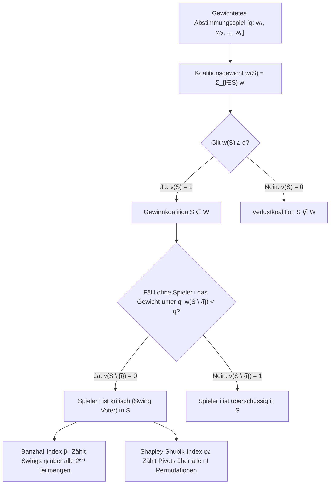
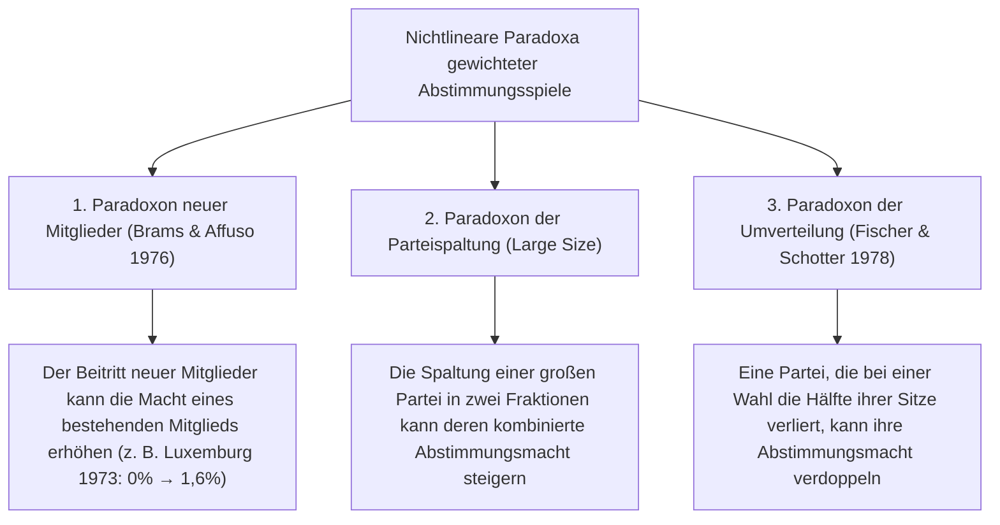

In demokratischen Parlamenten, internationalen Räten und Hauptversammlungen von Aktiengesellschaften unterliegen Beobachter regelmäßig einer trügerischen arithmetischen Illusion: der Annahme, dass <strong>der Sitzanteil einer Partei oder der Stimmrechtsanteil eines Aktionärs proportional zu seiner tatsächlichen politischen oder unternehmerischen Entscheidungsmacht (Voting Power) ist</strong>.

Betrachten wir ein Parlament mit 100 Sitzen, in dem für die Verabschiedung eines Gesetzes eine einfache Mehrheit von $q = 51$ Stimmen erforderlich ist. Partei A hält 49 Sitze, Partei B hält 49 Sitze und eine winzige dritte Partei C hält lediglich 2 Sitze. Nach Sitzanteilen scheinen A und B mit jeweils $49\%$ übermächtig zu sein, während C mit $2\%$ wie eine unbedeutende Randgruppe wirkt. Doch die präzise Analyse der <strong>kooperativen Spieltheorie (Cooperative Game Theory)</strong> liefert ein verblüffendes Ergebnis: Partei A, Partei B und Partei C besitzen <strong>exakt dieselbe Abstimmungsmacht – jeweils ein Drittel ($33{,}33\%$)</strong>.

Umgekehrt kann ein Akteur über ein erhebliches Stimmengewicht verfügen und dennoch eine <strong>Abstimmungsmacht von exakt null ($0\%$)</strong> besitzen – ein sogenannter <strong>Dummy-Spieler (Dummy Player)</strong>. Im Ministerrat der Europäischen Wirtschaftsgemeinschaft (EWG) galt von 1958 bis 1973 das gewichtete Abstimmungssystem $[12;\, 4, 4, 4, 2, 2, 1]$. Obwohl Luxemburg 1 Stimme ($5{,}88\%$ Stimmanteil) besaß, waren alle anderen Stimmengewichte ($4, 4, 4, 2, 2$) sowie das Quorum ($12$) gerade Zahlen. Dadurch konnte Luxemburgs einzelne Stimme niemals eine verlierende Koalition (maximal $10$ Stimmen) über die Schwelle von $12$ heben – Luxemburg hatte 15 Jahre lang exakt $0\%$ Abstimmungsmacht.

Dieser Artikel entwickelt die mathematische Theorie der <strong>Machtindizes (Voting Power Indices)</strong> von den Axiomen einfacher Spiele über den <strong>Banzhaf-Index</strong> und den <strong>Shapley-Shubik-Index</strong> bis hin zu erzeugenden Funktionen, dem UN-Sicherheitsrat und dem Paradoxon der Umverteilung.

---

## 1. Drei Gedankenexperimente zur Illusion des Sitzanteils

Es sei $W = 100$ die Gesamtzahl der Sitze und $q = 51$ das Mehrheitsquorum:

1. <strong>Der Königsmacher $[51;\, 49, 49, 2]$</strong>:
   Keine Partei erreicht allein 51 Sitze. Die Gewinnkoalitionen sind $\{A, B\}(98)$, $\{A, C\}(51)$, $\{B, C\}(51)$ und $\{A, B, C\}(100)$. Da jede beliebige Zweierkoalition gewinnt, ist $[51;\, 49, 49, 2]$ <strong>mathematisch isomorph</strong> zum einfachen Mehrheitsspiel $[2;\, 1, 1, 1]$. Partei C mit $2\%$ der Sitze hat exakt dieselbe Macht ($33{,}33\%$) wie A und B.
2. <strong>Der Diktator und die machtlose Opposition $[51;\, 52, 47, 1]$</strong>:
   Da $w_A = 52 \ge 51$, kann Partei A jedes Gesetz allein verabschieden (<strong>Diktator</strong> mit $100\%$ Macht). Partei B ($47\%$ der Sitze!) und Partei C ($1\%$) erreichen zusammen nur $48 < 51$ Sitze und sind <strong>Dummy-Spieler</strong> mit $0\%$ Macht.
3. <strong>Der unsichtbare Dummy und der Nassau-County-Prozess (1965) $[51;\, 35, 35, 25, 5]$</strong>:
   Keine Partei hat die absolute Mehrheit. Doch die Teilmengensummen von $\{A, B, C\}$ mit Gewichten $(35, 35, 25)$ lauten ausschließlich $0, 25, 35, 60, 70, 95$. Keine einzige Teilmenge fällt in das kritische Intervall $[51 - 5,\, 50] = [46, 50]$. Partei D ($5$ Sitze) kann niemals den Ausschlag geben und besitzt $0\%$ Macht! Genau mit dieser mathematischen Beweisführung wies der Jurist <strong>John F. Banzhaf III</strong> 1965 nach, dass im Board of Supervisors von Nassau County (New York) drei Gemeinden trotz Stimmrecht exakt $0\%$ Abstimmungsmacht besaßen.

---

## 2. Mathematische Formulierung: Banzhaf- und Shapley-Shubik-Index

### Einfache Spiele und gewichtete Abstimmungsspiele

Sei $N = \{1, 2, \dots, n\}$ die Spielermenge. Ein Paar $(N, v)$ mit einer charakteristischen Funktion $v: 2^N \to \{0, 1\}$ heißt <strong>einfaches Spiel (Simple Game)</strong>, falls $v(\emptyset) = 0$, $v(N) = 1$ und $S \subseteq T \implies v(S) \le v(T)$ (Monotonie). Ein <strong>gewichtetes Abstimmungsspiel</strong> $[q;\, w_1, w_2, \dots, w_n]$ mit Gewichten $w_i \ge 0$ und Quorum $q > \frac{1}{2}\sum w_i$ ist definiert durch:
$$v(S) = \begin{cases} 1 & \text{falls } \sum_{i \in S} w_i \ge q \quad (\text{Gewinnkoalition}) \\ 0 & \text{falls } \sum_{i \in S} w_i < q \quad (\text{Verlustkoalition}) \end{cases}$$

Ein Spieler $i \in S$ heißt <strong>kritisch (Critical / Swing Voter)</strong> in $S$, falls $v(S) = 1$ und $v(S \setminus \{i\}) = 0$, also $\Delta_i v(S) = v(S) - v(S \setminus \{i\}) = 1$.

### 1. Der Banzhaf-Machtindex (Penrose 1946 / Banzhaf 1965)

Sei $\eta_i = \sum_{T \subseteq N \setminus \{i\}} [v(T \cup \{i\}) - v(T)]$ die Anzahl der Koalitionen, in denen Spieler $i$ kritisch ist. Dann sind der <strong>absolute Banzhaf-Index</strong> $\beta'_i$ und der <strong>normierte Banzhaf-Index</strong> $\beta_i$ definiert durch:
$$\beta'_i = \frac{\eta_i}{2^{n-1}}, \qquad \beta_i = \frac{\eta_i}{\sum_{j=1}^n \eta_j}$$

### 2. Der Shapley-Shubik-Machtindex (Shapley & Shubik 1954)

Betrachtet man alle $n!$ Reihenfolgen (Permutationen) $\pi = (\pi_1, \dots, \pi_n)$, in denen die Spieler nacheinander einer Koalition beitreten, so heißt derjenige eindeutige Spieler, dessen Beitritt die kumulierte Stimmenzahl erstmals auf mindestens $q$ hebt, der <strong>Pivot-Spieler (Pivot)</strong>. Da für eine Vorgängermenge $S \subseteq N \setminus \{i\}$ genau $|S|!\,(n - |S| - 1)!$ Permutationen existieren, lautet der <strong>Shapley-Shubik-Index</strong> (als Spezialfall des Shapley-Werts):
$$\phi_i = \sum_{S \subseteq N \setminus \{i\}} \frac{|S|!\,(n - |S| - 1)!}{n!} \bigl[v(S \cup \{i\}) - v(S)\bigr]$$

---

## 3. Vollständige Berechnung am Beispiel $[6;\, 4, 3, 2, 1]$ und erzeugende Funktionen

Im Spiel $[6;\, 4, 3, 2, 1]$ ($w_A=4, w_B=3, w_C=2, w_D=1$, Gesamtgewicht $10$, Quorum $q=6$) ergeben sich folgende 7 Gewinnkoalitionen und 24 Permutationen:

| Gewinnkoalition $S$ | Gewicht $w(S)$ | Gewicht nach Austritt $w(S \setminus \{i\})$ | Kritische Spieler (Swing) | Partei | Sitzanteil | Swings $\eta_i$ | Normierter Banzhaf $\beta_i$ | Pivots ($/24$) | Shapley-Shubik $\phi_i$ |
| :--- | :---: | :--- | :--- | :---: | :---: | :---: | :---: | :---: | :---: |
| $\{A, B\}$ | $7$ | $-A:3,\ -B:4$ | <strong>A, B</strong> | <strong>A ($w_A=4$)</strong> | $40{,}0\%$ | $5$ | $5/12 \approx \mathbf{41{,}67\%}$ | $10$ | $10/24 \approx \mathbf{41{,}67\%}$ |
| $\{A, C\}$ | $6$ | $-A:2,\ -C:4$ | <strong>A, C</strong> | <strong>B ($w_B=3$)</strong> | $30{,}0\%$ | $3$ | $3/12 = \mathbf{25{,}00\%}$ | $6$ | $6/24 = \mathbf{25{,}00\%}$ |
| $\{A, B, C\}$ | $9$ | $-A:5,\ -B:6,\ -C:7$ | <strong>A</strong> | <strong>C ($w_C=2$)</strong> | $20{,}0\%$ | $3$ | $3/12 = \mathbf{25{,}00\%}$ | $6$ | $6/24 = \mathbf{25{,}00\%}$ |
| $\{A, B, D\}$ | $8$ | $-A:4,\ -B:5,\ -D:7$ | <strong>A, B</strong> | <strong>D ($w_D=1$)</strong> | $10{,}0\%$ | $1$ | $1/12 \approx \mathbf{8{,}33\%}$ | $2$ | $2/24 \approx \mathbf{8{,}33\%}$ |
| $\{A, C, D\}$ | $7$ | $-A:3,\ -C:5,\ -D:6$ | <strong>A, C</strong> | <strong>Summe</strong> | $100\%$ | $12$ | $100{,}00\%$ | $24$ | $100{,}00\%$ |
| $\{B, C, D\}$ | $6$ | $-B:3,\ -C:4,\ -D:5$ | <strong>B, C, D</strong> | | | | | | |
| $\{A,B,C,D\}$ | $10$ | Alle Austritte $\ge 6$ | <strong>Keine</strong> | | | | | | |

Obwohl Partei B ($30\%$) anderthalbmal so viele Sitze besitzt wie Partei C ($20\%$), haben beide nach beiden Indizes <strong>exakt dieselbe Macht ($25{,}00\%$)</strong>! Im Spiel $[5;\, 3, 2, 1, 1]$ hingegen weichen beide Indizes voneinander ab: $\beta = (50\%, 30\%, 10\%, 10\%)$ gegenüber $\phi = (58{,}33\%, 25{,}00\%, 8{,}33\%, 8{,}33\%)$. Nach dem <strong>Theorem von Straffin (1977)</strong> resultiert der Banzhaf-Index aus der <em>Unabhängigkeitsannahme</em> ($p_i = 1/2$ unabhängig), während der Shapley-Shubik-Index aus der <em>Homogenitätsannahme</em> ($p_1 = \dots = p_n = p \sim \mathrm{Uniform}(0,1)$) folgt.

Für große $n$ lassen sich die Indizes mithilfe <strong>erzeugender Funktionen (Generating Functions)</strong> in pseudopolynomieller Zeit $O(n^2 q)$ exakt berechnen:
$$P_{-i}(x) = \prod_{j \ne i} \left(1 + x^{w_j}\right) = \sum_{k} c_k^{(i)} x^k \implies \eta_i = \sum_{k=q-w_i}^{q-1} c_k^{(i)}$$

---

## 4. Reale Institutionen und die Paradoxa der Abstimmungsmacht

### 1. Der EWG-Ministerrat 1958–1973 $[12;\, 4, 4, 4, 2, 2, 1]$

Für Luxemburg ($w_{\text{Lux}} = 1$, Quorum $q = 12$) lautet die erzeugende Funktion $P_{-\text{Lux}}(x) = (1 + x^4)^3(1 + x^2)^2$. Da dieses Polynom nur gerade Exponenten besitzt, ist der Koeffizient von $x^{11}$ gleich $0$ ($\beta_{\text{Lux}} = \phi_{\text{Lux}} = 0\%$). Erst durch die EWG-Erweiterung 1973 auf $[41;\, 10, 10, 10, 10, 5, 5, 3, 3, 2]$ stieg Luxemburgs Macht trotz sinkenden Stimmanteils von $0\%$ auf $\beta = 1{,}62\%$ (<strong>Paradoxon neuer Mitglieder</strong>, Brams & Affuso 1976).

### 2. Der UN-Sicherheitsrat (Vetomacht der P5)

Der UN-Sicherheitsrat (5 ständige Mitglieder P5 mit Vetorecht, 10 nichtständige Mitglieder NP10, Quorum 9 inklusive aller 5 P5) ist äquivalent zum gewichteten Abstimmungsspiel $[39;\, 7, 7, 7, 7, 7, 1, 1, 1, 1, 1, 1, 1, 1, 1, 1]$.
- <strong>Banzhaf-Index</strong>: $\eta_{\text{P5}} = \sum_{k=4}^{10} \binom{10}{k} = 848$, $\eta_{\text{NP}} = \binom{9}{3} = 84 \implies \beta_{\text{P5}} = \frac{848}{5080} \approx \mathbf{16{,}69\%}$, $\beta_{\text{NP}} = \frac{84}{5080} \approx \mathbf{1{,}65\%}$.
- <strong>Shapley-Shubik-Index</strong>: Ein NP-Mitglied ist genau dann Pivot an 9. Stelle, wenn unter den ersten 8 Mitgliedern alle 5 P5 und genau 3 der übrigen 9 NP sind:
  $$\phi_{\text{NP}} = \binom{9}{3}\frac{8!\,6!}{15!} = \frac{84}{45045} = \frac{4}{2145} \approx \mathbf{0{,}1865\%}, \qquad \phi_{\text{P5}} = \frac{421}{2145} \approx \mathbf{19{,}627\%}$$
  Die 5 Vetomächte vereinen $98{,}135\%$ der gesamten Shapley-Shubik-Macht auf sich!

### 3. Das Paradoxon der Umverteilung (Fischer & Schotter 1978)

Vergleichen wir ein 14-Sitze-Parlament mit Quorum $q = 9$ vor und nach einer Wahl:
- <strong>Vor der Wahl $[9;\, 6, 4, 2, 2]$</strong>: Minimale Gewinnkoalitionen sind nur $\{A, B\}(10)$ und $\{A, C, D\}(10)$; Partei A ist Vetospieler. Partei D ($2$ Sitze) hat $\beta_D = 10{,}00\%$ und $\phi_D = 8{,}33\%$.
- <strong>Nach der Wahl $[9;\, 5, 5, 3, 1]$</strong>: Partei A verliert 1 Sitz an B, und <strong>Partei D verliert die Hälfte ihrer Sitze ($2 \to 1$) an C</strong>. Doch nun erreicht $\{B, C, D\}$ genau $5+3+1=9$ Sitze und wird zur Gewinnkoalition! Das Vetomonopol von A ist gebrochen, und Partei D wird mit ihrem einzigen Sitz zum unverzichtbaren Königsmacher sowohl für $\{A, C, D\}$ als auch für $\{B, C, D\}$: Ihre Macht springt auf $\beta_D = \mathbf{16{,}67\%}$ und $\phi_D = \mathbf{16{,}67\%}$ – <strong>halbierte Sitze, verdoppelte Macht</strong>!

Um in zweistufigen föderalen Systemen jedem Bürger gleichen indirekten Einfluss zu sichern, besagt das <strong>Penrose-Quadratwurzelgesetz (1946)</strong>, dass der Banzhaf-Index $\beta'_k$ jedes Mitgliedstaats proportional zur <strong>Quadratwurzel seiner Bevölkerung $\sqrt{P_k}$</strong> gewählt werden muss.
