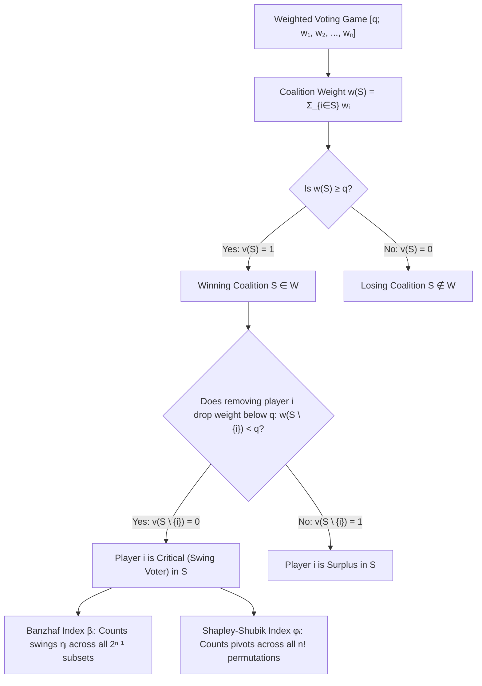
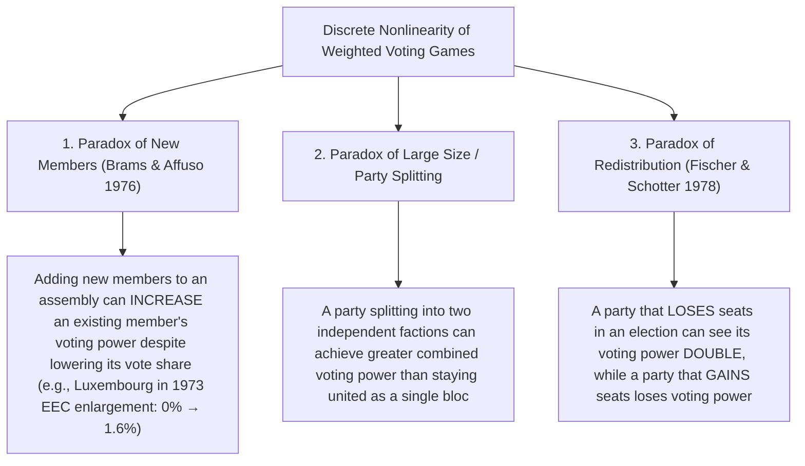

In democratic legislatures, international councils, and corporate boards of directors, observers routinely rely on a seductive arithmetic illusion: the assumption that <strong>a party's share of seats—or a shareholder's fraction of voting stock—is proportional to its actual political or corporate decision-making power</strong>.

Imagine a 100-seat parliament where passing legislation requires a simple majority of $q = 51$ votes. Suppose Party A holds 49 seats, Party B holds 49 seats, and a tiny third party, Party C, holds just 2 seats. On television graphics and in newspaper headlines, Parties A and B appear as towering behemoths controlling $49\%$ of the legislature apiece, while Party C looks like a fringe faction with a negligible $2\%$ share. Yet when we subject this legislature to the rigorous mathematics of <strong>cooperative game theory (Cooperative Game Theory)</strong>, a startling truth emerges: Party A, Party B, and Party C possess <strong>the exact same voting power—one-third ($33.33\%$) each</strong>.

Conversely, a political party or sovereign nation can be allocated a substantial block of votes and still possess <strong>strictly zero ($0\%$) mathematical voting power</strong>—a structural phantom known in game theory as a <strong>dummy player (Dummy Player)</strong>. When the six founding nations of the European Economic Community (EEC, the precursor to the European Union) signed the Treaty of Rome in 1957, Luxembourg was granted 1 vote out of 17 in the Council of Ministers under a qualified majority threshold of 12 votes. Because every other member state was assigned an even number of votes (4 for West Germany, France, and Italy; 2 for Belgium and the Netherlands), it was mathematically impossible for Luxembourg's single odd vote ever to turn a losing coalition into a winning one. For fifteen years, from 1958 to 1973, Luxembourg's formal voting power on qualified majority questions was literally $0\%$.

Why does the number of votes on paper ($w_i$) diverge so dramatically from real influence over outcomes? In this article, we build the complete mathematical theory of <strong>voting power indices (Voting Power Indices)</strong> from first principles. Starting from the axiomatic formulation of simple games and weighted voting games, we derive the two foundational pillars of the field—the <strong>Banzhaf Power Index</strong> (Penrose 1946; Banzhaf 1965) and the <strong>Shapley-Shubik Power Index</strong> (Shapley & Shubik 1954)—compare them across complete enumeration tables, unify them through Philip Straffin's probabilistic theorem, construct pseudo-polynomial dynamic programming algorithms via generating functions, dissect the veto architecture of the UN Security Council, and explore the counterintuitive <strong>paradoxes of voting power</strong>, where losing half of one's seats in an election can double one's actual power.

---

## 1. The Illusion of Seat Share: Three Thought Experiments

Before introducing formal axioms, let us examine three concrete parliaments of 100 total seats where a majority quota of $q = 51$ seats is required to pass a bill.

### Thought Experiment 1: The Kingmaker $[51;\, 49, 49, 2]$

Consider the three-party legislature introduced above:
- <strong>Party A</strong>: $w_A = 49$ seats ($49\%$ seat share)
- <strong>Party B</strong>: $w_B = 49$ seats ($49\%$ seat share)
- <strong>Party C</strong>: $w_C = 2$ seats ($2\%$ seat share)

Because no single party reaches the quota of 51 seats alone, passing any bill requires forming a <strong>coalition (Coalition)</strong>. Let us list all combinations of parties that achieve at least 51 seats:
- Coalition $\{A, B\}$: $49 + 49 = 98 \ge 51$ (Winning)
- Coalition $\{A, C\}$: $49 + 2 = 51 \ge 51$ (Winning)
- Coalition $\{B, C\}$: $49 + 2 = 51 \ge 51$ (Winning)
- Grand Coalition $\{A, B, C\}$: $49 + 49 + 2 = 100 \ge 51$ (Winning)

Look closely at the structure of winning coalitions: a bill passes if and only if <strong>at least two of the three parties vote in favor</strong>. Whether a party brings 49 seats or 2 seats to the negotiating table makes no difference whatsoever to which coalitions succeed. Mathematically, the game $[51;\, 49, 49, 2]$ is completely <strong>isomorphic (Isomorphic)</strong> to the one-person-one-vote majority committee $[2;\, 1, 1, 1]$. By symmetry, Party C's 2 seats confer the exact same $33.33\%$ voting power as Party A's or Party B's 49 seats.

### Thought Experiment 2: The Dictator and the Powerless Opposition $[51;\, 52, 47, 1]$

Now suppose Party A wins just 3 additional seats in an election:
- <strong>Party A</strong>: $w_A = 52$ seats ($52\%$ seat share)
- <strong>Party B</strong>: $w_B = 47$ seats ($47\%$ seat share)
- <strong>Party C</strong>: $w_C = 1$ seat ($1\%$ seat share)

Because $w_A = 52 \ge 51$, Party A can pass any bill entirely on its own, and no coalition excluding Party A can ever reach 51 (since $w_B + w_C = 47 + 1 = 48 < 51$). In game-theoretic terminology, Party A is a <strong>dictator (Dictator)</strong> holding $100\%$ of the voting power, while Party B and Party C are <strong>dummy players (Dummy Players)</strong> holding $0\%$ of the voting power. Even though Party B commands nearly half the chamber ($47\%$ of the seats), its institutional power to alter legislative outcomes is identical to that of a citizen sitting in the public gallery: zero.

### Thought Experiment 3: The Invisible Dummy $[51;\, 35, 35, 25, 5]$

One might object that dummy players only arise when another party holds an outright majority. Consider, then, a four-party legislature in which <strong>no party holds a majority</strong>:
- <strong>Party A</strong>: $w_A = 35$ seats ($35\%$)
- <strong>Party B</strong>: $w_B = 35$ seats ($35\%$)
- <strong>Party C</strong>: $w_C = 25$ seats ($25\%$)
- <strong>Party D</strong>: $w_D = 5$ seats ($5\%$)

At first glance, this looks like a fluid multiparty parliament where Party D's 5 seats might occasionally tip a close vote across the 51-seat threshold. Let us test that intuition by computing the seat totals of all eight possible subsets of the other three parties $\{A, B, C\}$:
- $\emptyset$: $0$ seats (adding Party D's $5$ seats gives $5 < 51$ — still losing)
- $\{C\}$: $25$ seats (adding Party D's $5$ seats gives $30 < 51$ — still losing)
- $\{A\}$ or $\{B\}$: $35$ seats (adding Party D's $5$ seats gives $40 < 51$ — still losing)
- $\{A, C\}$ or $\{B, C\}$: $35 + 25 = 60 \ge 51$ (already winning without Party D!)
- $\{A, B\}$: $35 + 35 = 70 \ge 51$ (already winning without Party D!)
- $\{A, B, C\}$: $35 + 35 + 25 = 95 \ge 51$ (already winning without Party D!)

There is <strong>not a single coalition</strong> in which Party D's 5 seats change the outcome from defeat to victory! For Party D to be decisive, the remaining parties in a coalition would need to sum to an integer in the critical interval $[q - w_D,\, q - 1] = [46, 50]$. Because the weights $(35, 35, 25)$ can only sum to $0, 25, 35, 60, 70,$ or $95$, the interval $[46, 50]$ is a mathematical desert. Party D is an invisible dummy player with $0\%$ voting power, while Parties A, B, and C each wield $33.33\%$ of the power.

It was precisely this phenomenon that prompted a young law student named <strong>John F. Banzhaf III</strong> to publish his landmark 1965 paper, *"Weighted Voting Doesn't Work: A Mathematical Analysis,"* in the *Rutgers Law Review*. Analyzing the weighted voting system of the Nassau County Board of Supervisors in New York (where six municipalities cast weighted votes in configurations such as $[58;\, 31, 31, 28, 21, 2, 2]$ out of 115 total votes), Banzhaf proved that three towns—North Hempstead, Long Beach, and Glen Cove—could never cast a decisive vote in any coalition. Their citizens had been mathematically disenfranchised ($0\%$ voting power), in violation of the Equal Protection Clause ("one person, one vote") of the Fourteenth Amendment.

---

## 2. Axiomatic Formulation of Simple Games and Weighted Voting Games

Let us now place these observations on a rigorous mathematical foundation using cooperative game theory.

### Simple Games and Characteristic Functions

Let $N = \{1, 2, \dots, n\}$ be a finite set of players (parties, legislators, shareholders, or states). Any subset $S \subseteq N$ is called a <strong>coalition</strong>. A pair $(N, v)$, where $v: 2^N \to \{0, 1\}$ is a real-valued set function on the power set $2^N$, is called a <strong>simple game (Simple Game)</strong> if it satisfies three axioms:

1. <strong>Empty Coalition Loses</strong>: $v(\emptyset) = 0$.
2. <strong>Grand Coalition Wins</strong>: $v(N) = 1$.
3. <strong>Monotonicity</strong>: For all $S \subseteq T \subseteq N$, $v(S) \le v(T)$ (adding supporters to a passing coalition cannot cause it to fail).

To rule out contradictory rules in which two disjoint coalitions could pass opposing motions simultaneously, we also require the game to be <strong>proper (Proper)</strong>:
$$v(S) = 1 \implies v(N \setminus S) = 0 \quad (\forall S \subseteq N)$$

A coalition $S \subseteq N$ is called a <strong>winning coalition</strong> if $v(S) = 1$, and a <strong>losing coalition</strong> if $v(S) = 0$. We denote the family of all winning coalitions by $\mathcal{W} = \{S \subseteq N : v(S) = 1\}$. A winning coalition $S \in \mathcal{W}$ is called a <strong>minimal winning coalition (Minimal Winning Coalition, MWC)</strong> if the defection of any member turns it into a losing coalition—that is, $v(T) = 0$ for every proper subset $T \subsetneq S$. Because of monotonicity, the family of minimal winning coalitions $\mathcal{W}^m$ uniquely determines the entire simple game $(N, v)$.

### Weighted Voting Games

A simple game $(N, v)$ is a <strong>weighted voting game (Weighted Voting Game)</strong> if there exist non-negative real weights $w_1, w_2, \dots, w_n \ge 0$ and a strictly positive threshold (or <strong>quota</strong>) $q > 0$ such that:
$$v(S) = \begin{cases} 1 & \text{if } \sum_{i \in S} w_i \ge q \\ 0 & \text{if } \sum_{i \in S} w_i < q \end{cases}$$

We write such a game compactly as:
$$[q;\, w_1, w_2, \dots, w_n]$$
To ensure that the game is proper, the quota is chosen to exceed half of the total weight $W = \sum_{i=1}^n w_i$, i.e., $q > W / 2$.

### Critical (Swing) Players, Dictators, Veto Players, and Dummies

Given a coalition $S \subseteq N$, a player $i \in S$ is said to be <strong>critical (Critical)</strong> or a <strong>swing voter (Swing Voter)</strong> in $S$ if $S$ is winning with $i$ but losing without $i$:
$$v(S) = 1 \quad \text{and} \quad v(S \setminus \{i\}) = 0 \iff \Delta_i v(S) \equiv v(S) - v(S \setminus \{i\}) = 1$$

In a weighted voting game $[q;\, w_1, \dots, w_n]$, player $i$ is critical in $S \ni i$ if and only if the combined weight of the other members $T = S \setminus \{i\}$ falls inside the <strong>critical interval</strong>:
$$q - w_i \le \sum_{j \in S \setminus \{i\}} w_j < q$$

This marginal contribution $\Delta_i v(S) \in \{0, 1\}$ allows us to classify structural roles precisely:
- <strong>Dictator</strong>: A player $i$ who wins alone, $v(\{i\}) = 1 \iff w_i \ge q$.
- <strong>Veto Player</strong>: A player $i$ who belongs to every winning coalition, $i \in \bigcap_{S \in \mathcal{W}} S \iff \sum_{j \ne i} w_j < q$. A veto player cannot necessarily pass a bill alone, but can unilaterally block any bill.
- <strong>Dummy Player</strong>: A player $i$ who is never critical in any coalition, $\Delta_i v(S) = 0$ for all $S \subseteq N$.

---

## 3. The Banzhaf Power Index (Penrose 1946; Banzhaf 1965)

The first major mathematical index of voting power was originally formulated by the British mathematician and geneticist <strong>Lionel Penrose (1946)</strong> and independently rediscovered by <strong>John F. Banzhaf III (1965)</strong>.

### Swing Counts, the Raw Banzhaf Index, and Normalization

The Banzhaf index asks a natural combinatorial question: <strong>If all possible voting coalitions are equally likely to form, how often does player $i$ cast a vote that is decisive for the outcome?</strong>

For each player $i \in N$, define the <strong>Banzhaf swing count (raw Banzhaf score)</strong> $\eta_i$ as the number of winning coalitions $S \subseteq N$ in which player $i$ is critical:
$$\eta_i = \sum_{S \subseteq N,\, S \ni i} \bigl[v(S) - v(S \setminus \{i\})\bigr] = \sum_{T \subseteq N \setminus \{i\}} \bigl[v(T \cup \{i\}) - v(T)\bigr]$$

Since there are $n - 1$ other players in $N \setminus \{i\}$, there are exactly $2^{n-1}$ subsets $T \subseteq N \setminus \{i\}$ that player $i$ can either join or refuse to join. Dividing $\eta_i$ by $2^{n-1}$ yields the <strong>Raw (or Absolute) Banzhaf Power Index</strong> (also called the <strong>Penrose measure</strong>) $\beta'_i$:
$$\beta'_i = \frac{\eta_i}{2^{n-1}} = \frac{1}{2^{n-1}} \sum_{T \subseteq N \setminus \{i\}} \bigl[v(T \cup \{i\}) - v(T)\bigr]$$

Because multiple players can be simultaneously critical in the same winning coalition $S$, the sum $\sum_{i=1}^n \beta'_i$ does not generally equal $1$. To obtain a relative share of power that sums to $100\%$ across all players in the legislature, we divide each player's swing count by the total number of swings of all players, yielding the <strong>Normalized Banzhaf Power Index</strong> $\beta_i$:
$$\beta_i = \frac{\eta_i}{\sum_{j=1}^n \eta_j} = \frac{\beta'_i}{\sum_{j=1}^n \beta'_j}$$

> [!IMPORTANT]
> <strong>When to use Raw $\beta'_i$ vs. Normalized $\beta_i$</strong>:
> Use the <strong>Normalized Banzhaf Index $\beta_i$</strong> when asking how the pie of political influence inside a single legislature is divided among its members ($\sum_{i=1}^n \beta_i = 1$). Use the <strong>Raw Banzhaf Index $\beta'_i$</strong> when measuring the absolute probability that a player's vote changes the outcome, or when designing two-tier federal systems (such as Penrose's Square Root Law), where normalizing away the denominator $\sum_j \eta_j$ would obscure how easy or difficult it is for the assembly as a whole to pass legislation.

---

## 4. The Shapley-Shubik Power Index (Shapley & Shubik 1954)

While the Banzhaf index treats coalitions as unordered subsets without regard to how they come together, the <strong>Shapley-Shubik Power Index</strong>, introduced by Nobel laureate <strong>Lloyd Shapley</strong> and economist <strong>Martin Shubik</strong> in 1954, models coalition formation as a <strong>sequential process</strong>.

### Axiomatic Derivation from the Shapley Value

In 1953, Shapley solved the fundamental problem of cooperative game theory: given any game $(N, v)$, what is the unique fair allocation $\phi(v) = (\phi_1(v), \dots, \phi_n(v))$ of the total value $v(N)$ generated by the grand coalition? Shapley proved that there is one and only one operator satisfying four axioms:

1. <strong>Efficiency</strong>: $\sum_{i=1}^n \phi_i(v) = v(N)$.
2. <strong>Symmetry (Anonymity)</strong>: If $v(S \cup \{i\}) = v(S \cup \{j\})$ for all $S \subseteq N \setminus \{i, j\}$, then $\phi_i(v) = \phi_j(v)$.
3. <strong>Dummy Player Axiom</strong>: If $v(S \cup \{i\}) = v(S)$ for all $S \subseteq N$, then $\phi_i(v) = 0$.
4. <strong>Additivity (or Dubey's Transfer Axiom for Simple Games)</strong>: $\phi(u + v) = \phi(u) + \phi(v)$, which on the lattice of simple games is equivalent to $\phi(u \lor v) + \phi(u \land v) = \phi(u) + \phi(v)$ (Dubey 1975).

That unique allocation is the <strong>Shapley Value</strong>, which specializes on simple games ($v: 2^N \to \{0, 1\}$) to the <strong>Shapley-Shubik Power Index</strong>:
$$\phi_i = \sum_{S \subseteq N \setminus \{i\}} \frac{|S|!\,(n - |S| - 1)!}{n!} \bigl[v(S \cup \{i\}) - v(S)\bigr]$$

### Permutations and the Pivot Player

To understand the factorial coefficient $\frac{|S|!\,(n - |S| - 1)!}{n!}$, imagine that whenever a bill is proposed, the $n$ players line up in order of their enthusiasm for the bill—from the most ardent supporter first to the most reluctant opponent last. There are $n!$ possible linear orderings (permutations) $\pi = (\pi_1, \pi_2, \dots, \pi_n)$ of the $n$ players.

As players join the coalition one by one in the order $\pi$, their cumulative voting weight grows monotonically from $0$ to $W = \sum_{i=1}^n w_i \ge q$. Consequently, in every permutation $\pi$, there is <strong>one and only one player</strong> whose arrival pushes the cumulative weight from below $q$ to at least $q$. That crucial player is called the <strong>pivot (Pivot)</strong> of the permutation $\pi$:
$$\text{Player } \pi_k \text{ is the pivot in } \pi \iff v\bigl(\{\pi_1, \dots, \pi_{k-1}\}\bigr) = 0 \quad \text{and} \quad v\bigl(\{\pi_1, \dots, \pi_{k-1}, \pi_k\}\bigr) = 1$$

How many permutations $\pi$ have a specific subset $S \subseteq N \setminus \{i\}$ of size $s = |S|$ preceding player $i$?
- The $s$ players in $S$ can be ordered before player $i$ in $s! = |S|!$ ways.
- The remaining $n - s - 1$ players in $N \setminus (S \cup \{i\})$ can be ordered after player $i$ in $(n - s - 1)!$ ways.

Thus, out of all $n!$ permutations, the fraction in which the exact set of predecessors of $i$ is $S$ equals $\frac{|S|!\,(n - |S| - 1)!}{n!}$. Because every permutation has a unique pivot, the Shapley-Shubik index automatically sums to $1$ ($\sum_{i=1}^n \phi_i = 1$) without any ad hoc normalization.

---

## 5. Step-by-Step Worked Comparison: $[6;\, 4, 3, 2, 1]$ and $[5;\, 3, 2, 1, 1]$

Let us compute both indices by hand for the canonical four-player game $[6;\, 4, 3, 2, 1]$, where $w_A = 4, w_B = 3, w_C = 2, w_D = 1$ (total weight $W = 10$, quota $q = 6$).

### Complete Coalition Table for $[6;\, 4, 3, 2, 1]$ (Banzhaf Calculation)

Among all $2^4 = 16$ subsets of $\{A, B, C, D\}$, exactly 7 coalitions have total weight $w(S) \ge 6$. In the table below, we test each member of each winning coalition to see whether removing that member drops the weight below $6$:

| Winning Coalition $S$ | Weights | Total $w(S)$ | Weight After Removing Member $w(S \setminus \{i\})$ | Critical (Swing) Players |
| :--- | :--- | :---: | :--- | :--- |
| $\{A, B\}$ | $4 + 3$ | $7$ | Remove $A$: $3 < 6$; Remove $B$: $4 < 6$ | <strong>A, B</strong> |
| $\{A, C\}$ | $4 + 2$ | $6$ | Remove $A$: $2 < 6$; Remove $C$: $4 < 6$ | <strong>A, C</strong> |
| $\{A, B, C\}$ | $4 + 3 + 2$ | $9$ | Remove $A$: $5 < 6$; Remove $B$: $6 \ge 6$; Remove $C$: $7 \ge 6$ | <strong>A</strong> only |
| $\{A, B, D\}$ | $4 + 3 + 1$ | $8$ | Remove $A$: $4 < 6$; Remove $B$: $5 < 6$; Remove $D$: $7 \ge 6$ | <strong>A, B</strong> |
| $\{A, C, D\}$ | $4 + 2 + 1$ | $7$ | Remove $A$: $3 < 6$; Remove $C$: $5 < 6$; Remove $D$: $6 \ge 6$ | <strong>A, C</strong> |
| $\{B, C, D\}$ | $3 + 2 + 1$ | $6$ | Remove $B$: $3 < 6$; Remove $C$: $4 < 6$; Remove $D$: $5 < 6$ | <strong>B, C, D</strong> |
| $\{A, B, C, D\}$ | $4 + 3 + 2 + 1$ | $10$ | Remove $A$: $6 \ge 6$ (remains winning if anyone leaves) | <strong>None</strong> (all surplus) |

Counting the appearances of each player in the rightmost column gives the Banzhaf swing scores:
- $\eta_A = 5$ (critical in $\{A,B\}, \{A,C\}, \{A,B,C\}, \{A,B,D\}, \{A,C,D\}$)
- $\eta_B = 3$ (critical in $\{A,B\}, \{A,B,D\}, \{B,C,D\}$)
- $\eta_C = 3$ (critical in $\{A,C\}, \{A,C,D\}, \{B,C,D\}$)
- $\eta_D = 1$ (critical in $\{B,C,D\}$)
- Total swings: $\sum_{j} \eta_j = 5 + 3 + 3 + 1 = 12$.

Dividing by $2^{4-1} = 8$ gives the Raw Banzhaf Index $\beta'$, and dividing by $12$ gives the Normalized Banzhaf Index $\beta$:
$$\beta' = \left(\frac{5}{8},\, \frac{3}{8},\, \frac{3}{8},\, \frac{1}{8}\right), \qquad \beta = \left(\frac{5}{12},\, \frac{3}{12},\, \frac{3}{12},\, \frac{1}{12}\right) \approx (41.67\%,\, 25.00\%,\, 25.00\%,\, 8.33\%)$$

### Complete Permutation Table for $[6;\, 4, 3, 2, 1]$ (Shapley-Shubik Calculation)

Now let us list all $4! = 24$ permutations of $(A, B, C, D)$ and mark in bold the unique pivot player whose arrival brings the cumulative sum to $\ge 6$:

| # | Ordering | Cumulative Sums | Pivot | # | Ordering | Cumulative Sums | Pivot |
| :---: | :--- | :--- | :---: | :---: | :--- | :--- | :---: |
| 1 | $(A, \mathbf{B}, C, D)$ | $4 \to \mathbf{7} \to 9 \to 10$ | <strong>B</strong> | 13 | $(C, \mathbf{A}, B, D)$ | $2 \to \mathbf{6} \to 9 \to 10$ | <strong>A</strong> |
| 2 | $(A, \mathbf{B}, D, C)$ | $4 \to \mathbf{7} \to 8 \to 10$ | <strong>B</strong> | 14 | $(C, \mathbf{A}, D, B)$ | $2 \to \mathbf{6} \to 7 \to 10$ | <strong>A</strong> |
| 3 | $(A, \mathbf{C}, B, D)$ | $4 \to \mathbf{6} \to 9 \to 10$ | <strong>C</strong> | 15 | $(C, B, \mathbf{A}, D)$ | $2 \to 5 \to \mathbf{9} \to 10$ | <strong>A</strong> |
| 4 | $(A, \mathbf{C}, D, B)$ | $4 \to \mathbf{6} \to 7 \to 10$ | <strong>C</strong> | 16 | $(C, B, \mathbf{D}, A)$ | $2 \to 5 \to \mathbf{6} \to 10$ | <strong>D</strong> |
| 5 | $(A, D, \mathbf{B}, C)$ | $4 \to 5 \to \mathbf{8} \to 10$ | <strong>B</strong> | 17 | $(C, D, \mathbf{A}, B)$ | $2 \to 3 \to \mathbf{7} \to 10$ | <strong>A</strong> |
| 6 | $(A, D, \mathbf{C}, B)$ | $4 \to 5 \to \mathbf{7} \to 10$ | <strong>C</strong> | 18 | $(C, D, \mathbf{B}, A)$ | $2 \to 3 \to \mathbf{6} \to 10$ | <strong>B</strong> |
| 7 | $(B, \mathbf{A}, C, D)$ | $3 \to \mathbf{7} \to 9 \to 10$ | <strong>A</strong> | 19 | $(D, A, \mathbf{B}, C)$ | $1 \to 5 \to \mathbf{8} \to 10$ | <strong>B</strong> |
| 8 | $(B, \mathbf{A}, D, C)$ | $3 \to \mathbf{7} \to 8 \to 10$ | <strong>A</strong> | 20 | $(D, A, \mathbf{C}, B)$ | $1 \to 5 \to \mathbf{7} \to 10$ | <strong>C</strong> |
| 9 | $(B, C, \mathbf{A}, D)$ | $3 \to 5 \to \mathbf{9} \to 10$ | <strong>A</strong> | 21 | $(D, B, \mathbf{A}, C)$ | $1 \to 4 \to \mathbf{8} \to 10$ | <strong>A</strong> |
| 10 | $(B, C, \mathbf{D}, A)$ | $3 \to 5 \to \mathbf{6} \to 10$ | <strong>D</strong> | 22 | $(D, B, \mathbf{C}, A)$ | $1 \to 4 \to \mathbf{6} \to 10$ | <strong>C</strong> |
| 11 | $(B, D, \mathbf{A}, C)$ | $3 \to 4 \to \mathbf{8} \to 10$ | <strong>A</strong> | 23 | $(D, C, \mathbf{A}, B)$ | $1 \to 3 \to \mathbf{7} \to 10$ | <strong>A</strong> |
| 12 | $(B, D, \mathbf{C}, A)$ | $3 \to 4 \to \mathbf{6} \to 10$ | <strong>C</strong> | 24 | $(D, C, \mathbf{B}, A)$ | $1 \to 3 \to \mathbf{6} \to 10$ | <strong>B</strong> |

Tallying the pivots across all 24 permutations gives $10$ for $A$, $6$ for $B$, $6$ for $C$, and $2$ for $D$:
$$\phi = \left(\frac{10}{24},\, \frac{6}{24},\, \frac{6}{24},\, \frac{2}{24}\right) = \left(\frac{5}{12},\, \frac{3}{12},\, \frac{3}{12},\, \frac{1}{12}\right) \approx (41.67\%,\, 25.00\%,\, 25.00\%,\, 8.33\%)$$

Notice a striking structural insight in $[6;\, 4, 3, 2, 1]$: <strong>Party B holds $30\%$ of the seats (3 votes) while Party C holds only $20\%$ of the seats (2 votes), yet both indices assign Party B and Party C the exact same voting power ($25.00\%$)</strong>! Why? Because whenever a coalition with Party A ($4$ votes) needs a partner to reach $6$, either B ($4+3=7$) or C ($4+2=6$) suffices; and whenever a coalition without Party A tries to reach $6$, all three remaining parties $\{B, C, D\}$ ($3+2+1=6$) must unite. Thus Party B's extra seat over Party C is completely redundant in every single coalition.

### Where Banzhaf and Shapley-Shubik Diverge: $[5;\, 3, 2, 1, 1]$ and Straffin's Probabilistic Theorem

While $\beta$ and $\phi$ happen to coincide in $[6;\, 4, 3, 2, 1]$, they diverge in most weighted voting games. Consider $[5;\, 3, 2, 1, 1]$ ($w_A = 3, w_B = 2, w_C = 1, w_D = 1$, quota $q = 5$):
- <strong>Banzhaf Calculation</strong>: Player A ($w_A = 3$) is critical whenever the subset $T \subseteq \{B, C, D\}$ has weight in $[2, 4]$. Those subsets are $\{B\}(2)$, $\{C,D\}(2)$, $\{B,C\}(3)$, $\{B,D\}(3)$, and $\{B,C,D\}(4)$, giving $\eta_A = 5$. Player B ($w_B = 2$) is critical when $T \subseteq \{A, C, D\}$ has weight in $[3, 4]$, which occurs for $\{A\}(3)$, $\{A,C\}(4)$, and $\{A,D\}(4)$, giving $\eta_B = 3$. Players C and D are critical only in $\{A, D\}(4)$ and $\{A, C\}(4)$ respectively ($\eta_C = \eta_D = 1$). Hence:
  $$\beta = \left(\frac{5}{10},\, \frac{3}{10},\, \frac{1}{10},\, \frac{1}{10}\right) = (50.00\%,\, 30.00\%,\, 10.00\%,\, 10.00\%)$$
- <strong>Shapley-Shubik Calculation</strong>: Weighting those same critical subsets $T$ for Player A by $\frac{|T|!(3-|T|)!}{4!}$ gives $\frac{1!2!}{24} = \frac{2}{24}$ for $\{B\}$, $3 \times \frac{2!1!}{24} = \frac{6}{24}$ for $\{B,C\}, \{B,D\}, \{C,D\}$, and $\frac{3!0!}{24} = \frac{6}{24}$ for $\{B,C,D\}$, totaling $\phi_A = \frac{14}{24} = \frac{7}{12} \approx 58.33\%$. Similarly, $\phi_B = \frac{6}{24} = 25.00\%$ and $\phi_C = \phi_D = \frac{2}{24} \approx 8.33\%$:
  $$\phi = \left(\frac{7}{12},\, \frac{3}{12},\, \frac{1}{12},\, \frac{1}{12}\right) \approx (58.33\%,\, 25.00\%,\, 8.33\%,\, 8.33\%)$$

Why does Shapley-Shubik assign higher power to Player A ($58.33\%$ vs. $50.00\%$) than Banzhaf? Because Banzhaf weights every subset $T \subseteq N \setminus \{i\}$ equally with probability $\frac{1}{2^{n-1}}$ (which peaks at middle-sized coalitions $|T| \approx \frac{n-1}{2}$ by binomial coefficients), whereas Shapley-Shubik weights every <strong>coalition size</strong> $|T| \in \{0, 1, \dots, n-1\}$ equally with probability $\frac{1}{n}$, giving much greater weight to very small and very large coalitions (such as $|T| = 3$, $\{B,C,D\}$).

In 1977, mathematician <strong>Philip D. Straffin Jr.</strong> proved a celebrated theorem showing that both indices arise from a single probabilistic voting model under two different assumptions about voter behavior:

1. <strong>The Independence Assumption $\implies$ Raw Banzhaf Index $\beta'_i$</strong>:
   Suppose that on each bill, each player $j \in N$ votes "Yes" with probability $p_j$ drawn <strong>independently</strong> from the uniform distribution $\mathrm{Uniform}(0, 1)$ (so $\mathbb{E}[p_j] = 1/2$ independently across players). Then the probability that player $i$'s vote is decisive equals the Raw Banzhaf Index $\beta'_i$.
2. <strong>The Homogeneity Assumption $\implies$ Shapley-Shubik Index $\phi_i$</strong>:
   Suppose that for each bill, a single common number $p \sim \mathrm{Uniform}(0, 1)$ (representing the general acceptability or ideological popularity of the bill) is drawn first, and every player votes "Yes" with that <strong>same probability</strong> $p_1 = p_2 = \dots = p_n = p$. Then the probability that player $i$'s vote is decisive is given by the Beta integral:
   $$\int_0^1 \sum_{S \subseteq N \setminus \{i\}} p^{|S|}(1 - p)^{n - |S| - 1}\bigl[v(S \cup \{i\}) - v(S)\bigr]\,dp = \sum_{S \subseteq N \setminus \{i\}} \frac{|S|!\,(n - |S| - 1)!}{n!}\bigl[v(S \cup \{i\}) - v(S)\bigr] = \phi_i$$

---

## 6. Generating Functions and Dynamic Programming for Exact Computation

As the number of players $n$ grows, enumerating $2^n$ subsets or $n!$ permutations becomes computationally impossible (for a 100-seat senate or a 27-member EU Council, $2^{27} \approx 1.34 \times 10^8$ and $27! \approx 10^{28}$). In fact, computing Banzhaf or Shapley-Shubik indices for general integer weights is <strong>$\#\text{P}$-complete</strong> (Prasad & Kelly 1990; Deng & Papadimitriou 1994).

However, when the weights $w_i$ are moderate integers, <strong>generating functions (Generating Functions)</strong> allow us to compute exact power indices in $O(n^2 q)$ pseudo-polynomial time via dynamic programming (Mann & Shapley 1962; Brams & Affuso 1976).

### Generating Function for the Banzhaf Index

For player $i$, the swing count $\eta_i$ is the number of subsets $T \subseteq N \setminus \{i\}$ whose weight $w(T) = k$ lies in the interval $[q - w_i,\, q - 1]$. Consider the univariate polynomial:
$$P_{-i}(x) = \prod_{j \in N \setminus \{i\}} \left(1 + x^{w_j}\right) = \sum_{k=0}^{W - w_i} c_k^{(i)}\, x^k$$

When we expand this product, each factor $(1 + x^{w_j})$ represents the binary choice of either excluding player $j$ ($1 = x^0$) or including player $j$ ($x^{w_j}$). Therefore, the coefficient $c_k^{(i)}$ of $x^k$ counts the exact number of subsets $T \subseteq N \setminus \{i\}$ with total weight $w(T) = k$. Summing these coefficients over the critical interval gives $\eta_i$ immediately:
$$\eta_i = \sum_{k = q - w_i}^{q - 1} c_k^{(i)}$$

### Bivariate Generating Function for the Shapley-Shubik Index

To compute the Shapley-Shubik index $\phi_i$, we must track both the weight $w(T) = k$ and the cardinality $|T| = s$ of the preceding coalition. We introduce a second formal variable $z$ to mark coalition size, forming the bivariate generating function:
$$Q_{-i}(x, z) = \prod_{j \in N \setminus \{i\}} \left(1 + z\, x^{w_j}\right) = \sum_{s=0}^{n-1} \sum_{k=0}^{W - w_i} d_{s, k}^{(i)}\, z^s x^k$$

Here $d_{s, k}^{(i)}$ is the exact number of subsets $T \subseteq N \setminus \{i\}$ of size $|T| = s$ and weight $w(T) = k$. Weighting each size $s$ by its combinatorial Beta factor yields the exact Shapley-Shubik index:
$$\phi_i = \sum_{s=0}^{n-1} \frac{s!\,(n - s - 1)!}{n!} \left( \sum_{k = q - w_i}^{q - 1} d_{s, k}^{(i)} \right)$$

---

## 7. Real-World Institutions: The EEC Council and the UN Security Council

Let us apply these mathematical tools to two landmark international voting bodies.

### Case Study 1: The 1958–1973 EEC Council of Ministers $[12;\, 4, 4, 4, 2, 2, 1]$

Under Article 148 of the 1957 Treaty of Rome, the Council of Ministers of the six-member European Economic Community used the weighted voting game:
$$[12;\, 4, 4, 4, 2, 2, 1]$$
where West Germany, France, and Italy held $4$ votes each, Belgium and the Netherlands held $2$ votes each, and Luxembourg held $1$ vote (total weight $17$, quota $q = 12$).

Using the Banzhaf generating function for Luxembourg ($w_{\text{Lux}} = 1$), the critical interval is $[12 - 1,\, 12 - 1] = [11, 11]$, so $\eta_{\text{Lux}}$ is the coefficient of $x^{11}$ in:
$$P_{-\text{Lux}}(x) = (1 + x^4)^3 (1 + x^2)^2 = 1 + 2x^2 + 4x^4 + 6x^6 + 6x^8 + 6x^{10} + 4x^{12} + 2x^{14} + x^{16}$$

Because every exponent in $P_{-\text{Lux}}(x)$ is <strong>even</strong>, the coefficient of $x^{11}$ is strictly <strong>zero</strong> ($\eta_{\text{Lux}} = 0$)! Meanwhile, for a large state $G$ ($w_G = 4$, critical interval $[8, 11]$):
$$P_{-G}(x) = (1 + x^4)^2 (1 + x^2)^2 (1 + x)$$
The sum of coefficients of $x^8, x^9, x^{10}, x^{11}$ in $P_{-G}(x)$ is $4 + 4 + 1 + 1 = 10$, while for Belgium ($w_B = 2$, critical interval $[10, 11]$), the sum of coefficients of $x^{10}, x^{11}$ in $P_{-B}(x)$ is $3 + 3 = 6$.

| Member State | Weight $w_i$ | Vote Share | Swings $\eta_i$ | Normalized Banzhaf $\beta_i$ | Shapley-Shubik $\phi_i$ |
| :--- | :---: | :---: | :---: | :---: | :---: |
| <strong>West Germany, France, Italy</strong> (each) | $4$ | $23.53\%$ | $10$ | $10/42 \approx \mathbf{23.81\%}$ | $14/60 \approx \mathbf{23.33\%}$ |
| <strong>Belgium, Netherlands</strong> (each) | $2$ | $11.76\%$ | $6$ | $6/42 \approx \mathbf{14.29\%}$ | $9/60 = \mathbf{15.00\%}$ |
| <strong>Luxembourg</strong> | $1$ | $5.88\%$ | $0$ | $\mathbf{0.00\%}$ | $\mathbf{0.00\%}$ |
| <strong>Total (6 Member States)</strong> | $17$ | $100.00\%$ | $42$ | $100.00\%$ | $100.00\%$ |

### Case Study 2: The United Nations Security Council (Veto Power vs. Non-Permanent Seats)

Since its 1965 reform, the <strong>United Nations Security Council (UNSC)</strong> has consisted of 15 members:
- <strong>5 Permanent Members (P5)</strong>: China, France, Russia, the United Kingdom, and the United States, each possessing an absolute veto.
- <strong>10 Non-Permanent Members (NP10)</strong>: Elected for two-year terms without veto power.

For a substantive resolution to pass, it must receive at least 9 affirmative votes out of 15, <strong>including the concurring (non-veto) votes of all 5 Permanent Members</strong>. That means a winning coalition must contain all 5 P5 members plus at least 4 of the 10 NP members.

We can represent the UNSC as an exact weighted voting game by assigning weight $w_{\text{NP}} = 1$ to each non-permanent member and weight $w_{\text{P5}} = 7$ to each permanent member, with quota $q = 39$:
$$[39;\, \underbrace{7, 7, 7, 7, 7}_{\text{5 Permanent Members}},\, \underbrace{1, 1, 1, 1, 1, 1, 1, 1, 1, 1}_{\text{10 Non-Permanent Members}}]$$
Indeed, if even one P5 member defects, the maximum weight of the remaining 14 members is $4 \times 7 + 10 \times 1 = 38 < 39$ (losing); whereas all 5 P5 members plus any 4 NP members reach $5 \times 7 + 4 \times 1 = 39 \ge 39$ (winning).

Let us compute both indices in closed combinatorial form:

1. <strong>Banzhaf Power in the UNSC</strong>:
   - A P5 member is critical whenever the other 4 P5 members vote "Yes" and at least 4 of the 10 NP members vote "Yes":
     $$\eta_{\text{P5}} = \sum_{k=4}^{10} \binom{10}{k} = 2^{10} - \sum_{k=0}^{3} \binom{10}{k} = 1024 - (1 + 10 + 45 + 120) = 848$$
   - A non-permanent (NP) member is critical if and only if all 5 P5 members vote "Yes" and <strong>exactly 3</strong> of the other 9 NP members vote "Yes":
     $$\eta_{\text{NP}} = \binom{9}{3} = \frac{9 \times 8 \times 7}{3 \times 2 \times 1} = 84$$
   - Across all 15 members, the total number of swings is $5 \times 848 + 10 \times 84 = 4240 + 840 = 5080$. Thus:
     $$\beta_{\text{P5}} = \frac{848}{5080} = \frac{106}{635} \approx \mathbf{16.69\%} \quad (\text{P5 total: } \mathbf{83.46\%})$$
     $$\beta_{\text{NP}} = \frac{84}{5080} = \frac{21}{1270} \approx \mathbf{1.65\%} \quad (\text{NP10 total: } \mathbf{16.54\%})$$

2. <strong>Shapley-Shubik Power in the UNSC</strong>:
   - In a sequential ordering of all 15 members, a specific NP member is the pivot if and only if the preceding $s = 8$ members consist of all 5 P5 members and exactly 3 of the other 9 NP members. Since there are $\binom{9}{3} = 84$ such subsets of size $8$, the Shapley-Shubik index of an NP member is:
     $$\phi_{\text{NP}} = \binom{9}{3} \frac{8!\, 6!}{15!} = \frac{84}{15 \times \binom{14}{8}} = \frac{84}{45045} = \frac{4}{2145} \approx \mathbf{0.1865\%} \quad (\text{NP10 total: } \mathbf{1.865\%})$$
   - By efficiency ($\sum \phi_i = 1$), the 5 Permanent Members share the remaining $1 - \frac{40}{2145} = \frac{2105}{2145} \approx \mathbf{98.135\%}$ of the power, giving each P5 member:
     $$\phi_{\text{P5}} = \frac{421}{2145} \approx \mathbf{19.627\%}$$

Measured by the Shapley-Shubik index, a permanent member holds <strong>more than 105 times the voting power</strong> of a non-permanent member ($421/4 = 105.25$), and all ten elected non-permanent members combined control less than $1.9\%$ of the Council's decision-making power!

---

## 8. Paradoxes of Voting Power: When Seat Gains Reduce Power

Because the mapping from weights $(q; w_1, \dots, w_n)$ to the lattice of winning coalitions $\mathcal{W}$ is a step function full of discrete jumps, weighted voting games exhibit astonishing <strong>paradoxes of voting power</strong>.

### 1. The Paradox of New Members (Brams & Affuso 1976)

Intuition suggests that enlarging a committee by admitting new voting members must dilute the power of existing members. Yet <strong>admitting new members can strictly increase an existing member's voting power</strong>.

When the EEC expanded from 6 to 9 members in 1973 (admitting the United Kingdom with 10 votes, and Denmark and Ireland with 3 votes each), the Council of Ministers reweighted its system from $[12;\, 4, 4, 4, 2, 2, 1]$ to $[41;\, 10, 10, 10, 10, 5, 5, 3, 3, 2]$. Luxembourg's share of total votes fell from $1/17 \approx 5.88\%$ down to $2/58 \approx 3.45\%$. Yet because the new weights included odd numbers ($5$ and $3$), coalitions of other states could now sum to $39$ or $40$, allowing Luxembourg's $2$ votes to push them across the quota of $41$! Luxembourg's Banzhaf power jumped from $0\%$ to $1.62\%$ (and its Shapley-Shubik power rose from $0\%$ to $0.95\%$).

### 2. The Paradox of Large Size (Party Splitting and Merger Paradox)

Does merging two parties into a single unified bloc always increase their bargaining power? Remarkably, the answer is no: under both Banzhaf and Shapley-Shubik indices, <strong>two factions merging their votes can lose combined voting power—or equivalently, a large party can increase its total power by splitting in two</strong>.

Consider the three-party game $[5;\, 3, 2, 2]$ (total weight 7, quota 5). Here the minimal winning coalitions are $\{A, B\}(5)$ and $\{A, C\}(5)$, while $\{B, C\}(4 < 5)$ loses. Thus Player A ($w_A = 3$) holds $\phi_A = 4/6 \approx 66.67\%$ and $\beta_A = 3/5 = 60.0\%$. By contrast, in $[4;\, 2, 2, 1]$ (where $\phi = (1/3, 1/3, 1/3)$ and $\beta = (1/3, 1/3, 1/3)$), if the two weight-$2$ players merge into a single player of weight $4$, they become a dictator ($100\%$ power, gaining from $66.7\% \to 100\%$); whereas in $[6;\, 3, 2, 1, 1]$, if the two weight-$1$ players merge into a single player of weight $2$ to form $[6;\, 3, 2, 2]$, their combined Banzhaf power actually <strong>drops</strong> from $1/6 + 1/6 = 33.33\%$ down to $1/5 = 20.00\%$!

### 3. The Paradox of Redistribution (Fischer & Schotter 1978)

Most counterintuitive of all is the <strong>Paradox of Redistribution</strong> discovered by Dietrich Fischer and Andrew Schotter (1978): <strong>when seats are redistributed after an election (with total seats and quota unchanged), a party that loses seats can gain voting power, while a party that gains seats loses voting power</strong>.

Consider a 14-seat parliament with quota $q = 9$ before and after an election:
- <strong>Before the Election</strong>: $[9;\, 6, 4, 2, 2]$ ($w_A = 6, w_B = 4, w_C = 2, w_D = 2$)
  - The minimal winning coalitions are $\{A, B\}$ ($6+4=10 \ge 9$) and $\{A, C, D\}$ ($6+2+2=10 \ge 9$). Notice that $\{B, C, D\}$ has only $4+2+2 = 8 < 9$ seats and loses! Thus Party A is a <strong>veto player</strong>, and Party D ($2$ seats) is only critical in a single coalition ($\{A, C, D\}$).
  - The swing counts are $\eta = (5, 3, 1, 1)$, yielding:
    $$\beta_{\text{before}} = (50.00\%,\, 30.00\%,\, 10.00\%,\, \mathbf{10.00\%}), \qquad \phi_{\text{before}} = (58.33\%,\, 25.00\%,\, 8.33\%,\, \mathbf{8.33\%})$$
- <strong>After the Election</strong>: $[9;\, 5, 5, 3, 1]$ (Party A loses 1 seat to Party B, and <strong>Party D loses half of its seats—dropping from 2 seats to 1 seat—in favor of Party C</strong>)
  - Look at what happened to <strong>Party D</strong>: it suffered an electoral defeat, losing $50\%$ of its seats ($2 \to 1$).
  - Yet in the new parliament $[9;\, 5, 5, 3, 1]$, the coalition $\{B, C, D\}$ now sums to $5 + 3 + 1 = 9 \ge 9$ and becomes a <strong>winning coalition</strong> alongside $\{A, B\}(10)$ and $\{A, C, D\}(9)$!
  - Because Party A's veto monopoly has been broken, Party D—despite having only 1 seat—is now the indispensable kingmaker for <strong>two</strong> distinct three-party coalitions ($\{A, C, D\}$ and $\{B, C, D\}$).
  - The new swing counts are $\eta = (4, 4, 2, 2)$, yielding:
    $$\beta_{\text{after}} = (33.33\%,\, 33.33\%,\, 16.67\%,\, \mathbf{16.67\%}), \qquad \phi_{\text{after}} = (33.33\%,\, 33.33\%,\, 16.67\%,\, \mathbf{16.67\%})$$

Even though Party D lost half its seats ($2 \to 1$), its Banzhaf power jumped from $10.00\%$ to $16.67\%$, and its <strong>Shapley-Shubik power doubled from $8.33\%$ to $16.67\%$</strong>! Conversely, if an election shifts the parliament from $[9;\, 5, 5, 3, 1]$ to $[9;\, 6, 4, 2, 2]$, Party D doubles its seat share ($1 \to 2$) while losing half of its actual voting power ($16.67\% \to 8.33\%$).

---

## 9. Penrose's Square Root Law for Fair Two-Tier Voting Systems

If weighted voting is so prone to distortions, how should a federation or international organization—such as the Council of the European Union or the U.S. Electoral College—assign voting weights to member states of vastly different populations $P_1, P_2, \dots, P_n$ so that every individual citizen enjoys equal indirect influence?

Lionel Penrose (1946) solved this problem via a two-tier probabilistic model:
1. <strong>Tier 1 (National Election)</strong>: In a constituency $k$ of population $P_k$, suppose each citizen votes independently "Yes" or "No" with probability $1/2$. By Stirling's approximation to the central binomial coefficient $\binom{P_k}{P_k/2} 2^{-P_k}$, the probability that a single citizen breaks a tie in constituency $k$ scales inversely with the <strong>square root of the population</strong>:
   $$\beta'_{\text{citizen} \in k} \approx \sqrt{\frac{2}{\pi P_k}} \propto \frac{1}{\sqrt{P_k}}$$
2. <strong>Tier 2 (Federal Council)</strong>: The representative of state $k$ casts a block vote of weight $w_k$ in the federal council, where the probability of casting a decisive swing vote is the Raw Banzhaf Index $\beta'_k$.
3. <strong>Composite Citizen Power</strong>: Assuming independence across tiers, the probability that a citizen in state $k$ simultaneously swings the national election and swings the federal council is the product:
   $$\text{Indirect Citizen Power} = \beta'_{\text{citizen} \in k} \times \beta'_k \propto \frac{\beta'_k}{\sqrt{P_k}}$$

To equalize indirect voting power across all citizens regardless of whether they live in a huge state or a small state, each member state's Banzhaf index $\beta'_k$ (and approximately its voting weight $w_k$ for large councils) must be proportional to the <strong>square root of its population</strong>:
$$\beta'_k \propto \sqrt{P_k}$$

Known as <strong>Penrose's Square Root Law (Penrose Square Root Law)</strong>, this theorem formed the basis of the famous <strong>Jagiellonian Compromise</strong> proposed by Polish mathematicians Wojciech Słomczyński and Karol Życzkowski (2006) during negotiations over the European Union's Treaty of Lisbon.

---

## 10. Summary: Reading the Structure Beneath the Numbers

The table below synthesizes the mathematical properties of seat share and the two classic voting power indices:

| Feature | Seat / Vote Share $w_i / W$ | Banzhaf Index $\beta_i$ ($\beta'_i$) | Shapley-Shubik Index $\phi_i$ |
| :--- | :--- | :--- | :--- |
| <strong>Origin</strong> | Naive proportionality | L. Penrose (1946) / J. Banzhaf (1965) | L. Shapley & M. Shubik (1954) |
| <strong>Combinatorial Domain</strong> | Raw weights $w_i$ | All $2^n$ unordered subsets (coalitions) | All $n!$ sequential orderings (permutations) |
| <strong>Decisive Event</strong> | None (ignores quota $q$) | <strong>Swing voter</strong>: $v(S)=1,\, v(S\setminus\{i\})=0$ | <strong>Pivot player</strong>: first to cross quota $q$ in $\pi$ |
| <strong>Mathematical Formula</strong> | $\dfrac{w_i}{\sum_{j=1}^n w_j}$ | $\beta'_i = \dfrac{\eta_i}{2^{n-1}}, \quad \beta_i = \dfrac{\eta_i}{\sum_{j=1}^n \eta_j}$ | $\sum_{S \subseteq N \setminus \{i\}} \dfrac{|S|!\,(n-|S|-1)!}{n!}[v(S \cup \{i\}) - v(S)]$ |
| <strong>Straffin's Probability Model</strong> | N/A | <strong>Independence</strong>: $p_j \stackrel{\text{i.i.d.}}{\sim} \mathrm{Uniform}(0,1)$ | <strong>Homogeneity</strong>: $p_1 = \dots = p_n = p \sim \mathrm{Uniform}(0,1)$ |
| <strong>Generating Function</strong> | N/A | $\prod_{j \ne i} (1 + x^{w_j})$ | $\prod_{j \ne i} (1 + z x^{w_j})$ |

Whenever a parliament is deadlocked, a corporate proxy fight erupts, or an international treaty is negotiated, the true distribution of power is governed not by the continuous arithmetic of percentages, but by the discrete combinatorics of thresholds and coalitions. Power does not reside in the static quantity of votes a player holds in isolation; it resides in the capacity to serve as the critical bridge that transforms a losing coalition into a winning one.
