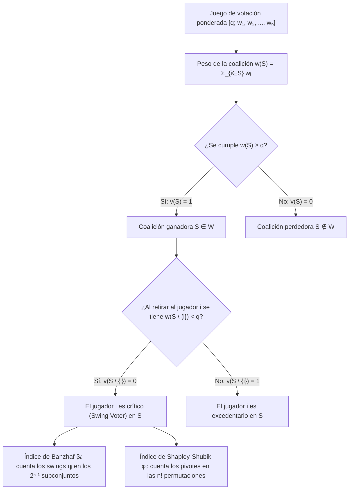
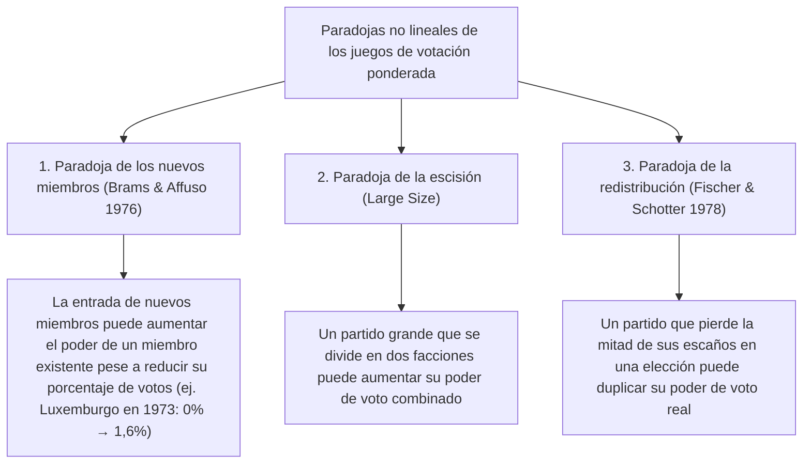

En los parlamentos democráticos, los consejos internacionales y las juntas de accionistas, suele darse por sentado un supuesto lineal tan intuitivo como falso: que <strong>la proporción de escaños de un partido —o el porcentaje de acciones de un socio— equivale directamente a su poder real de decisión (Voting Power)</strong>.

Imaginemos un parlamento de 100 escaños donde aprobar una ley exige una mayoría absoluta de $q = 51$ votos. El partido A tiene 49 escaños, el partido B tiene 49 escaños y un diminuto partido C cuenta con solo 2 escaños. A primera vista, A y B dominan el hemiciclo con un $49\%$ cada uno, mientras que C parece irrelevante con un $2\%$. Sin embargo, la <strong>teoría de juegos cooperativos (Cooperative Game Theory)</strong> demuestra un hecho sorprendente: los partidos A, B y C poseen <strong>exactamente el mismo poder de voto: un tercio ($33,33\%$) cada uno</strong>.

Por el contrario, un partido o Estado puede poseer un bloque considerable de votos y tener un <strong>poder de voto matemáticamente igual a cero ($0\%$)</strong>, convirtiéndose en lo que la teoría de juegos denomina un <strong>jugador ficticio (Dummy Player)</strong>. Entre 1958 y 1973, el Consejo de Ministros de la Comunidad Económica Europea (CEE) aplicó el sistema ponderado $[12;\, 4, 4, 4, 2, 2, 1]$. Aunque Luxemburgo tenía 1 voto ($5,88\%$ del total), todos los demás países tenían un número par de votos ($4, 4, 4, 2, 2$) y la cuota era par ($12$). Como la suma de números pares siempre es par, ninguna coalición perdedora (máximo $10$ votos) podía alcanzar $12$ gracias al voto único de Luxemburgo: durante 15 años, su poder de voto fue exactamente del $0\%$.

En este artículo desarrollamos la teoría matemática de los <strong>índices de poder de voto</strong>: la formulación axiomática de los juegos simples ponderados, el <strong>índice de Banzhaf</strong>, el <strong>índice de Shapley-Shubik</strong>, el teorema probabilístico de Straffin, los algoritmos mediante funciones generatrices, el derecho de veto en el Consejo de Seguridad de la ONU y las paradojas de redistribución.

---

## 1. La ilusión de la cuota de escaños: tres experimentos mentales

Consideremos tres parlamentos con $W = 100$ escaños y una cuota de mayoría $q = 51$:

1. <strong>El hacedor de reyes (Kingmaker) $[51;\, 49, 49, 2]$</strong>:
   Ningún partido alcanza los 51 escaños por sí solo. Las coaliciones ganadoras son $\{A, B\}(98)$, $\{A, C\}(51)$, $\{B, C\}(51)$ y $\{A, B, C\}(100)$. Como cualquier pareja de partidos gana, este juego es <strong>isomorfo</strong> a la votación mayoritaria simple $[2;\, 1, 1, 1]$. Con solo el $2\%$ de los escaños, el partido C ostenta el $33,33\%$ del poder de decisión, exactamente igual que A y B.
2. <strong>El dictador y la oposición impotente $[51;\, 52, 47, 1]$</strong>:
   Dado que $w_A = 52 \ge 51$, el partido A es un <strong>dictador</strong> ($100\%$ del poder). Aunque el partido B controla el $47\%$ de los escaños, ni siquiera uniéndose a C ($47 + 1 = 48 < 51$) puede aprobar o bloquear nada: B y C son <strong>jugadores ficticios</strong> ($0\%$ de poder).
3. <strong>El jugador ficticio invisible y el caso del condado de Nassau (1965) $[51;\, 35, 35, 25, 5]$</strong>:
   Ningún partido tiene mayoría absoluta. Pero las sumas posibles de los subconjuntos de $\{A, B, C\}$ (pesos $35, 35, 25$) son únicamente $0, 25, 35, 60, 70, 95$. ¡Ningún subconjunto suma entre $46$ y $50$ (el intervalo crítico $[q - w_D,\, q - 1]$)! Por tanto, los $5$ escaños del partido D jamás pueden transformar una derrota en victoria y su poder es del $0\%$. En 1965, el jurista <strong>John F. Banzhaf III</strong> empleó exactamente este análisis para demostrar que tres municipios de la Junta de Supervisores del condado de Nassau (Nueva York) tenían un $0\%$ de poder de voto, logrando que los tribunales declararan inconstitucional dicho sistema.

---

## 2. Formulación matemática: índices de Banzhaf y Shapley-Shubik

### Juegos simples y juegos de votación ponderada

Sea $N = \{1, 2, \dots, n\}$ el conjunto de jugadores. Un par $(N, v)$ con $v: 2^N \to \{0, 1\}$ es un <strong>juego simple</strong> si $v(\emptyset) = 0$, $v(N) = 1$ y $S \subseteq T \implies v(S) \le v(T)$ (monotonía). Un <strong>juego de votación ponderada</strong> $[q;\, w_1, w_2, \dots, w_n]$ con pesos $w_i \ge 0$ y cuota $q > \frac{1}{2}\sum w_i$ se define mediante:
$$v(S) = \begin{cases} 1 & \text{si } \sum_{i \in S} w_i \ge q \quad (\text{coalición ganadora}) \\ 0 & \text{si } \sum_{i \in S} w_i < q \quad (\text{coalición perdedora}) \end{cases}$$

Un jugador $i \in S$ es <strong>crítico (Swing Voter)</strong> en $S$ si $v(S) = 1$ y $v(S \setminus \{i\}) = 0$, es decir, $\Delta_i v(S) = v(S) - v(S \setminus \{i\}) = 1$.

### 1. El índice de poder de Banzhaf (Penrose 1946 / Banzhaf 1965)

Sea $\eta_i = \sum_{T \subseteq N \setminus \{i\}} [v(T \cup \{i\}) - v(T)]$ el número de coaliciones en las que $i$ es crítico. El <strong>índice de Banzhaf absoluto</strong> $\beta'_i$ y el <strong>índice de Banzhaf normalizado</strong> $\beta_i$ se definen como:
$$\beta'_i = \frac{\eta_i}{2^{n-1}}, \qquad \beta_i = \frac{\eta_i}{\sum_{j=1}^n \eta_j}$$

### 2. El índice de poder de Shapley-Shubik (Shapley & Shubik 1954)

Considerando las $n!$ permutaciones $\pi = (\pi_1, \dots, \pi_n)$ en las que los jugadores se incorporan uno a uno a una coalición, el único jugador cuya llegada eleva el peso acumulado hasta alcanzar o superar $q$ por primera vez se denomina <strong>pivote (Pivot)</strong>. Como existen $|S|!\,(n - |S| - 1)!$ permutaciones donde el conjunto de predecesores de $i$ es $S$, el <strong>índice de Shapley-Shubik</strong> es:
$$\phi_i = \sum_{S \subseteq N \setminus \{i\}} \frac{|S|!\,(n - |S| - 1)!}{n!} \bigl[v(S \cup \{i\}) - v(S)\bigr]$$

---

## 3. Comparación paso a paso en $[6;\, 4, 3, 2, 1]$ y funciones generatrices

En el juego $[6;\, 4, 3, 2, 1]$ ($w_A=4, w_B=3, w_C=2, w_D=1$, peso total $10$, cuota $q=6$), el análisis exhaustivo de las 7 coaliciones ganadoras y las 24 permutaciones arroja:

| Coalición ganadora $S$ | Peso $w(S)$ | Peso tras retiro $w(S \setminus \{i\})$ | Jugadores críticos (Swing) | Partido | Cuota de votos | Swings $\eta_i$ | Banzhaf normalizado $\beta_i$ | Pivotes ($/24$) | Shapley-Shubik $\phi_i$ |
| :--- | :---: | :--- | :--- | :---: | :---: | :---: | :---: | :---: | :---: |
| $\{A, B\}$ | $7$ | $-A:3,\ -B:4$ | <strong>A, B</strong> | <strong>A ($w_A=4$)</strong> | $40,0\%$ | $5$ | $5/12 \approx \mathbf{41,67\%}$ | $10$ | $10/24 \approx \mathbf{41,67\%}$ |
| $\{A, C\}$ | $6$ | $-A:2,\ -C:4$ | <strong>A, C</strong> | <strong>B ($w_B=3$)</strong> | $30,0\%$ | $3$ | $3/12 = \mathbf{25,00\%}$ | $6$ | $6/24 = \mathbf{25,00\%}$ |
| $\{A, B, C\}$ | $9$ | $-A:5,\ -B:6,\ -C:7$ | <strong>A</strong> | <strong>C ($w_C=2$)</strong> | $20,0\%$ | $3$ | $3/12 = \mathbf{25,00\%}$ | $6$ | $6/24 = \mathbf{25,00\%}$ |
| $\{A, B, D\}$ | $8$ | $-A:4,\ -B:5,\ -D:7$ | <strong>A, B</strong> | <strong>D ($w_D=1$)</strong> | $10,0\%$ | $1$ | $1/12 \approx \mathbf{8,33\%}$ | $2$ | $2/24 \approx \mathbf{8,33\%}$ |
| $\{A, C, D\}$ | $7$ | $-A:3,\ -C:5,\ -D:6$ | <strong>A, C</strong> | <strong>Total</strong> | $100\%$ | $12$ | $100,00\%$ | $24$ | $100,00\%$ |
| $\{B, C, D\}$ | $6$ | $-B:3,\ -C:4,\ -D:5$ | <strong>B, C, D</strong> | | | | | | |
| $\{A,B,C,D\}$ | $10$ | Cualquier retiro $\ge 6$ | <strong>Ninguno</strong> | | | | | | |

Aunque el partido B ($30\%$) tiene un $50\%$ más de escaños que el partido C ($20\%$), ambos poseen <strong>exactamente el mismo poder ($25,00\%$)</strong> según ambos índices. En cambio, en $[5;\, 3, 2, 1, 1]$, ambos índices difieren: $\beta = (50\%, 30\%, 10\%, 10\%)$ frente a $\phi = (58,33\%, 25,00\%, 8,33\%, 8,33\%)$. Según el <strong>teorema de Straffin (1977)</strong>, Banzhaf corresponde al <em>supuesto de independencia</em> ($p_i = 1/2$ independientes) y Shapley-Shubik al <em>supuesto de homogeneidad</em> ($p_1 = \dots = p_n = p \sim \mathrm{Uniform}(0,1)$).

Para valores grandes de $n$, las <strong>funciones generatrices</strong> permiten el cálculo exacto en tiempo pseudopolinómico $O(n^2 q)$:
$$P_{-i}(x) = \prod_{j \ne i} \left(1 + x^{w_j}\right) = \sum_{k} c_k^{(i)} x^k \implies \eta_i = \sum_{k=q-w_i}^{q-1} c_k^{(i)}$$

---

## 4. Instituciones reales y las paradojas del poder de voto

### 1. El Consejo de Ministros de la CEE (1958–1973) $[12;\, 4, 4, 4, 2, 2, 1]$

Para Luxemburgo ($w_{\text{Lux}} = 1$, cuota $q = 12$), el polinomio generatriz $P_{-\text{Lux}}(x) = (1 + x^4)^3(1 + x^2)^2$ solo tiene exponentes pares, por lo que el coeficiente de $x^{11}$ es $0$ ($\beta_{\text{Lux}} = \phi_{\text{Lux}} = 0\%$). Al ampliarse la CEE en 1973 a 9 miembros ($[41;\, 10, 10, 10, 10, 5, 5, 3, 3, 2]$), aunque la cuota de votos de Luxemburgo cayó del $5,88\%$ al $3,45\%$, su poder de Banzhaf subió del $0\%$ al $1,62\%$ (<strong>paradoja de los nuevos miembros</strong>, Brams & Affuso 1976).

### 2. El Consejo de Seguridad de la ONU (el poder de veto del P5)

El Consejo de Seguridad (5 miembros permanentes P5 con veto y 10 no permanentes NP10, mayoría de 9 votos incluyendo los 5 P5) equivale al juego ponderado $[39;\, 7, 7, 7, 7, 7, 1, 1, 1, 1, 1, 1, 1, 1, 1, 1]$.
- <strong>Índice de Banzhaf</strong>: $\eta_{\text{P5}} = \sum_{k=4}^{10} \binom{10}{k} = 848$, $\eta_{\text{NP}} = \binom{9}{3} = 84 \implies \beta_{\text{P5}} = \frac{848}{5080} \approx \mathbf{16,69\%}$ y $\beta_{\text{NP}} = \frac{84}{5080} \approx \mathbf{1,65\%}$.
- <strong>Índice de Shapley-Shubik</strong>: Un miembro no permanente solo es pivote en la 9.ª posición tras los 5 P5 y exactamente 3 de los otros 9 NP:
  $$\phi_{\text{NP}} = \binom{9}{3}\frac{8!\,6!}{15!} = \frac{84}{45045} = \frac{4}{2145} \approx \mathbf{0,1865\%}, \qquad \phi_{\text{P5}} = \frac{421}{2145} \approx \mathbf{19,627\%}$$
  ¡Los 5 miembros permanentes acaparan el $98,135\%$ del poder de Shapley-Shubik (cada P5 tiene <strong>105,25 veces</strong> el poder de un miembro no permanente)!

### 3. La paradoja de la redistribución (Fischer & Schotter 1978)

Comparecemos un parlamento de 14 escaños (cuota $q = 9$) antes y después de unas elecciones:
- <strong>Antes de la elección $[9;\, 6, 4, 2, 2]$</strong>: Las únicas coaliciones ganadoras mínimas son $\{A, B\}(10)$ y $\{A, C, D\}(10)$; A tiene poder de veto. El partido D ($2$ escaños) tiene $\beta_D = 10,00\%$ y $\phi_D = 8,33\%$.
- <strong>Después de la elección $[9;\, 5, 5, 3, 1]$</strong>: A pierde 1 escaño en favor de B, y <strong>el partido D pierde la mitad de sus escaños ($2 \to 1$) en favor de C</strong>. Sin embargo, ahora $\{B, C, D\}$ suma $5+3+1=9$ y se convierte en coalición ganadora. Roto el monopolio de veto de A, el partido D, con un solo escaño, pasa a ser el hacedor de reyes indispensable tanto para $\{A, C, D\}$ como para $\{B, C, D\}$: su poder salta a $\beta_D = \mathbf{16,67\%}$ y $\phi_D = \mathbf{16,67\%}$ — <strong>la mitad de escaños, el doble de poder</strong>.

Finalmente, en sistemas federales de dos niveles, la <strong>ley de la raíz cuadrada de Penrose (1946)</strong> demuestra que para igualar el poder indirecto de cada ciudadano independientemente de la población $P_k$ de su Estado, el índice de Banzhaf $\beta'_k$ de cada Estado debe ser proporcional a <strong>$\sqrt{P_k}$</strong>.
