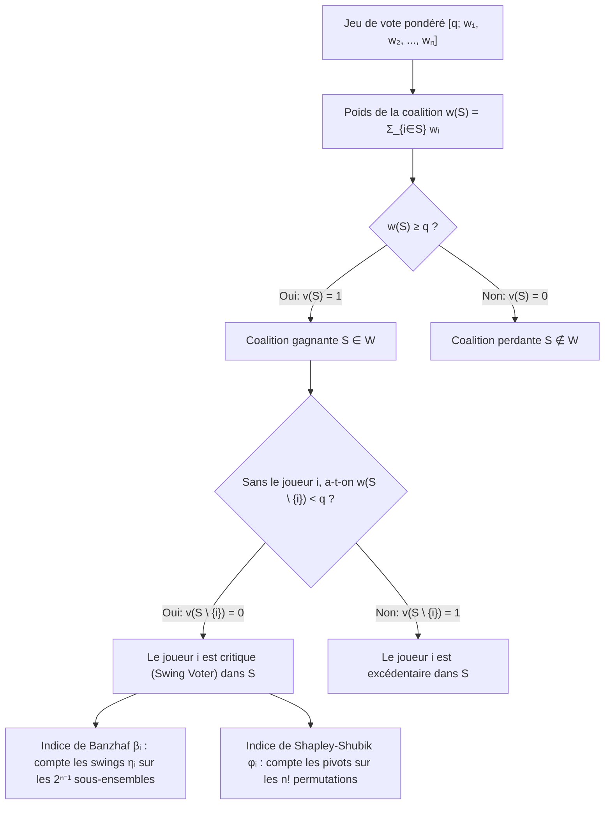
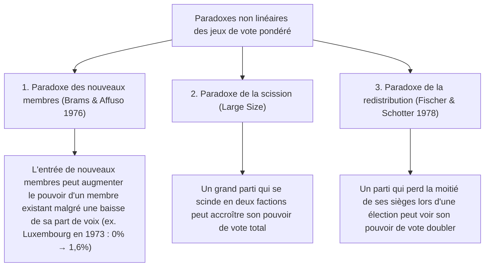

Dans les assemblées parlementaires, les conseils internationaux et les conseils d'administration d'entreprises, l'intuition commune repose sur une illusion arithmétique tenace : l'idée que <strong>la proportion de sièges d'un parti — ou la part du capital détenue par un actionnaire — est proportionnelle à son véritable pouvoir de décision (Voting Power)</strong>.

Imaginons un parlement de 100 sièges où l'adoption d'une loi requiert une majorité absolue de $q = 51$ voix. Supposons que le parti A détienne 49 sièges, le parti B 49 sièges, et qu'un minuscule parti C ne dispose que de 2 sièges. En apparence, A et B sont deux géants contrôlant chacun $49\%$ de l'hémicycle, tandis que C semble marginal avec $2\%$. Pourtant, la <strong>théorie des jeux coopératifs (Cooperative Game Theory)</strong> démontre un résultat saisissant : les partis A, B et C détiennent <strong>exactement le même pouvoir de vote — un tiers ($33,33\%$) chacun</strong>.

Inversement, un État ou un parti peut disposer d'un nombre substantiel de voix tout en ayant un <strong>pouvoir de vote mathématiquement nul ($0\%$)</strong> — ce qu'on appelle un <strong>joueur factice (Dummy Player)</strong>. Entre 1958 et 1973, le Conseil des ministres de la Communauté économique européenne (CEE) utilisait la règle de majorité qualifiée $[12;\, 4, 4, 4, 2, 2, 1]$. Bien que le Luxembourg disposât d'une voix ($5,88\%$ du total), tous les autres États avaient un nombre pair de voix ($4, 4, 4, 2, 2$) et le quota était pair ($12$). Il était donc mathématiquement impossible que la voix unique du Luxembourg fasse basculer une coalition perdante (au plus $10$ voix) au-dessus du seuil de $12$ : pendant 15 ans, son pouvoir réel fut de $0\%$.

Cet article expose la théorie mathématique des <strong>indices de pouvoir de vote</strong> : la formulation axiomatique des jeux simples pondérés, l'<strong>indice de Banzhaf</strong>, l'<strong>indice de Shapley-Shubik</strong>, le théorème probabiliste de Straffin, le calcul par fonctions génératrices, le droit de veto au Conseil de sécurité de l'ONU et les paradoxes de redistribution.

---

## 1. L'illusion de la part des sièges : trois expériences de pensée

Considérons trois parlements de $W = 100$ sièges avec un seuil de majorité $q = 51$ :

1. <strong>Le faiseur de rois (Kingmaker) $[51;\, 49, 49, 2]$</strong> :
   Aucun parti n'a la majorité seul. Les coalitions gagnantes sont $\{A, B\}(98)$, $\{A, C\}(51)$, $\{B, C\}(51)$ et $\{A, B, C\}(100)$. Toute coalition de deux partis l'emporte : ce jeu est <strong>isomorphe</strong> au vote majoritaire simple $[2;\, 1, 1, 1]$. Avec $2\%$ des sièges, le parti C détient $33,33\%$ du pouvoir, à égalité parfaite avec A et B.
2. <strong>Le dictateur et l'opposition impuissante $[51;\, 52, 47, 1]$</strong> :
   Avec $w_A = 52 \ge 51$, le parti A est un <strong>dictateur</strong> ($100\%$ du pouvoir). Bien que le parti B possède $47\%$ des sièges, même allié à C ($47 + 1 = 48 < 51$), il ne peut jamais modifier l'issue d'un scrutin : B et C sont des <strong>joueurs factices</strong> ($0\%$ de pouvoir).
3. <strong>Le joueur factice invisible et l'affaire du comté de Nassau (1965) $[51;\, 35, 35, 25, 5]$</strong> :
   Aucun parti n'a la majorité absolue. Pourtant, les sommes possibles des sous-ensembles de $\{A, B, C\}$ (poids $35, 35, 25$) sont uniquement $0, 25, 35, 60, 70, 95$. Aucune coalition ne tombe dans l'intervalle critique $[51 - 5,\, 50] = [46, 50]$ où les $5$ sièges du parti D feraient basculer le vote ! Le parti D a donc un pouvoir de $0\%$. C'est par cette démonstration que le juriste <strong>John F. Banzhaf III</strong> prouva en 1965 que trois municipalités du comté de Nassau (New York) avaient $0\%$ de pouvoir réel, entraînant l'invalidation constitutionnelle du système.

---

## 2. Formulation mathématique : indices de Banzhaf et de Shapley-Shubik

### Jeux simples et jeux de vote pondéré

Soit $N = \{1, 2, \dots, n\}$ l'ensemble des joueurs. Un couple $(N, v)$ avec $v: 2^N \to \{0, 1\}$ est un <strong>jeu simple</strong> si $v(\emptyset) = 0$, $v(N) = 1$ et $S \subseteq T \implies v(S) \le v(T)$ (monotonie). Un <strong>jeu de vote pondéré</strong> $[q;\, w_1, w_2, \dots, w_n]$ de poids $w_i \ge 0$ et de quota $q > \frac{1}{2}\sum w_i$ est défini par :
$$v(S) = \begin{cases} 1 & \text{si } \sum_{i \in S} w_i \ge q \quad (\text{coalition gagnante}) \\ 0 & \text{si } \sum_{i \in S} w_i < q \quad (\text{coalition perdante}) \end{cases}$$

Un joueur $i \in S$ est dit <strong>critique (Swing Voter)</strong> dans $S$ si $v(S) = 1$ et $v(S \setminus \{i\}) = 0$, soit $\Delta_i v(S) = v(S) - v(S \setminus \{i\}) = 1$.

### 1. L'indice de pouvoir de Banzhaf (Penrose 1946 / Banzhaf 1965)

En notant $\eta_i = \sum_{T \subseteq N \setminus \{i\}} [v(T \cup \{i\}) - v(T)]$ le nombre de coalitions où $i$ est critique, l'<strong>indice de Banzhaf brut</strong> $\beta'_i$ et l'<strong>indice de Banzhaf normalisé</strong> $\beta_i$ sont définis par :
$$\beta'_i = \frac{\eta_i}{2^{n-1}}, \qquad \beta_i = \frac{\eta_i}{\sum_{j=1}^n \eta_j}$$

### 2. L'indice de pouvoir de Shapley-Shubik (Shapley & Shubik 1954)

En considérant les $n!$ ordres (permutations) $\pi = (\pi_1, \dots, \pi_n)$ selon lesquels les joueurs rejoignent successivement une coalition, le joueur unique dont l'arrivée fait franchir le quota $q$ au cumul des voix est appelé le <strong>pivot</strong>. Comme il existe $|S|!\,(n - |S| - 1)!$ permutations où l'ensemble des prédécesseurs de $i$ est $S$, l'<strong>indice de Shapley-Shubik</strong> s'écrit :
$$\phi_i = \sum_{S \subseteq N \setminus \{i\}} \frac{|S|!\,(n - |S| - 1)!}{n!} \bigl[v(S \cup \{i\}) - v(S)\bigr]$$

---

## 3. Calcul complet sur $[6;\, 4, 3, 2, 1]$ et fonctions génératrices

Pour le jeu $[6;\, 4, 3, 2, 1]$ ($w_A=4, w_B=3, w_C=2, w_D=1$, total $10$, quota $q=6$), le dénombrement des 7 coalitions gagnantes (sur 16) et des 24 permutations donne :

| Coalition gagnante $S$ | Poids $w(S)$ | Poids après retrait $w(S \setminus \{i\})$ | Joueurs critiques (Swing) | Parti | Part de voix | Swings $\eta_i$ | Banzhaf normalisé $\beta_i$ | Pivots ($/24$) | Shapley-Shubik $\phi_i$ |
| :--- | :---: | :--- | :--- | :---: | :---: | :---: | :---: | :---: | :---: |
| $\{A, B\}$ | $7$ | $-A:3,\ -B:4$ | <strong>A, B</strong> | <strong>A ($w_A=4$)</strong> | $40,0\%$ | $5$ | $5/12 \approx \mathbf{41,67\%}$ | $10$ | $10/24 \approx \mathbf{41,67\%}$ |
| $\{A, C\}$ | $6$ | $-A:2,\ -C:4$ | <strong>A, C</strong> | <strong>B ($w_B=3$)</strong> | $30,0\%$ | $3$ | $3/12 = \mathbf{25,00\%}$ | $6$ | $6/24 = \mathbf{25,00\%}$ |
| $\{A, B, C\}$ | $9$ | $-A:5,\ -B:6,\ -C:7$ | <strong>A</strong> | <strong>C ($w_C=2$)</strong> | $20,0\%$ | $3$ | $3/12 = \mathbf{25,00\%}$ | $6$ | $6/24 = \mathbf{25,00\%}$ |
| $\{A, B, D\}$ | $8$ | $-A:4,\ -B:5,\ -D:7$ | <strong>A, B</strong> | <strong>D ($w_D=1$)</strong> | $10,0\%$ | $1$ | $1/12 \approx \mathbf{8,33\%}$ | $2$ | $2/24 \approx \mathbf{8,33\%}$ |
| $\{A, C, D\}$ | $7$ | $-A:3,\ -C:5,\ -D:6$ | <strong>A, C</strong> | <strong>Total</strong> | $100\%$ | $12$ | $100,00\%$ | $24$ | $100,00\%$ |
| $\{B, C, D\}$ | $6$ | $-B:3,\ -C:4,\ -D:5$ | <strong>B, C, D</strong> | | | | | | |
| $\{A,B,C,D\}$ | $10$ | Tout retrait $\ge 6$ | <strong>Aucun</strong> | | | | | | |

Bien que le parti B ($30\%$) ait $1,5$ fois plus de sièges que le parti C ($20\%$), tous deux ont <strong>exactement le même pouvoir ($25,00\%$)</strong> ! En revanche, dans $[5;\, 3, 2, 1, 1]$, les deux indices divergent : $\beta = (50\%, 30\%, 10\%, 10\%)$ contre $\phi = (58,33\%, 25,00\%, 8,33\%, 8,33\%)$. D'après le <strong>théorème de Straffin (1977)</strong>, l'indice de Banzhaf découle de l'<em>hypothèse d'indépendance</em> ($p_i = 1/2$ indépendants), tandis que celui de Shapley-Shubik découle de l'<em>hypothèse d'homogénéité</em> ($p_1 = \dots = p_n = p \sim \mathrm{Uniform}(0,1)$).

Pour $n$ grand, les <strong>fonctions génératrices</strong> permettent un calcul exact par programmation dynamique en temps pseudo-polynomial $O(n^2 q)$ :
$$P_{-i}(x) = \prod_{j \ne i} \left(1 + x^{w_j}\right) = \sum_{k} c_k^{(i)} x^k \implies \eta_i = \sum_{k=q-w_i}^{q-1} c_k^{(i)}$$

---

## 4. Institutions internationales et paradoxes du pouvoir de vote

### 1. Le Conseil des ministres de la CEE (1958–1973) $[12;\, 4, 4, 4, 2, 2, 1]$

Pour le Luxembourg ($w_{\text{Lux}} = 1$, quota $q = 12$), la fonction génératrice $P_{-\text{Lux}}(x) = (1 + x^4)^3(1 + x^2)^2$ ne contient que des puissances paires de $x$, donc le coefficient de $x^{11}$ est nul ($\beta_{\text{Lux}} = \phi_{\text{Lux}} = 0\%$). Lors de l'élargissement de 1973 à 9 États ($[41;\, 10, 10, 10, 10, 5, 5, 3, 3, 2]$), bien que la part des voix du Luxembourg ait baissé de $5,88\%$ à $3,45\%$, son pouvoir de Banzhaf est passé de $0\%$ à $1,62\%$ (<strong>paradoxe des nouveaux membres</strong>, Brams & Affuso 1976).

### 2. Le Conseil de sécurité de l'ONU (droit de veto des P5)

Le Conseil de sécurité (5 membres permanents P5 avec droit de veto et 10 membres non permanents NP10, majorité de 9 voix incluant les 5 P5) équivaut au jeu pondéré $[39;\, 7, 7, 7, 7, 7, 1, 1, 1, 1, 1, 1, 1, 1, 1, 1]$.
- <strong>Indice de Banzhaf</strong> : $\eta_{\text{P5}} = \sum_{k=4}^{10} \binom{10}{k} = 848$, $\eta_{\text{NP}} = \binom{9}{3} = 84 \implies \beta_{\text{P5}} = \frac{848}{5080} \approx \mathbf{16,69\%}$ et $\beta_{\text{NP}} = \frac{84}{5080} \approx \mathbf{1,65\%}$.
- <strong>Indice de Shapley-Shubik</strong> : Un membre non permanent n'est pivot qu'en $9^{\text{e}}$ position derrière les 5 P5 et exactement 3 des 9 autres NP :
  $$\phi_{\text{NP}} = \binom{9}{3}\frac{8!\,6!}{15!} = \frac{84}{45045} = \frac{4}{2145} \approx \mathbf{0,1865\%}, \qquad \phi_{\text{P5}} = \frac{421}{2145} \approx \mathbf{19,627\%}$$
  Les cinq membres permanents concentrent $98,135\%$ du pouvoir de Shapley-Shubik (chacun ayant <strong>105,25 fois</strong> le pouvoir d'un membre élu).

### 3. Le paradoxe de la redistribution (Fischer & Schotter 1978)

Comparons un parlement de 14 sièges (quota $q = 9$) avant et après une élection :
- <strong>Avant l'élection $[9;\, 6, 4, 2, 2]$</strong> : Les seules coalitions gagnantes minimales sont $\{A, B\}(10)$ et $\{A, C, D\}(10)$ ; A détient un droit de veto. Le parti D ($2$ sièges) a $\beta_D = 10,00\%$ et $\phi_D = 8,33\%$.
- <strong>Après l'élection $[9;\, 5, 5, 3, 1]$</strong> : A cède 1 siège à B, et <strong>le parti D perd la moitié de ses sièges ($2 \to 1$) au profit de C</strong>. Or, la coalition $\{B, C, D\}$ atteint désormais $5+3+1=9$ sièges et devient gagnante ! Le monopole de veto de A est brisé et le parti D, avec un seul siège, devient le faiseur de rois indispensable à la fois pour $\{A, C, D\}$ et $\{B, C, D\}$ : son pouvoir bondit à $\beta_D = \mathbf{16,67\%}$ et $\phi_D = \mathbf{16,67\%}$ — <strong>deux fois moins de sièges, deux fois plus de pouvoir</strong> !

Enfin, dans un système fédéral à deux niveaux, la <strong>loi de la racine carrée de Penrose (1946)</strong> établit que pour garantir à chaque citoyen une influence indirecte égale quelle que soit la population $P_k$ de son État, l'indice de Banzhaf $\beta'_k$ de chaque État au conseil fédéral doit être proportionnel à <strong>$\sqrt{P_k}$</strong>.
