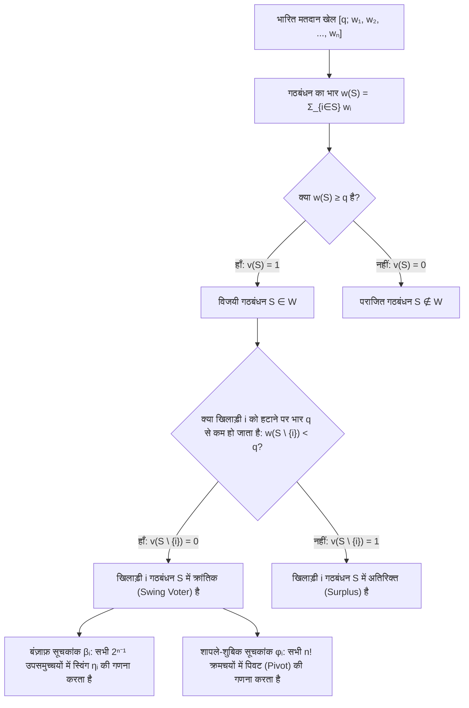
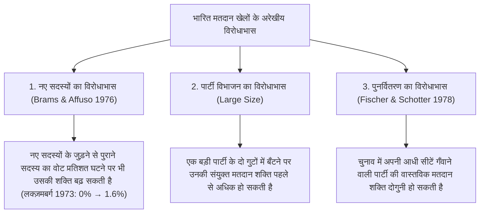

लोकतांत्रिक संसदों, अंतर्राष्ट्रीय परिषदों और कॉर्पोरेट निदेशक मंडलों में अक्सर एक सहज किंतु भ्रामक अंकगणितीय धारणा मान ली जाती है: यह कि <strong>किसी पार्टी के पास मौजूद सीटों का प्रतिशत — या किसी शेयरधारक के पास मौजूद वोटिंग शेयरों का अनुपात — उसकी वास्तविक निर्णय लेने की शक्ति (Voting Power) के सीधे समानुपाती होता है</strong>।

कल्पना कीजिए कि 100 सीटों वाली एक संसद में किसी विधेयक को पारित करने के लिए $q = 51$ मतों के साधारण बहुमत की आवश्यकता है। मान लीजिए पार्टी A के पास 49 सीटें हैं, पार्टी B के पास 49 सीटें हैं, और एक अत्यंत छोटी तीसरी पार्टी C के पास केवल 2 सीटें हैं। टेलीविज़न के ग्राफ़िक्स में पार्टी A और B $49\%$ हिस्सेदारी वाले विशालकाय दिग्गज दिखते हैं, जबकि $2\%$ वाली पार्टी C नगण्य प्रतीत होती है। किंतु जब हम इस संसद का विश्लेषण <strong>सहकारी खेल सिद्धांत (Cooperative Game Theory)</strong> के कठोर गणित से करते हैं, तो एक चौंकाने वाला सत्य सामने आता है: पार्टी A, पार्टी B और पार्टी C तीनों के पास <strong>बिल्कुल समान मतदान शक्ति है — प्रत्येक के पास एक-तिहाई ($33.33\%$)</strong>!

इसके विपरीत, किसी राजनीतिक दल या संप्रभु राष्ट्र के पास मतों का एक बड़ा हिस्सा होने के बावजूद उसकी <strong>गणितीय मतदान शक्ति पूर्णतः शून्य ($0\%$)</strong> हो सकती है — जिसे खेल सिद्धांत में <strong>डमी खिलाड़ी (Dummy Player)</strong> कहा जाता है। 1958 से 1973 तक यूरोपीय आर्थिक समुदाय (EEC) की मंत्रिपरिषद ने भारित मतदान प्रणाली $[12;\, 4, 4, 4, 2, 2, 1]$ का उपयोग किया। यद्यपि लक्ज़मबर्ग के पास 1 वोट ($5.88\%$) था, अन्य सभी पाँच देशों के वोट सम संख्या ($4, 4, 4, 2, 2$) में थे और बहुमत का कोटा भी सम ($12$) था। चूँकि सम संख्याओं का योग सदैव सम होता है, इसलिए किसी भी गठबंधन का योग $11$ हो ही नहीं सकता था जिसे लक्ज़मबर्ग का 1 वोट $12$ में बदल सके: पूरे 15 वर्षों तक लक्ज़मबर्ग की वास्तविक मतदान शक्ति ठीक $0\%$ रही।

इस लेख में हम <strong>मतदान शक्ति सूचकांकों (Voting Power Indices)</strong> के संपूर्ण गणितीय सिद्धांत का निर्माण करेंगे: भारित मतदान खेलों का स्वयंसिद्ध सूत्रीकरण, <strong>बंज़ाफ़ शक्ति सूचकांक (Banzhaf Index)</strong>, <strong>शापले-शुबिक शक्ति सूचकांक (Shapley-Shubik Index)</strong>, स्ट्रैफ़िन का प्रायिकता प्रमेय, जनक फलन (Generating Functions) एल्गोरिदम, संयुक्त राष्ट्र सुरक्षा परिषद का वीटो ढाँचा और पुनर्वितरण के विरोधाभास।

---

## 1. सीट अनुपात का भ्रम: तीन विचार प्रयोग

आइए कुल $W = 100$ सीटों और बहुमत कोटा $q = 51$ वाली तीन संसदों पर विचार करें:

1. <strong>किंगमेकर (Kingmaker) $[51;\, 49, 49, 2]$</strong>:
   कोई भी दल अकेले 51 सीटों तक नहीं पहुँच सकता। विजयी गठबंधन $\{A, B\}(98)$, $\{A, C\}(51)$, $\{B, C\}(51)$ और $\{A, B, C\}(100)$ हैं। चूँकि किन्हीं भी दो दलों का गठबंधन जीत जाता है, यह खेल एक-व्यक्ति-एक-वोट वाली समिति $[2;\, 1, 1, 1]$ के पूर्णतः <strong>तुल्यकारी (Isomorphic)</strong> है। मात्र $2\%$ सीटों के साथ पार्टी C के पास A और B के बराबर $33.33\%$ निर्णय शक्ति है।
2. <strong>तानाशाह और शक्तिहीन विपक्ष $[51;\, 52, 47, 1]$</strong>:
   चूँकि $w_A = 52 \ge 51$, पार्टी A एक <strong>तानाशाह (Dictator)</strong> है जिसके पास $100\%$ शक्ति है। यद्यपि पार्टी B के पास सदन की $47\%$ सीटें हैं, फिर भी वह C के साथ मिलकर भी ($47 + 1 = 48 < 51$) किसी कानून को पारित या अवरुद्ध नहीं कर सकती: B और C <strong>डमी खिलाड़ी</strong> ($0\%$ शक्ति) हैं।
3. <strong>अदृश्य डमी खिलाड़ी और नासाउ काउंटी मामला (1965) $[51;\, 35, 35, 25, 5]$</strong>:
   यहाँ किसी भी दल के पास स्पष्ट बहुमत नहीं है। किंतु अन्य तीन दलों $\{A, B, C\}$ (भार $35, 35, 25$) के सभी उपसमुच्चयों के संभावित योग केवल $0, 25, 35, 60, 70, 95$ हैं। कोई भी उपसमुच्चय क्रांतिक अंतराल $[q - w_D,\, q - 1] = [46, 50]$ के बीच योग नहीं देता! फलस्वरूप पार्टी D की $5$ सीटें कभी भी हार को जीत में नहीं बदल सकतीं और उसकी शक्ति $0\%$ है। 1965 में युवा विधि छात्र <strong>जॉन एफ़. बंज़ाफ़ (John F. Banzhaf III)</strong> ने इसी गणित से सिद्ध किया कि न्यूयॉर्क के नासाउ काउंटी बोर्ड में तीन नगरों की मतदान शक्ति $0\%$ थी।

---

## 2. गणितीय सूत्रीकरण: बंज़ाफ़ और शापले-शुबिक सूचकांक

### सरल खेल और भारित मतदान खेल

मान लीजिए $N = \{1, 2, \dots, n\}$ खिलाड़ियों का समुच्चय है। युग्म $(N, v)$, जहाँ $v: 2^N \to \{0, 1\}$, एक <strong>सरल खेल (Simple Game)</strong> कहलाता है यदि $v(\emptyset) = 0$, $v(N) = 1$ और $S \subseteq T \implies v(S) \le v(T)$ (एकदिष्टता)। भार $w_i \ge 0$ और कोटा $q > \frac{1}{2}\sum w_i$ वाला <strong>भारित मतदान खेल</strong> $[q;\, w_1, w_2, \dots, w_n]$ इस प्रकार परिभाषित होता है:
$$v(S) = \begin{cases} 1 & \text{यदि } \sum_{i \in S} w_i \ge q \quad (\text{विजयी गठबंधन}) \\ 0 & \text{यदि } \sum_{i \in S} w_i < q \quad (\text{पराजित गठबंधन}) \end{cases}$$

किसी गठबंधन $S$ में खिलाड़ी $i \in S$ को <strong>क्रांतिक या निर्णायक मतदाता (Critical / Swing Voter)</strong> कहा जाता है यदि $v(S) = 1$ किंतु $v(S \setminus \{i\}) = 0$, अर्थात् $\Delta_i v(S) = v(S) - v(S \setminus \{i\}) = 1$।

### 1. बंज़ाफ़ शक्ति सूचकांक (Penrose 1946 / Banzhaf 1965)

यदि $\eta_i = \sum_{T \subseteq N \setminus \{i\}} [v(T \cup \{i\}) - v(T)]$ उन गठबंधनों की संख्या है जिनमें खिलाड़ी $i$ क्रांतिक है, तो <strong>निरपेक्ष बंज़ाफ़ सूचकांक</strong> $\beta'_i$ और <strong>प्रसामान्यीकृत बंज़ाफ़ सूचकांक</strong> $\beta_i$ इस प्रकार हैं:
$$\beta'_i = \frac{\eta_i}{2^{n-1}}, \qquad \beta_i = \frac{\eta_i}{\sum_{j=1}^n \eta_j}$$

### 2. शापले-शुबिक शक्ति सूचकांक (Shapley & Shubik 1954)

सभी $n!$ क्रमचयों (permutations) $\pi = (\pi_1, \dots, \pi_n)$ पर विचार करें जिनमें खिलाड़ी एक-एक करके गठबंधन में शामिल होते हैं। वह एकमात्र खिलाड़ी जिसके जुड़ने से संचयी भार पहली बार कोटा $q$ तक पहुँचता या उससे अधिक होता है, <strong>धुरी खिलाड़ी (Pivot)</strong> कहलाता है। चूँकि ऐसे $|S|!\,(n - |S| - 1)!$ क्रमचय होते हैं जिनमें $i$ से पहले आने वाले खिलाड़ियों का समुच्चय $S$ है, इसलिए <strong>शापले-शुबिक सूचकांक</strong> है:
$$\phi_i = \sum_{S \subseteq N \setminus \{i\}} \frac{|S|!\,(n - |S| - 1)!}{n!} \bigl[v(S \cup \{i\}) - v(S)\bigr]$$

---

## 3. $[6;\, 4, 3, 2, 1]$ में चरण-दर-चरण तुलना और जनक फलन

खेल $[6;\, 4, 3, 2, 1]$ ($w_A=4, w_B=3, w_C=2, w_D=1$, कुल भार $10$, कोटा $q=6$) में सभी 7 विजयी गठबंधनों और 24 क्रमचयों की गणना से निम्नलिखित परिणाम मिलते हैं:

| विजयी गठबंधन $S$ | भार $w(S)$ | सदस्य हटाने पर भार $w(S \setminus \{i\})$ | क्रांतिक खिलाड़ी (Swing) | दल | वोट अनुपात | स्विंग $\eta_i$ | प्रसामान्यीकृत बंज़ाफ़ $\beta_i$ | पिवट ($/24$) | शापले-शुबिक $\phi_i$ |
| :--- | :---: | :--- | :--- | :---: | :---: | :---: | :---: | :---: | :---: |
| $\{A, B\}$ | $7$ | $-A:3,\ -B:4$ | <strong>A, B</strong> | <strong>A ($w_A=4$)</strong> | $40.0\%$ | $5$ | $5/12 \approx \mathbf{41.67\%}$ | $10$ | $10/24 \approx \mathbf{41.67\%}$ |
| $\{A, C\}$ | $6$ | $-A:2,\ -C:4$ | <strong>A, C</strong> | <strong>B ($w_B=3$)</strong> | $30.0\%$ | $3$ | $3/12 = \mathbf{25.00\%}$ | $6$ | $6/24 = \mathbf{25.00\%}$ |
| $\{A, B, C\}$ | $9$ | $-A:5,\ -B:6,\ -C:7$ | <strong>A</strong> | <strong>C ($w_C=2$)</strong> | $20.0\%$ | $3$ | $3/12 = \mathbf{25.00\%}$ | $6$ | $6/24 = \mathbf{25.00\%}$ |
| $\{A, B, D\}$ | $8$ | $-A:4,\ -B:5,\ -D:7$ | <strong>A, B</strong> | <strong>D ($w_D=1$)</strong> | $10.0\%$ | $1$ | $1/12 \approx \mathbf{8.33\%}$ | $2$ | $2/24 \approx \mathbf{8.33\%}$ |
| $\{A, C, D\}$ | $7$ | $-A:3,\ -C:5,\ -D:6$ | <strong>A, C</strong> | <strong>कुल</strong> | $100\%$ | $12$ | $100.00\%$ | $24$ | $100.00\%$ |
| $\{B, C, D\}$ | $6$ | $-B:3,\ -C:4,\ -D:5$ | <strong>B, C, D</strong> | | | | | | |
| $\{A,B,C,D\}$ | $10$ | किसी को हटाने पर $\ge 6$ | <strong>कोई नहीं</strong> | | | | | | |

यद्यपि पार्टी B ($30\%$) के पास पार्टी C ($20\%$) की तुलना में डेढ़ गुना सीटें हैं, फिर भी दोनों सूचकांकों के अनुसार B और C की <strong>मतदान शक्ति बिल्कुल बराबर ($25.00\%$)</strong> है! इसके विपरीत, $[5;\, 3, 2, 1, 1]$ में दोनों सूचकांक भिन्न परिणाम देते हैं: $\beta = (50\%, 30\%, 10\%, 10\%)$ बनाम $\phi = (58.33\%, 25.00\%, 8.33\%, 8.33\%)$। <strong>स्ट्रैफ़िन के प्रमेय (1977)</strong> के अनुसार बंज़ाफ़ सूचकांक <em>स्वतंत्रता की मान्यता</em> और शापले-शुबिक सूचकांक <em>समरूपता की मान्यता</em> ($p_1 = \dots = p_n = p \sim \mathrm{Uniform}(0,1)$) के संगत है।

बड़े $n$ के लिए <strong>जनक फलन (Generating Functions)</strong> डायनामिक प्रोग्रामिंग द्वारा $O(n^2 q)$ छद्म-बहुपद समय में सटीक गणना संभव बनाते हैं:
$$P_{-i}(x) = \prod_{j \ne i} \left(1 + x^{w_j}\right) = \sum_{k} c_k^{(i)} x^k \implies \eta_i = \sum_{k=q-w_i}^{q-1} c_k^{(i)}$$

---

## 4. वास्तविक संस्थाएं और मतदान शक्ति के विरोधाभास

### 1. EEC मंत्रिपरिषद (1958–1973) $[12;\, 4, 4, 4, 2, 2, 1]$

लक्ज़मबर्ग ($w_{\text{Lux}} = 1$, कोटा $q = 12$) के लिए जनक बहुपद $P_{-\text{Lux}}(x) = (1 + x^4)^3(1 + x^2)^2$ में केवल सम घातें आती हैं, इसलिए $x^{11}$ का गुणांक $0$ है ($\beta_{\text{Lux}} = \phi_{\text{Lux}} = 0\%$)। किंतु 1973 में जब EEC का विस्तार 9 देशों तक हुआ ($[41;\, 10, 10, 10, 10, 5, 5, 3, 3, 2]$), तो लक्ज़मबर्ग का वोट हिस्सा $5.88\%$ से घटकर $3.45\%$ होने के बावजूद उसकी बंज़ाफ़ शक्ति $0\%$ से बढ़कर $1.62\%$ हो गई (<strong>नए सदस्यों का विरोधाभास</strong>, Brams & Affuso 1976)।

### 2. संयुक्त राष्ट्र सुरक्षा परिषद (P5 का वीटो अधिकार)

संयुक्त राष्ट्र सुरक्षा परिषद (वीटो सहित 5 स्थायी सदस्य P5 और 10 अस्थायी सदस्य NP10, पारित होने के लिए सभी 5 P5 सहित कुल 9 मत) भारित खेल $[39;\, 7, 7, 7, 7, 7, 1, 1, 1, 1, 1, 1, 1, 1, 1, 1]$ के तुल्य है।
- <strong>बंज़ाफ़ सूचकांक</strong>: $\eta_{\text{P5}} = \sum_{k=4}^{10} \binom{10}{k} = 848$, $\eta_{\text{NP}} = \binom{9}{3} = 84 \implies \beta_{\text{P5}} = \frac{848}{5080} \approx \mathbf{16.69\%}$ और $\beta_{\text{NP}} = \frac{84}{5080} \approx \mathbf{1.65\%}$।
- <strong>शापले-शुबिक सूचकांक</strong>: एक अस्थायी सदस्य केवल 9वें स्थान पर ही पिवट बन सकता है जब उससे पहले सभी 5 P5 और ठीक 3 अन्य NP सदस्य हों:
  $$\phi_{\text{NP}} = \binom{9}{3}\frac{8!\,6!}{15!} = \frac{84}{45045} = \frac{4}{2145} \approx \mathbf{0.1865\%}, \qquad \phi_{\text{P5}} = \frac{421}{2145} \approx \mathbf{19.627\%}$$
  पाँच स्थायी सदस्यों के पास कुल शापले-शुबिक शक्ति का $98.135\%$ हिस्सा है (प्रत्येक P5 सदस्य की शक्ति एक अस्थायी सदस्य से <strong>105.25 गुना</strong> अधिक है)!

### 3. पुनर्वितरण का विरोधाभास (Fischer & Schotter 1978)

14 सीटों वाली संसद (कोटा $q = 9$) की चुनाव से पहले और बाद की स्थिति की तुलना करें:
- <strong>चुनाव से पहले $[9;\, 6, 4, 2, 2]$</strong>: न्यूनतम विजयी गठबंधन केवल $\{A, B\}(10)$ और $\{A, C, D\}(10)$ हैं; पार्टी A के पास वीटो शक्ति है। पार्टी D ($2$ सीटें) की शक्ति $\beta_D = 10.00\%$ और $\phi_D = 8.33\%$ है।
- <strong>चुनाव के बाद $[9;\, 5, 5, 3, 1]$</strong>: A अपनी 1 सीट B को गँवा देता है, और <strong>पार्टी D अपनी आधी सीटें ($2 \to 1$) C को गँवा देती है</strong>। परंतु अब $\{B, C, D\}$ का योग $5+3+1=9$ हो जाता है और यह एक नया विजयी गठबंधन बन जाता है! पार्टी A का वीटो एकाधिकार टूटने से 1 सीट वाली पार्टी D अब दो गठबंधनों ($\{A, C, D\}$ और $\{B, C, D\}$) के लिए अनिवार्य किंगमेकर बन जाती है: उसकी शक्ति उछलकर $\beta_D = \mathbf{16.67\%}$ और $\phi_D = \mathbf{16.67\%}$ हो जाती है — <strong>सीटें आधी, किंतु शक्ति दोगुनी</strong>!

अंत में, द्वि-स्तरीय संघीय प्रणालियों के लिए <strong>पेनरोज़ का वर्गमूल नियम (Penrose Square Root Law, 1946)</strong> सिद्ध करता है कि प्रत्येक नागरिक को उसके राज्य की जनसंख्या $P_k$ से स्वतंत्र समान अप्रत्यक्ष प्रभाव देने के लिए प्रत्येक राज्य का बंज़ाफ़ सूचकांक $\beta'_k$ उसकी जनसंख्या के वर्गमूल <strong>$\sqrt{P_k}$</strong> के समानुपाती होना चाहिए।
