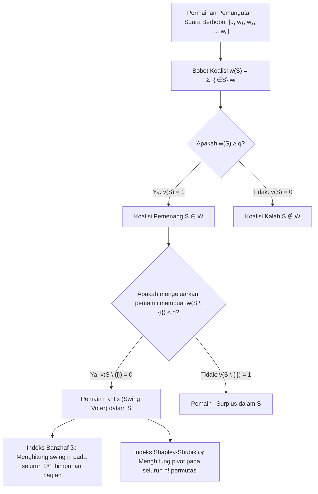
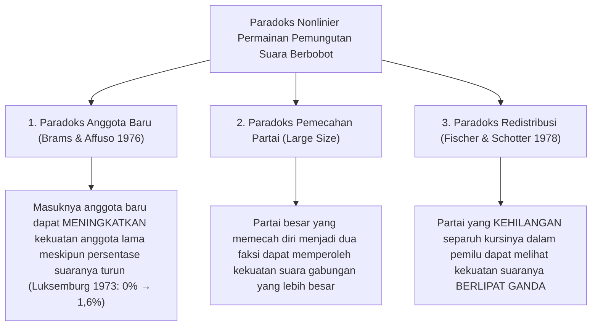

Di parlemen demokratis, dewan internasional, maupun rapat umum pemegang saham, para pengamat sering terjebak dalam ilusi aritmetika yang tampak masuk akal namun keliru: anggapan bahwa <strong>persentase kursi sebuah partai — atau persentase saham seorang investor — berbanding lurus dengan kekuatan pengambilan keputusan yang sebenarnya (Voting Power)</strong>.

Bayangkan sebuah parlemen dengan 100 kursi di mana pengesahan undang-undang memerlukan mayoritas sederhana $q = 51$ suara. Partai A memegang 49 kursi, Partai B memegang 49 kursi, dan Partai C yang sangat kecil hanya memegang 2 kursi. Di layar televisi, Partai A dan B tampak seperti raksasa yang masing-masing menguasai $49\%$ parlemen, sedangkan Partai C tampak remeh dengan $2\%$ kursi. Namun ketika kita menganalisis parlemen ini menggunakan <strong>teori permainan kooperatif (Cooperative Game Theory)</strong>, muncul kebenaran yang mengejutkan: Partai A, Partai B, dan Partai C memiliki <strong>kekuatan suara yang persis sama — masing-masing sepertiga ($33,33\%$)</strong>.

Sebaliknya, sebuah partai politik atau negara berdaulat dapat memiliki sejumlah suara tetapi memegang <strong>kekuatan suara matematis tepat nol ($0\%$)</strong> — fenomena yang dalam teori permainan disebut <strong>pemain boneka / semu (Dummy Player)</strong>. Antara tahun 1958 hingga 1973, Dewan Menteri Masyarakat Ekonomi Eropa (MEE / EEC) menerapkan sistem suara berbobot $[12;\, 4, 4, 4, 2, 2, 1]$. Meskipun Luksemburg memiliki 1 suara ($5,88\%$ dari total 17 suara), lima negara lainnya seluruhnya memiliki jumlah suara genap ($4, 4, 4, 2, 2$) dan kuota kelulusannya genap ($12$). Karena penjumlahan bilangan genap selalu menghasilkan bilangan genap, tidak mungkin ada koalisi yang mengumpulkan $11$ suara untuk diubah menjadi $12$ oleh Luksemburg: selama 15 tahun, kekuatan suara Luksemburg secara matematis adalah $0\%$.

Dalam artikel ini kita membangun teori matematika <strong>indeks kekuatan suara (Voting Power Indices)</strong>: formulasi aksiomatik permainan pemungutan suara berbobot, <strong>indeks Banzhaf</strong>, <strong>indeks Shapley-Shubik</strong>, teorema probabilistik Straffin, algoritma fungsi pembangkit, hak veto Dewan Keamanan PBB, serta paradoks redistribusi kursi.

---

## 1. Ilusi Pangsa Kursi: Tiga Eksperimen Pikiran

Mari kita tinjau tiga parlemen dengan total $W = 100$ kursi dan kuota mayoritas $q = 51$:

1. <strong>Sang Penentu Raja (Kingmaker) $[51;\, 49, 49, 2]$</strong>:
   Tidak ada satu partai pun yang mencapai 51 kursi sendirian. Koalisi pemenang adalah $\{A, B\}(98)$, $\{A, C\}(51)$, $\{B, C\}(51)$, dan $\{A, B, C\}(100)$. Karena setiap pasangan dua partai pasti menang, permainan ini <strong>isomorfik</strong> dengan pemungutan suara satu-orang-satu-suara $[2;\, 1, 1, 1]$. Hanya dengan $2\%$ kursi, Partai C menggenggam $33,33\%$ kekuatan suara, setara dengan A dan B.
2. <strong>Sang Diktator dan Oposisi Tanpa Daya $[51;\, 52, 47, 1]$</strong>:
   Karena $w_A = 52 \ge 51$, Partai A adalah <strong>diktator</strong> ($100\%$ kekuatan). Walaupun Partai B menguasai $47\%$ kursi, bahkan jika bergabung dengan C ($47 + 1 = 48 < 51$) ia tidak pernah bisa meloloskan atau memblokir RUU apa pun: B dan C adalah <strong>pemain semu (Dummy Players)</strong> dengan kekuatan $0\%$.
3. <strong>Pemain Semu Tak Kasatmata dan Kasus Nassau County (1965) $[51;\, 35, 35, 25, 5]$</strong>:
   Tidak ada partai yang memegang mayoritas mutlak. Akan tetapi, jumlah kursi dari seluruh himpunan bagian $\{A, B, C\}$ (bobot $35, 35, 25$) hanyalah $0, 25, 35, 60, 70, 95$. Tidak ada satu pun koalisi yang berjumlah di dalam interval kritis $[q - w_D,\, q - 1] = [46, 50]$! Akibatnya, $5$ kursi milik Partai D tidak pernah bisa mengubah kekalahan menjadi kemenangan ($0\%$ kekuatan). Pada tahun 1965, <strong>John F. Banzhaf III</strong> menggunakan analisis ini untuk membuktikan bahwa tiga kota di Dewan Pengawas Nassau County (New York) memiliki kekuatan suara $0\%$.

---

## 2. Formulasi Matematika: Indeks Banzhaf dan Shapley-Shubik

### Permainan Sederhana dan Pemungutan Suara Berbobot

Misalkan $N = \{1, 2, \dots, n\}$ adalah himpunan pemain. Pasangan $(N, v)$ dengan $v: 2^N \to \{0, 1\}$ disebut <strong>permainan sederhana (Simple Game)</strong> jika $v(\emptyset) = 0$, $v(N) = 1$, dan $S \subseteq T \implies v(S) \le v(T)$ (monotonisitas). <strong>Permainan pemungutan suara berbobot</strong> $[q;\, w_1, w_2, \dots, w_n]$ dengan bobot $w_i \ge 0$ dan kuota $q > \frac{1}{2}\sum w_i$ didefinisikan oleh:
$$v(S) = \begin{cases} 1 & \text{jika } \sum_{i \in S} w_i \ge q \quad (\text{koalisi pemenang}) \\ 0 & \text{jika } \sum_{i \in S} w_i < q \quad (\text{koalisi kalah}) \end{cases}$$

Seorang pemain $i \in S$ disebut <strong>kritis (Swing Voter)</strong> dalam koalisi $S$ jika $v(S) = 1$ dan $v(S \setminus \{i\}) = 0$, yaitu $\Delta_i v(S) = v(S) - v(S \setminus \{i\}) = 1$.

### 1. Indeks Kekuatan Banzhaf (Penrose 1946 / Banzhaf 1965)

Misalkan $\eta_i = \sum_{T \subseteq N \setminus \{i\}} [v(T \cup \{i\}) - v(T)]$ adalah jumlah koalisi di mana pemain $i$ bersifat kritis. <strong>Indeks Banzhaf absolut</strong> $\beta'_i$ dan <strong>indeks Banzhaf ternormalisasi</strong> $\beta_i$ didefinisikan sebagai:
$$\beta'_i = \frac{\eta_i}{2^{n-1}}, \qquad \beta_i = \frac{\eta_i}{\sum_{j=1}^n \eta_j}$$

### 2. Indeks Kekuatan Shapley-Shubik (Shapley & Shubik 1954)

Tinjau seluruh $n!$ permutasi $\pi = (\pi_1, \dots, \pi_n)$ di mana para pemain bergabung satu per satu membentuk koalisi. Satu-satunya pemain yang kehadirannya pertama kali mendorong bobot kumulatif mencapai atau melampaui kuota $q$ disebut <strong>pemain poros (Pivot)</strong>. Karena terdapat $|S|!\,(n - |S| - 1)!$ permutasi di mana himpunan pendahulu $i$ adalah $S$, maka <strong>indeks Shapley-Shubik</strong> adalah:
$$\phi_i = \sum_{S \subseteq N \setminus \{i\}} \frac{|S|!\,(n - |S| - 1)!}{n!} \bigl[v(S \cup \{i\}) - v(S)\bigr]$$

---

## 3. Perbandingan Langkah demi Langkah pada $[6;\, 4, 3, 2, 1]$ dan Fungsi Pembangkit

Pada permainan $[6;\, 4, 3, 2, 1]$ ($w_A=4, w_B=3, w_C=2, w_D=1$, total bobot $10$, kuota $q=6$), enumerasi lengkap terhadap 7 koalisi pemenang dan 24 permutasi menghasilkan:

| Koalisi Pemenang $S$ | Bobot $w(S)$ | Bobot Tanpa Anggota $w(S \setminus \{i\})$ | Pemain Kritis (Swing) | Partai | Pangsa Suara | Swing $\eta_i$ | Banzhaf Ternormalisasi $\beta_i$ | Pivot ($/24$) | Shapley-Shubik $\phi_i$ |
| :--- | :---: | :--- | :--- | :---: | :---: | :---: | :---: | :---: | :---: |
| $\{A, B\}$ | $7$ | $-A:3,\ -B:4$ | <strong>A, B</strong> | <strong>A ($w_A=4$)</strong> | $40,0\%$ | $5$ | $5/12 \approx \mathbf{41,67\%}$ | $10$ | $10/24 \approx \mathbf{41,67\%}$ |
| $\{A, C\}$ | $6$ | $-A:2,\ -C:4$ | <strong>A, C</strong> | <strong>B ($w_B=3$)</strong> | $30,0\%$ | $3$ | $3/12 = \mathbf{25,00\%}$ | $6$ | $6/24 = \mathbf{25,00\%}$ |
| $\{A, B, C\}$ | $9$ | $-A:5,\ -B:6,\ -C:7$ | <strong>A</strong> | <strong>C ($w_C=2$)</strong> | $20,0\%$ | $3$ | $3/12 = \mathbf{25,00\%}$ | $6$ | $6/24 = \mathbf{25,00\%}$ |
| $\{A, B, D\}$ | $8$ | $-A:4,\ -B:5,\ -D:7$ | <strong>A, B</strong> | <strong>D ($w_D=1$)</strong> | $10,0\%$ | $1$ | $1/12 \approx \mathbf{8,33\%}$ | $2$ | $2/24 \approx \mathbf{8,33\%}$ |
| $\{A, C, D\}$ | $7$ | $-A:3,\ -C:5,\ -D:6$ | <strong>A, C</strong> | <strong>Total</strong> | $100\%$ | $12$ | $100,00\%$ | $24$ | $100,00\%$ |
| $\{B, C, D\}$ | $6$ | $-B:3,\ -C:4,\ -D:5$ | <strong>B, C, D</strong> | | | | | | |
| $\{A,B,C,D\}$ | $10$ | Siapa pun keluar $\ge 6$ | <strong>Tidak ada</strong> | | | | | | |

Meskipun Partai B ($30\%$) memiliki kursi $50\%$ lebih banyak daripada Partai C ($20\%$), keduanya memiliki <strong>kekuatan suara yang persis sama ($25,00\%$)</strong> menurut kedua indeks! Sebaliknya, pada $[5;\, 3, 2, 1, 1]$, kedua indeks berbeda: $\beta = (50\%, 30\%, 10\%, 10\%)$ sedangkan $\phi = (58,33\%, 25,00\%, 8,33\%, 8,33\%)$. Menurut <strong>teorema Straffin (1977)</strong>, Banzhaf bersesuaian dengan <em>asumsi independensi</em> pemilih, sedangkan Shapley-Shubik bersesuaian dengan <em>asumsi homogenitas</em> ($p_1 = \dots = p_n = p \sim \mathrm{Uniform}(0,1)$).

Untuk $n$ yang besar, <strong>fungsi pembangkit (Generating Functions)</strong> memungkinkan perhitungan eksak dalam waktu pseudopolinomial $O(n^2 q)$:
$$P_{-i}(x) = \prod_{j \ne i} \left(1 + x^{w_j}\right) = \sum_{k} c_k^{(i)} x^k \implies \eta_i = \sum_{k=q-w_i}^{q-1} c_k^{(i)}$$

---

## 4. Institusi Nyata dan Paradoks Kekuatan Suara

### 1. Dewan Menteri MEE / EEC (1958–1973) $[12;\, 4, 4, 4, 2, 2, 1]$

Bagi Luksemburg ($w_{\text{Lux}} = 1$, kuota $q = 12$), polinomial pembangkit $P_{-\text{Lux}}(x) = (1 + x^4)^3(1 + x^2)^2$ hanya memiliki pangkat genap sehingga koefisien $x^{11}$ adalah $0$ ($\beta_{\text{Lux}} = \phi_{\text{Lux}} = 0\%$). Saat MEE diperluas menjadi 9 anggota pada tahun 1973 ($[41;\, 10, 10, 10, 10, 5, 5, 3, 3, 2]$), meskipun pangsa suara Luksemburg turun dari $5,88\%$ menjadi $3,45\%$, kekuatan Banzhaf-nya justru melonjak dari $0\%$ menjadi $1,62\%$ (<strong>paradoks anggota baru</strong>, Brams & Affuso 1976).

### 2. Dewan Keamanan PBB (Hak Veto P5)

Dewan Keamanan PBB (5 anggota tetap P5 dengan hak veto dan 10 anggota tidak tetap NP10, syarat lulus 9 suara termasuk seluruh 5 P5) ekuivalen dengan permainan berbobot $[39;\, 7, 7, 7, 7, 7, 1, 1, 1, 1, 1, 1, 1, 1, 1, 1]$.
- <strong>Indeks Banzhaf</strong>: $\eta_{\text{P5}} = \sum_{k=4}^{10} \binom{10}{k} = 848$, $\eta_{\text{NP}} = \binom{9}{3} = 84 \implies \beta_{\text{P5}} = \frac{848}{5080} \approx \mathbf{16,69\%}$ dan $\beta_{\text{NP}} = \frac{84}{5080} \approx \mathbf{1,65\%}$.
- <strong>Indeks Shapley-Shubik</strong>: Anggota tidak tetap hanya menjadi pivot pada urutan ke-9 setelah 5 P5 dan tepat 3 dari 9 NP lainnya:
  $$\phi_{\text{NP}} = \binom{9}{3}\frac{8!\,6!}{15!} = \frac{84}{45045} = \frac{4}{2145} \approx \mathbf{0,1865\%}, \qquad \phi_{\text{P5}} = \frac{421}{2145} \approx \mathbf{19,627\%}$$
  Kelima anggota tetap menguasai $98,135\%$ kekuatan Shapley-Shubik (setiap anggota P5 memiliki kekuatan <strong>105,25 kali lipat</strong> anggota tidak tetap)!

### 3. Paradoks Redistribusi (Fischer & Schotter 1978)

Bandingkan parlemen 14 kursi (kuota $q = 9$) sebelum dan sesudah pemilu:
- <strong>Sebelum Pemilu $[9;\, 6, 4, 2, 2]$</strong>: Koalisi pemenang minimal hanyalah $\{A, B\}(10)$ dan $\{A, C, D\}(10)$; A memegang hak veto. Partai D ($2$ kursi) memiliki $\beta_D = 10,00\%$ dan $\phi_D = 8,33\%$.
- <strong>Sesudah Pemilu $[9;\, 5, 5, 3, 1]$</strong>: A kehilangan 1 kursi ke B, dan <strong>Partai D kehilangan separuh kursinya ($2 \to 1$) ke C</strong>. Namun kini $\{B, C, D\}$ berjumlah $5+3+1=9$ dan menjadi koalisi pemenang! Runtuhnya monopoli veto A membuat Partai D (dengan 1 kursi) menjadi penentu kemenangan bagi dua koalisi sekaligus ($\{A, C, D\}$ dan $\{B, C, D\}$): kekuatannya melonjak menjadi $\beta_D = \mathbf{16,67\%}$ dan $\phi_D = \mathbf{16,67\%}$ — <strong>kursi berkurang separuh, kekuatan berlipat ganda</strong>.

Terakhir, pada sistem federal dua tingkat, <strong>hukum akar kuadrat Penrose (1946)</strong> membuktikan bahwa agar setiap warga negara memiliki pengaruh tidak langsung yang setara tanpa memandang jumlah penduduk $P_k$ negara bagiannya, indeks Banzhaf $\beta'_k$ setiap negara bagian harus sebanding dengan <strong>$\sqrt{P_k}$</strong>.
