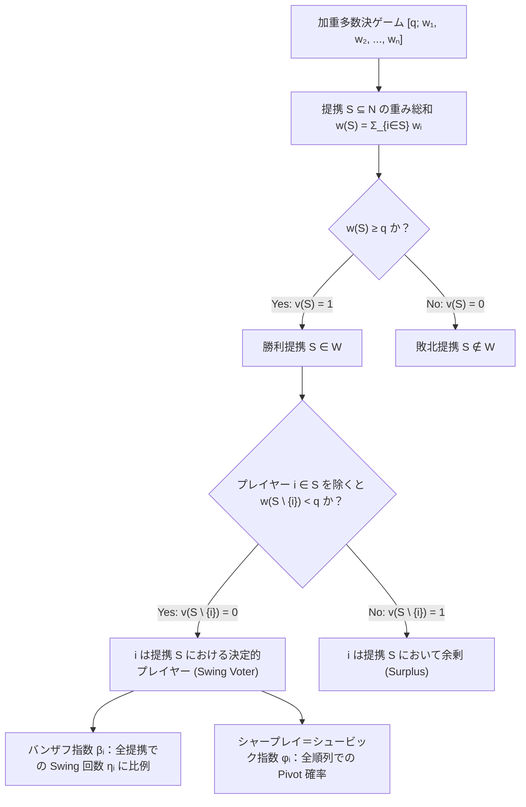
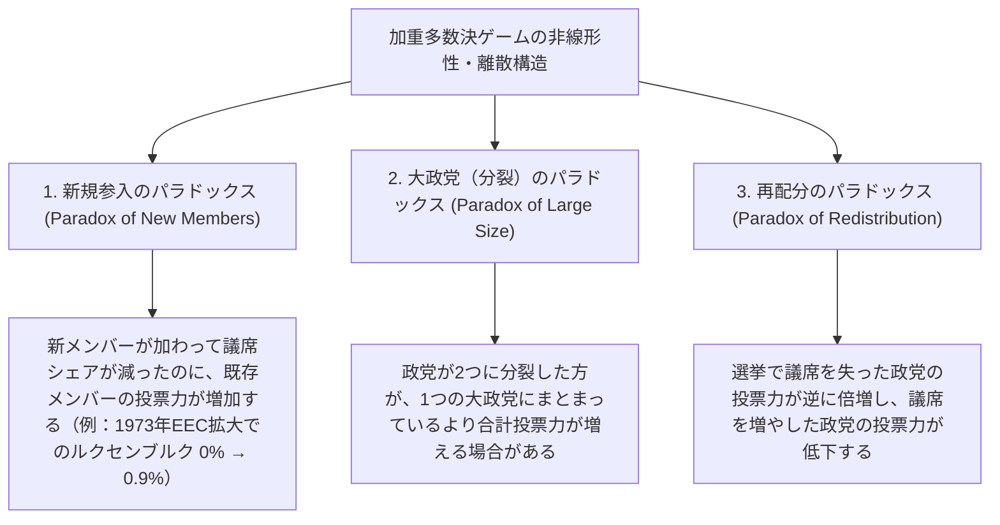

民主主義の議会や株式会社の株主総会において、私たちは無意識のうちにひとつの素朴な比例仮説を信じている。すなわち、<strong>「議席の割合（あるいは持株比率）がそのまま政治的な決定力（影響力）に比例する」</strong>という思い込みである。

たとえば定数100議席の議会で、過半数の51議席で法案が可決されるとする。A党が49議席、B党が49議席、そして小政党であるC党がわずか2議席を持っているとしよう。議席シェアだけを見れば、A党とB党はそれぞれ全体の $49\%$ を占める巨大政党であり、C党はわずか $2\%$ の泡沫政党に見える。ところが、この議会における実質的な<strong>「投票力（Voting Power）」</strong>を数学的に計算すると、驚くべき結論が導かれる。A党、B党、C党の投票力は、まったく同じ<strong>3分の1（約 $33.33\%$）ずつ</strong>なのである。

逆に、全体の $30\%$ もの議席や投票権を与えられていながら、数学的な投票力が<strong>完全にゼロ（$0\%$）</strong>になってしまう「透明人間（ダミープレイヤー）」が制度設計のバグとして生まれることも珍しくない。実際、1958年に発足した欧州経済共同体（EEC、現在のEUの前身）の閣僚理事会では、ルクセンブルクに1票の投票権が与えられていたにもかかわらず、他の加盟国の票数配分との組み合わせによって、15年間にわたりルクセンブルクの投票力が数学的に $0\%$ であったことが証明されている。

なぜ「票の数（Weight）」と「決定権の大きさ（Power）」はこれほど激しく乖離するのか。本稿では、協力ゲーム理論（Cooperative Game Theory）および社会的選択理論（Social Choice Theory）の中核をなす<strong>投票力指数（Voting Power Indices）</strong>の数理を体系的に解き明かす。加重多数決ゲームの厳密な定式化から出発し、双璧をなす<strong>バンザフ指数（Banzhaf Power Index）</strong>と<strong>シャープレイ＝シュービック指数（Shapley-Shubik Power Index）</strong>の導出、確率論的解釈（ストラフィンの定理）、母関数を用いた多項式時間アルゴリズム、さらには国連安全保障理事会の拒否権構造や「議席を減らした政党の決定力が倍増する」という<strong>再配分のパラドックス</strong>まで、制度を支配する離散数学の深淵に迫る。

---

## 1. 議席シェアという幻想：3つの思考実験

数式による公理的定義に入る前に、直観を根底から揺さぶる3つの具体的な議会モデル（加重多数決ゲーム）を観察しよう。すべての例において、議会の総議席数は $100$、法案可決に必要な過半数ライン（クォータ）は $q = 51$ 議席とする。

### 思考実験1：キングメーカーの誕生 $[51;\, 49, 49, 2]$

冒頭で触れた3政党の議会を考えよう。
- <strong>A党</strong>：$w_A = 49$ 議席（議席シェア $49\%$）
- <strong>B党</strong>：$w_B = 49$ 議席（議席シェア $49\%$）
- <strong>C党</strong>：$w_C = 2$ 議席（議席シェア $2\%$）

どの政党も単独では $51$ 議席に届かないため、法案を通すには必ず他党と連立（Coalition）を組まなければならない。では、どのような連立が過半数 $51$ 議席以上を獲得できるだろうか。
- $\{A, B\}$ の連立：$49 + 49 = 98 \ge 51$（可決）
- $\{A, C\}$ の連立：$49 + 2 = 51 \ge 51$（可決）
- $\{B, C\}$ の連立：$49 + 2 = 51 \ge 51$（可決）
- $\{A, B, C\}$ の大連立：$49 + 49 + 2 = 100 \ge 51$（可決）

この結果が意味する事実は極めて重大である。法案を可決するための条件は、「A党、B党、C党のうち<strong>任意の2党以上が賛成すること</strong>」に尽きる。49議席という数字も、2議席という数字も、連立の成否においてはただの飾りであり、この議会は全員が1票ずつを持ち2票以上で可決する多数決 $[2;\, 1, 1, 1]$ と<strong>数学的に完全同型（Isomorphic）</strong>なのである。したがって、わずか $2\%$ の議席しか持たないC党は、$49\%$ を持つA党・B党と寸分違わぬ $33.33\%$ の決定権（キャスティング・ボート）を握る。

### 思考実験2：独裁者と無力な野党 $[51;\, 52, 47, 1]$

次に、A党がわずか3議席を積み増した次の配分を考えよう。
- <strong>A党</strong>：$w_A = 52$ 議席（議席シェア $52\%$）
- <strong>B党</strong>：$w_B = 47$ 議席（議席シェア $47\%$）
- <strong>C党</strong>：$w_C = 1$ 議席（議席シェア $1\%$）

A党は単独で $52 \ge 51$ を満たすため、B党やC党の意向に一切関わりなく、すべての法案を単独で可決・否決できる。一方、B党とC党が団結しても $47 + 1 = 48 < 51$ であり、A党の決定を覆すことは絶対にできない。ゲーム理論において、このときのA党を<strong>独裁者（Dictator）</strong>と呼び、B党とC党を<strong>ダミープレイヤー（Dummy Player）</strong>と呼ぶ。B党は議席のほぼ半分（$47\%$）を占めているにもかかわらず、その投票力は $1$ 議席のC党と同じく<strong>完全に $0\%$</strong> である。

### 思考実験3：見えないダミープレイヤー $[51;\, 35, 35, 25, 5]$

「単独過半数を握る独裁者がいる場合に他党が無力化するのは当たり前だ」と思うかもしれない。では、<strong>どの政党も単独過半数を持たない</strong>次の4政党モデルはどうだろうか。
- <strong>A党</strong>：$w_A = 35$ 議席（$35\%$）
- <strong>B党</strong>：$w_B = 35$ 議席（$35\%$）
- <strong>C党</strong>：$w_C = 25$ 議席（$25\%$）
- <strong>D党</strong>：$w_D = 5$ 議席（$5\%$）

一見すると、キャスティング・ボートが複雑に絡み合う連立議会であり、5議席を持つD党にも「あと少しで過半数に届く連立を助ける決定権」がありそうに見える。しかし、A党・B党・C党の3党が作り得るすべての部分集合の議席合計を書き出してみよう。
- 空集合 $\emptyset$：$0$ 議席（ここにD党の $5$ 議席を足しても $5 < 51$ で否決のまま）
- $\{C\}$：$25$ 議席（D党の $5$ 議席を足しても $30 < 51$ で否決のまま）
- $\{A\}$ または $\{B\}$：$35$ 議席（D党の $5$ 議席を足しても $40 < 51$ で否決のまま）
- $\{A, C\}$ または $\{B, C\}$：$35 + 25 = 60 \ge 51$（D党が参加する前からすでに可決！）
- $\{A, B\}$：$35 + 35 = 70 \ge 51$（D党が参加する前からすでに可決！）
- $\{A, B, C\}$：$35 + 35 + 25 = 95 \ge 51$（D党が参加する前からすでに可決！）

驚くべきことに、A・B・Cの3党のどのような組み合わせに対しても、D党が加わることで「否決（$50$ 議席以下）だったものが可決（$51$ 議席以上）に変わる」という状況は<strong>ただの一度も発生しない</strong>。なぜなら、D党の $5$ 議席が決定打となるためには、他党の合計議席が $46$ 議席以上 $50$ 議席以下の範囲（スイング区間 $[q - w_D,\, q - 1] = [46, 50]$）に収まる連立が存在しなければならないが、$\{35, 35, 25\}$ の部分和はすべて $5$ の倍数かつ $40$ の次がいきなり $60$ に飛ぶため、$[46, 50]$ の区間が完全に空白になっているからである。

結果として、この $[51;\, 35, 35, 25, 5]$ において、A党・B党・C党はそれぞれ $33.33\%$ の投票力を持ち、5議席を持つD党の投票力は<strong>完全に $0\%$（ダミープレイヤー）</strong>となる。

この「票を持っているのに決定権がゼロになる」という数学的矛盾を法廷に持ち込み、アメリカ合衆国の地方自治制度を覆したのが、若き法学生<strong>ジョン・F・バンザフ3世（John F. Banzhaf III）</strong>であった。1965年、バンザフはニューヨーク州ナッソー郡（Nassau County）の郡政委員会における加重投票制度（総票数115票・過半数58票に対し、6つの自治体に $[58;\, 31, 31, 28, 21, 2, 2]$ などを配分していた制度）を解析し、ノース・ヘンプステッド、ロング・ビーチ、グレン・コーブの3自治体がどのような連立においても決定票を投じることができない<strong>投票力 $0\%$ のダミー</strong>であることを証明した。この論文は合衆国憲法修正第14条の平等保護条項（「一人一票の原則」）違反を認定する歴史的判決へとつながり、数理政治学が現実の法制度を書き換える決定的な契機となったのである。

---

## 2. 加重多数決ゲームと単純ゲームの公理的定式化

ここまでの観察を、協力ゲーム理論の言葉で厳密に定式化しよう。

### 単純ゲーム（Simple Game）と特性関数

プレイヤー（政党、株主、加盟国）の有限集合を $N = \{1, 2, \dots, n\}$ とする。$N$ の任意の部分集合 $S \subseteq N$ を<strong>提携（Coalition：連立）</strong>と呼ぶ。全部分集合の族 $2^N$ から $\{0, 1\}$ への写像 $v: 2^N \to \{0, 1\}$ が以下の3条件を満たすとき、組 $(N, v)$ を<strong>単純ゲーム（Simple Game）</strong>と呼ぶ。

1. <strong>空提携の敗北</strong>：$v(\emptyset) = 0$
2. <strong>全体提携の勝利</strong>：$v(N) = 1$
3. <strong>単調性（Monotonicity）</strong>：$S \subseteq T \subseteq N \implies v(S) \le v(T)$（賛成派が増えることで可決が否決に覆ることはない）

さらに、互いに素な2つの提携が同時に勝利することを防ぐため、通常は以下の<strong>固有性（Properness）</strong>を課す。
$$v(S) = 1 \implies v(N \setminus S) = 0 \quad (\forall S \subseteq N)$$

$v(S) = 1$ となる提携 $S$ を<strong>勝利提携（Winning Coalition）</strong>、$v(S) = 0$ となる提携を<strong>敗北提携（Losing Coalition）</strong>と呼ぶ。勝利提携全体の集合を $\mathcal{W} = \{S \subseteq N : v(S) = 1\}$ と書く。また、勝利提携 $S \in \mathcal{W}$ のうち、そこから誰か1人でも抜けると敗北提携に転落するもの（すなわち任意の真部分集合 $T \subsetneq S$ に対して $v(T) = 0$ となるもの）を<strong>極小勝利提携（Minimal Winning Coalition, MWC）</strong>と呼び、その族を $\mathcal{W}^m$ と表す。単調性により、単純ゲーム $(N, v)$ は極小勝利提携の族 $\mathcal{W}^m$ によって一意に決定される。

### 加重多数決ゲーム（Weighted Voting Game）

単純ゲームの最も重要なクラスが<strong>加重多数決ゲーム（Weighted Voting Game）</strong>である。各プレイヤー $i \in N$ に非負の実数（または整数）の<strong>重み（Weight：議席数・票数）</strong> $w_i \ge 0$ が与えられ、可決に必要な閾値として正の実数<strong>クォータ（Quota：定足数・可決ライン）</strong> $q > 0$ が定められているとき、このゲームを次の記法で表す。
$$[q;\, w_1, w_2, \dots, w_n]$$

その特性関数 $v: 2^N \to \{0, 1\}$ は、提携 $S$ に属するプレイヤーの重みの総和 $w(S) = \sum_{i \in S} w_i$ によって次のように定義される。
$$v(S) = \begin{cases} 1 & \text{if } \sum_{i \in S} w_i \ge q \\ 0 & \text{if } \sum_{i \in S} w_i < q \end{cases}$$

固有性（互いに補集合となる $S$ と $N \setminus S$ が同時に $q$ 以上にならないこと）を保証するため、通常は総重み $W = \sum_{i=1}^n w_i$ に対して $q > \frac{1}{2}W$ と設定される。

### 決定的プレイヤー（Critical Player）と3つの特殊類型

ある提携 $S \subseteq N$ において、プレイヤー $i \in S$ が<strong>決定的（Critical）</strong>あるいは<strong>スイング・ボーター（Swing Voter）</strong>であるとは、$i$ を含む $S$ は勝利提携であるが、$i$ が離脱した $S \setminus \{i\}$ は敗北提携になることをいう。すなわち、限界貢献度（Marginal Contribution）$\Delta_i v(S) = v(S) - v(S \setminus \{i\})$ が $1$ となることである。
$$v(S) = 1 \quad \text{かつ} \quad v(S \setminus \{i\}) = 0 \iff q - w_i \le \sum_{j \in S \setminus \{i\}} w_j < q$$

この概念を用いると、制度上の特殊な立場にあるプレイヤーは次のように分類される。
- <strong>独裁者（Dictator）</strong>：単独で勝利できるプレイヤー（$v(\{i\}) = 1 \iff w_i \ge q$）。このとき他のすべてのプレイヤーはダミーとなる。
- <strong>拒否権保持者（Veto Player）</strong>：すべての勝利提携に必ず含まれるプレイヤー（$i \in \bigcap_{S \in \mathcal{W}} S \iff \sum_{j \ne i} w_j < q$）。拒否権保持者が単独で法案を通せるとは限らないが、このプレイヤーが反対すればいかなる法案も可決されない。
- <strong>ダミープレイヤー（Dummy Player）</strong>：いかなる提携 $S$ においても決して決定的にならないプレイヤー（$\forall S \subseteq N,\, v(S) - v(S \setminus \{i\}) = 0$）。

---

## 3. バンザフ指数（Banzhaf Power Index）の数理

投票力を定量化する第1の標準的指標が、イギリスの統計学者・遺伝学者ライオネル・ペンローズ（Lionel Penrose, 1946）が考案し、後にジョン・バンザフ（1965）が法学・政治学の文脈で再発見・普及させた<strong>バンザフ指数（ペンローズ＝バンザフ指数）</strong>である。

### 定義：スイング数 $\eta_i$ と2つのバンザフ指数

バンザフ指数の根本思想は極めて明快である。<strong>「起こり得るすべての賛否の組み合わせ（提携）が等確率で出現すると仮定したとき、プレイヤー $i$ が自らの賛否を変えることで議決結果を覆せる確率はいくらか」</strong>を測るのである。

プレイヤー $i \in N$ が決定的（スイング）となる勝利提携の総数を<strong>バンザフ・スイング数（Banzhaf Score）</strong> $\eta_i$ と定義する。
$$\eta_i = \sum_{S \subseteq N,\, S \ni i} \bigl[v(S) - v(S \setminus \{i\})\bigr] = \bigl|\{S \subseteq N : i \in S,\, v(S) = 1,\, v(S \setminus \{i\}) = 0\}\bigr|$$

プレイヤー $i$ 以外の $n-1$ 人のプレイヤーが作る部分集合 $T = S \setminus \{i\} \subseteq N \setminus \{i\}$ の総数は $2^{n-1}$ 通り存在する。その $2^{n-1}$ 通りのうち、$\eta_i$ 通りにおいてプレイヤー $i$ の一票が勝敗を分ける。そこで、$\eta_i$ を $2^{n-1}$ で割った値を<strong>絶対バンザフ指数（Raw / Absolute Banzhaf Index, または Penrose Measure）</strong> $\beta'_i$ と呼ぶ。
$$\beta'_i = \frac{\eta_i}{2^{n-1}} = \frac{1}{2^{n-1}} \sum_{T \subseteq N \setminus \{i\}} \bigl[v(T \cup \{i\}) - v(T)\bigr]$$

一方、全プレイヤーの投票力の合計が $1$（$100\%$）になるように正規化したものを<strong>正規化バンザフ指数（Normalized Banzhaf Index）</strong> $\beta_i$ と呼ぶ。
$$\beta_i = \frac{\eta_i}{\sum_{j=1}^n \eta_j} = \frac{\beta'_i}{\sum_{j=1}^n \beta'_j}$$

> [!IMPORTANT]
> <strong>絶対バンザフ指数 $\beta'_i$ と正規化バンザフ指数 $\beta_i$ の使い分け</strong>：
> 「議会の中で各政党がどれだけのシェアの権力を分け合っているか」を比較する際には、合計が $100\%$ になる<strong>正規化バンザフ指数 $\beta_i$</strong> が用いられる。一方、「ある一人の有権者や国家の票が、議決結果を左右する絶対的な確率はいくらか（制度全体の意思決定がいかに硬直的か）」を評価する際には、正規化によって分母の情報が消えてしまうのを防ぐため、<strong>絶対バンザフ指数 $\beta'_i$</strong> を用いる必要がある。

---

## 4. シャープレイ＝シュービック指数（Shapley-Shubik Power Index）の数理

バンザフ指数と並ぶもうひとつの金字塔が、後にノーベル経済学賞を受賞するロイド・シャープレイ（Lloyd Shapley）とマーティン・シュービック（Martin Shubik）が1954年に発表した<strong>シャープレイ＝シュービック指数</strong>である。

### 協力ゲームのシャープレイ値からの導出

1953年、シャープレイは一般の協力ゲーム $(N, v)$ において、全体提携 $N$ が生み出す総価値 $v(N)$ を各プレイヤーの貢献度に応じて公正に分配する唯一の方法として<strong>シャープレイ値（Shapley Value）</strong> $\phi_i(v)$ を公理的に導出した。シャープレイは以下の4つの公理を満たす配分ルールが一意に存在することを証明した。

1. <strong>効率性（Efficiency / 全体合理性）</strong>：$\sum_{i=1}^n \phi_i(v) = v(N)$
2. <strong>対称性（Symmetry / 匿名性）</strong>：任意の提携 $S \subseteq N \setminus \{i, j\}$ に対して $v(S \cup \{i\}) = v(S \cup \{j\})$ ならば、$\phi_i(v) = \phi_j(v)$
3. <strong>ダミープレイヤー公理（Dummy Player Axiom）</strong>：任意の $S$ に対して $v(S \cup \{i\}) = v(S)$ ならば、$\phi_i(v) = 0$
4. <strong>加法性（Additivity）</strong>：2つの独立なゲーム $u, v$ に対して $\phi_i(u + v) = \phi_i(u) + \phi_i(v)$（単純ゲームにおいては、これを $v(S \cup T) + v(S \cap T)$ に関する<strong>移転公理 Transfer Axiom</strong>、すなわちダビーの公理 Dubey 1975 に置き換えることで特徴づけられる）

この公理系から導かれるシャープレイ値の一般公式は次の通りである。
$$\phi_i(v) = \sum_{S \subseteq N \setminus \{i\}} \frac{|S|!\,(n - |S| - 1)!}{n!} \bigl[v(S \cup \{i\}) - v(S)\bigr]$$

これを単純ゲーム（$v: 2^N \to \{0, 1\}$）に特殊化したものが<strong>シャープレイ＝シュービック指数</strong>にほかならない。

### 順列とピボット（Pivot）による直観的解釈

なぜ上式の係数に $\frac{|S|!\,(n - |S| - 1)!}{n!}$ という階乗が現れるのか。それは「連立が<strong>順番に1人ずつ形成されていくプロセス</strong>」を考えることで鮮やかに理解できる。

$n$ 人のプレイヤーが、法案に対して「最も熱烈に賛成している順」に1人ずつ部屋に入ってきて賛成票を投じていくとしよう。$n$ 人が部屋に入る順序（順列 $\pi = (\pi_1, \pi_2, \dots, \pi_n)$）は全部で $n!$ 通り存在する。最初は0票から始まり、プレイヤーが1人加わるごとに累積票数が増えていく。そして、ある特定のプレイヤー $i$ が部屋に入った瞬間に、累積票数が初めて可決ライン $q$ 以上の領域へと突破する。この<strong>「累積票数を敗北（$< q$）から勝利（$\ge q$）へと押し上げた唯一の中枢プレイヤー」</strong>を、その順列 $\pi$ における<strong>ピボット（Pivot：要・中軸）</strong>と呼ぶ。

もしプレイヤー $i$ より前に部屋に入っていたプレイヤーの集合が $S \subseteq N \setminus \{i\}$（人数 $|S|$ 人）であったとすると、
- 先行する $|S|$ 人の並び順は $|S|!$ 通り
- プレイヤー $i$ の後から部屋に入ってくる残りの $(n - |S| - 1)$ 人の並び順は $(n - |S| - 1)!$ 通り

存在する。したがって、特定の先行集合 $S$ の直後にプレイヤー $i$ が入室してピボットとなる順列の個数は $|S|!\,(n - |S| - 1)!$ 個であり、それを全順列数 $n!$ で割ったものが上式の重み係数 $\frac{|S|!\,(n - |S| - 1)!}{n!}$ なのである。各順列 $\pi$ には必ずただ1人のピボットが存在するため、シャープレイ＝シュービック指数は最初から正規化されており、常に $\sum_{i=1}^n \phi_i = 1$ を満たす。

---

## 5. 完全計算による徹底比較：$[6;\, 4, 3, 2, 1]$ と $[5;\, 3, 2, 1, 1]$

理論の仕組みを完全に体得するため、4政党の加重多数決ゲーム $[6;\, 4, 3, 2, 1]$（総議席10、過半数ライン $q = 6$、プレイヤー $A=4, B=3, C=2, D=1$）に対して、バンザフ指数とシャープレイ＝シュービック指数を全列挙によって手計算してみよう。

### $[6;\, 4, 3, 2, 1]$ における全勝利提携とバンザフ指数の計算

4人のプレイヤーが作る $2^4 = 16$ 個の提携のうち、重みの合計が $q = 6$ 以上となる勝利提携は以下の7個である。各勝利提携において、誰が抜けると合計が $6$ 未満に転落するか（決定的プレイヤー＝下線付き太字）を判定する。

| 勝利提携 $S$ | 議席構成 | 合計重み $w(S)$ | 各プレイヤー離脱後の重み $w(S \setminus \{i\})$ | 決定的プレイヤー（Swing） |
| :--- | :--- | :---: | :--- | :--- |
| $\{A, B\}$ | $4 + 3$ | $7$ | $A\text{離脱}: 3 < 6, \quad B\text{離脱}: 4 < 6$ | <strong>A, B</strong> |
| $\{A, C\}$ | $4 + 2$ | $6$ | $A\text{離脱}: 2 < 6, \quad C\text{離脱}: 4 < 6$ | <strong>A, C</strong> |
| $\{A, B, C\}$ | $4 + 3 + 2$ | $9$ | $A\text{離脱}: 5 < 6, \quad B\text{離脱}: 6, \quad C\text{離脱}: 7$ | <strong>A</strong> のみ |
| $\{A, B, D\}$ | $4 + 3 + 1$ | $8$ | $A\text{離脱}: 4 < 6, \quad B\text{離脱}: 5 < 6, \quad D\text{離脱}: 7$ | <strong>A, B</strong> |
| $\{A, C, D\}$ | $4 + 2 + 1$ | $7$ | $A\text{離脱}: 3 < 6, \quad C\text{離脱}: 5 < 6, \quad D\text{離脱}: 6$ | <strong>A, C</strong> |
| $\{B, C, D\}$ | $3 + 2 + 1$ | $6$ | $B\text{離脱}: 3 < 6, \quad C\text{離脱}: 4 < 6, \quad D\text{離脱}: 5 < 6$ | <strong>B, C, D</strong> |
| $\{A, B, C, D\}$ | $4 + 3 + 2 + 1$ | $10$ | $A\text{離脱}: 6 \ge 6$（誰が抜けても $6$ 以上を維持） | <strong>なし</strong>（全員余剰） |

この表から、各プレイヤーのスイング回数 $\eta_i$ を集計すると次のようになる。
- $\eta_A = 5$ 回（$\{A,B\}, \{A,C\}, \{A,B,C\}, \{A,B,D\}, \{A,C,D\}$）
- $\eta_B = 3$ 回（$\{A,B\}, \{A,B,D\}, \{B,C,D\}$）
- $\eta_C = 3$ 回（$\{A,C\}, \{A,C,D\}, \{B,C,D\}$）
- $\eta_D = 1$ 回（$\{B,C,D\}$）
- スイング総数：$\sum_{j} \eta_j = 5 + 3 + 3 + 1 = 12$

したがって、絶対バンザフ指数 $\beta'_i = \eta_i / 8$ と正規化バンザフ指数 $\beta_i = \eta_i / 12$ は次のように求まる。
$$\beta' = \left(\frac{5}{8},\, \frac{3}{8},\, \frac{3}{8},\, \frac{1}{8}\right), \qquad \beta = \left(\frac{5}{12},\, \frac{3}{12},\, \frac{3}{12},\, \frac{1}{12}\right) \approx (41.67\%,\, 25.00\%,\, 25.00\%,\, 8.33\%)$$

### $[6;\, 4, 3, 2, 1]$ における全24順列とシャープレイ＝シュービック指数の計算

次に、4人のプレイヤーが1人ずつ連立に参加する $4! = 24$ 通りの全順列を書き出し、累積重みが初めて $q = 6$ に到達するピボット（<strong>太字</strong>）を特定しよう。

| 順列番号 | 参加順序 | 累積重みの推移 | ピボット | 順列番号 | 参加順序 | 累積重みの推移 | ピボット |
| :---: | :--- | :--- | :---: | :---: | :--- | :--- | :---: |
| 1 | $(A, \mathbf{B}, C, D)$ | $4 \to \mathbf{7} \to 9 \to 10$ | <strong>B</strong> | 13 | $(C, \mathbf{A}, B, D)$ | $2 \to \mathbf{6} \to 9 \to 10$ | <strong>A</strong> |
| 2 | $(A, \mathbf{B}, D, C)$ | $4 \to \mathbf{7} \to 8 \to 10$ | <strong>B</strong> | 14 | $(C, \mathbf{A}, D, B)$ | $2 \to \mathbf{6} \to 7 \to 10$ | <strong>A</strong> |
| 3 | $(A, \mathbf{C}, B, D)$ | $4 \to \mathbf{6} \to 9 \to 10$ | <strong>C</strong> | 15 | $(C, B, \mathbf{A}, D)$ | $2 \to 5 \to \mathbf{9} \to 10$ | <strong>A</strong> |
| 4 | $(A, \mathbf{C}, D, B)$ | $4 \to \mathbf{6} \to 7 \to 10$ | <strong>C</strong> | 16 | $(C, B, \mathbf{D}, A)$ | $2 \to 5 \to \mathbf{6} \to 10$ | <strong>D</strong> |
| 5 | $(A, D, \mathbf{B}, C)$ | $4 \to 5 \to \mathbf{8} \to 10$ | <strong>B</strong> | 17 | $(C, D, \mathbf{A}, B)$ | $2 \to 3 \to \mathbf{7} \to 10$ | <strong>A</strong> |
| 6 | $(A, D, \mathbf{C}, B)$ | $4 \to 5 \to \mathbf{7} \to 10$ | <strong>C</strong> | 18 | $(C, D, \mathbf{B}, A)$ | $2 \to 3 \to \mathbf{6} \to 10$ | <strong>B</strong> |
| 7 | $(B, \mathbf{A}, C, D)$ | $3 \to \mathbf{7} \to 9 \to 10$ | <strong>A</strong> | 19 | $(D, A, \mathbf{B}, C)$ | $1 \to 5 \to \mathbf{8} \to 10$ | <strong>B</strong> |
| 8 | $(B, \mathbf{A}, D, C)$ | $3 \to \mathbf{7} \to 8 \to 10$ | <strong>A</strong> | 20 | $(D, A, \mathbf{C}, B)$ | $1 \to 5 \to \mathbf{7} \to 10$ | <strong>C</strong> |
| 9 | $(B, C, \mathbf{A}, D)$ | $3 \to 5 \to \mathbf{9} \to 10$ | <strong>A</strong> | 21 | $(D, B, \mathbf{A}, C)$ | $1 \to 4 \to \mathbf{8} \to 10$ | <strong>A</strong> |
| 10 | $(B, C, \mathbf{D}, A)$ | $3 \to 5 \to \mathbf{6} \to 10$ | <strong>D</strong> | 22 | $(D, B, \mathbf{C}, A)$ | $1 \to 4 \to \mathbf{6} \to 10$ | <strong>C</strong> |
| 11 | $(B, D, \mathbf{A}, C)$ | $3 \to 4 \to \mathbf{8} \to 10$ | <strong>A</strong> | 23 | $(D, C, \mathbf{A}, B)$ | $1 \to 3 \to \mathbf{7} \to 10$ | <strong>A</strong> |
| 12 | $(B, D, \mathbf{C}, A)$ | $3 \to 4 \to \mathbf{6} \to 10$ | <strong>C</strong> | 24 | $(D, C, \mathbf{B}, A)$ | $1 \to 3 \to \mathbf{6} \to 10$ | <strong>B</strong> |

ピボットとなった回数を数えると、$A$ が $10$ 回、$B$ が $6$ 回、$C$ が $6$ 回、$D$ が $2$ 回である。
$$\phi = \left(\frac{10}{24},\, \frac{6}{24},\, \frac{6}{24},\, \frac{2}{24}\right) = \left(\frac{5}{12},\, \frac{3}{12},\, \frac{3}{12},\, \frac{1}{12}\right) \approx (41.67\%,\, 25.00\%,\, 25.00\%,\, 8.33\%)$$

ここで極めて重要な事実が浮かび上がる。<strong>B党は3議席（$30\%$）、C党は2議席（$20\%$）を持っており、B党の方が1.5倍も議席が多いにもかかわらず、B党とC党の投票力はバンザフ指数でもシャープレイ＝シュービック指数でも完全に同じ $25.00\%$</strong> なのである。なぜなら、A党（4議席）と組んで6議席に到達する上では、3議席のB党も2議席のC党もまったく同じ役割を果たし、A党抜きで6議席を作るには $\{B, C, D\}$ の3党全員が揃うしかないため、ゲーム構造上B党とC党は完全に対称な位置にあるからである。

### 2つの指数が乖離する例：$[5;\, 3, 2, 1, 1]$ と確率論的解釈（ストラフィンの定理）

上の $[6;\, 4, 3, 2, 1]$ ではたまたま $\beta$ と $\phi$ が一致したが、一般には両者は異なる値を示す。たとえば $[5;\, 3, 2, 1, 1]$（$A=3, B=2, C=1, D=1$, クォータ $q=5$）を計算してみよう。
- <strong>バンザフ指数</strong>：Aがスイングとなる相手集合 $T \subseteq \{B, C, D\}$（重み和が $2, 3, 4$ のもの）は $\{B\}, \{C,D\}, \{B,C\}, \{B,D\}, \{B,C,D\}$ の $\eta_A = 5$ 個。同様に $\eta_B = 3$ 個（$\{A\}, \{A,C\}, \{A,D\}$）、$\eta_C = 1$ 個（$\{A,D\}$）、$\eta_D = 1$ 個（$\{A,C\}$）。ゆえに：
  $$\beta = \left(\frac{5}{10},\, \frac{3}{10},\, \frac{1}{10},\, \frac{1}{10}\right) = (50.00\%,\, 30.00\%,\, 10.00\%,\, 10.00\%)$$
- <strong>シャープレイ＝シュービック指数</strong>：Aがピボットとなるのは、先行集合 $T$ がサイズ1の $\{B\}$（重み係数 $\frac{1!2!}{24} = \frac{2}{24}$）、サイズ2の $\{B,C\}, \{B,D\}, \{C,D\}$（係数 $3 \times \frac{2!1!}{24} = \frac{6}{24}$）、サイズ3の $\{B,C,D\}$（係数 $\frac{3!0!}{24} = \frac{6}{24}$）のときであり、合計 $\phi_A = \frac{14}{24} = \frac{7}{12} \approx 58.33\%$ に達する。同様に $\phi_B = \frac{6}{24} = 25.00\%$、$\phi_C = \phi_D = \frac{2}{24} \approx 8.33\%$ となる。
  $$\phi = \left(\frac{7}{12},\, \frac{3}{12},\, \frac{1}{12},\, \frac{1}{12}\right) \approx (58.33\%,\, 25.00\%,\, 8.33\%,\, 8.33\%)$$

なぜ同じゲームに対して2つの異なる指数が存在し、値が異なるのか。数学者フィリップ・ストラフィン（Philip D. Straffin Jr., 1977）は、<strong>確率的投票モデルにおける2つの異なる独立性仮定</strong>から両者を統一的に説明した（<strong>ストラフィンの定理</strong>）。

各法案に対して、プレイヤー $i$ が賛成する確率を $p_i \in [0, 1]$ とする。
1. <strong>独立性の仮定（Independence Assumption）$\implies$ バンザフ指数</strong>：
   各プレイヤーの賛成確率 $p_1, p_2, \dots, p_n$ が互いに独立に一様分布 $\mathrm{Uniform}(0, 1)$ から選ばれる（すなわち全員が毎回コイン投げのように $p_i = 1/2$ で独立に賛否を決める）とき、プレイヤー $i$ の票が決定票となる期待確率は<strong>絶対バンザフ指数 $\beta'_i$</strong> に一致する。
2. <strong>同質性の仮定（Homogeneity Assumption）$\implies$ シャープレイ＝シュービック指数</strong>：
   法案ごとに社会全体の「法案の人気の高さ」を表す共通の確率変数 $p \sim \mathrm{Uniform}(0, 1)$ がまず選ばれ、すべてのプレイヤーがその同じ確率 $p_1 = p_2 = \dots = p_n = p$ で賛否を決める（人気のある法案には全員が賛成しやすく、不人気な法案には全員が反対しやすい）とき、プレイヤー $i$ の票が決定票となる期待確率は：
   $$\int_0^1 \sum_{S \subseteq N \setminus \{i\}} p^{|S|} (1 - p)^{n - |S| - 1} \bigl[v(S \cup \{i\}) - v(S)\bigr]\, dp = \sum_{S \subseteq N \setminus \{i\}} \frac{|S|!\,(n - |S| - 1)!}{n!} \bigl[v(S \cup \{i\}) - v(S)\bigr] = \phi_i$$
   となり、ベータ関数積分 $\int_0^1 p^k (1-p)^{n-k-1}\,dp = \frac{k!(n-k-1)!}{n!}$ によって<strong>シャープレイ＝シュービック指数 $\phi_i$</strong> に完全一致する！

つまり、各議員が独自の利害でバラバラに投票する議会ではバンザフ指数が適しており、共通のイデオロギー軸や世論の風向きに沿って連立が形成される議会ではシャープレイ＝シュービック指数が適しているのである。

---

## 6. 母関数（Generating Functions）と動的計画法による高速計算

プレイヤー数 $n$ が増えると、部分集合の総数 $2^n$ や順列の総数 $n!$ は爆発的に増大する（たとえば日本の衆議院465議席や、株主が100人いる企業では全列挙は不可能である）。実際、加重多数決ゲームのバンザフ指数やシャープレイ＝シュービック指数を求める問題は、一般には<strong>$\#\text{P}$完全（Sharp-P Complete）</strong>であることが証明されている。

しかし、重み $w_i$ が比較的小さな整数である場合、<strong>母関数（Generating Function：生成関数）</strong>と動的計画法（Dynamic Programming）を用いることで、擬多項式時間 $O(n^2 q)$ で厳密解を一瞬で求めることができる（Cantor 1962, Mann & Shapley 1962, Brams & Affuso 1976）。

### バンザフ指数の母関数公式

プレイヤー $i$ がスイングとなる回数 $\eta_i$ は、「$N \setminus \{i\}$ の部分集合 $S$ のうち、重みの合計 $w(S)$ が $q - w_i \le w(S) \le q - 1$ を満たすものの個数」に等しい。
ここで次の多項式 $P_{-i}(x)$ を考えよう。
$$P_{-i}(x) = \prod_{j \in N \setminus \{i\}} \left(1 + x^{w_j}\right) = \sum_{k=0}^{W - w_i} c_k^{(i)}\, x^k$$

この多項式を展開したときの $x^k$ の係数 $c_k^{(i)}$ は、<strong>「プレイヤー $i$ 以外のメンバーから重みの合計がちょうど $k$ になるように選ぶ組み合わせ（提携）の総数」</strong>そのものである！したがって、バンザフ・スイング数 $\eta_i$ は、次数が $q - w_i$ から $q - 1$ までの係数を足し合わせるだけで直ちに求まる。
$$\eta_i = \sum_{k = q - w_i}^{q - 1} c_k^{(i)}$$

たとえば、先ほどの $[6;\, 4, 3, 2, 1]$ で $B$（$w_B = 3$）のスイング数 $\eta_B$ を求めてみよう。$B$ を除いた $A(4), C(2), D(1)$ の母関数は：
$$P_{-B}(x) = (1 + x^4)(1 + x^2)(1 + x^1) = 1 + x + x^2 + x^3 + x^4 + x^5 + x^6 + x^7$$
スイング区間は $q - w_B = 6 - 3 = 3$ から $q - 1 = 5$ までなので、$x^3, x^4, x^5$ の係数の和を取れば $\eta_B = 1 + 1 + 1 = 3$ と一瞬で求まる。

### シャープレイ＝シュービック指数の2変数母関数公式

シャープレイ＝シュービック指数では、「重みの合計 $k$」だけでなく「提携の人数 $s = |S|$」も同時に追跡する必要がある。そこで、人数を数える変数 $z$ を導入した2変数母関数 $Q_{-i}(x, z)$ を構成する。
$$Q_{-i}(x, z) = \prod_{j \in N \setminus \{i\}} \left(1 + z\, x^{w_j}\right) = \sum_{s=0}^{n-1} \sum_{k=0}^{W - w_i} d_{s, k}^{(i)}\, z^s x^k$$

展開式の $z^s x^k$ の係数 $d_{s, k}^{(i)}$ は、「$i$ 以外のメンバーから<strong>ちょうど $s$ 人を選んで重みの合計が $k$ になる提携の個数</strong>」を表す。すると、シャープレイ＝シュービック指数 $\phi_i$ は全順列を列挙することなく次式で厳密に計算できる。
$$\phi_i = \sum_{s=0}^{n-1} \frac{s!\,(n - s - 1)!}{n!} \left( \sum_{k = q - w_i}^{q - 1} d_{s, k}^{(i)} \right)$$

---

## 7. 現実の国際機関における投票力分析

この母関数法を用いて、歴史上および現代の最重要国際機関の投票構造を解剖してみよう。

### 事例1：1958年〜1973年の欧州経済共同体（EEC）閣僚理事会

1957年のローマ条約によって設立された初期EEC（欧州6カ国）の閣僚理事会では、特定多数決（Qualified Majority Voting）の票数配分が次のように定められていた。
- 西ドイツ（$G$）：$4$ 票
- フランス（$F$）：$4$ 票
- イタリア（$I$）：$4$ 票
- ベルギー（$B$）：$2$ 票
- オランダ（$NL$）：$2$ 票
- ルクセンブルク（$Lux$）：$1$ 票
- 総票数 $17$ 票、可決クォータ $q = 12$ 票 $\implies [12;\, 4, 4, 4, 2, 2, 1]$

この制度におけるルクセンブルク（$w_{\text{Lux}} = 1$）の母関数 $P_{-\text{Lux}}(x)$ を考えてみよう。
$$P_{-\text{Lux}}(x) = (1 + x^4)^3 (1 + x^2)^2$$
スイング区間は $q - w_{\text{Lux}} = 12 - 1 = 11$ から $q - 1 = 11$ まで、すなわち<strong>$x^{11}$ の係数 $c_{11}^{(\text{Lux})}$</strong> である。
ところが、ルクセンブルク以外の5カ国の票数は $(4, 4, 4, 2, 2)$ と<strong>すべて偶数</strong>である。偶数をいくつ足し合わせてもその和は必ず偶数になるため、$P_{-\text{Lux}}(x)$ には奇数次の項が一切現れず、<strong>$x^{11}$ の係数は恒等的に $0$</strong> となる！

つまり、他国の賛成票の合計が $12$ 未満である限り、その合計は最大でも $10$ 票以下であり、そこにルクセンブルクが $1$ 票を投じても $10 + 1 = 11 < 12$ となって絶対に可決ラインに届かないのである。

| 加盟国 | 票数 $w_i$ | 票数シェア | スイング数 $\eta_i$ | 正規化バンザフ指数 $\beta_i$ | シャープレイ＝シュービック指数 $\phi_i$ |
| :--- | :---: | :---: | :---: | :---: | :---: |
| <strong>西ドイツ・フランス・イタリア</strong>（各） | $4$ | $23.53\%$ | $10$ | $10/42 \approx \mathbf{23.81\%}$ | $14/60 \approx \mathbf{23.33\%}$ |
| <strong>ベルギー・オランダ</strong>（各） | $2$ | $11.76\%$ | $6$ | $6/42 \approx \mathbf{14.29\%}$ | $9/60 = \mathbf{15.00\%}$ |
| <strong>ルクセンブルク</strong> | $1$ | $5.88\%$ | $0$ | $\mathbf{0.00\%}$ | $\mathbf{0.00\%}$ |
| <strong>合計（6カ国）</strong> | $17$ | $100.00\%$ | $42$ | $100.00\%$ | $100.00\%$ |

こうしてルクセンブルクは、1958年から1973年（イギリス・デンマーク・アイルランドが加盟して第1次拡大が行われる）までの15年間、特定多数決において数学的に<strong>投票力 $0\%$ のダミープレイヤー</strong>であった。

### 事例2：国際連合安全保障理事会（UNSC）と拒否権の重み

現代の国際政治で最も極端な非対称性を持つ投票機関が、<strong>国連安全保障理事会（UN Security Council）</strong>である。安保理は15カ国で構成される。
- <strong>常任理事国（P5：米・英・仏・露・中）</strong>：5カ国（拒否権を保有）
- <strong>非常任理事国（NP10）</strong>：10カ国（拒否権なし）

実質事項の決議が採択されるための条件は、<strong>「15カ国のうち9カ国以上が賛成し、かつ常任理事国5カ国のうち1カ国も拒否権を行使しない（全員が賛成または棄権する）こと」</strong>である。

これを整数重みの加重多数決ゲームとして表現してみよう。非常任理事国1カ国の重みを $w_{\text{NP}} = 1$ とする。もし常任理事国4カ国と非常任理事国10カ国の計14カ国が賛成しても、残り1つの常任理事国が反対すれば否決されなければならない。また、常任理事国5カ国すべてと非常任理事国4カ国が賛成すれば可決される。したがって、常任理事国の重みを $w_{\text{P5}} = 7$、クォータを $q = 39$ と置けば、
$$4 \times 7 + 10 \times 1 = 38 < 39 \quad (\text{P5が1カ国でも欠ければ敗北})$$
$$5 \times 7 + 4 \times 1 = 39 \ge 39 \quad (\text{P5全5カ国} + \text{NP4カ国以上で勝利})$$
となり、国連安保理は次の加重多数決ゲームと完全に一致する。
$$[39;\, \underbrace{7, 7, 7, 7, 7}_{\text{P5 (5カ国)}},\, \underbrace{1, 1, 1, 1, 1, 1, 1, 1, 1, 1}_{\text{NP10 (10カ国)}}]$$

このゲームのバンザフ指数とシャープレイ＝シュービック指数を組合せ論で厳密に計算しよう。

1. <strong>バンザフ指数の計算</strong>：
   - ある常任理事国（P5）が決定的となるのは、「残りのP5全4カ国が賛成し、かつ非常任理事国10カ国のうち $4$ カ国以上が賛成している」ときである。その組み合わせ数は：
     $$\eta_{\text{P5}} = \sum_{k=4}^{10} \binom{10}{k} = 2^{10} - \left[\binom{10}{0} + \binom{10}{1} + \binom{10}{2} + \binom{10}{3}\right] = 1024 - (1 + 10 + 45 + 120) = 848$$
   - ある非常任理事国（NP）が決定的となるのは、「P5全5カ国がすべて賛成し、かつ残りの非常任理事国9カ国のうち<strong>ちょうど3カ国</strong>が賛成している」ときのみである。その組み合わせ数は：
     $$\eta_{\text{NP}} = \binom{9}{3} = \frac{9 \times 8 \times 7}{3 \times 2 \times 1} = 84$$
   - スイング総数は $5 \times 848 + 10 \times 84 = 4240 + 840 = 5080$。ゆえに正規化バンザフ指数は：
     $$\beta_{\text{P5}} = \frac{848}{5080} = \frac{106}{635} \approx \mathbf{16.69\%} \quad (\text{5カ国合計 } \mathbf{83.46\%})$$
     $$\beta_{\text{NP}} = \frac{84}{5080} = \frac{21}{1270} \approx \mathbf{1.65\%} \quad (\text{10カ国合計 } \mathbf{16.54\%})$$

2. <strong>シャープレイ＝シュービック指数の計算</strong>：
   - ある非常任理事国（NP）が順列においてピボットとなるのは、その国より前に「P5全5カ国」と「他のNP9カ国のうちちょうど3カ国」の計 $|S| = 8$ カ国が並んでいるときだけである。そのような先行集合 $S$ の選び方は $\binom{9}{3} = 84$ 通りあるから、
     $$\phi_{\text{NP}} = \binom{9}{3} \frac{8!\, (15 - 8 - 1)!}{15!} = 84 \times \frac{8!\, 6!}{15!} = \frac{84}{45045} = \frac{4}{2145} \approx \mathbf{0.1865\%} \quad (\text{10カ国合計 } \mathbf{1.865\%})$$
   - したがって、5つの常任理事国が全体の $1 - \frac{40}{2145} = \frac{2105}{2145} \approx \mathbf{98.135\%}$ もの権力を独占しており、常任理事国1カ国あたりのシャープレイ＝シュービック指数は：
     $$\phi_{\text{P5}} = \frac{1}{5}\left(1 - \frac{40}{2145}\right) = \frac{421}{2145} \approx \mathbf{19.627\%}$$

驚くべきことに、シャープレイ＝シュービック指数で測ると、拒否権を持たない非常任理事国1カ国の投票力は<strong>わずか $0.186\%$（常任理事国の105分の1以下）</strong>に過ぎず、非常任理事国10カ国をすべて合わせても安保理全体の決定力の $2\%$ にも満たないのである。

---

## 8. 投票力のパラドックス：直観を裏切る3つの怪現象

加重多数決ゲームの非線形な離散構造は、制度設計者が全く予期しなかった数々の<strong>投票力のパラドックス（Paradoxes of Voting Power）</strong>を引き起こす。

### 1. 新規参入のパラドックス（Paradox of New Members, Brams & Affuso 1976）

常識的には、組織に新しいメンバーが加われば、既存メンバー1人あたりの影響力は薄まるはずである。しかし実際には、<strong>新メンバーが参入した結果、既存メンバーの投票力が上昇する</strong>ことがある。

最も劇的な歴史的実例が、先ほど見たEEC閣僚理事会の1973年拡大である。1958年時点の6カ国体制 $[12;\, 4, 4, 4, 2, 2, 1]$ では、ルクセンブルクの投票力は $0\%$ であった。ところが1973年にイギリス（10票）、デンマーク（3票）、アイルランド（3票）の3カ国が新規加盟し、既存国の票数も調整されて9カ国体制 $[41;\, 10, 10, 10, 10, 5, 5, 3, 3, 2]$ となった際、ルクセンブルクの票数シェアは全体の $5.88\%$（$1/17$）から $3.45\%$（$2/58$）へと<strong>低下したにもかかわらず</strong>、奇数票（5票や3票）を持つ国が登場したことで偶数パリティの呪縛が解け、ルクセンブルクの投票力はバンザフ指数で $0\% \to 1.6\%$、シャープレイ＝シュービック指数で $0\% \to 0.95\%$ へと<strong>無から有へ急上昇</strong>したのである。

### 2. 分裂のパラドックス／大政党のパラドックス（Paradox of Large Size）

「小異を捨てて大同につく（政党が合併して巨大与党を作る）」ことは常に有利だろうか。実は、<strong>1つの政党が2つの派閥に分裂して別々に投票した方が、合計の投票力が増える</strong>ケースが存在する。

たとえば3政党の議会 $[5;\, 3, 2, 2]$（総議席7、クォータ5）を考えよう。このゲームではどの2党が組んでも $5$ または $4$ ではなく、$\{A, B\}(5), \{A, C\}(5)$ に加えて $\{B, C\}(4 < 5)$ は敗北するため、計算すると $\phi = (4/6, 1/6, 1/6)$ となる。では、もし $[6;\, 4, 3, 2]$ において4議席のA党が2議席ずつの $A_1, A_2$ に分裂し、$[6;\, 2, 2, 3, 2]$ になったらどうなるか。あるいは逆に、$[5;\, 2, 2, 2, 1]$ のような議会で2つの政党が合併すると、それまで別々にピボットになれていた順列が統合されてしまい、合併後の政党の投票力が合併前の2党の合計を下回ることがある。シャープレイ＝シュービック指数とバンザフ指数は、どちらを採用するかによって「合併が有利になるか、分裂が有利になるか」の判定すら逆転することが知られている。

### 3. 再配分のパラドックス（Paradox of Redistribution, Fischer & Schotter 1978）

最も衝撃的なのが、フィッシャーとショッター（1978）が発見した<strong>再配分のパラドックス</strong>である。これは、<strong>「選挙で議席を減らした政党の投票力が上昇し、逆に議席を増やした政党の投票力が下落する」</strong>という現象である。

総議席14、可決ライン $q = 9$ の4政党議会において、選挙前と選挙後の次の変化を比べてみよう。
- <strong>選挙前</strong>：$[9;\, 6, 4, 2, 2]$（A党6、B党4、C党2、D党2）
  - 極小勝利提携は $\{A, B\}$（$6+4=10 \ge 9$）と $\{A, C, D\}$（$6+2+2=10 \ge 9$）のみである。$\{B, C, D\}$ は $4+2+2=8 < 9$ で過半数に届かないため、A党は<strong>拒否権保持者</strong>となっている。
  - 各党のスイング数は $\eta = (5, 3, 1, 1)$ であり、正規化バンザフ指数とシャープレイ＝シュービック指数は次のようになる。
    $$\beta_{\text{前}} = (50.00\%,\, 30.00\%,\, 10.00\%,\, \mathbf{10.00\%}), \qquad \phi_{\text{前}} = (58.33\%,\, 25.00\%,\, 8.33\%,\, \mathbf{8.33\%})$$
- <strong>選挙後</strong>：$[9;\, 5, 5, 3, 1]$（A党が1議席減ってB党へ移動し、<strong>D党が2議席から1議席へと半減してC党へ移動</strong>）
  - 注目すべきは<strong>D党</strong>である。D党は改選前の $2$ 議席から $1$ 議席へと<strong>議席を半分失った</strong>。
  - ところが、選挙後の極小勝利提携を調べると、$\{A, B\}$（$10 \ge 9$）、$\{A, C, D\}$（$5+3+1=9$）に加えて、新たに<strong>$\{B, C, D\}$（$5+3+1=9$）も勝利提携に昇格</strong>している！
  - その結果、A党の独占的な拒否権が崩壊し、D党はわずか1議席でありながら「A・C連合」と「B・C連合」の<strong>両方にとって不可欠なキングメーカー</strong>へと躍り出る。
  - 選挙後のスイング数は $\eta = (4, 4, 2, 2)$ となり、投票力は次のように激変する。
    $$\beta_{\text{後}} = (33.33\%,\, 33.33\%,\, 16.67\%,\, \mathbf{16.67\%}), \qquad \phi_{\text{後}} = (33.33\%,\, 33.33\%,\, 16.67\%,\, \mathbf{16.67\%})$$

なんと、<strong>議席が $2 \to 1$ と半減したD党のシャープレイ＝シュービック投票力は、$8.33\%$ から $16.67\%$ へとちょうど2倍に跳ね上がった</strong>のである（逆に $[9;\, 5, 5, 3, 1]$ から $[9;\, 6, 4, 2, 2]$ への変化として見れば、D党は議席を $1 \to 2$ と倍増させたのに投票力が半分に減っている！）。自分の議席数だけを見て一喜一憂する政治家やコメンテーターがいかに本質を見誤っているか、この数理は冷徹に突きつけている。

---

## 9. ペンローズの平方根法則：公平な投票制度をどう設計するか

では、人口の異なる複数の自治体や国家が集まって連邦議会や国際機関（EU理事会など）を作る際、各代表に何票ずつ割り当てれば「すべての市民の一票の重み（間接的な投票力）」を完全に平等にできるだろうか。

人口 $P_k$ の選挙区（または加盟国）$k$ の有権者が、まず自国内の多数決で代表を1人選び、その代表が連邦議会で重み $w_k$ の票を投じるという<strong>二段階投票モデル（Two-Tier Voting System）</strong>を考えよう。
1. 人口 $P_k$ の国内選挙において、各市民が独立に確率 $1/2$ で賛否を決めるとき、ある1人の市民が国内選挙で決定的（同数を破るスイング）となる確率 $\beta'_{\text{citizen} \in k}$ は、二項分布の中央項のスターリング近似（ド・モアブル＝ラプラスの極限定理）により、<strong>人口の平方根に反比例</strong>する。
   $$\beta'_{\text{citizen} \in k} \approx \sqrt{\frac{2}{\pi P_k}} \propto \frac{1}{\sqrt{P_k}}$$
2. その結果選ばれた国の代表 $k$ が、連邦議会において決定的となる確率が絶対バンザフ指数 $\beta'_k$ である。
3. したがって、選挙区 $k$ に住む一市民が「自国の決定を左右し、かつ自国代表が連邦議会の決定を左右する」という二重のスイングを果たす合成確率は、次の積で表される。
   $$\text{市民1人の実質的投票力} = \beta'_{\text{citizen} \in k} \times \beta'_k \propto \frac{\beta'_k}{\sqrt{P_k}}$$

すべての選挙区の市民に対してこの実質的投票力を等しくするためには、各国の連邦議会でのバンザフ指数 $\beta'_k$（および近似的に投票重み $w_k$）を、人口 $P_k$ そのままではなく<strong>人口の平方根 $\sqrt{P_k}$ に比例するように配分しなければならない</strong>。
$$\beta'_k \propto \sqrt{P_k}$$

これを<strong>ペンローズの平方根法則（Penrose Square Root Law, 1946）</strong>と呼ぶ。直観的には、大国では国内で少数意見に切り捨てられる人の数も多いため、連邦議会で人口に正比例した票を与えると大国の多数派市民の権力が過大になりすぎるのである。この法則に基づき、1990年代から2000年代にかけての欧州連合（EU）憲法条約交渉では、ポーランドや複数の数学者グループから「各国の投票重みを人口の平方根に比例させる『ヤギェウォ妥協案（Jagiellonian Compromise）』」が真剣に提案され、数理政治学が現実の国際条約交渉の中心議題となった。

---

## 10. まとめ：数の背後にある「構造」を読む

本稿で明らかにしてきた投票力指数の数理を整理しよう。

| 比較項目 | 議席シェア $w_i / W$ | バンザフ指数 $\beta_i$ | シャープレイ＝シュービック指数 $\phi_i$ |
| :--- | :--- | :--- | :--- |
| <strong>考案者・発表年</strong> | 素朴な比例配分 | L. Penrose (1946) / J. Banzhaf (1965) | L. Shapley & M. Shubik (1954) |
| <strong>基本単位</strong> | 保有する票数・議席数 $w_i$ | 勝利提携で決定的（Swing）となる部分集合の数 | 全順列 $n!$ でピボット（Pivot）となる順序の数 |
| <strong>数理定義</strong> | $\dfrac{w_i}{\sum_{j=1}^n w_j}$ | $\dfrac{\eta_i}{\sum_{j=1}^n \eta_j},\ \ \beta'_i = \dfrac{\eta_i}{2^{n-1}}$ | $\sum_{S \subseteq N \setminus \{i\}} \dfrac{|S|!\,(n-|S|-1)!}{n!}[v(S \cup \{i\}) - v(S)]$ |
| <strong>確率論的仮定（Straffin）</strong> | 構造を無視 | <strong>独立性仮定</strong>：各人が独立に確率 $1/2$ で投票 | <strong>同質性仮定</strong>：共通の支持率 $p \sim U(0,1)$ に従い順次に結集 |
| <strong>連立サイズへの重み</strong> | なし | 全提携サイズ $|S|$ を二項係数 $\binom{n-1}{|S|}$ で評価（中規模連立を重視） | 全提携サイズ $|S| \in \{0,\dots,n-1\}$ を均等に評価 |

私たちがニュースで目にする「与党が過半数割れ」「第三極がキャスティング・ボートを握る」「企業の敵対的買収でホワイトナイトが数パーセントの株式を取得する」といった出来事の裏側では、常に加重多数決ゲームの離散的な相転移が作動している。

権力とは、自分が抱えている議席や株券という「モノの量（Weight）」に宿るのではない。他者と結びついたときに全体の状態を「否決」から「可決」へと反転させる<strong>「関係性の臨界点（Swing / Pivot）」</strong>にこそ宿るのである。バンザフ指数とシャープレイ＝シュービック指数という数学のレンズを手にすることで、私たちは初めて、数字の表面的な大小に惑わされることなく、社会制度の真の支配構造を見抜くことができるようになる。
