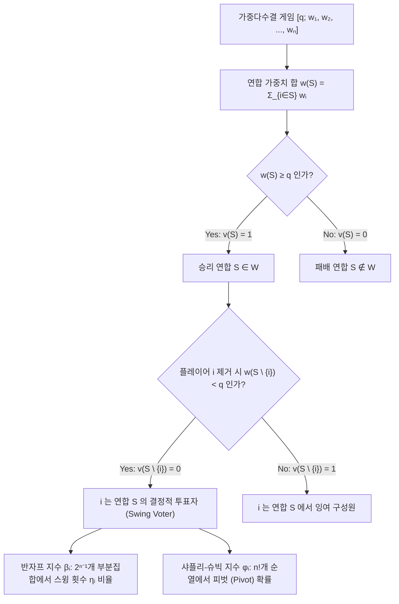
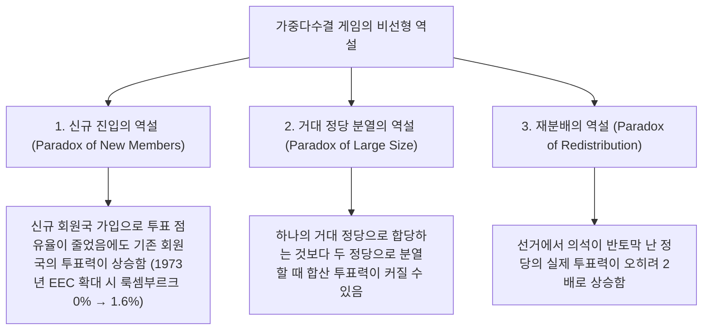

민주주의 의회나 주식회사의 주주총회에서 우리는 흔히 한 가지 소박한 비례 가설을 당연하게 받아들인다. 즉, <strong>"정당의 의석 비율(또는 주주의 지분율)이 곧 정치적·제도적 결정권(투표력, Voting Power)에 비례한다"</strong>는 믿음이다.

그러나 협동 게임 이론(Cooperative Game Theory)과 사회선택이론(Social Choice Theory)의 수학적 분석은 이러한 직관이 완벽한 착각임을 보여준다. 총의석 100석, 가결 정족수(쿼터)가 $q = 51$석인 의회에서 A당이 49석, B당이 49석, 군소 정당인 C당이 단 2석을 가지고 있다고 하자. 의석 점유율만 보면 A당과 B당은 각각 $49\%$를 차지하는 거대 정당이고 C당은 $2\%$에 불과하다. 하지만 법안의 가결 여부를 좌우하는 실제 <strong>투표력(Voting Power)</strong>을 계산하면, A당, B당, C당의 권력은 정확히 <strong>3분의 1($33.33\%$)씩 완전히 동일</strong>하다.

반대로 상당한 수의 투표권을 배정받았음에도 수학적 투표력이 <strong>완전히 제로($0\%$)</strong>가 되는 <strong>더미 플레이어(Dummy Player, 허수아비 투표자)</strong>가 탄생하기도 한다. 1958년 출범한 유럽경제공동체(EEC, 현 EU의 전신) 각료이사회에서는 가중다수결 $[12;\, 4, 4, 4, 2, 2, 1]$이 채택되었는데, 룩셈부르크는 1표($5.88\%$)를 보유했음에도 다른 5개국의 표수가 모두 짝수이고 정족수 $12$ 또한 짝수였기 때문에 15년 동안 투표력이 수학적으로 $0\%$였다.

본고에서는 가중다수결 게임의 공리적 정의로부터 출발하여, 투표력을 측정하는 양대 지표인 <strong>반자프 지수(Banzhaf Power Index)</strong>와 <strong>샤플리-슈빅 지수(Shapley-Shubik Power Index)</strong>를 유도하고, 생성함수 알고리즘과 유엔 안전보장이사회의 거부권 구조, 그리고 의석을 잃은 정당의 권력이 오히려 두 배로 뛰는 <strong>재분배의 역설(Paradox of Redistribution)</strong>을 심층적으로 해부한다.

---

## 1. 의석 점유율이라는 환상: 3가지 사고실험

총의석 $W = 100$, 가결 정족수 $q = 51$인 세 가지 의회 모델을 비교해 보자.

1. <strong>킹메이커의 탄생 $[51;\, 49, 49, 2]$</strong>:
   어느 정당도 단독 과반에 미치지 못한다. 승리 연합(Winning Coalitions)은 $\{A, B\}(98)$, $\{A, C\}(51)$, $\{B, C\}(51)$, $\{A, B, C\}(100)$뿐이다. 즉 "어느 두 정당이라도 연합하면 가결된다"는 뜻이므로, 이 게임은 1인 1표 다수결 $[2;\, 1, 1, 1]$과 <strong>수학적으로 완전 동형(Isomorphic)</strong>이다. 따라서 $2\%$ 의석의 C당은 $49\%$ 의석의 A·B당과 똑같은 $33.33\%$의 캐스팅보트 권력을 행사한다.
2. <strong>독재자와 무력한 야당 $[51;\, 52, 47, 1]$</strong>:
   A당은 단독으로 $52 \ge 51$을 넘기므로 모든 법안을 단독 처리할 수 있는 <strong>독재자(Dictator, 투표력 $100\%$)</strong>가 된다. 반면 B당은 $47\%$의 의석을 가졌음에도 C당과 합쳐 $48 < 51$에 그치므로 투표력이 $0\%$인 더미 플레이어로 전락한다.
3. <strong>보이지 않는 더미와 1965년 나소 카운티 소송 $[51;\, 35, 35, 25, 5]$</strong>:
   어느 정당도 과반이 아니지만, $\{A, B, C\}$(가중치 $35, 35, 25$)의 부분집합 합을 구해보면 $0, 25, 35, 60, 70, 95$뿐이다. D당(5석)이 가세하여 패배 연합을 승리 연합으로 바꾸려면 나머지 정당들의 합이 스윙 구간 $[51 - 5,\, 50] = [46, 50]$에 들어야 하는데, 그러한 조합이 <strong>단 하나도 존재하지 않는다</strong>. 따라서 D당의 투표력은 $0\%$이다. 1965년 법학도 존 반자프 3세(John F. Banzhaf III)는 바로 이 수리 분석을 통해 뉴욕주 나소 카운티(Nassau County) 위원회의 가중투표제에서 3개 자치구의 투표력이 $0\%$임을 입증하여 위헌 판결을 이끌어냈다.

---

## 2. 가중다수결 게임과 두 권력 지수의 수리적 정의

### 단순 게임과 가중다수결 게임

플레이어 집합 $N = \{1, 2, \dots, n\}$의 부분집합 $S \subseteq N$을 <strong>연합(Coalition)</strong>이라 한다. 특성함수 $v: 2^N \to \{0, 1\}$가 $v(\emptyset)=0$, $v(N)=1$, 단조성($S \subseteq T \implies v(S) \le v(T)$)을 만족할 때 $(N, v)$를 <strong>단순 게임(Simple Game)</strong>이라 한다. 각 플레이어에게 가중치 $w_i \ge 0$와 정족수 $q > \frac{1}{2}\sum w_i$가 주어져
$$v(S) = \begin{cases} 1 & \text{if } \sum_{i \in S} w_i \ge q \quad (\text{승리 연합}) \\ 0 & \text{if } \sum_{i \in S} w_i < q \quad (\text{패배 연합}) \end{cases}$$
로 정의되는 게임을 <strong>가중다수결 게임(Weighted Voting Game)</strong>이라 하며 $[q;\, w_1, w_2, \dots, w_n]$으로 표기한다. 승리 연합 $S \ni i$에서 $i$가 이탈했을 때 패배 연합이 된다면($v(S)=1,\ v(S \setminus \{i\})=0$), 플레이어 $i$를 <strong>결정적 투표자(Critical / Swing Voter)</strong>라고 부른다.

### 1. 반자프 투표력 지수 (Penrose 1946 / Banzhaf 1965)

플레이어 $i$가 결정적(스윙)이 되는 승리 연합의 총개수를 $\eta_i = \sum_{T \subseteq N \setminus \{i\}} [v(T \cup \{i\}) - v(T)]$라 하자. 이를 $2^{n-1}$로 나눈 <strong>절대 반자프 지수</strong> $\beta'_i$와 전체 합이 $1$이 되도록 정규화한 <strong>정규화 반자프 지수</strong> $\beta_i$는 다음과 같다.
$$\beta'_i = \frac{\eta_i}{2^{n-1}}, \qquad \beta_i = \frac{\eta_i}{\sum_{j=1}^n \eta_j}$$

### 2. 샤플리-슈빅 투표력 지수 (Shapley & Shubik 1954)

노벨 경제학상 수상자 로이드 샤플리(Lloyd Shapley)와 마틴 슈빅은 협동 게임의 <strong>샤플리 값(Shapley Value)</strong>을 단순 게임에 적용했다. $n$명의 플레이어가 일렬로 연립에 참여하는 $n!$가지 순열 $\pi = (\pi_1, \dots, \pi_n)$에서, 자신의 합류로 누적 가중치를 처음 $q$ 이상으로 돌파시키는 유일한 플레이어를 <strong>피벗(Pivot, 중추)</strong>이라 한다. 선행 집합이 $S$일 때의 순열 수는 $|S|!\,(n - |S| - 1)!$이므로, <strong>샤플리-슈빅 지수</strong>는 다음과 같이 정의된다.
$$\phi_i = \sum_{S \subseteq N \setminus \{i\}} \frac{|S|!\,(n - |S| - 1)!}{n!} \bigl[v(S \cup \{i\}) - v(S)\bigr]$$

---

## 3. 완전 계산 비교: $[6;\, 4, 3, 2, 1]$ 및 생성함수 해법

4자 게임 $[6;\, 4, 3, 2, 1]$ ($w_A=4, w_B=3, w_C=2, w_D=1$, 총합 $10$, 쿼터 $q=6$)의 전체 승리 연합 7개와 24개 순열의 계산 결과는 다음과 같다.

| 승리 연합 $S$ | 가중치 합 $w(S)$ | 이탈 시 가중치 $w(S \setminus \{i\})$ | 결정적 플레이어 (Swing) | 정당 | 의석률 | 스윙 수 $\eta_i$ | 정규화 반자프 $\beta_i$ | 피벗 횟수 ($/24$) | 샤플리-슈빅 $\phi_i$ |
| :--- | :---: | :--- | :--- | :---: | :---: | :---: | :---: | :---: | :---: |
| $\{A, B\}$ | $7$ | $-A:3,\ -B:4$ | <strong>A, B</strong> | <strong>A ($w_A=4$)</strong> | $40.0\%$ | $5$ | $5/12 \approx \mathbf{41.67\%}$ | $10$ | $10/24 \approx \mathbf{41.67\%}$ |
| $\{A, C\}$ | $6$ | $-A:2,\ -C:4$ | <strong>A, C</strong> | <strong>B ($w_B=3$)</strong> | $30.0\%$ | $3$ | $3/12 = \mathbf{25.00\%}$ | $6$ | $6/24 = \mathbf{25.00\%}$ |
| $\{A, B, C\}$ | $9$ | $-A:5,\ -B:6,\ -C:7$ | <strong>A</strong> | <strong>C ($w_C=2$)</strong> | $20.0\%$ | $3$ | $3/12 = \mathbf{25.00\%}$ | $6$ | $6/24 = \mathbf{25.00\%}$ |
| $\{A, B, D\}$ | $8$ | $-A:4,\ -B:5,\ -D:7$ | <strong>A, B</strong> | <strong>D ($w_D=1$)</strong> | $10.0\%$ | $1$ | $1/12 \approx \mathbf{8.33\%}$ | $2$ | $2/24 \approx \mathbf{8.33\%}$ |
| $\{A, C, D\}$ | $7$ | $-A:3,\ -C:5,\ -D:6$ | <strong>A, C</strong> | <strong>합계</strong> | $100\%$ | $12$ | $100.00\%$ | $24$ | $100.00\%$ |
| $\{B, C, D\}$ | $6$ | $-B:3,\ -C:4,\ -D:5$ | <strong>B, C, D</strong> | | | | | | |
| $\{A,B,C,D\}$ | $10$ | 누구를 빼도 $\ge 6$ | <strong>없음</strong> | | | | | | |

놀랍게도 B당(3석)은 C당(2석)보다 의석이 1.5배나 많지만, 두 정당의 투표력은 반자프 지수와 샤플리-슈빅 지수 모두 <strong>$25.00\%$로 완전히 동일</strong>하다. 반면 $[5;\, 3, 2, 1, 1]$에서는 $\beta = (50\%, 30\%, 10\%, 10\%)$, $\phi = (58.33\%, 25.00\%, 8.33\%, 8.33\%)$로 갈라진다. <strong>스트래핀 정리(Straffin 1977)</strong>에 따르면 각 투표자가 독립적으로 확률 $1/2$로 찬반을 결정할 때(독립성 가정)는 반자프 지수가 도출되고, 모든 투표자가 공통의 여론 확률 $p \sim \mathrm{Uniform}(0,1)$을 따를 때(동질성 가정)는 베타 적분 $\int_0^1 p^{|S|}(1-p)^{n-|S|-1}dp$에 의해 샤플리-슈빅 지수가 도출된다.

또한 플레이어 수 $n$이 클 때는 <strong>생성함수(Generating Function)</strong>를 이용해 의사다항 시간 $O(n^2 q)$에 엄밀해를 구할 수 있다.
$$P_{-i}(x) = \prod_{j \ne i} \left(1 + x^{w_j}\right) = \sum_{k} c_k^{(i)} x^k \implies \eta_i = \sum_{k=q-w_i}^{q-1} c_k^{(i)}$$

---

## 4. 실제 국제기구 분석과 투표력의 3대 역설

### 1. 1958–1973년 유럽경제공동체(EEC) 각료이사회 $[12;\, 4, 4, 4, 2, 2, 1]$

서독·프랑스·이탈리아 각 4표, 벨기에·네덜란드 각 2표, 룩셈부르크 1표(정족수 $q = 12$). 룩셈부르크의 생성함수 $P_{-\text{Lux}}(x) = (1 + x^4)^3(1 + x^2)^2$은 오직 짝수 차수 항만 가지므로 $x^{11}$의 계수가 $0$이다! 즉 룩셈부르크는 15년간 <strong>투표력이 $0\%$인 더미 플레이어</strong>였다(강대국 3국은 각 $\beta = 23.81\%, \phi = 23.33\%$, 벨기에·네덜란드는 각 $\beta = 14.29\%, \phi = 15.00\%$).

### 2. 유엔 안전보장이사회(UNSC)와 거부권의 위력

상임이사국 5개국(P5, 거부권 보유)과 비상임이사국 10개국(NP10)으로 구성되며, 가결에는 P5 전원의 동의와 총 9표 이상이 필요하다. 이는 가중다수결 게임 $[39;\, 7, 7, 7, 7, 7, 1, 1, 1, 1, 1, 1, 1, 1, 1, 1]$과 동치이다.
- <strong>반자프 지수</strong>: $\eta_{\text{P5}} = \sum_{k=4}^{10} \binom{10}{k} = 848$, $\eta_{\text{NP}} = \binom{9}{3} = 84$. 따라서 상임이사국 1개국은 $\beta_{\text{P5}} = \frac{848}{5080} \approx \mathbf{16.69\%}$, 비상임이사국 1개국은 $\beta_{\text{NP}} = \frac{84}{5080} \approx \mathbf{1.65\%}$를 갖는다.
- <strong>샤플리-슈빅 지수</strong>: 비상임이사국이 피벗이 되려면 앞선 8개국에 P5 5개국과 다른 NP 3개국이 포함되어야 하므로,
  $$\phi_{\text{NP}} = \binom{9}{3}\frac{8!\,6!}{15!} = \frac{84}{45045} = \frac{4}{2145} \approx \mathbf{0.1865\%}, \qquad \phi_{\text{P5}} = \frac{421}{2145} \approx \mathbf{19.627\%}$$
  상임이사국 5개국이 전체 권력의 $98.135\%$를 독점하며, 상임이사국 1개국의 권력은 비상임이사국의 <strong>105.25배</strong>에 달한다.

### 3. 재분배의 역설 (Paradox of Redistribution, Fischer & Schotter 1978)

총의석 14석, 정족수 $q = 9$인 4당 의회에서 선거 전후의 변화를 보자.
- <strong>선거 전 $[9;\, 6, 4, 2, 2]$</strong>: 극소 승리 연합은 $\{A, B\}(10)$와 $\{A, C, D\}(10)$뿐이며 A당이 거부권을 독점한다. 이때 D당(2석)의 투표력은 $\beta_D = 10.00\%$, $\phi_D = 8.33\%$이다.
- <strong>선거 후 $[9;\, 5, 5, 3, 1]$</strong>: A당이 1석을 잃어 B당으로 가고, <strong>D당은 2석에서 1석으로 의석이 반토막 나 C당으로 이동</strong>했다. 그러나 이제 $\{B, C, D\}(5+3+1=9)$도 승리 연합이 되면서 A당의 거부권이 깨지고, 단 1석뿐인 D당이 $\{A, C, D\}$와 $\{B, C, D\}$ 양쪽 모두의 필수 킹메이커로 등극한다! 그 결과 D당의 투표력은 $\beta_D = \mathbf{16.67\%}$, $\phi_D = \mathbf{16.67\%}$로 <strong>의석은 절반으로 줄었는데 권력은 정확히 2배로 폭등</strong>한다.

한편, 인구 $P_k$가 서로 다른 국가들로 구성된 2단계 연방 투표에서 모든 시민의 간접 투표력을 평등하게 만들려면, 각국 대표의 반자프 지수 $\beta'_k$를 인구가 아닌 <strong>인구의 제곱근 $\sqrt{P_k}$에 비례</strong>하도록 설계해야 한다(<strong>펜로즈의 제곱근 법칙, Penrose Square Root Law 1946</strong>).
