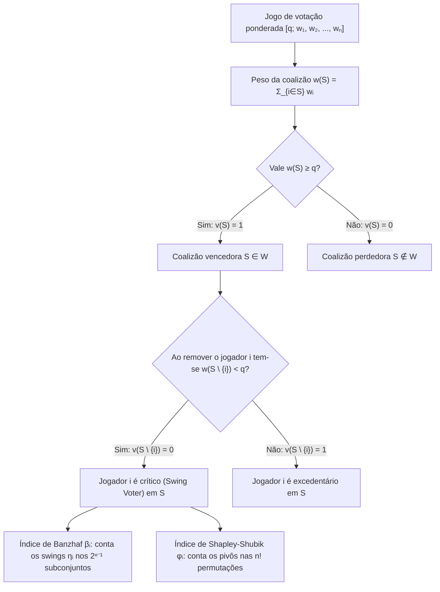
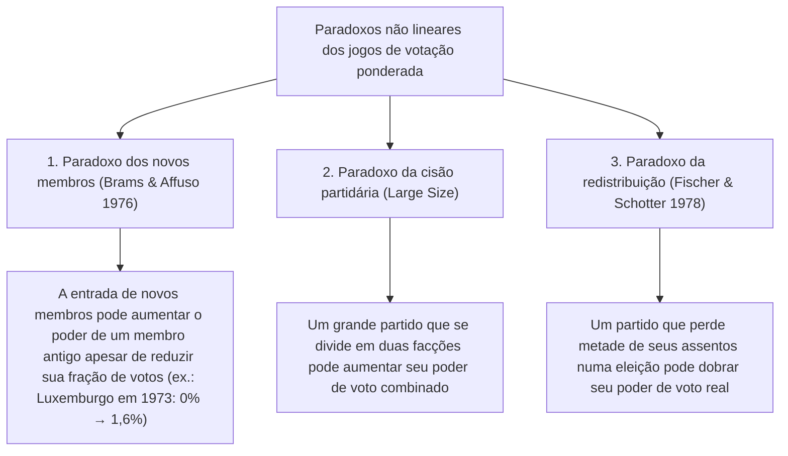

Nos parlamentos democráticos, nos conselhos internacionais e nas assembleias de acionistas, costuma-se aceitar uma ilusão aritmética intuitiva, porém profundamente falsa: a suposição de que <strong>a proporção de assentos de um partido — ou o percentual de ações de um sócio — equivale diretamente ao seu poder real de decisão (Voting Power)</strong>.

Imagine um parlamento de 100 assentos onde aprovar uma lei exige maioria simples de $q = 51$ votos. O partido A possui 49 assentos, o partido B possui 49 assentos e um minúsculo partido C detém apenas 2 assentos. À primeira vista, A e B dominam o plenário com $49\%$ cada um, enquanto C parece irrelevante com $2\%$. Contudo, a <strong>teoria dos jogos cooperativos (Cooperative Game Theory)</strong> demonstra um fato surpreendente: os partidos A, B e C possuem <strong>exatamente o mesmo poder de voto: um terço ($33,33\%$) cada um</strong>.

Por outro lado, um partido ou Estado soberano pode possuir um bloco considerável de votos e ter <strong>poder de voto matematicamente igual a zero ($0\%$)</strong>, tornando-se o que a teoria dos jogos chama de <strong>jogador fictício (Dummy Player)</strong>. Entre 1958 e 1973, o Conselho de Ministros da Comunidade Econômica Europeia (CEE) utilizou o sistema ponderado $[12;\, 4, 4, 4, 2, 2, 1]$. Embora Luxemburgo tivesse 1 voto ($5,88\%$ do total), todos os demais países tinham um número par de votos ($4, 4, 4, 2, 2$) e a cota era par ($12$). Como a soma de números pares é sempre par, nenhuma coalizão perdedora (no máximo $10$ votos) podia alcançar $12$ graças ao voto único de Luxemburgo: durante 15 anos, seu poder formal de voto foi literalmente $0\%$.

Neste artigo desenvolvemos a teoria matemática dos <strong>índices de poder de voto</strong>: a formulação axiomática dos jogos simples ponderados, o <strong>índice de Banzhaf</strong>, o <strong>índice de Shapley-Shubik</strong>, o teorema probabilístico de Straffin, algoritmos por funções geradoras, o poder de veto no Conselho de Segurança da ONU e os paradoxos de redistribuição.

---

## 1. A ilusão da proporção de assentos: três experimentos mentais

Consideremos três parlamentos com $W = 100$ assentos e uma cota de maioria $q = 51$:

1. <strong>O fazedor de reis (Kingmaker) $[51;\, 49, 49, 2]$</strong>:
   Nenhum partido atinge 51 assentos sozinho. As coalizões vencedoras são $\{A, B\}(98)$, $\{A, C\}(51)$, $\{B, C\}(51)$ e $\{A, B, C\}(100)$. Como qualquer par de partidos vence, este jogo é <strong>isomorfo</strong> à votação majoritária simples $[2;\, 1, 1, 1]$. Com apenas $2\%$ dos assentos, o partido C detém $33,33\%$ do poder de decisão, exatamente igual a A e B.
2. <strong>O ditador e a oposição impotente $[51;\, 52, 47, 1]$</strong>:
   Como $w_A = 52 \ge 51$, o partido A é um <strong>ditador</strong> ($100\%$ do poder). Embora o partido B controle $47\%$ dos assentos, nem mesmo unindo-se a C ($47 + 1 = 48 < 51$) pode aprovar ou bloquear qualquer projeto: B e C são <strong>jogadores fictícios</strong> ($0\%$ de poder).
3. <strong>O jogador fictício invisível e o caso do Condado de Nassau (1965) $[51;\, 35, 35, 25, 5]$</strong>:
   Nenhum partido tem maioria absoluta. Mas as somas possíveis dos subconjuntos de $\{A, B, C\}$ (pesos $35, 35, 25$) são apenas $0, 25, 35, 60, 70, 95$. Nenhum subconjunto soma entre $46$ e $50$ (o intervalo crítico $[q - w_D,\, q - 1]$)! Portanto, os $5$ assentos do partido D jamais podem converter uma derrota em vitória e seu poder é $0\%$. Em 1965, o jurista <strong>John F. Banzhaf III</strong> empregou exatamente essa análise para provar que três municípios do Conselho de Supervisores do Condado de Nassau (Nova York) tinham $0\%$ de poder de voto, levando os tribunais a declarar o sistema inconstitucional.

---

## 2. Formulação matemática: índices de Banzhaf e Shapley-Shubik

### Jogos simples e jogos de votação ponderada

Seja $N = \{1, 2, \dots, n\}$ o conjunto de jogadores. Um par $(N, v)$ com $v: 2^N \to \{0, 1\}$ é um <strong>jogo simples</strong> se $v(\emptyset) = 0$, $v(N) = 1$ e $S \subseteq T \implies v(S) \le v(T)$ (monotonicidade). Um <strong>jogo de votação ponderada</strong> $[q;\, w_1, w_2, \dots, w_n]$ com pesos $w_i \ge 0$ e cota $q > \frac{1}{2}\sum w_i$ é definido por:
$$v(S) = \begin{cases} 1 & \text{se } \sum_{i \in S} w_i \ge q \quad (\text{coalizão vencedora}) \\ 0 & \text{se } \sum_{i \in S} w_i < q \quad (\text{coalizão perdedora}) \end{cases}$$

Um jogador $i \in S$ é <strong>crítico (Swing Voter)</strong> em $S$ se $v(S) = 1$ e $v(S \setminus \{i\}) = 0$, isto é, $\Delta_i v(S) = v(S) - v(S \setminus \{i\}) = 1$.

### 1. O índice de poder de Banzhaf (Penrose 1946 / Banzhaf 1965)

Seja $\eta_i = \sum_{T \subseteq N \setminus \{i\}} [v(T \cup \{i\}) - v(T)]$ o número de coalizões nas quais $i$ é crítico. O <strong>índice de Banzhaf absoluto</strong> $\beta'_i$ e o <strong>índice de Banzhaf normalizado</strong> $\beta_i$ são definidos por:
$$\beta'_i = \frac{\eta_i}{2^{n-1}}, \qquad \beta_i = \frac{\eta_i}{\sum_{j=1}^n \eta_j}$$

### 2. O índice de poder de Shapley-Shubik (Shapley & Shubik 1954)

Considerando as $n!$ permutações $\pi = (\pi_1, \dots, \pi_n)$ nas quais os jogadores aderem um a um a uma coalizão, o único jogador cuja chegada eleva o peso acumulado até atingir ou superar $q$ pela primeira vez é chamado de <strong>pivô (Pivot)</strong>. Como existem $|S|!\,(n - |S| - 1)!$ permutações em que o conjunto de predecessores de $i$ é exatamente $S$, o <strong>índice de Shapley-Shubik</strong> é:
$$\phi_i = \sum_{S \subseteq N \setminus \{i\}} \frac{|S|!\,(n - |S| - 1)!}{n!} \bigl[v(S \cup \{i\}) - v(S)\bigr]$$

---

## 3. Comparação passo a passo em $[6;\, 4, 3, 2, 1]$ e funções geradoras

No jogo $[6;\, 4, 3, 2, 1]$ ($w_A=4, w_B=3, w_C=2, w_D=1$, peso total $10$, cota $q=6$), a enumeração completa das 7 coalizões vencedoras e das 24 permutações fornece:

| Coalizão vencedora $S$ | Peso $w(S)$ | Peso após remoção $w(S \setminus \{i\})$ | Jogadores críticos (Swing) | Partido | Quota de votos | Swings $\eta_i$ | Banzhaf normalizado $\beta_i$ | Pivôs ($/24$) | Shapley-Shubik $\phi_i$ |
| :--- | :---: | :--- | :--- | :---: | :---: | :---: | :---: | :---: | :---: |
| $\{A, B\}$ | $7$ | $-A:3,\ -B:4$ | <strong>A, B</strong> | <strong>A ($w_A=4$)</strong> | $40,0\%$ | $5$ | $5/12 \approx \mathbf{41,67\%}$ | $10$ | $10/24 \approx \mathbf{41,67\%}$ |
| $\{A, C\}$ | $6$ | $-A:2,\ -C:4$ | <strong>A, C</strong> | <strong>B ($w_B=3$)</strong> | $30,0\%$ | $3$ | $3/12 = \mathbf{25,00\%}$ | $6$ | $6/24 = \mathbf{25,00\%}$ |
| $\{A, B, C\}$ | $9$ | $-A:5,\ -B:6,\ -C:7$ | <strong>A</strong> | <strong>C ($w_C=2$)</strong> | $20,0\%$ | $3$ | $3/12 = \mathbf{25,00\%}$ | $6$ | $6/24 = \mathbf{25,00\%}$ |
| $\{A, B, D\}$ | $8$ | $-A:4,\ -B:5,\ -D:7$ | <strong>A, B</strong> | <strong>D ($w_D=1$)</strong> | $10,0\%$ | $1$ | $1/12 \approx \mathbf{8,33\%}$ | $2$ | $2/24 \approx \mathbf{8,33\%}$ |
| $\{A, C, D\}$ | $7$ | $-A:3,\ -C:5,\ -D:6$ | <strong>A, C</strong> | <strong>Total</strong> | $100\%$ | $12$ | $100,00\%$ | $24$ | $100,00\%$ |
| $\{B, C, D\}$ | $6$ | $-B:3,\ -C:4,\ -D:5$ | <strong>B, C, D</strong> | | | | | | |
| $\{A,B,C,D\}$ | $10$ | Qualquer remoção $\ge 6$ | <strong>Nenhum</strong> | | | | | | |

Embora o partido B ($30\%$) tenha $50\%$ mais votos que o partido C ($20\%$), ambos possuem <strong>exatamente o mesmo poder de voto ($25,00\%$)</strong> segundo os dois índices. Já em $[5;\, 3, 2, 1, 1]$, os dois índices divergem: $\beta = (50\%, 30\%, 10\%, 10\%)$ contra $\phi = (58,33\%, 25,00\%, 8,33\%, 8,33\%)$. Pelo <strong>teorema de Straffin (1977)</strong>, Banzhaf corresponde à <em>hipótese de independência</em> ($p_i \sim \mathrm{Uniform}(0,1)$ independentes) e Shapley-Shubik à <em>hipótese de homogeneidade</em> ($p_1 = \dots = p_n = p \sim \mathrm{Uniform}(0,1)$).

Para valores grandes de $n$, as <strong>funções geradoras</strong> permitem o cálculo exato em tempo pseudopolinomial $O(n^2 q)$:
$$P_{-i}(x) = \prod_{j \ne i} \left(1 + x^{w_j}\right) = \sum_{k} c_k^{(i)} x^k \implies \eta_i = \sum_{k=q-w_i}^{q-1} c_k^{(i)}$$

---

## 4. Instituições reais e os paradoxos do poder de voto

### 1. O Conselho de Ministros da CEE (1958–1973) $[12;\, 4, 4, 4, 2, 2, 1]$

Para Luxemburgo ($w_{\text{Lux}} = 1$, cota $q = 12$), o polinômio gerador $P_{-\text{Lux}}(x) = (1 + x^4)^3(1 + x^2)^2$ possui apenas expoentes pares, de modo que o coeficiente de $x^{11}$ é $0$ ($\beta_{\text{Lux}} = \phi_{\text{Lux}} = 0\%$). Com a ampliação da CEE em 1973 para 9 membros ($[41;\, 10, 10, 10, 10, 5, 5, 3, 3, 2]$), embora a fatia de votos de Luxemburgo tenha caído de $5,88\%$ para $3,45\%$, seu poder de Banzhaf subiu de $0\%$ para $1,62\%$ (<strong>paradoxo dos novos membros</strong>, Brams & Affuso 1976).

### 2. O Conselho de Segurança da ONU (o poder de veto do P5)

O Conselho de Segurança (5 membros permanentes P5 com veto e 10 não permanentes NP10, exigindo 9 votos incluindo todos os 5 P5) equivale ao jogo ponderado $[39;\, 7, 7, 7, 7, 7, 1, 1, 1, 1, 1, 1, 1, 1, 1, 1]$.
- <strong>Índice de Banzhaf</strong>: $\eta_{\text{P5}} = \sum_{k=4}^{10} \binom{10}{k} = 848$, $\eta_{\text{NP}} = \binom{9}{3} = 84 \implies \beta_{\text{P5}} = \frac{848}{5080} \approx \mathbf{16,69\%}$ e $\beta_{\text{NP}} = \frac{84}{5080} \approx \mathbf{1,65\%}$.
- <strong>Índice de Shapley-Shubik</strong>: Um membro não permanente só é pivô na 9.ª posição após os 5 P5 e exatamente 3 dos outros 9 NP:
  $$\phi_{\text{NP}} = \binom{9}{3}\frac{8!\,6!}{15!} = \frac{84}{45045} = \frac{4}{2145} \approx \mathbf{0,1865\%}, \qquad \phi_{\text{P5}} = \frac{421}{2145} \approx \mathbf{19,627\%}$$
  Os 5 membros permanentes concentram $98,135\%$ do poder de Shapley-Shubik (cada P5 possui <strong>105,25 vezes</strong> o poder de um membro não permanente)!

### 3. O paradoxo da redistribuição (Fischer & Schotter 1978)

Comparemos um parlamento de 14 assentos (cota $q = 9$) antes e depois de uma eleição:
- <strong>Antes da eleição $[9;\, 6, 4, 2, 2]$</strong>: As únicas coalizões vencedoras mínimas são $\{A, B\}(10)$ e $\{A, C, D\}(10)$; A detém poder de veto. O partido D ($2$ assentos) tem $\beta_D = 10,00\%$ e $\phi_D = 8,33\%$.
- <strong>Depois da eleição $[9;\, 5, 5, 3, 1]$</strong>: A perde 1 assento para B, e <strong>o partido D perde metade de seus assentos ($2 \to 1$) para C</strong>. No entanto, agora $\{B, C, D\}$ soma $5+3+1=9$ e torna-se uma coalizão vencedora. Quebrado o monopólio de veto de A, o partido D, com apenas 1 assento, passa a ser o fiel da balança indispensável tanto para $\{A, C, D\}$ quanto para $\{B, C, D\}$: seu poder salta para $\beta_D = \mathbf{16,67\%}$ e $\phi_D = \mathbf{16,67\%}$ — <strong>metade dos assentos, o dobro do poder</strong>.

Por fim, em sistemas federativos de dois níveis, a <strong>lei da raiz quadrada de Penrose (1946)</strong> demonstra que, para igualar o poder indireto de cada cidadão independentemente da população $P_k$ de seu Estado, o índice de Banzhaf $\beta'_k$ de cada Estado deve ser proporcional a <strong>$\sqrt{P_k}$</strong>.
