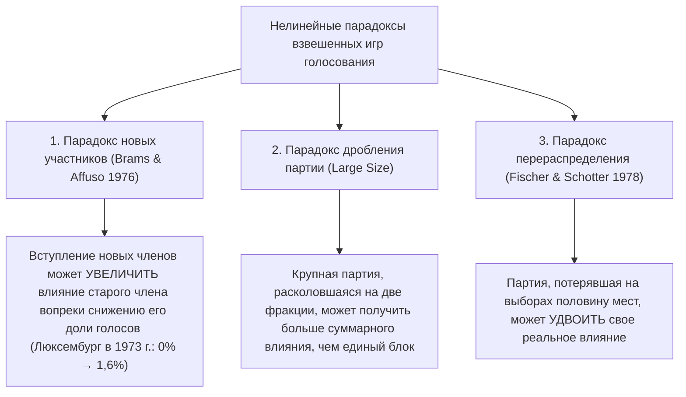

В демократических парламентах, международных советах и корпоративных советах директоров наблюдатели часто попадают в ловушку наглядной арифметической иллюзии: предполагается, что <strong>доля мандатов партии или процент голосующих акций акционера прямо пропорциональны их реальному влиянию на принятие решений (Voting Power)</strong>.

Представьте парламент из 100 мест, где для принятия закона требуется простое большинство в $q = 51$ голос. У партии A — 49 мест, у партии B — 49 мест, а у крошечной третьей партии C — всего 2 места. На телевизионных диаграммах партии A и B выглядят гигантами, контролирующими по $49\%$ палаты, тогда как партия C кажется маргинальной группой с $2\%$. Однако строгий анализ с позиций <strong>кооперативной теории игр (Cooperative Game Theory)</strong> открывает поразительный факт: партии A, B и C обладают <strong>абсолютно одинаковым влиянием при голосовании — ровно по одной трети ($33{,}33\%$) каждая</strong>.

Напротив, политическая партия или суверенное государство может располагать солидным пакетом голосов, но иметь <strong>математически нулевое ($0\%$) влияние на исход голосования</strong> — такой участник называется <strong>фиктивным игроком (Dummy Player, «болваном»)</strong>. С 1958 по 1973 год Совет министров Европейского экономического сообщества (ЕЭС) использовал взвешенную систему $[12;\, 4, 4, 4, 2, 2, 1]$. Хотя Люксембург имел 1 голос ($5{,}88\%$ от общего числа), все остальные страны имели четное число голосов ($4, 4, 4, 2, 2$) при четной квоте $q = 12$. Поскольку сумма четных чисел всегда четна, ни одна проигрывающая коалиция (максимум $10$ голосов) не могла набрать $12$ за счет единственного голоса Люксембурга: в течение 15 лет его реальное влияние составляло ровно $0\%$.

В этой статье мы построим полную математическую теорию <strong>индексов влияния при голосовании</strong>: аксиоматику простых взвешенных игр, <strong>индекс Банцафа</strong>, <strong>индекс Шепли — Шубика</strong>, вероятностную теорему Страффина, алгоритмы динамического программирования через производящие функции, архитектуру вето в Совете Безопасности ООН и парадоксы перераспределения мест.

---

## 1. Иллюзия доли мандатов: три мысленных эксперимента

Рассмотрим три парламента со $100$ мандатами и квотой большинства $q = 51$:

1. <strong>«Делатель королей» (Kingmaker) $[51;\, 49, 49, 2]$</strong>:
   Ни одна партия не набирает 51 голос в одиночку. Выигрывающими коалициями являются $\{A, B\}(98)$, $\{A, C\}(51)$, $\{B, C\}(51)$ и $\{A, B, C\}(100)$. Поскольку любые две партии образуют большинство, эта игра <strong>изоморфна</strong> комитету с равными голосами $[2;\, 1, 1, 1]$. Обладая лишь $2\%$ мест, партия C имеет те же $33{,}33\%$ власти, что и партии A и B.
2. <strong>Диктатор и бессильная оппозиция $[51;\, 52, 47, 1]$</strong>:
   Так как $w_A = 52 \ge 51$, партия A является <strong>диктатором</strong> ($100\%$ влияния). Хотя партия B контролирует $47\%$ кресел, даже объединившись с C ($47 + 1 = 48 < 51$), она не может ни провести, ни заблокировать ни один закон: B и C — <strong>фиктивные игроки</strong> ($0\%$ влияния).
3. <strong>Невидимый фиктивный игрок и дело округа Нассо (1965) $[51;\, 35, 35, 25, 5]$</strong>:
   Ни у одной партии нет большинства. Однако возможные суммы весов подмножеств партий $\{A, B, C\}$ ($35, 35, 25$) равны только $0, 25, 35, 60, 70, 95$. Ни одно подмножество не дает сумму в критическом интервале $[q - w_D,\, q - 1] = [46, 50]$! Следовательно, $5$ мандатов партии D никогда не превращают поражение в победу, и ее влияние равно $0\%$. В 1965 году юрист <strong>Джон Банцаф (John F. Banzhaf III)</strong> применил этот расчет к Наблюдательному совету округа Нассо (штат Нью-Йорк), доказав в суде, что три муниципалитета имели $0\%$ влияния при голосовании.

---

## 2. Математическая формулировка: индексы Банцафа и Шепли — Шубика

### Простые игры и взвешенные игры голосования

Пусть $N = \{1, 2, \dots, n\}$ — множество игроков. Пара $(N, v)$, где $v: 2^N \to \{0, 1\}$, называется <strong>простой игрой</strong>, если $v(\emptyset) = 0$, $v(N) = 1$ и из $S \subseteq T$ следует $v(S) \le v(T)$ (монотонность). <strong>Взвешенная игра голосования</strong> $[q;\, w_1, w_2, \dots, w_n]$ с весами $w_i \ge 0$ и квотой $q > \frac{1}{2}\sum w_i$ задается функцией:
$$v(S) = \begin{cases} 1, & \text{если } \sum_{i \in S} w_i \ge q \quad (\text{выигрывающая коалиция}) \\ 0, & \text{если } \sum_{i \in S} w_i < q \quad (\text{проигрывающая коалиция}) \end{cases}$$

```mermaid
flowchart TD
    A["Взвешенная игра голосования [q; w₁, w₂, ..., wₙ]"] --> B["Вес коалиции w(S) = Σ_{i∈S} wᵢ"]
    B --> C{"Выполнено ли w(S) ≥ q?"}
    C -- "Да: v(S) = 1" --> D["Выигрывающая коалиция S ∈ W"]
    C -- "Нет: v(S) = 0" --> E["Проигрывающая коалиция S ∉ W"]
    D --> F{"Падает ли вес ниже q без игрока i: w(S \ {i}) < q?"}
    F -- "Да: v(S \ {i}) = 0" --> G["Игрок i — критический (Swing Voter) в S"]
    F -- "Нет: v(S \ {i}) = 1" --> H["Игрок i — избыточный в S"]
    G --> I["Индекс Банцафа βᵢ: считает решающие голоса ηᵢ по всем 2ⁿ⁻¹ подмножествам"]
    G --> J["Индекс Шепли — Шубика φᵢ: считает пивоты по всем n! перестановкам"]
```

Игрок $i \in S$ называется <strong>критическим (решающим / Swing Voter)</strong> в коалиции $S$, если $v(S) = 1$, но $v(S \setminus \{i\}) = 0$, то есть $\Delta_i v(S) = v(S) - v(S \setminus \{i\}) = 1$.

### 1. Индекс влияния Банцафа (Пенроуз 1946 / Банцаф 1965)

Пусть $\eta_i = \sum_{T \subseteq N \setminus \{i\}} [v(T \cup \{i\}) - v(T)]$ — число коалиций, в которых игрок $i$ является критическим. <strong>Абсолютный индекс Банцафа</strong> $\beta'_i$ и <strong>нормализованный индекс Банцафа</strong> $\beta_i$ определяются как:
$$\beta'_i = \frac{\eta_i}{2^{n-1}}, \qquad \beta_i = \frac{\eta_i}{\sum_{j=1}^n \eta_j}$$

### 2. Индекс влияния Шепли — Шубика (Shapley & Shubik 1954)

Рассмотрим все $n!$ перестановок $\pi = (\pi_1, \dots, \pi_n)$, упорядочивающих игроков по мере их присоединения к коалиции. Единственный игрок, чей приход впервые поднимает суммарный вес коалиции до порога $q$ или выше, называется <strong>ключевым игроком (пивотом / Pivot)</strong>. Поскольку существует $|S|!\,(n - |S| - 1)!$ перестановок, в которых множество предшественников игрока $i$ совпадает с $S$, <strong>индекс Шепли — Шубика</strong> равен:
$$\phi_i = \sum_{S \subseteq N \setminus \{i\}} \frac{|S|!\,(n - |S| - 1)!}{n!} \bigl[v(S \cup \{i\}) - v(S)\bigr]$$

---

## 3. Пошаговое сравнение на примере $[6;\, 4, 3, 2, 1]$ и производящие функции

В игре $[6;\, 4, 3, 2, 1]$ ($w_A=4, w_B=3, w_C=2, w_D=1$, сумма весов $10$, квота $q=6$) полный перебор 7 выигрывающих коалиций и 24 перестановок дает:

| Выигрывающая коалиция $S$ | Вес $w(S)$ | Вес после ухода $w(S \setminus \{i\})$ | Критические игроки (Swing) | Партия | Доля голосов | Число свингов $\eta_i$ | Норм. Банцаф $\beta_i$ | Пивоты ($/24$) | Шепли — Шубик $\phi_i$ |
| :--- | :---: | :--- | :--- | :---: | :---: | :---: | :---: | :---: | :---: |
| $\{A, B\}$ | $7$ | $-A:3,\ -B:4$ | <strong>A, B</strong> | <strong>A ($w_A=4$)</strong> | $40{,}0\%$ | $5$ | $5/12 \approx \mathbf{41{,}67\%}$ | $10$ | $10/24 \approx \mathbf{41{,}67\%}$ |
| $\{A, C\}$ | $6$ | $-A:2,\ -C:4$ | <strong>A, C</strong> | <strong>B ($w_B=3$)</strong> | $30{,}0\%$ | $3$ | $3/12 = \mathbf{25{,}00\%}$ | $6$ | $6/24 = \mathbf{25{,}00\%}$ |
| $\{A, B, C\}$ | $9$ | $-A:5,\ -B:6,\ -C:7$ | <strong>A</strong> | <strong>C ($w_C=2$)</strong> | $20{,}0\%$ | $3$ | $3/12 = \mathbf{25{,}00\%}$ | $6$ | $6/24 = \mathbf{25{,}00\%}$ |
| $\{A, B, D\}$ | $8$ | $-A:4,\ -B:5,\ -D:7$ | <strong>A, B</strong> | <strong>D ($w_D=1$)</strong> | $10{,}0\%$ | $1$ | $1/12 \approx \mathbf{8{,}33\%}$ | $2$ | $2/24 \approx \mathbf{8{,}33\%}$ |
| $\{A, C, D\}$ | $7$ | $-A:3,\ -C:5,\ -D:6$ | <strong>A, C</strong> | <strong>Итого</strong> | $100\%$ | $12$ | $100{,}00\%$ | $24$ | $100{,}00\%$ |
| $\{B, C, D\}$ | $6$ | $-B:3,\ -C:4,\ -D:5$ | <strong>B, C, D</strong> | | | | | | |
| $\{A,B,C,D\}$ | $10$ | Любой уход $\ge 6$ | <strong>Нет</strong> | | | | | | |

Хотя у партии B ($30\%$) на полтора раза больше мест, чем у партии C ($20\%$), обе партии обладают <strong>абсолютно одинаковым влиянием ($25{,}00\%$)</strong> по обоим индексам! Напротив, в игре $[5;\, 3, 2, 1, 1]$ индексы расходятся: $\beta = (50\%, 30\%, 10\%, 10\%)$ против $\phi = (58{,}33\%, 25{,}00\%, 8{,}33\%, 8{,}33\%)$. Согласно <strong>теореме Страффина (1977)</strong>, индекс Банцафа отвечает <em>гипотезе независимости</em> голосования игроков, а индекс Шепли — Шубика — <em>гипотезе однородности</em> ($p_1 = \dots = p_n = p \sim \mathrm{Uniform}(0,1)$).

При больших $n$ <strong>производящие функции</strong> позволяют точно вычислять индексы за псевдополиномиальное время $O(n^2 q)$:
$$P_{-i}(x) = \prod_{j \ne i} \left(1 + x^{w_j}\right) = \sum_{k} c_k^{(i)} x^k \implies \eta_i = \sum_{k=q-w_i}^{q-1} c_k^{(i)}$$

---

## 4. Реальные институты и парадоксы влияния при голосовании

### 1. Совет министров ЕЭС (1958–1973) $[12;\, 4, 4, 4, 2, 2, 1]$

Для Люксембурга ($w_{\text{Lux}} = 1$, квота $q = 12$) производящий многочлен $P_{-\text{Lux}}(x) = (1 + x^4)^3(1 + x^2)^2$ содержит только четные степени $x$, поэтому коэффициент при $x^{11}$ равен $0$ ($\beta_{\text{Lux}} = \phi_{\text{Lux}} = 0\%$). Однако при расширении ЕЭС в 1973 году до 9 стран ($[41;\, 10, 10, 10, 10, 5, 5, 3, 3, 2]$), несмотря на падение доли голосов Люксембурга с $5{,}88\%$ до $3{,}45\%$, его индекс Банцафа вырос с $0\%$ до $1{,}62\%$ (<strong>парадокс новых участников</strong>, Brams & Affuso 1976).

### 2. Совет Безопасности ООН (право вето постоянных членов P5)

Совет Безопасности ООН (5 постоянных членов P5 с правом вето и 10 непостоянных членов NP10, квота 9 голосов при согласии всех 5 P5) эквивалентен взвешенной игре $[39;\, 7, 7, 7, 7, 7, 1, 1, 1, 1, 1, 1, 1, 1, 1, 1]$.
- <strong>Индекс Банцафа</strong>: $\eta_{\text{P5}} = \sum_{k=4}^{10} \binom{10}{k} = 848$, $\eta_{\text{NP}} = \binom{9}{3} = 84 \implies \beta_{\text{P5}} = \frac{848}{5080} \approx \mathbf{16{,}69\%}$ и $\beta_{\text{NP}} = \frac{84}{5080} \approx \mathbf{1{,}65\%}$.
- <strong>Индекс Шепли — Шубика</strong>: Непостоянный член является пивотом только на 9-й позиции после всех 5 P5 и ровно 3 из остальных 9 NP:
  $$\phi_{\text{NP}} = \binom{9}{3}\frac{8!\,6!}{15!} = \frac{84}{45045} = \frac{4}{2145} \approx \mathbf{0{,}1865\%}, \qquad \phi_{\text{P5}} = \frac{421}{2145} \approx \mathbf{19{,}627\%}$$
  Пять постоянных членов сосредоточивают в своих руках $98{,}135\%$ влияния Шепли — Шубика (влияние одного члена P5 в <strong>105,25 раза</strong> превышает влияние непостоянного члена)!

### 3. Парадокс перераспределения (Fischer & Schotter 1978)

Сравним парламент из 14 мест (квота $q = 9$) до и после выборов:
- <strong>До выборов $[9;\, 6, 4, 2, 2]$</strong>: Минимальные выигрывающие коалиции — $\{A, B\}(10)$ и $\{A, C, D\}(10)$; партия A обладает правом вето. У партии D ($2$ места) $\beta_D = 10{,}00\%$ и $\phi_D = 8{,}33\%$.
- <strong>После выборов $[9;\, 5, 5, 3, 1]$</strong>: A теряет 1 место в пользу B, а <strong>партия D теряет половину своих мест ($2 \to 1$) в пользу C</strong>. Однако теперь коалиция $\{B, C, D\}$ набирает $5+3+1=9$ голосов и становится выигрывающей! Монополия вето партии A разрушена, и партия D с единственным мандатом становится незаменимым «делателем королей» сразу для двух коалиций ($\{A, C, D\}$ и $\{B, C, D\}$): ее влияние подскакивает до $\beta_D = \mathbf{16{,}67\%}$ и $\phi_D = \mathbf{16{,}67\%}$ — <strong>потеряв половину мест, партия удвоила свою власть</strong>.

Наконец, для двухуровневых федеративных систем <strong>закон квадратного корня Пенроуза (1946)</strong> доказывает: чтобы косвенное влияние каждого гражданина было одинаковым независимо от численности населения $P_k$ его государства, индекс Банцафа $\beta'_k$ каждого государства должен быть пропорционален <strong>$\sqrt{P_k}$</strong>.
