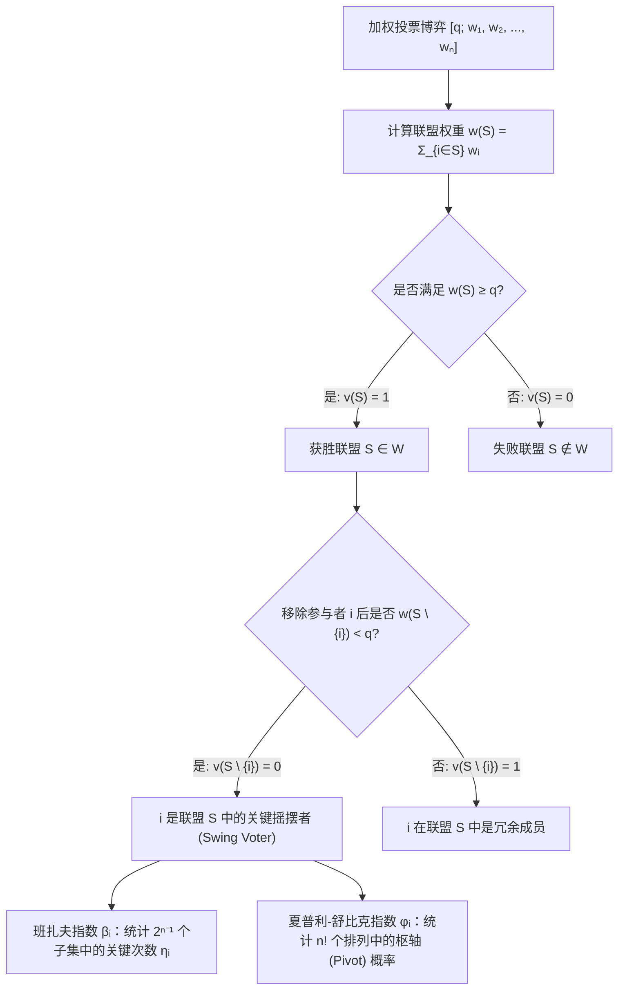
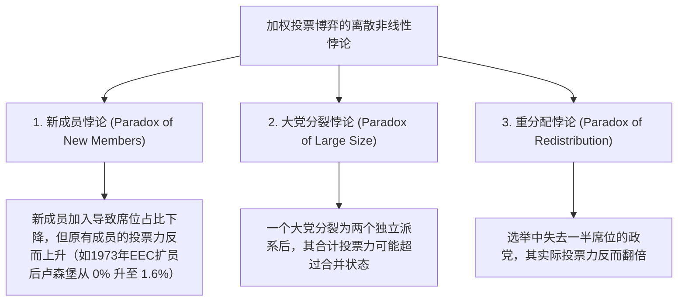

在民主议会、国际组织理事会以及现代公司股东大会中，人们往往默认一个看似天经地义的线性假设：<strong>一个政党拥有的席位比例（或股东持有的股份比例）直接等于其在决策中的实际权力（投票力，Voting Power）</strong>。

然而，合作博弈论（Cooperative Game Theory）与社会选择理论（Social Choice Theory）的研究彻底击碎了这一幻觉。假设在一个拥有100个席位、法案通过门槛（配额）为 $q = 51$ 席的议会中，A党拥有49席，B党拥有49席，而微型政党C党仅有2席。从表面席位占比来看，A党与B党各占 $49\%$，C党仅占微不足道的 $2\%$。但如果我们从数学上严格计算它们对议案成败的控制力，就会发现：A党、B党与C党的实际<strong>投票力完全相等，各占三分之一（$33.33\%$）</strong>。

更令人震惊的是，一个政党或主权国家即便拥有可观的选票，其数学上的投票力也可能是<strong>绝对的零（$0\%$）</strong>——博弈论称之为<strong>傀儡参与者（Dummy Player，或无力者）</strong>。1958年至1973年间，欧洲经济共同体（EEC，欧盟前身）部长理事会采用加权多数决 $[12;\, 4, 4, 4, 2, 2, 1]$，卢森堡虽然拥有1票（占总票数的 $5.88\%$），但由于其他五国的票数全为偶数且通过配额 $12$ 也是偶数，卢森堡在长达15年的时间里数学投票力严格为 $0\%$。

本文将从加权投票博弈的公理化定义出发，完整推导衡量权力的两大经典数学指标——<strong>班扎夫权力指数（Banzhaf Power Index）</strong>与<strong>夏普利-舒比克权力指数（Shapley-Shubik Power Index）</strong>，并剖析生成函数算法、联合国安理会否决权结构以及违背直觉的“投票力悖论”。

---

## 1. 席位占比的幻觉：三个思想实验

在进入形式化定义之前，我们先考察总席位 $W = 100$、多数决配额 $q = 51$ 的三个典型议会模型：

1. <strong>造王者模型 $[51;\, 49, 49, 2]$</strong>：
   没有任何政党能单独过半。所有获胜联盟（Winning Coalitions）为 $\{A, B\}(98)$、$\{A, C\}(51)$、$\{B, C\}(51)$ 和 $\{A, B, C\}(100)$。换言之，“任意两党联合即可获胜”。这与一人一票的简单多数决 $[2;\, 1, 1, 1]$ 在数学上<strong>完全同构（Isomorphic）</strong>。因此，仅占 $2\%$ 席位的C党拥有与A、B两党完全相同的 $33.33\%$ 投票力。
2. <strong>独裁者与无力野党 $[51;\, 52, 47, 1]$</strong>：
   A党单独拥有 $52 \ge 51$ 席，无需任何盟友即可通过任何法案；而B党与C党即便联合也只有 $47 + 1 = 48 < 51$ 席。此时A党是<strong>独裁者（Dictator，投票力 $100\%$）</strong>，而拥有 $47\%$ 席位的B党与C党同为<strong>傀儡参与者（投票力 $0\%$）</strong>。
3. <strong>隐形傀儡与1965年拿骚县诉讼 $[51;\, 35, 35, 25, 5]$</strong>：
   四党均未单独过半（$35 < 51$）。但考察前三党 $\{A, B, C\}$ 的所有子集权重之和：$\emptyset(0)$、$\{C\}(25)$、$\{A\}\text{或}\{B\}(35)$、$\{A,C\}\text{或}\{B,C\}(60)$、$\{A,B\}(70)$、$\{A,B,C\}(95)$。没有任何子集的票数落在区间 $[51 - 5,\, 50] = [46, 50]$ 内！这意味着拥有5席的D党<strong>永远无法将任何一个失败联盟转变为获胜联盟</strong>，其投票力严格为 $0\%$。1965年，法学学者约翰·班扎夫（John F. Banzhaf III）正是利用这一数学分析，证明美国纽约州拿骚县（Nassau County）监事会的加权投票制度中三个市镇的投票力为 $0\%$，从而推动法院裁定该制度违宪。

---

## 2. 加权投票博弈与两大权力指数的数学定义

### 简单博弈与加权投票博弈

设参与者集合为 $N = \{1, 2, \dots, n\}$，任意子集 $S \subseteq N$ 称为一个<strong>联盟（Coalition）</strong>。特征函数 $v: 2^N \to \{0, 1\}$ 满足 $v(\emptyset) = 0$、$v(N) = 1$ 以及单调性（$S \subseteq T \implies v(S) \le v(T)$）时，称 $(N, v)$ 为<strong>简单博弈（Simple Game）</strong>。

若存在非负权重 $w_1, w_2, \dots, w_n \ge 0$ 与通过配额 $q > \frac{1}{2}\sum_{i=1}^n w_i$，使得：
$$v(S) = \begin{cases} 1 & \text{若 } \sum_{i \in S} w_i \ge q \quad (\text{获胜联盟}) \\ 0 & \text{若 } \sum_{i \in S} w_i < q \quad (\text{失败联盟}) \end{cases}$$
则称该博弈为<strong>加权投票博弈（Weighted Voting Game）</strong>，记作 $[q;\, w_1, w_2, \dots, w_n]$。

若对于联盟 $S \ni i$，有 $v(S) = 1$ 且 $v(S \setminus \{i\}) = 0$（即没有 $i$ 联盟就会失败），则称参与者 $i$ 在联盟 $S$ 中是<strong>关键的（Critical / Swing Voter）</strong>。

### 1. 班扎夫权力指数（Penrose 1946 / Banzhaf 1965）

设 $\eta_i$ 为参与者 $i$ 成为关键摇摆者的获胜联盟总数：
$$\eta_i = \sum_{T \subseteq N \setminus \{i\}} \bigl[v(T \cup \{i\}) - v(T)\bigr]$$
由于其余 $n-1$ 名参与者共能组成 $2^{n-1}$ 个子集，定义<strong>绝对班扎夫指数（Raw Banzhaf Index）</strong> $\beta'_i$ 与<strong>归一化班扎夫指数（Normalized Banzhaf Index）</strong> $\beta_i$ 为：
$$\beta'_i = \frac{\eta_i}{2^{n-1}}, \qquad \beta_i = \frac{\eta_i}{\sum_{j=1}^n \eta_j}$$

### 2. 夏普利-舒比克权力指数（Shapley & Shubik 1954）

诺贝尔经济学奖得主劳埃德·夏普利（Lloyd Shapley）与马丁·舒比克将合作博弈的<strong>夏普利值（Shapley Value）</strong>应用于简单博弈。考虑 $n$ 名参与者按支持程度依次加入联盟的所有 $n!$ 种排列 $\pi = (\pi_1, \dots, \pi_n)$。在每个排列中，恰好存在唯一一名参与者，其加入使累计权重首次达到或超过配额 $q$，称为该排列的<strong>枢轴（Pivot）</strong>。若参与者 $i$ 之前的集合为 $S$（人数 $|S|$），则对应的排列数为 $|S|!\,(n - |S| - 1)!$。因此，<strong>夏普利-舒比克指数</strong>定义为：
$$\phi_i = \sum_{S \subseteq N \setminus \{i\}} \frac{|S|!\,(n - |S| - 1)!}{n!} \bigl[v(S \cup \{i\}) - v(S)\bigr]$$

---

## 3. 完整算例对比：$[6;\, 4, 3, 2, 1]$ 与生成函数算法

考察四党博弈 $[6;\, 4, 3, 2, 1]$（$w_A=4, w_B=3, w_C=2, w_D=1$，总权重 $10$，配额 $q=6$）。

### 全获胜联盟与全排列对比表

在全部 $2^4 = 16$ 个子集中，共有 7 个获胜联盟；在全部 $4! = 24$ 个排列中，各参与者的关键度统计如下：

| 获胜联盟 $S$ | 权重和 $w(S)$ | 移除各成员后的权重 $w(S \setminus \{i\})$ | 关键摇摆者 (Swing) | 参与者 | 席位占比 | 关键次数 $\eta_i$ | 归一化班扎夫 $\beta_i$ | 枢轴次数 ($/24$) | 夏普利-舒比克 $\phi_i$ |
| :--- | :---: | :--- | :--- | :---: | :---: | :---: | :---: | :---: | :---: |
| $\{A, B\}$ | $7$ | $-A:3,\ -B:4$ | <strong>A, B</strong> | <strong>A ($w_A=4$)</strong> | $40.0\%$ | $5$ | $5/12 \approx \mathbf{41.67\%}$ | $10$ | $10/24 \approx \mathbf{41.67\%}$ |
| $\{A, C\}$ | $6$ | $-A:2,\ -C:4$ | <strong>A, C</strong> | <strong>B ($w_B=3$)</strong> | $30.0\%$ | $3$ | $3/12 = \mathbf{25.00\%}$ | $6$ | $6/24 = \mathbf{25.00\%}$ |
| $\{A, B, C\}$ | $9$ | $-A:5,\ -B:6,\ -C:7$ | <strong>A</strong> | <strong>C ($w_C=2$)</strong> | $20.0\%$ | $3$ | $3/12 = \mathbf{25.00\%}$ | $6$ | $6/24 = \mathbf{25.00\%}$ |
| $\{A, B, D\}$ | $8$ | $-A:4,\ -B:5,\ -D:7$ | <strong>A, B</strong> | <strong>D ($w_D=1$)</strong> | $10.0\%$ | $1$ | $1/12 \approx \mathbf{8.33\%}$ | $2$ | $2/24 \approx \mathbf{8.33\%}$ |
| $\{A, C, D\}$ | $7$ | $-A:3,\ -C:5,\ -D:6$ | <strong>A, C</strong> | <strong>合计</strong> | $100\%$ | $12$ | $100.00\%$ | $24$ | $100.00\%$ |
| $\{B, C, D\}$ | $6$ | $-B:3,\ -C:4,\ -D:5$ | <strong>B, C, D</strong> | | | | | | |
| $\{A,B,C,D\}$ | $10$ | 任意移除均 $\ge 6$ | <strong>无</strong> | | | | | | |

可以看到，尽管B党（3席）比C党（2席）多出 $50\%$ 的席位，但两者的班扎夫指数与夏普利-舒比克指数<strong>完全相同（均为 $25.00\%$）</strong>！而在另一个博弈 $[5;\, 3, 2, 1, 1]$ 中，两指数则出现分化：$\beta = (50\%, 30\%, 10\%, 10\%)$，而 $\phi = (58.33\%, 25.00\%, 8.33\%, 8.33\%)$。根据<strong>斯特拉芬定理（Straffin 1977）</strong>，当各投票者以独立概率 $1/2$ 投票（独立性假设）时对应班扎夫指数；当所有投票者受同一社会潮流 $p \sim \mathrm{Uniform}(0,1)$ 驱动（同质性假设）时，利用贝塔积分 $\int_0^1 p^{|S|}(1-p)^{n-|S|-1}dp = \frac{|S|!(n-|S|-1)!}{n!}$ 恰好导出夏普利-舒比克指数。

此外，当 $n$ 较大时，可通过<strong>母函数（生成函数）</strong>在拟多项式时间 $O(n^2 q)$ 内精确求解：
$$P_{-i}(x) = \prod_{j \ne i} \left(1 + x^{w_j}\right) = \sum_{k} c_k^{(i)} x^k \implies \eta_i = \sum_{k=q-w_i}^{q-1} c_k^{(i)}$$

---

## 4. 现实国际机构与三大投票力悖论

### 1. 1958–1973年欧洲经济共同体（EEC）理事会 $[12;\, 4, 4, 4, 2, 2, 1]$

西德、法国、意大利各4票，比利时、荷兰各2票，卢森堡1票，配额 $q = 12$。卢森堡的母函数为 $P_{-\text{Lux}}(x) = (1 + x^4)^3(1 + x^2)^2$，展开式中仅含偶次幂项，故 $x^{11}$ 的系数严格为 $0$！卢森堡的投票力为 $\beta_{\text{Lux}} = \phi_{\text{Lux}} = 0\%$（纯粹的傀儡参与者），而大国各占 $\beta = 23.81\%$（$\phi = 23.33\%$），比、荷各占 $\beta = 14.29\%$（$\phi = 15.00\%$）。

### 2. 联合国安全理事会（UNSC）的否决权压制

安理会由5个常任理事国（P5，拥有一票否决权）和10个非常任理事国（NP10）组成，决议需至少9票赞成且无P5反对，等价于加权博弈 $[39;\, 7, 7, 7, 7, 7, 1, 1, 1, 1, 1, 1, 1, 1, 1, 1]$。
- <strong>班扎夫指数</strong>：$\eta_{\text{P5}} = \sum_{k=4}^{10} \binom{10}{k} = 848$，$\eta_{\text{NP}} = \binom{9}{3} = 84$。因此每个常任理事国拥有 $\beta_{\text{P5}} = \frac{848}{5080} \approx \mathbf{16.69\%}$，而每个非常任理事国仅有 $\beta_{\text{NP}} = \frac{84}{5080} \approx \mathbf{1.65\%}$。
- <strong>夏普利-舒比克指数</strong>：非常任理事国成为枢轴当且仅当前8名成员包含全部5个P5及恰好3个NP，故：
  $$\phi_{\text{NP}} = \binom{9}{3}\frac{8!\,6!}{15!} = \frac{84}{45045} = \frac{4}{2145} \approx \mathbf{0.1865\%}, \qquad \phi_{\text{P5}} = \frac{421}{2145} \approx \mathbf{19.627\%}$$
  五个常任理事国垄断了高达 $98.135\%$ 的夏普利-舒比克投票力，单个常任理事国的权力是非常任理事国的 <strong>105.25倍</strong>！

### 3. 重分配悖论（Paradox of Redistribution, Fischer & Schotter 1978）

考察总席位14、配额 $q = 9$ 的四党议会：
- <strong>选前 $[9;\, 6, 4, 2, 2]$</strong>：极小获胜联盟仅为 $\{A, B\}(10)$ 与 $\{A, C, D\}(10)$，A党拥有一票否决权。此时D党（2席）的权力为 $\beta_D = 10.00\%$，$\phi_D = 8.33\%$。
- <strong>选后 $[9;\, 5, 5, 3, 1]$</strong>：A党失去1席给B党，<strong>D党失去一半席位（从2席跌至1席）给C党</strong>。然而此时 $\{B, C, D\}(5+3+1=9)$ 也成为了获胜联盟！A党的否决权垄断被打破，仅剩1席的D党同时成为 $\{A, C, D\}$ 与 $\{B, C, D\}$ 的关键造王者，其投票力跃升至 $\beta_D = \mathbf{16.67\%}$、$\phi_D = \mathbf{16.67\%}$——<strong>席位减半，权力反而翻倍</strong>！

为了在两级联邦投票制中消除人口差异带来的不公，<strong>彭罗斯平方根法则（Penrose Square Root Law, 1946）</strong>证明：由于国内选举中单个公民成为关键一票的概率与人口平方根成反比（$\approx \sqrt{2/(\pi P_k)}$），只有让各国在联邦理事会中的班扎夫指数 $\beta'_k$ 与其<strong>人口的平方根 $\sqrt{P_k}$ 成正比</strong>，才能实现每位公民间接投票力的绝对平等。
