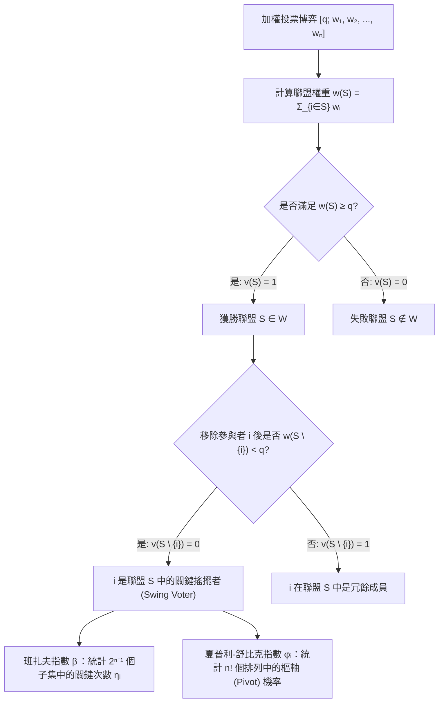
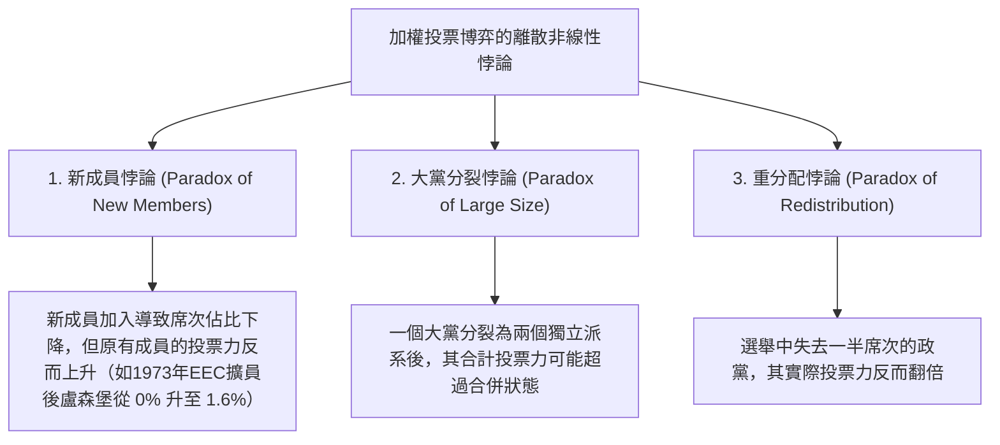

在民主議會、國際組織理事會以及現代公司股東大會中，人們往往預設一個看似理所當然的線性假設：<strong>一個政黨擁有的席次比例（或股東持有的股份比例）直接等於其在決策中的實際權力（投票力，Voting Power）</strong>。

然而，合作博弈論（Cooperative Game Theory）與社會選擇理論（Social Choice Theory）的研究徹底打破了這一幻覺。假設在一個擁有100個席次、法案通過門檻（配額）為 $q = 51$ 席的議會中，A黨擁有49席，B黨擁有49席，而小黨C黨僅有2席。從表面席次佔比來看，A黨與B黨各佔 $49\%$，C黨僅佔微不足道的 $2\%$。但如果我們從數學上嚴格計算它們對議案成敗的控制力，就會發現：A黨、B黨與C黨的實際<strong>投票力完全相等，各佔三分之一（$33.33\%$）</strong>。

更令人震驚的是，一個政黨或主權國家即便擁有可觀的選票，其數學上的投票力也可能是<strong>絕對的零（$0\%$）</strong>——博弈論稱之為<strong>傀儡參與者（Dummy Player，或無力者）</strong>。1958年至1973年間，歐洲經濟共同體（EEC，歐盟前身）部長理事會採用加權多數決 $[12;\, 4, 4, 4, 2, 2, 1]$，盧森堡雖然擁有1票（佔總票數的 $5.88\%$），但由於其他五國的票數全為偶數且通過配額 $12$ 也是偶數，盧森堡在長達15年的時間裡數學投票力嚴格為 $0\%$。

本文將從加權投票博弈的公理化定義出發，完整推導衡量權力的兩大經典數學指標——<strong>班扎夫權力指數（Banzhaf Power Index）</strong>與<strong>夏普利-舒比克權力指數（Shapley-Shubik Power Index）</strong>，並剖析生成函數演算法、聯合國安理會否決權結構以及違背直覺的「投票力悖論」。

---

## 1. 席次佔比的幻覺：三個思想實驗

在進入形式化定義之前，我們先考察總席次 $W = 100$、多數決配額 $q = 51$ 的三個典型議會模型：

1. <strong>造王者模型 $[51;\, 49, 49, 2]$</strong>：
   沒有任何政黨能單獨過半。所有獲勝聯盟（Winning Coalitions）為 $\{A, B\}(98)$、$\{A, C\}(51)$、$\{B, C\}(51)$ 和 $\{A, B, C\}(100)$。換言之，「任意兩黨聯合即可獲勝」。這與一人一票的簡單多數決 $[2;\, 1, 1, 1]$ 在數學上<strong>完全同構（Isomorphic）</strong>。因此，僅佔 $2\%$ 席次的C黨擁有與A、B兩黨完全相同的 $33.33\%$ 投票力。
2. <strong>獨裁者與無力在野黨 $[51;\, 52, 47, 1]$</strong>：
   A黨單獨擁有 $52 \ge 51$ 席，無需任何盟友即可通過任何法案；而B黨與C黨即便聯合也只有 $47 + 1 = 48 < 51$ 席。此時A黨是<strong>獨裁者（Dictator，投票力 $100\%$）</strong>，而擁有 $47\%$ 席次的B黨與C黨同為<strong>傀儡參與者（投票力 $0\%$）</strong>。
3. <strong>隱形傀儡與1965年拿騷郡訴訟 $[51;\, 35, 35, 25, 5]$</strong>：
   四黨均未單獨過半（$35 < 51$）。但考察前三黨 $\{A, B, C\}$ 的所有子集權重之和：$\emptyset(0)$、$\{C\}(25)$、$\{A\}\text{或}\{B\}(35)$、$\{A,C\}\text{或}\{B,C\}(60)$、$\{A,B\}(70)$、$\{A,B,C\}(95)$。沒有任何子集的票數落在區間 $[51 - 5,\, 50] = [46, 50]$ 內！這意味著擁有5席的D黨<strong>永遠無法將任何一個失敗聯盟轉變為獲勝聯盟</strong>，其投票力嚴格為 $0\%$。1965年，法學學者約翰·班扎夫（John F. Banzhaf III）正是利用這一數學分析，證明美國紐約州拿騷郡（Nassau County）監事會的加權投票制度中三個市鎮的投票力為 $0\%$，從而推動法院裁定該制度違憲。

---

## 2. 加權投票博弈與兩大權力指數的數學定義

### 簡單博弈與加權投票博弈

設參與者集合為 $N = \{1, 2, \dots, n\}$，任意子集 $S \subseteq N$ 稱為一個<strong>聯盟（Coalition）</strong>。特徵函數 $v: 2^N \to \{0, 1\}$ 滿足 $v(\emptyset) = 0$、$v(N) = 1$ 以及單調性（$S \subseteq T \implies v(S) \le v(T)$）時，稱 $(N, v)$ 為<strong>簡單博弈（Simple Game）</strong>。

若存在非負權重 $w_1, w_2, \dots, w_n \ge 0$ 與通過配額 $q > \frac{1}{2}\sum_{i=1}^n w_i$，使得：
$$v(S) = \begin{cases} 1 & \text{若 } \sum_{i \in S} w_i \ge q \quad (\text{獲勝聯盟}) \\ 0 & \text{若 } \sum_{i \in S} w_i < q \quad (\text{失敗聯盟}) \end{cases}$$
則稱該博弈為<strong>加權投票博弈（Weighted Voting Game）</strong>，記作 $[q;\, w_1, w_2, \dots, w_n]$。

若對於聯盟 $S \ni i$，有 $v(S) = 1$ 且 $v(S \setminus \{i\}) = 0$（即沒有 $i$ 聯盟就會失敗），則稱參與者 $i$ 在聯盟 $S$ 中是<strong>關鍵的（Critical / Swing Voter）</strong>。

### 1. 班扎夫權力指數（Penrose 1946 / Banzhaf 1965）

設 $\eta_i$ 為參與者 $i$ 成為關鍵搖擺者的獲勝聯盟總數：
$$\eta_i = \sum_{T \subseteq N \setminus \{i\}} \bigl[v(T \cup \{i\}) - v(T)\bigr]$$
由於其餘 $n-1$ 名參與者共能組成 $2^{n-1}$ 個子集，定義<strong>絕對班扎夫指數（Raw Banzhaf Index）</strong> $\beta'_i$ 與<strong>正規化班扎夫指數（Normalized Banzhaf Index）</strong> $\beta_i$ 為：
$$\beta'_i = \frac{\eta_i}{2^{n-1}}, \qquad \beta_i = \frac{\eta_i}{\sum_{j=1}^n \eta_j}$$

### 2. 夏普利-舒比克權力指數（Shapley & Shubik 1954）

諾貝爾經濟學獎得主勞埃德·夏普利（Lloyd Shapley）與馬丁·舒比克將合作博弈的<strong>夏普利值（Shapley Value）</strong>應用於簡單博弈。考慮 $n$ 名參與者按支持程度依次加入聯盟的所有 $n!$ 種排列 $\pi = (\pi_1, \dots, \pi_n)$。在每個排列中，恰好存在唯一一名參與者，其加入使累計權重首次達到或超過配額 $q$，稱為該排列的<strong>樞軸（Pivot）</strong>。若參與者 $i$ 之前的集合為 $S$（人數 $|S|$），則對應的排列數為 $|S|!\,(n - |S| - 1)!$。因此，<strong>夏普利-舒比克指數</strong>定義為：
$$\phi_i = \sum_{S \subseteq N \setminus \{i\}} \frac{|S|!\,(n - |S| - 1)!}{n!} \bigl[v(S \cup \{i\}) - v(S)\bigr]$$

---

## 3. 完整算例對比：$[6;\, 4, 3, 2, 1]$ 與生成函數演算法

考察四黨博弈 $[6;\, 4, 3, 2, 1]$（$w_A=4, w_B=3, w_C=2, w_D=1$，總權重 $10$，配額 $q=6$）。

### 全獲勝聯盟與全排列對比表

在全部 $2^4 = 16$ 個子集中，共有 7 個獲勝聯盟；在全部 $4! = 24$ 個排列中，各參與者的關鍵度統計如下：

| 獲勝聯盟 $S$ | 權重和 $w(S)$ | 移除各成員後的權重 $w(S \setminus \{i\})$ | 關鍵搖擺者 (Swing) | 參與者 | 席次佔比 | 關鍵次數 $\eta_i$ | 正規化班扎夫 $\beta_i$ | 樞軸次數 ($/24$) | 夏普利-舒比克 $\phi_i$ |
| :--- | :---: | :--- | :--- | :---: | :---: | :---: | :---: | :---: | :---: |
| $\{A, B\}$ | $7$ | $-A:3,\ -B:4$ | <strong>A, B</strong> | <strong>A ($w_A=4$)</strong> | $40.0\%$ | $5$ | $5/12 \approx \mathbf{41.67\%}$ | $10$ | $10/24 \approx \mathbf{41.67\%}$ |
| $\{A, C\}$ | $6$ | $-A:2,\ -C:4$ | <strong>A, C</strong> | <strong>B ($w_B=3$)</strong> | $30.0\%$ | $3$ | $3/12 = \mathbf{25.00\%}$ | $6$ | $6/24 = \mathbf{25.00\%}$ |
| $\{A, B, C\}$ | $9$ | $-A:5,\ -B:6,\ -C:7$ | <strong>A</strong> | <strong>C ($w_C=2$)</strong> | $20.0\%$ | $3$ | $3/12 = \mathbf{25.00\%}$ | $6$ | $6/24 = \mathbf{25.00\%}$ |
| $\{A, B, D\}$ | $8$ | $-A:4,\ -B:5,\ -D:7$ | <strong>A, B</strong> | <strong>D ($w_D=1$)</strong> | $10.0\%$ | $1$ | $1/12 \approx \mathbf{8.33\%}$ | $2$ | $2/24 \approx \mathbf{8.33\%}$ |
| $\{A, C, D\}$ | $7$ | $-A:3,\ -C:5,\ -D:6$ | <strong>A, C</strong> | <strong>合計</strong> | $100\%$ | $12$ | $100.00\%$ | $24$ | $100.00\%$ |
| $\{B, C, D\}$ | $6$ | $-B:3,\ -C:4,\ -D:5$ | <strong>B, C, D</strong> | | | | | | |
| $\{A,B,C,D\}$ | $10$ | 任意移除均 $\ge 6$ | <strong>無</strong> | | | | | | |

可以看到，儘管B黨（3席）比C黨（2席）多出 $50\%$ 的席次，但兩者的班扎夫指數與夏普利-舒比克指數<strong>完全相同（均為 $25.00\%$）</strong>！而在另一個博弈 $[5;\, 3, 2, 1, 1]$ 中，兩指數則出現分化：$\beta = (50\%, 30\%, 10\%, 10\%)$，而 $\phi = (58.33\%, 25.00\%, 8.33\%, 8.33\%)$。根據<strong>斯特拉芬定理（Straffin 1977）</strong>，當各投票者以獨立機率 $1/2$ 投票（獨立性假設）時對應班扎夫指數；當所有投票者受同一社會潮流 $p \sim \mathrm{Uniform}(0,1)$ 驅動（同質性假設）時，利用貝塔積分 $\int_0^1 p^{|S|}(1-p)^{n-|S|-1}dp = \frac{|S|!(n-|S|-1)!}{n!}$ 恰好導出夏普利-舒比克指數。

此外，當 $n$ 較大時，可透過<strong>生成函數（Generating Functions）</strong>在擬多項式時間 $O(n^2 q)$ 內精確求解：
$$P_{-i}(x) = \prod_{j \ne i} \left(1 + x^{w_j}\right) = \sum_{k} c_k^{(i)} x^k \implies \eta_i = \sum_{k=q-w_i}^{q-1} c_k^{(i)}$$

---

## 4. 現實國際機構與三大投票力悖論

### 1. 1958–1973年歐洲經濟共同體（EEC）理事會 $[12;\, 4, 4, 4, 2, 2, 1]$

西德、法國、義大利各4票，比利時、荷蘭各2票，盧森堡1票，配額 $q = 12$。盧森堡的生成函數為 $P_{-\text{Lux}}(x) = (1 + x^4)^3(1 + x^2)^2$，展開式中僅含偶次冪項，故 $x^{11}$ 的係數嚴格為 $0$！盧森堡的投票力為 $\beta_{\text{Lux}} = \phi_{\text{Lux}} = 0\%$（純粹的傀儡參與者），而大國各佔 $\beta = 23.81\%$（$\phi = 23.33\%$），比、荷各佔 $\beta = 14.29\%$（$\phi = 15.00\%$）。

### 2. 聯合國安全理事會（UNSC）的否決權壓制

安理會由5個常任理事國（P5，擁有一票否決權）和10個非常任理事國（NP10）組成，決議需至少9票贊成且無P5反對，等價於加權博弈 $[39;\, 7, 7, 7, 7, 7, 1, 1, 1, 1, 1, 1, 1, 1, 1, 1]$。
- <strong>班扎夫指數</strong>：$\eta_{\text{P5}} = \sum_{k=4}^{10} \binom{10}{k} = 848$，$\eta_{\text{NP}} = \binom{9}{3} = 84$。因此每個常任理事國擁有 $\beta_{\text{P5}} = \frac{848}{5080} \approx \mathbf{16.69\%}$，而每個非常任理事國僅有 $\beta_{\text{NP}} = \frac{84}{5080} \approx \mathbf{1.65\%}$。
- <strong>夏普利-舒比克指數</strong>：非常任理事國成為樞軸當且僅當前8名成員包含全部5個P5及恰好3個NP，故：
  $$\phi_{\text{NP}} = \binom{9}{3}\frac{8!\,6!}{15!} = \frac{84}{45045} = \frac{4}{2145} \approx \mathbf{0.1865\%}, \qquad \phi_{\text{P5}} = \frac{421}{2145} \approx \mathbf{19.627\%}$$
  五個常任理事國壟斷了高達 $98.135\%$ 的夏普利-舒比克投票力，單個常任理事國的權力是非常任理事國的 <strong>105.25倍</strong>！

### 3. 重分配悖論（Paradox of Redistribution, Fischer & Schotter 1978）

考察總席次14、配額 $q = 9$ 的四黨議會：
- <strong>選前 $[9;\, 6, 4, 2, 2]$</strong>：極小獲勝聯盟僅為 $\{A, B\}(10)$ 與 $\{A, C, D\}(10)$，A黨擁有一票否決權。此時D黨（2席）的權力為 $\beta_D = 10.00\%$，$\phi_D = 8.33\%$。
- <strong>選後 $[9;\, 5, 5, 3, 1]$</strong>：A黨失去1席給B黨，<strong>D黨失去一半席次（從2席跌至1席）給C黨</strong>。然而此時 $\{B, C, D\}(5+3+1=9)$ 也成為了獲勝聯盟！A黨的否決權壟斷被打破，僅剩1席的D黨同時成為 $\{A, C, D\}$ 與 $\{B, C, D\}$ 的關鍵造王者，其投票力躍升至 $\beta_D = \mathbf{16.67\%}$、$\phi_D = \mathbf{16.67\%}$——<strong>席次減半，權力反而翻倍</strong>！

為了在兩級聯邦投票制中消除人口差異帶來的不公，<strong>彭羅斯平方根法則（Penrose Square Root Law, 1946）</strong>證明：由於國內選舉中單個公民成為關鍵一票的機率與人口平方根成反比（$\approx \sqrt{2/(\pi P_k)}$），只有讓各國在聯邦理事會中的班扎夫指數 $\beta'_k$ 與其<strong>人口的平方根 $\sqrt{P_k}$ 成正比</strong>，才能實現每位公民間接投票力的絕對平等。
