Standing hundreds of feet above pastoral hillsides or anchored deep into tempestuous offshore waters, modern wind turbines represent some of the most colossal and technologically sophisticated rotating structures ever engineered by humanity. Modern offshore turbines feature nacelles towering over 150 meters above the sea surface, supporting three-bladed rotors whose swept diameter exceeds 230 meters—sweeping an area greater than four soccer fields and generating 15 megawatts of electricity from a single unit.

To the casual observer, a utility-scale wind turbine might appear to be an enlarged version of an ancient Dutch windmill. In reality, it represents the absolute frontier of <strong>applied fluid mechanics, aeroelasticity, composite fatigue mechanics, and multi-megawatt mechatronics</strong>. 

Every subtle contour of its form is governed by strict physical necessities:
- Why do all utility-scale turbines converge universally on <strong>three blades mounted on a horizontal axis</strong>?
- Why are the blades <strong>dramatically twisted from root to tip</strong>, with fat cylindrical roots tapering into razor-thin, curved tips?
- Why is it physically impossible to extract 100% of the kinetic energy from moving air, as quantified by the <strong>Betz Limit</strong>?
- How do massive blades spinning at highway velocities survive over <strong>100 million violent load cycles</strong> over a 25-year design life?
- How do floating offshore platforms survive ferocious ocean waves while actively stabilizing a 1,000-ton nacelle?

This comprehensive treatise explores the aerodynamic and mechanical engineering architecture of the modern wind turbine: from the foundational fluid mechanics of 1D actuator disk momentum theory, to the 2D airfoil kinematics of Blade Element Momentum (BEM) theory, tip-loss corrections, pitch-to-feather control dynamics, drive-train electromechanics, downwind wake decay modeling, and the hydro-elastic challenges of deep-water floating installations.

---

## 1. The Convergence of Form: Why Three-Bladed Horizontal-Axis Turbines?

Over decades of trial, computational optimization, and full-scale field testing, the global wind power industry evaluated hundreds of competing architectures: vertical-axis Darrieus and Savonius rotors, multi-bladed American water-pumping mills, downwind rotors, and one- or two-bladed prototypes. Virtually every modern commercial machine has converged on the <strong>three-bladed, upwind, horizontal-axis wind turbine (HAWT)</strong>.

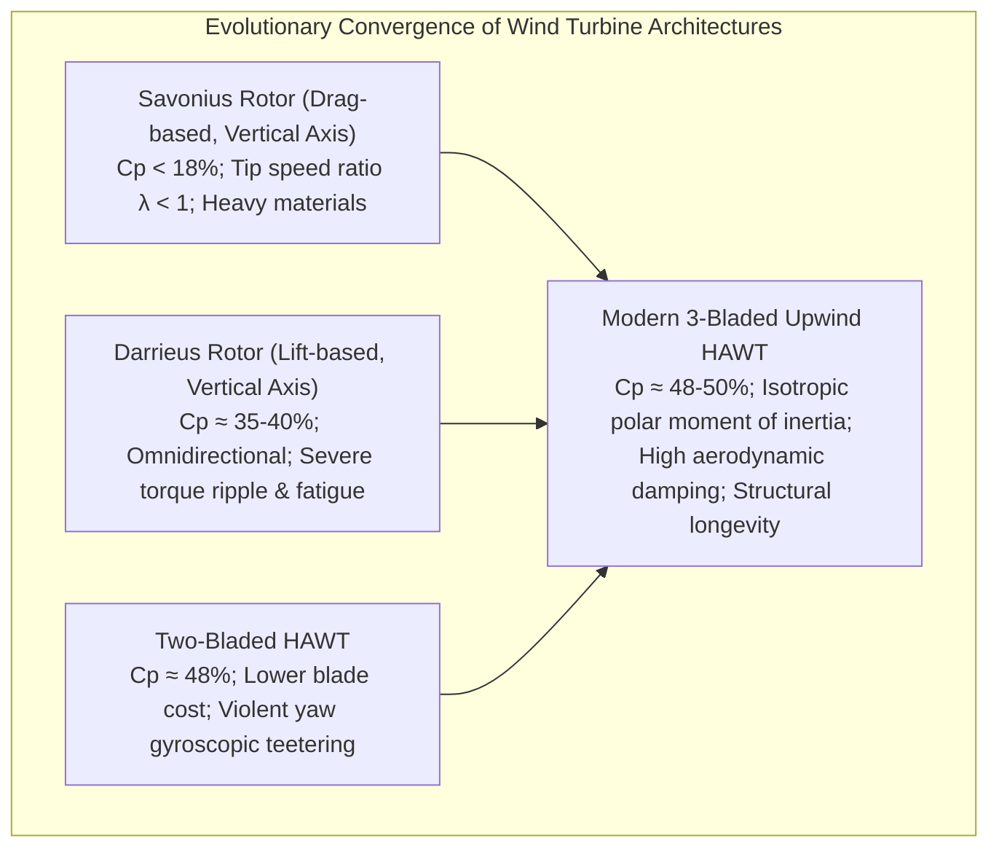

### 1.1 Lift vs. Drag: The Quantum Leap in Power Density

The earliest historical windmills (such as Persian panemones or Savonius rotors) were <strong>drag-based devices</strong>. In a drag device, the rotor surfaces are pushed directly by the wind. 

The fundamental limitation of drag machines is governed by relative velocity kinematics: as the blade accelerates in the direction of the wind, the relative wind speed seen by the surface decreases:

$$V_{rel} = V_0 - v_{blade}$$

Consequently, the tip speed ratio $\lambda = \omega R / V_0$ can never exceed unity ($\lambda < 1$). The maximum theoretical power coefficient of pure drag devices is physically bounded below <strong>$C_P \approx 16 - 20\%$</strong>.

In contrast, modern turbines are <strong>lift-based devices</strong>. Like commercial jet airfoils, their blades are curved aerodynamic surfaces. When relative wind flows over the asymmetric airfoil, a circulation $\Gamma$ is established, creating a pressure differential between the upper (suction) and lower (pressure) surfaces. 

Because the resulting lift force acts perpendicular to the oncoming relative flow, the blade can travel much faster than the ambient wind:

$$\lambda = \frac{\Omega R}{V_0} \approx 7 \text{ to } 9$$

At a tip speed ratio of 8, a blade operating in a $10\,\mathrm{m/s}$ breeze travels at $80\,\mathrm{m/s}$ ($288\,\mathrm{km/h}$) at the tip. This massive rotational speed increases the swept air mass per unit time and dramatically reduces the required mechanical torque for a given power rating ($P = Q \cdot \Omega$), slashing the weight and cost of the gearbox, shaft, and generator.

### 1.2 The Mechanics of Rotor Blade Count: The Gyroscopic Invariant

Why are there exactly three blades? Why not two or four?

While aerodynamic efficiency increases as blade count increases from one to three, the incremental gain beyond three blades is negligible:
- 1 blade: $C_{P,max} \approx 0.43$ (requires heavy counterweight; massive dynamic imbalance).
- 2 blades: $C_{P,max} \approx 0.47$ (aerodynamically excellent, lower blade capital cost).
- 3 blades: $C_{P,max} \approx 0.485$ (industry benchmark).
- 4+ blades: $C_{P,max} \approx 0.49$ (blades interfere aerodynamically with preceding blade wakes; excessive solidity, weight, and cost).

The ultimate justification for three blades is <strong>structural dynamics and gyroscopic stability during yaw alignment</strong>.

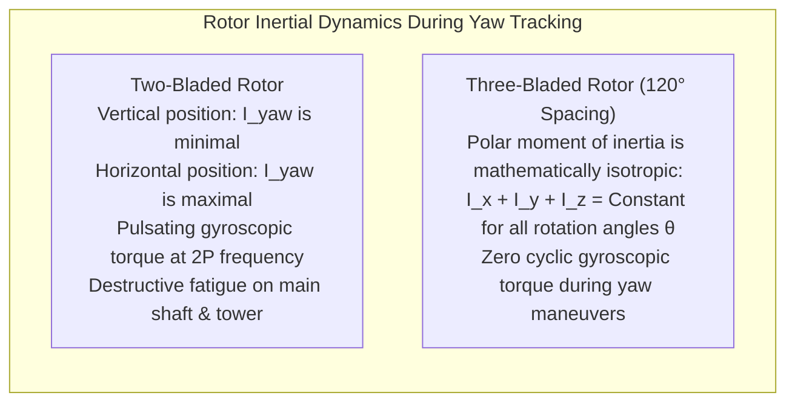

When wind direction shifts, the nacelle must yaw (rotate horizontally) to face the wind. Consider the moment of inertia tensor of the spinning rotor about the yaw axis:
- <strong>In a two-bladed rotor</strong>: When the two blades are oriented vertically, their mass is concentrated near the yaw axis, making the rotational moment of inertia $I_{yaw}$ small. When the blades rotate $90^\circ$ into a horizontal orientation, $I_{yaw}$ reaches a massive maximum. As the rotor spins at speed $\Omega$, $I_{yaw}$ oscillates between high and low values at twice the rotational frequency (<strong>2P cyclic oscillation</strong>). 
  
  When a yaw motor forces the nacelle to turn at yaw rate $\omega_{yaw}$, the gyroscopic precession torque $\mathbf{\tau} = \mathbf{I} (\mathbf{\Omega} \times \mathbf{\omega}_{yaw})$ violently pulses twice per revolution, slamming destructive cyclic fatigue bending moments into the low-speed shaft, yaw bearings, and tower top.
- <strong>In a three-bladed rotor</strong>: Because the three identical blades are distributed at symmetrical $120^\circ$ azimuthal intervals, the polar moment of inertia about the yaw axis is <strong>invariant with respect to rotational angle</strong>:
  $$I_{yaw}(\theta) = \sum_{i=1}^3 m r_i^2 \sin^2(\theta + i \cdot 120^\circ) = \text{Constant}$$
  
  When a three-bladed turbine yaws, the gyroscopic precession torque is perfectly smooth and constant. Destructive cyclic fatigue stresses are eliminated, ensuring long operating lifetimes.

---

## 2. Theoretical Aerodynamic Ceiling: The Betz Limit Derivation

How much kinetic energy can a wind turbine theoretically extract from moving air? The definitive thermodynamic limit was established in 1919 by German physicist Albert Betz using 1D actuator disk momentum theory.

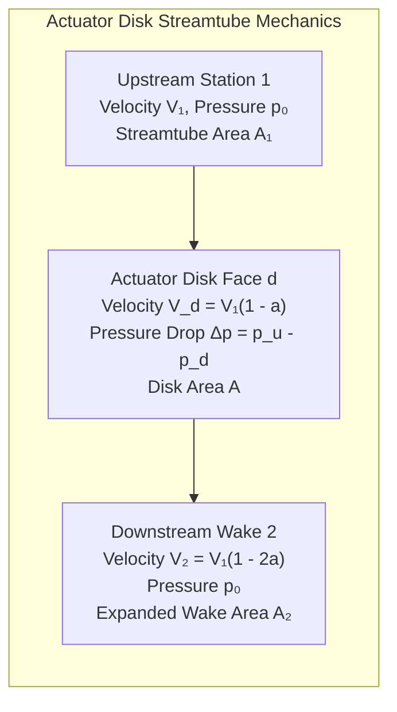

### 2.1 The Actuator Disk Momentum Formulation

Consider an idealized, frictionless, non-rotating actuator disk of area $A$ immersed in an incompressible, steady airflow of density $\rho$. The streamtube expands as air decelerates approaching and leaving the disk.

Applying the <strong>Principle of Conservation of Mass</strong>:

$$\dot{m} = \rho A_1 V_1 = \rho A V_d = \rho A_2 V_2$$

where $V_1$ is the undisturbed freestream velocity upstream, $V_d$ is the velocity through the rotor disk, and $V_2$ is the fully expanded wake velocity far downstream.

Applying the <strong>Conservation of Linear Momentum</strong>, the net thrust force $T$ exerted by the fluid on the actuator disk equals the net change in momentum flux:

$$T = \dot{m} (V_1 - V_2) = \rho A V_d (V_1 - V_2)$$

Applying <strong>Bernoulli's Equation</strong> separately upstream and downstream of the disk (where total mechanical energy is conserved along streamlines, punctuated by an abrupt static pressure drop $\Delta p = p_u - p_d$ across the disk):
- Upstream: $p_0 + \frac{1}{2}\rho V_1^2 = p_u + \frac{1}{2}\rho V_d^2$
- Downstream: $p_d + \frac{1}{2}\rho V_d^2 = p_0 + \frac{1}{2}\rho V_2^2$

Subtracting the two equations yields the pressure drop across the rotor:

$$\Delta p = p_u - p_d = \frac{1}{2}\rho (V_1^2 - V_2^2)$$

The thrust on the disk is also the integrated pressure difference across its area:

$$T = A \Delta p = \frac{1}{2}\rho A (V_1^2 - V_2^2) = \frac{1}{2}\rho A (V_1 - V_2)(V_1 + V_2)$$

Equating the momentum thrust expression to the pressure thrust expression:

$$\rho A V_d (V_1 - V_2) = \frac{1}{2}\rho A (V_1 - V_2)(V_1 + V_2)$$

Assuming energy is extracted ($V_1 \ne V_2$), dividing both sides by $\rho A (V_1 - V_2)$ yields a fundamental aerodynamic theorem:

$$V_d = \frac{V_1 + V_2}{2}$$

<strong>The wind speed at the rotor plane is the exact arithmetic mean of the upstream freestream velocity and the downstream wake velocity.</strong>

### 2.2 Derivation of Maximum Power Coefficient ($C_{P,max} = 16/27$)

We define the dimensionless <strong>Axial Induction Factor ($a$)</strong> as the fractional deceleration of wind speed between the freestream and the rotor plane:

$$V_d = V_1 (1 - a)$$

Substituting this into the arithmetic mean relation gives the downstream wake speed:

$$V_2 = 2V_d - V_1 = 2V_1(1-a) - V_1 = V_1 (1 - 2a)$$

The mechanical power $P$ extracted from the wind is the product of thrust and disk velocity:

$$P = T \cdot V_d = [\rho A V_1 (1-a) \cdot (V_1 - V_1(1-2a))] \cdot V_1(1-a) = 2\rho A V_1^3 a (1 - a)^2$$

The total theoretical power flux contained in an unperturbed wind streamtube of cross-sectional area $A$ is:

$$P_{wind} = \frac{1}{2} \dot{m}_{unperturbed} V_1^2 = \frac{1}{2} (\rho A V_1) V_1^2 = \frac{1}{2}\rho A V_1^3$$

The <strong>Power Coefficient ($C_P$)</strong>—representing the aerodynamic extraction efficiency—is the ratio of extracted power to available kinetic power:

$$C_P = \frac{P}{P_{wind}} = \frac{2\rho A V_1^3 a (1 - a)^2}{\frac{1}{2}\rho A V_1^3} = 4a (1 - a)^2$$

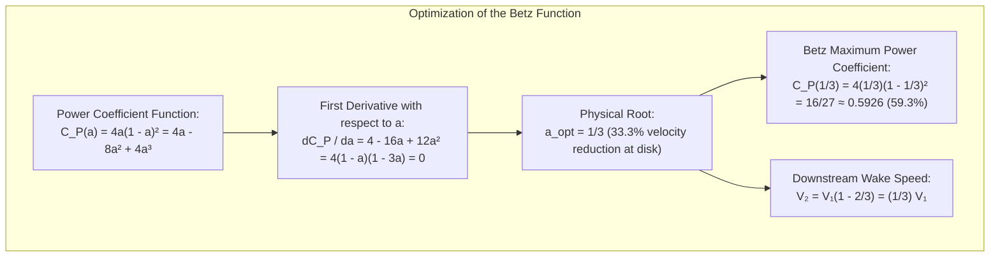

To find the theoretical maximum, we compute the derivative with respect to $a$ and set it to zero:

$$\frac{dC_P}{da} = 4 - 16a + 12a^2 = 4(1 - a)(1 - 3a) = 0$$

Discarding the trivial boundary root ($a = 1$, representing complete stagnation), the unique physical optimum is:

$$a_{opt} = \frac{1}{3}$$

Substituting $a = 1/3$ back into the $C_P$ equation yields the celebrated <strong>Betz Limit</strong>:

$$C_{P,max} = 4\left(\frac{1}{3}\right)\left(1 - \frac{1}{3}\right)^2 = \frac{16}{27} \approx 0.5926 \quad (\mathbf{59.26\%})$$

### 2.3 The Physical Paradox: Why 100% Extraction Is Impossible

Why can a turbine never capture 100% of the wind's energy?

Consider what happens if an engineer attempts to design a machine that absorbs 100% of the kinetic energy ($C_P \to 1.0$). By definition, extracting all kinetic energy would mean reducing the wake velocity to absolute zero ($V_2 = 0$). 

However, air is a continuous fluid obeying mass conservation ($\dot{m} = \rho A_2 V_2$). If the air behind the turbine stops moving entirely, it creates an impenetrable stationary mass of air directly downstream. This stagnant plug blocks all oncoming air, forcing the oncoming wind to deflect and spill around the turbine rather than passing through it. 

With zero mass flow traversing the rotor ($\dot{m} \to 0$), the power extracted collapses to zero ($P = \dot{m} \Delta h \to 0$).

Therefore, continuous power extraction requires a delicate physical compromise: the turbine must extract energy by slowing the air down, yet it <strong>must allow the exhausted air to escape with sufficient velocity ($V_2 = \frac{1}{3} V_1$) to clear the path for fresh, energetic air to enter the rotor</strong>. The Betz condition ($a = 1/3$) represents the exact mathematical optimum of this fluid dynamic trade-off.

---

## 3. Blade Element Momentum (BEM) Theory and Blade Aerodynamic Geometry

While the 1D Betz model treats the rotor as a uniform, non-rotating actuator disk, real wind turbine blades are discrete, rotating airfoils. The definitive engineering framework for blade design is <strong>Blade Element Momentum (BEM) Theory</strong>, developed by Glauert in 1935.

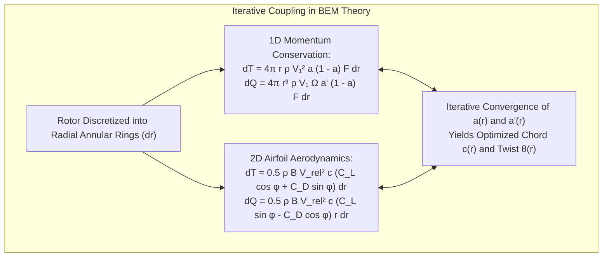

### 3.1 Kinematics of the Rotating Blade Element

BEM theory discretizes the blade of radius $R$ into a series of independent radial cross-sections (blade elements of spanwise width $dr$) located at distance $r$ from the hub.

Each blade element experiences two orthogonal velocity components:
1. <strong>Axial Velocity</strong>: The incoming wind decelerated by axial induction:
   $$V_{ax} = V_0 (1 - a)$$
2. <strong>Tangential Velocity</strong>: The rotational velocity $\Omega r$ augmented by the swirl induced in the wake:
   $$V_{tan} = \Omega r (1 + a')$$
   where $a'$ is the <strong>angular (tangential) induction factor</strong>.

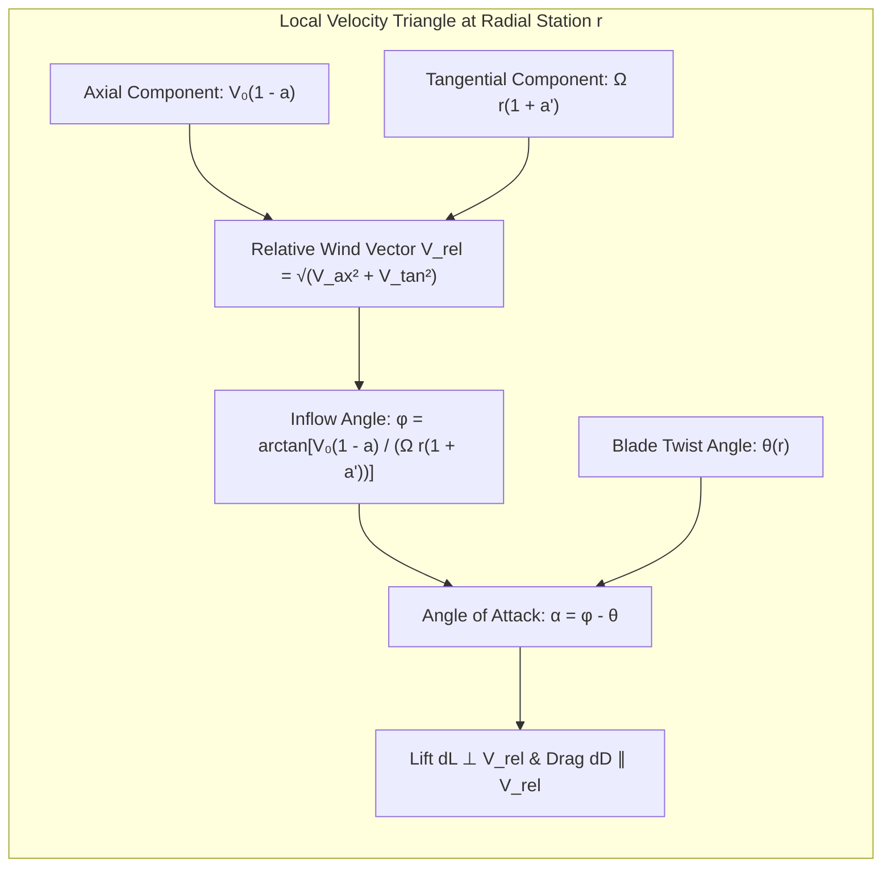

The resulting <strong>relative velocity vector ($\mathbf{V}_{rel}$)</strong> seen by the airfoil has magnitude:

$$V_{rel} = \sqrt{[V_0(1-a)]^2 + [\Omega r(1+a')]^2}$$

The <strong>inflow angle ($\phi$)</strong> between the relative wind vector and the plane of rotation is:

$$\tan \phi = \frac{V_{ax}}{V_{tan}} = \frac{V_0(1-a)}{\Omega r(1+a')}$$

If the chord line of the airfoil is oriented at a local geometric pitch angle $\theta(r)$ relative to the plane of rotation, the <strong>aerodynamic angle of attack ($\alpha$)</strong> is:

$$\alpha(r) = \phi(r) - \theta(r)$$

### 3.2 Aerodynamic Force Resolution

Under this angle of attack $\alpha$, the airfoil generates aerodynamic lift $dL$ (perpendicular to $\mathbf{V}_{rel}$) and aerodynamic drag $dD$ (parallel to $\mathbf{V}_{rel}$):

$$dL = \frac{1}{2}\rho V_{rel}^2 c(r) C_L(\alpha) \, dr$$

$$dD = \frac{1}{2}\rho V_{rel}^2 c(r) C_D(\alpha) \, dr$$

Resolving these forces into components aligned with the turbine axes:
- <strong>Tangential Force ($dF_T$)</strong>: Acts in the plane of rotation, driving the useful mechanical torque:
  $$dF_T = dL \sin \phi - dD \cos \phi = \frac{1}{2}\rho V_{rel}^2 c(r) [C_L \sin \phi - C_D \cos \phi] \, dr$$
- <strong>Normal Force ($dF_N$)</strong>: Acts parallel to the axis of rotation, creating parasitic aerodynamic thrust that bends the blade and tower:
  $$dF_N = dL \cos \phi + dD \sin \phi = \frac{1}{2}\rho V_{rel}^2 c(r) [C_L \cos \phi + C_D \sin \phi] \, dr$$

To maximize energy extraction while minimizing structural bending loads, wind turbine airfoils must achieve <strong>extraordinarily high lift-to-drag ratios ($C_L / C_D > 60 \text{ to } 120$)</strong>.

### 3.3 The Physics of Blade Twist and Chord Distribution

Examining the velocity triangle equation reveals why wind turbine blades exhibit their complex, twisted, sculptural geometry:

$$\tan \phi(r) \approx \frac{V_0}{\Omega r} = \frac{1}{\lambda_r}$$

1. <strong>Why the Blade Must Be Twisted</strong>:
   - Near the blade root ($r \to 0$), rotational velocity $\Omega r$ is small. The axial wind dominates, causing the inflow angle $\phi$ to be very steep (<strong>$\phi \approx 40^\circ \text{ to } 60^\circ$</strong>).
   - Near the blade tip ($r \to R$), the rotational speed reaches $80 - 90\,\mathrm{m/s}$, dwarfing the wind speed. The inflow angle becomes very shallow (<strong>$\phi \approx 3^\circ \text{ to } 6^\circ$</strong>).
   - Every aerodynamic airfoil has a narrow, optimal angle of attack range ($\alpha_{opt} \approx 5^\circ \text{ to } 8^\circ$) where the lift-to-drag ratio is maximized before stall occurs.
   - Because $\alpha = \phi(r) - \theta(r)$, maintaining a constant optimal $\alpha_{opt}$ across the entire length of the blade requires that <strong>the structural pitch angle $\theta(r)$ vary continuously along the span</strong>. The blade must have a large twist angle at the root ($\theta \approx 30^\circ - 45^\circ$) that smoothly un-twists toward the tip ($\theta \approx 0^\circ - 2^\circ$). Without geometric twist, portions of the blade would stall while other portions generated negative torque.
2. <strong>Why the Blade Is Fat at the Root and Thin at the Tip</strong>:
   - Aerodynamically, the optimal chord length $c(r)$ derived from Betz-BEM optimization scales inversely with radius: $c(r) \propto \frac{1}{r \lambda}$. Because dynamic pressure $\frac{1}{2}\rho V_{rel}^2$ increases quadratically with radius ($\propto r^2$), the blade tip travels so fast that even a very narrow chord captures immense aerodynamic lift.
   - Structurally, the blade functions as an immense <strong>cantilever beam</strong>. Flapwise aerodynamic thrust and edgewise gravitational deadweight create colossal bending moments that peak at the root attachment. To maximize the section modulus ($Z = I/y$) and resist bending with minimal composite material weight, the root transition region must be exceptionally thick, terminating in a massive circular cylindrical root flange with a diameter exceeding 4 to 5 meters.

---

## 4. Tip Vortices, Prandtl Corrections, and Noise Mitigation

Because a lifting blade maintains lower static pressure on its suction surface than on its pressure surface, high-pressure air curls around the physical tip toward the low-pressure side, shedding a powerful helical <strong>Tip Vortex</strong> into the downstream wake.

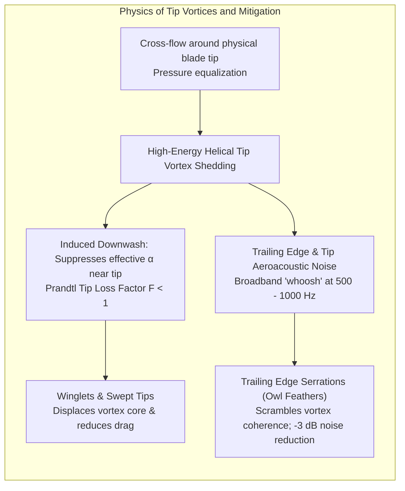

### 4.1 Prandtl's Tip-Loss Factor

In finite-blade reality, the circular movement of tip vortices reduces effective circulation to zero at $r = R$. Ludwig Prandtl modeled this three-dimensional boundary effect by introducing a correction factor $F(r)$:

$$F(r) = \frac{2}{\pi} \arccos\left[ \exp\left( -\frac{B(R - r)}{2 r \sin \phi} \right) \right]$$

where $B = 3$ is the blade count. The factor $F$ ranges from $1$ across the mid-span to $0$ at the exact tip, scaling down the local forces calculated by idealized momentum theory.

### 4.2 Aeroacoustics and Serration Engineering

For onshore turbines, community noise regulations frequently limit operation. The dominant noise source is <strong>trailing-edge aeroacoustic noise</strong> caused by boundary layer turbulence convecting past the sharp trailing edge.

Turbine designers deploy biomimetic engineering inspired by owl wings:
- <strong>Trailing Edge Serrations (DinoTails)</strong>: Triangular serrated plastic teeth affixed to the trailing edge over the outer $30\%$ of the blade span. These serrations disrupt the spatial coherence of passing turbulent eddies, converting large acoustic pressure fluctuations into high-frequency, destructive-interference micro-eddies. This reduces acoustic emissions by <strong>$2 \text{ to } 3.5\,\mathrm{dB}$</strong>—a perceived sound energy reduction of nearly $50\%$.

---

## 5. Control Dynamics and Survival across Operational Wind Regimes

Wind is an inherently stochastic resource. A wind turbine must extract maximum energy during light breezes, operate safely at constant capacity in high winds, and protect itself from structural destruction during Category 5 typhoons.

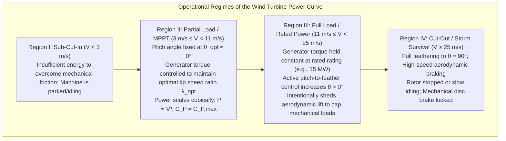

### 5.1 The Four Power Curve Regimes

1. <strong>Region I ($V < V_{in} \approx 3\,\mathrm{m/s}$)</strong>:
   Below the <strong>cut-in wind speed</strong>, kinetic power is insufficient to offset auxiliary parasitic loads (cooling fans, lubrication pumps, power electronics). The rotor remains aerodynamically pitched out or idles slowly.
2. <strong>Region II ($3\,\mathrm{m/s} \le V < 11\,\mathrm{m/s}$)</strong>:
   <strong>Maximum Power Point Tracking (MPPT) Regime</strong>. Because wind power density scales cubically with wind speed ($P_{wind} = \frac{1}{2}\rho A V^3$), this region holds enormous economic value.
   - The blade pitch angle is held constant at its optimum aerodynamic setting ($\theta \approx 0^\circ$).
   - The power converter continuously adjusts the generator's electromagnetic counter-torque to track the aerodynamic torque:
     $$Q_{gen} = K_{opt} \Omega^2, \quad \text{where } K_{opt} = \frac{1}{2}\rho A R^3 \frac{C_{P,max}}{\lambda_{opt}^3}$$
   - This control forces the rotor speed $\Omega$ to vary in direct linear lockstep with wind speed $V$, locking the operational tip speed ratio to $\lambda_{opt} \approx 8$ and pinning aerodynamic efficiency at its maximum possible peak ($C_P \approx 0.48 - 0.50$).
3. <strong>Region III ($11\,\mathrm{m/s} \le V < 25\,\mathrm{m/s}$)</strong>:
   <strong>Rated Capacity Limitation Regime</strong>. At the <strong>rated wind speed</strong> ($V_{rated} \approx 11 - 12\,\mathrm{m/s}$), the generator reaches its maximum thermal and mechanical rating (e.g., $15\,\mathrm{MW}$). Allowing power to continue climbing with $V^3$ would instantly shatter the gearbox, snap the blades, and melt the electrical windings.
   - In this regime, the generator torque is held constant, and <strong>Active Pitch Control</strong> takes over. Powerful hydraulic cylinders or electromechanical servo drives at each blade root rotate the blades along their longitudinal axes.
   - By pitching the blades toward feather ($\theta > 0^\circ$), the aerodynamic angle of attack $\alpha = \phi - \theta$ is deliberately reduced, spilling excess aerodynamic lift. The pitch controller executes closed-loop PID control on rotor speed, holding generator output perfectly flat at rated power.
4. <strong>Region IV ($V \ge V_{out} \approx 25\,\mathrm{m/s}$ / $90\,\mathrm{km/h}$)</strong>:
   <strong>Cut-Out and Storm Survival</strong>. When hurricane-force winds or severe wind gusts threaten structural integrity, the turbine shuts down. The pitch actuators rotate all three blades rapidly to full feather (<strong>$\theta = 90^\circ$</strong>), setting the airfoils parallel to the flow. Aerodynamic lift drops to zero, drag is minimized, and the rotor comes to a safe stop.

### 5.2 Individual Pitch Control (IPC)

In ultra-large rotors ($D > 200\,\mathrm{m}$), atmospheric wind shear causes wind velocity at the top of the rotor disc ($z = 250\,\mathrm{m}$) to be substantially higher than at the bottom ($z = 50\,\mathrm{m}$). Consequently, as each blade completes a $360^\circ$ revolution, it encounters an intense cyclic aerodynamic pulsing at the rotational frequency (<strong>1P fatigue loading</strong>).

Modern turbines implement <strong>Individual Pitch Control (IPC)</strong>. Using multi-axis blade-root fiber-optic strain gauge feedback, the controller computes independent pitch commands for each individual blade via Coleman coordinate transformations. The top blade pitches slightly to feather to spill excess aerodynamic load, while the bottom blade pitches in to boost lift, neutralizing asymmetrical tilting and yawing moments across the rotor by <strong>$30\% \text{ to } 40\%$</strong> and extending tower and bearing fatigue lifespans.

---

## 6. Drivetrain Architecture: Geared vs. Direct-Drive

The mechanical power developed at the rotor hub must be delivered to an electrical generator within the nacelle. The wind industry has split into two primary engineering camps:

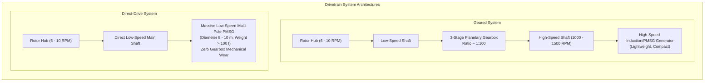

1. <strong>Geared Systems</strong>:
   Because rotor speed is low ($\sim 7\,\mathrm{RPM}$ for a 15 MW machine), generating power directly would require an enormous number of electromagnetic poles. Geared turbines interpose a heavy, three-stage epicyclic (planetary) gearbox to step up rotational speed roughly 100-fold to $1,000 - 1,500\,\mathrm{RPM}$. This allows the use of a lightweight, highly compact generator. However, planetary gearboxes operate under brutal, multidirectional cyclic shock loads, requiring complex pressurized oil filtration systems and representing a historical maintenance vulnerability.
2. <strong>Direct-Drive Systems (Gearless)</strong>:
   Pioneered by Enercon and Siemens Gamesa, direct-drive turbines completely eliminate the gearbox. The rotor hub is bolted directly to the rotor of a massive, multi-pole <strong>Permanent Magnet Synchronous Generator (PMSG)</strong> utilizing neodymium-iron-boron ($\mathrm{NdFeB}$) rare-earth magnets. 
   
   The direct-drive generator is a structural behemoth—often exceeding $8 - 10\,\mathrm{meters}$ in diameter and weighing over $100\,\mathrm{metric\ tons}$. However, eliminating hundreds of high-speed meshing gear teeth dramatically improves operational reliability, making direct-drive the dominant choice for remote, inaccessible offshore installations where maintenance vessels cost tens of thousands of dollars per day.

---

## 7. Wake Aerodynamics and Wind Farm Array Engineering

A wind turbine does not operate in isolation; it functions within a collective array (a wind farm). As air passes through a turbine, it sheds a long downstream <strong>turbulent wake</strong> characterized by reduced mean velocity and elevated turbulent kinetic energy (TKE).

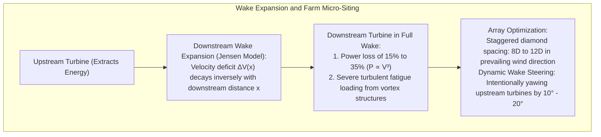

### 7.1 Jensen's Wake Decay Model

The classic analytical engineering model for wind farm wake expansion is the <strong>Jensen Park Model</strong>. Assuming a conical, linearly expanding wake boundary:

$$R_w(x) = R_{rotor} + k_{wake} x$$

where $k_{wake}$ is the entrainment decay coefficient (typically $0.075$ for terrestrial landscapes, $0.04$ for low-turbulence offshore seascapes).

Applying conservation of momentum, the velocity deficit at downstream distance $x$ is:

$$\frac{V_0 - V_x}{V_0} = \left( 1 - \sqrt{1 - C_T} \right) \left( \frac{D}{D + 2 k_{wake} x} \right)^2$$

where $C_T = \frac{T}{\frac{1}{2}\rho A V_0^2} = 4a(1-a)$ is the turbine thrust coefficient.

### 7.2 Micro-Siting and Wake Steering

If a downstream turbine sits directly in the wake of an upstream turbine:
1. <strong>Severe Power Deficit</strong>: Because power scales cubically with velocity ($P \propto V^3$), even a $20\%$ drop in local wind speed slashes electrical output by <strong>nearly $50\%$</strong>.
2. <strong>Accelerated Fatigue</strong>: High turbulent eddy kinetic energy shakes the downstream blades, accelerating material micro-cracking.

Wind farm engineers mitigate this through <strong>micro-siting</strong>:
- Spacing turbines <strong>$8D \text{ to } 12D$ apart</strong> along the prevailing wind vector ($1.5 \text{ to } 2.5\,\mathrm{km}$ between adjacent units).
- Arranging turbines in staggered, non-aligned diamond arrays.
- <strong>Active Wake Steering</strong>: Using collaborative wind farm control, upstream turbines are intentionally operated with a $10^\circ - 20^\circ$ yaw misalignment. While this reduces the upstream turbine's output by $1 - 2\%$, the resulting lateral aerodynamic force curls the wake sideways, diverting the turbulent plume entirely away from downstream turbines and boosting net farm-wide energy production by $5\% \text{ to } 12\%$.

---

## 8. Extreme Offshore Structural Engineering: Fixed to Floating

As land constraints mount, the global wind industry is expanding into deep offshore waters where winds are stronger, smoother, and uninterrupted by terrain.

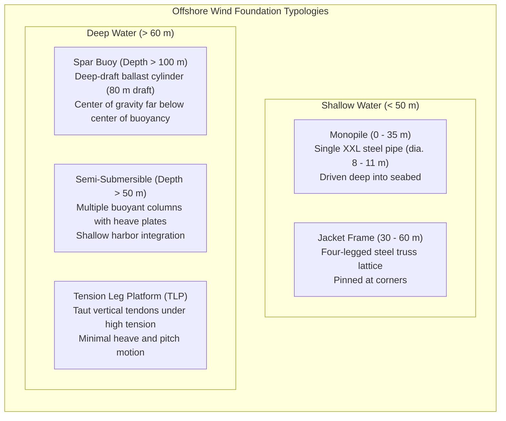

### 8.1 From Fixed Monopiles to Floating Structures

- <strong>Monopiles (Water depths $< 35\,\mathrm{m}$)</strong>: A single massive cylindrical steel pipe ($8 - 11\,\mathrm{meters}$ in diameter, weighing over $1,500\,\mathrm{tons}$) driven up to 40 meters into the marine sediments by hydraulic piling hammers.
- <strong>Jacket Foundations ($30 - 60\,\mathrm{m}$)</strong>: Three- or four-legged welded tubular steel space frames providing high structural stiffness with lower steel mass.
- <strong>Floating Wind ($> 60\,\mathrm{m}$)</strong>: Over $80\%$ of the world's offshore wind resource resides in deep waters where seabed-fixed piling is technically and economically unfeasible. Here, turbines sit on buoyant floating hulls tethered to the seabed by catenary or taut synthetic mooring lines.

### 8.2 Aero-Hydro-Servo-Elastic Coupling and Negative Damping

Floating offshore wind turbines (FOWT) represent the pinnacle of multi-physics engineering complexity. The system couples six physical domains:
1. <strong>Aerodynamics</strong>: High-speed unsteady aerodynamic lift and drag across rotating airfoils.
2. <strong>Hydrodynamics</strong>: Linear wave radiation, diffraction, viscous drag (Morison's equation), and second-order drift forces from ocean swells acting on the hull across 6 degrees of freedom (surge, sway, heave, roll, pitch, yaw).
3. <strong>Elasticity</strong>: Bending compliance of 100-meter composite blades and flexible steel/concrete towers.
4. <strong>Mooring Dynamics</strong>: Non-linear geometric stiffness, catenary line dynamics, and seabed friction.
5. <strong>Servo-Control</strong>: Pitch and torque digital control algorithms.
6. <strong>Aero-Hydro Coupling: The Negative Damping Trap</strong>:
   In standard land-based turbines in Region III, if rotor speed surges, the pitch controller quickly pitches blades toward feather to reduce aerodynamic torque. 
   
   However, on a floating platform, pitching to feather reduces thrust. When the platform is pitching forward into an oncoming wave, reducing thrust causes the platform to pitch forward *even faster*. Conversely, when the platform rocks backward, the controller pitches in to maintain power, increasing thrust and shoving the platform backward with greater violence. 
   
   This classical control interaction creates <strong>Aerodynamic Negative Damping</strong>, leading to divergent, catastrophic structural oscillations. Floating wind turbines require specialized control algorithms that detune pitch gains below the platform pitch resonant frequency or use active platform motion feedback to damp hydro-elastic swaying.

---

## 9. Materials Science, Fatigue Mechanics, and Leading Edge Erosion

A modern 15 MW turbine blade spans over <strong>110 meters</strong> and weighs between <strong>45 and 60 metric tons</strong>. This colossal composite structure must flex under extreme cyclonic gusts without touching the tower, yet survive over <strong>$10^8$ cyclic stress reversals</strong> over a 25-year operational lifecycle.

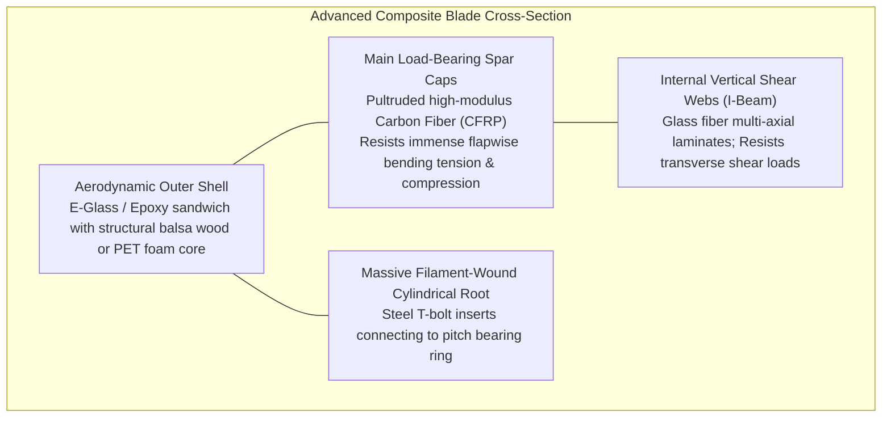

### 9.1 Composite Material Architecture

- <strong>Pultruded Carbon Fiber Spar Caps</strong>: To prevent tower strikes during extreme $50\,\mathrm{m/s}$ gusts, blades must possess extreme flapwise bending stiffness. The primary load-bearing members are <strong>spar caps</strong> manufactured from pultruded carbon fiber reinforced polymer (CFRP). Carbon fiber provides double the elastic stiffness ($E \approx 140\,\mathrm{GPa}$) of glass fiber ($E \approx 40\,\mathrm{GPa}$) at half the density, shedding tons of structural weight.
- <strong>Sandwich Shear Webs</strong>: The internal I-beam shear webs utilize lightweight structural balsa wood or recycled polyethylene terephthalate (PET) structural foam cores sandwiched between multiaxial fiberglass skins, providing exceptional resistance to shear buckling.

### 9.2 The Leading Edge Erosion Threat

At rotational tip speeds exceeding $90\,\mathrm{m/s}$ ($324\,\mathrm{km/h}$), atmospheric rain droplets, hail, sea spray, and airborne sand particles impact the leading edge with the kinetic velocity of bullets.

Repeated high-speed liquid droplet impacts generate localized Rayleigh surface acoustic waves and shock pressures exceeding the yield strength of polymer coatings. Over several years, the protective polyurethane gelcoat pits, peels, and erodes:
- Surface roughness of the leading edge increases by mere fractions of a millimeter.
- This minute roughness triggers premature boundary layer transition from laminar to turbulent flow, creating premature flow separation.
- Maximum lift coefficient $C_{L,max}$ drops by $15\%$, drag $C_D$ doubles, and annual energy production (AEP) plunges by <strong>$3\% \text{ to } 7\%$</strong>—translating to millions of dollars in lost revenue across a wind farm.

To combat erosion, modern blades apply nanostructured thermoplastic polyurethane (TPU) leading-edge protection (LEP) tapes and soft-elastomeric erosion shields, supplemented by autonomous drone-based computer vision inspections.

---

## 10. Conclusion: The Masterwork of Atmospheric Fluid Mechanics

The modern wind turbine is an engineering monument: a colossal, living synthesis of fluid dynamics, solid-state mechanics, and modern control theory.

- <strong>The Betz Limit</strong> establishes the universal thermodynamic ceiling ($59.3\%$), proving that air must escape downstream to allow continuous power extraction.
- <strong>Three-Bladed Geometry</strong> provides the perfect intersection of high aerodynamic lift-to-drag efficiency and mathematically isotropic gyroscopic stability during yaw alignment.
- <strong>BEM Aerodynamics and Spanwise Twist</strong> ensure that every square millimeter of the 100-meter airfoil operates at peak aerodynamic efficiency, navigating a relative wind vector that shifts from steep to near-horizontal between root and tip.
- <strong>Full-Span Pitch and Mechatronic Control</strong> tame the violent stochasticity of nature, turning savage gale-force gusts into steady, grid-compliant megawatts.

As offshore turbines push past 20 megawatts and rotor diameters exceed 250 meters, the wind turbine stands as one of humanity's supreme technical achievements—capturing the invisible momentum of planetary atmospheric circulation and converting it cleanly into the foundational electrical lifeblood of modern civilization.
