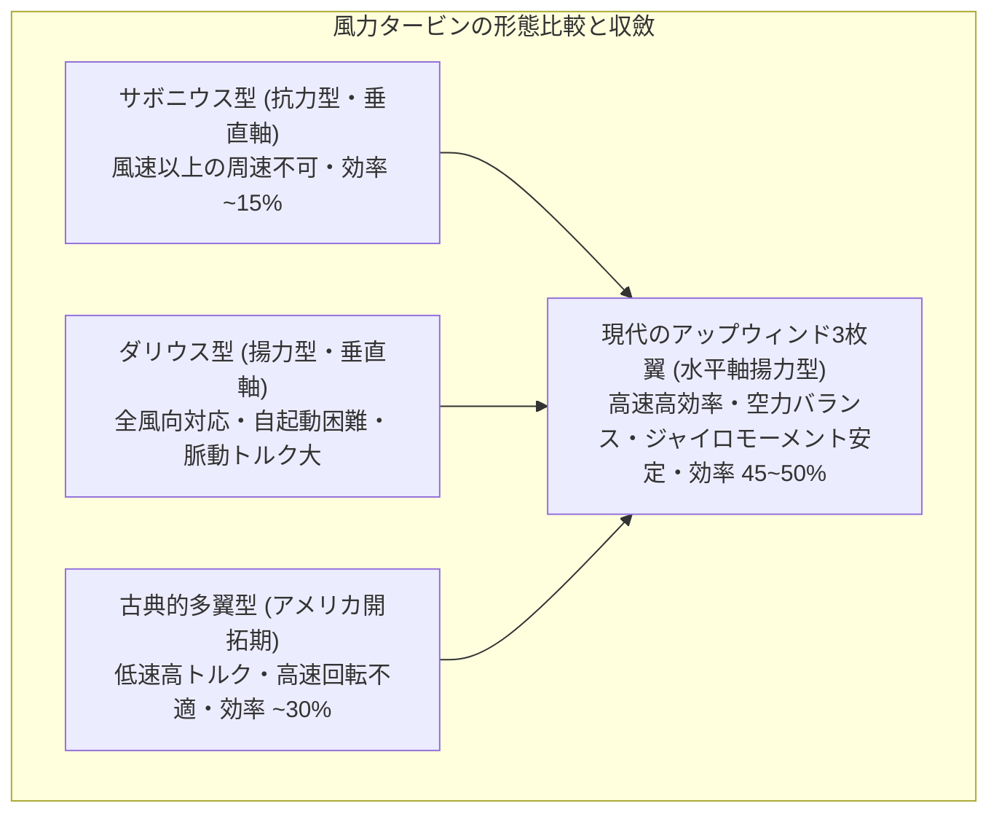
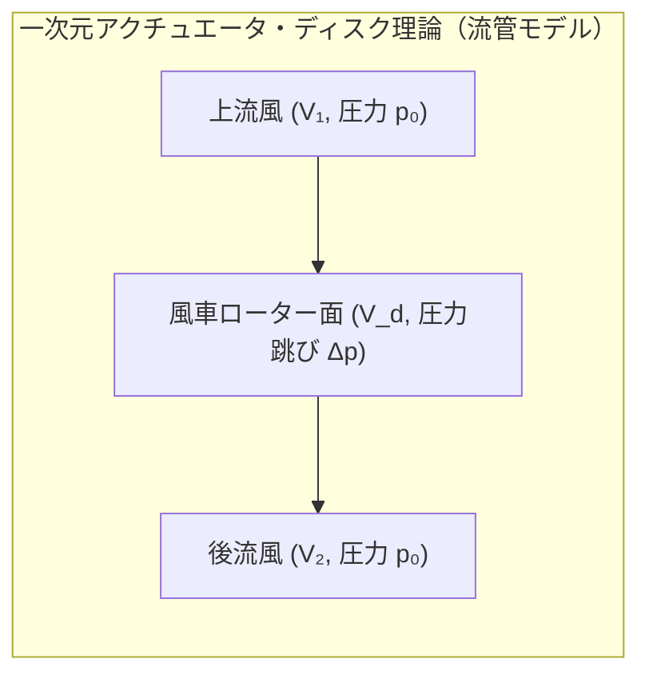
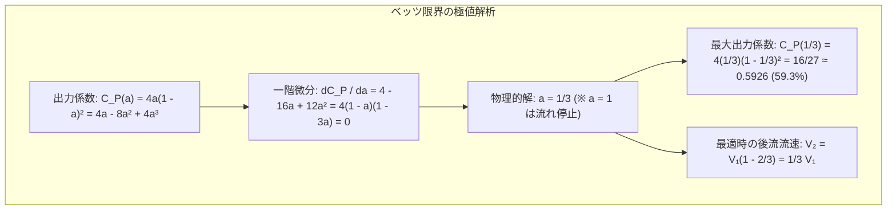
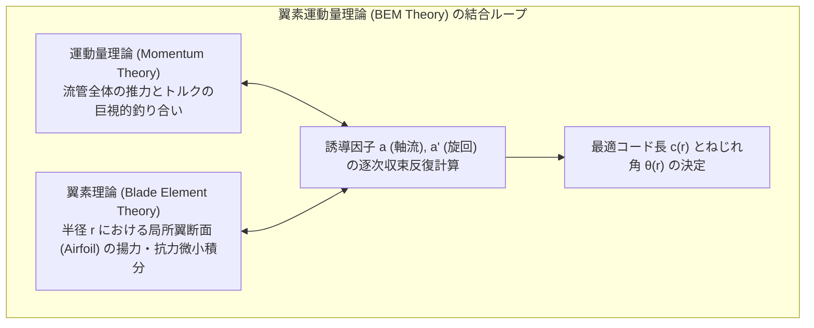
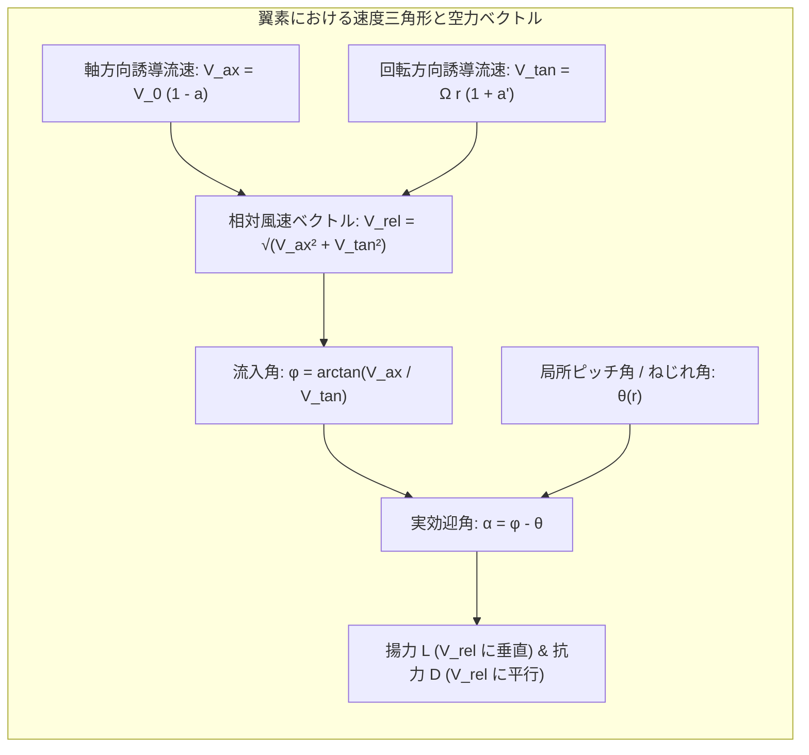
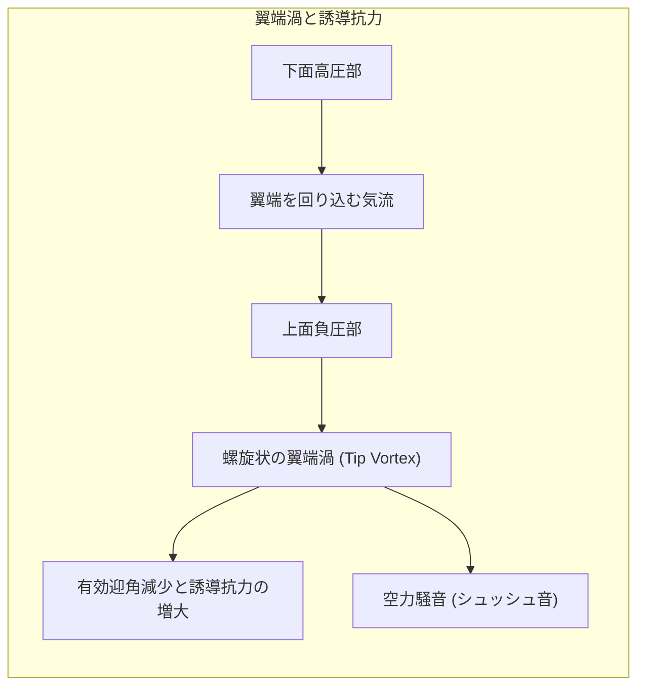
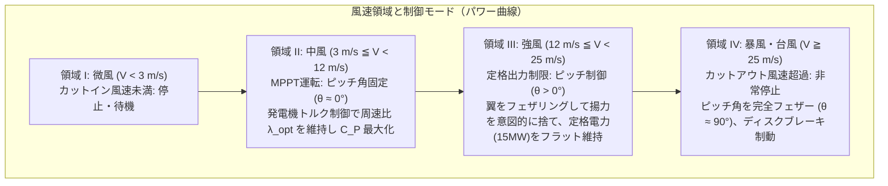
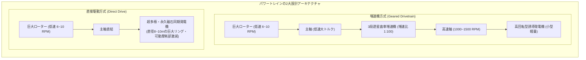
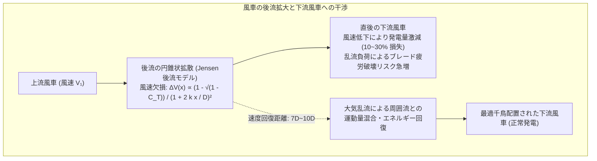
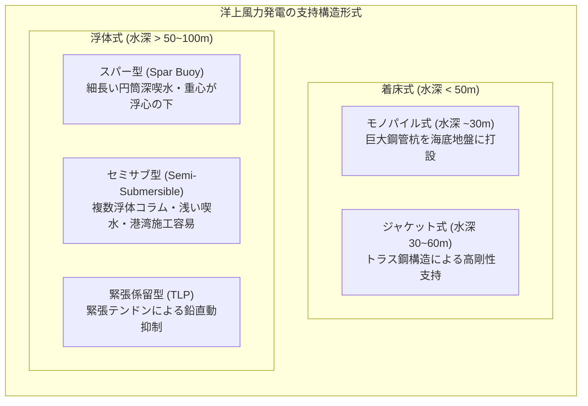

広大な丘陵地帯や荒れ狂う外洋の上にそびえ立ち、真っ白な3枚の巨大なブレードを優雅に旋回させる現代の風力発電機（Wind Turbine）。その全高はときに250メートルを超え、ローター直径は大型旅客機の翼幅を遥かに凌駕する230メートル以上（単基出力15メガワット）に達します。

この巨大な構造物は、単なる「大きな風車」ではありません。そこには、流体から取り出し得るエネルギーの絶対上限を定めた「ベッツの法則」、航空力学の極致である「翼素運動量理論（BEM理論）」、巨大複合材料の疲労破壊力学、そして暴風雨のなかで回転数を精密にねじ伏せるメガワット級メカトロニクス制御が凝縮されています。

「なぜ風車は3枚翼なのか？」「なぜ翼は根元が太く、先端にかけて複雑にねじれているのか？」「なぜ風のエネルギーを100%取り出すことは物理的に不可能なのか？」「風車の後方に生まれる乱気流（後流）はどのように減衰するのか？」「洋上に浮かぶ巨大風車はいかにして荒波に耐えているのか？」

本稿では、風力タービンが現在の姿へと収斂した必然の理由を、流体力学・空気力学・機械工学・制御理論の数理とともに余すところなく解き明かします。

---

## 1. 形態の必然：なぜ現代の風車は「3枚翼の水平軸」なのか？

世界各地の風力発電所を見渡すと、メーカーや設置環境（陸上・洋上）にかかわらず、ほぼ100%が<strong>「水平軸型（Horizontal Axis Wind Turbine: HAWT）」</strong>かつ<strong>「上流風受け（アップウィンド型）3枚ブレード」</strong>という同一の形態を採用しています。なぜこの形状が唯一無二の最適解となったのでしょうか。

### 1.1 抗力型（Drag Type）から揚力型（Lift Type）への飛躍

風から機械動力を得る原理には、大きく分けて「抗力（Drag）」と「揚力（Lift）」の2つが存在します。
- <strong>抗力型風車（サボニウス型、オランダ風車の一部など）</strong>:
  風が吹き付ける力（風圧）を直接受けて羽根を押す方式です。原理上、翼の回転速度は風速 $V_0$ を絶対に超えることができません（周速比 $\lambda = \omega R / V_0 < 1$）。ブレードが風から逃げるように動くため、相対風速が低下し、エネルギー変換効率は最大でも $15\sim 20\%$ 程度に頭打ちとなります。
- <strong>揚力型風車（現代の風力タービン）</strong>:
  航空機の主翼と同じ翼型（Airfoil）を採用し、翼の表面を流れる空気の圧力差によって生じる強力な<strong>揚力（Lift Force）</strong>を利用してローターを回転させます。ブレードの先端速度は自然の風速の <strong>6倍〜8倍（周速比 $\lambda \approx 7\sim 9$）</strong> という超高速（時速 $250\sim 320\,\mathrm{km/h}$）で飛行します。高速回転によって同一出力あたりの発生トルクを小さく抑えられるため、ドライブトレイン（シャフトや増速機）を劇的に軽量化でき、変換効率も $45\sim 50\%$ という圧倒的な高効率に達します。

### 1.2 翼の枚数はなぜ「3枚」なのか？

揚力型風車を作る場合、ブレードの枚数には力学的・空力的なトレードオフが存在します。

| 翼枚数 | 空力特性 | 構造・コスト | 動力学的安定性（ジャイロ効果） | 視覚的・騒音特性 |
|---|---|---|---|---|
| <strong>1枚翼</strong> | 空力効率は理論上良好 | カウンターウェイト必須・アンバランス | 致命的なジャイロモーメント振動 | 視覚的不安感大・騒音甚大 |
| <strong>2枚翼</strong> | 空力効率は極めて高い | ブレードコスト最小・軽量 | <strong>ヨー旋回時に激しい慣性変動（Teetering必須）</strong> | 高速回転による視覚的せわしなさ |
| <strong>3枚翼</strong> | <strong>空力効率ほぼ最高（2枚と大差なし）</strong> | コストと重量のバランス良好 | <strong>極めて滑らかな極慣性モーメント（安定）</strong> | <strong>視覚的安定感・低騒音（世界標準）</strong> |
| <strong>多翼（4枚以上）</strong> | 先行ブレードの後流干渉で効率低下 | 重量・コスト激増 | 安定だが過剰設計 | 景観圧迫・トルク過剰 |

物理学的に最も決定的な要因は、風向きの変化に合わせて風車全体を水平旋回（ヨー制御 / Yawing）させる際に生じる<strong>ジャイロモーメント（Gyroscopic Precession Moment）</strong>の対称性です。

剛体ローターの慣性テンソルを考えると、
- <strong>2枚翼の場合</strong>:
  ブレードが垂直に直立した瞬間と、水平に倒れた瞬間で、ヨー軸まわりの回転慣性モーメント（主慣性モーメント）が周期的に激変します。風向きを追従しようとヨーモーターでナセルを旋回させると、毎回転ごとに激しい交番曲げトルクが主軸とタワーに叩きつけられ、金属疲労破壊を引き起こします（これを逃がすには複雑なシーソー構造「チータリングハブ」が必要です）。
- <strong>3枚翼の場合</strong>:
  円周方向に $120^\circ$ 等間隔で配置された3枚の翼は、数学的に<strong>どの回転位相においてもヨー軸およびピッチ軸まわりの極慣性モーメントが完全に一定</strong>（円対称）となります。その結果、ヨー旋回を行ってもジャイロモーメントによる周期的な加振力が一切発生せず、機械構造が極めて長寿命かつ安定に保たれます。

加えて、3枚翼の回転周期は人間の視覚心理学的に最も穏やかで安定感を与え、景観受容性が高いという社会工学的理由も合致し、世界の風力タービンは「3枚翼」へと完全に統一されました。

---

## 2. 流体力学的限界：ベッツの法則（Betz's Law）

風車は風のエネルギーをどれだけ電気に変えられるのでしょうか。熱機関におけるカルノーサイクルと同様に、風力エネルギー変換には流体力学の第一原理から導かれる絶対的な理論限界が存在します。これが1919年にドイツの物理学者アルベルト・ベッツ（Albert Betz）によって導出された<strong>ベッツの限界（Betz Limit）</strong>です。

### 2.1 一次元流管モデルと基礎方程式

風車ローターを無限に薄い円盤（アクチュエータ・ディスク / Actuator Disk、面積 $A$）としてモデル化します。非圧縮性・定常・摩擦なしの理想流体を仮定し、ローターを通過する空気の「流管（Streamtube）」を考えます。

- 上流無限遠での風速を $V_1$、静圧を大気圧 $p_0$ とする。
- ローター通過面での風速を $V_d$、ローター直前・直後の圧力をそれぞれ $p_u, p_d$ とする。
- 後流無限遠での風速を $V_2$、静圧は大気圧 $p_0$ に回復するとする。

<strong>連続の式（質量の保存）</strong>より、流管内を流れる質量流量 $\dot{m}$ は一定です。

$$\dot{m} = \rho A V_d$$

ここで $\rho$ は空気密度（常温常圧で約 $1.225\,\mathrm{kg/m^3}$）です。

<strong>運動量保存則</strong>より、流体がローターに及ぼす推力（スラスト力 $T$）は、流入と流出の運動量フラックスの差に等しくなります。

$$T = \dot{m} (V_1 - V_2) = \rho A V_d (V_1 - V_2)$$

一方、ローターの直前と直後でそれぞれ<strong>ベルヌーイの定理（Bernoulli's Principle）</strong>を適用します。
- ローター上流側: $p_0 + \frac{1}{2}\rho V_1^2 = p_u + \frac{1}{2}\rho V_d^2$
- ローター下流側: $p_d + \frac{1}{2}\rho V_d^2 = p_0 + \frac{1}{2}\rho V_2^2$

両式の差をとると、ローター面における圧力降下（圧力跳び $\Delta p$）が得られます。

$$\Delta p = p_u - p_d = \frac{1}{2}\rho (V_1^2 - V_2^2)$$

推力は圧力差と面積の積でもあるため、$T = A \Delta p$ です。運動量式と比較すると:

$$\rho A V_d (V_1 - V_2) = \frac{1}{2}\rho A (V_1^2 - V_2^2) = \frac{1}{2}\rho A (V_1 - V_2)(V_1 + V_2)$$

$(V_1 - V_2) \ne 0$ の両辺を割ることで、極めて美しい基本関係が導かれます。

$$V_d = \frac{V_1 + V_2}{2}$$

すなわち、<strong>「ローター面を通過する流速 $V_d$ は、上流流速 $V_1$ と後流流速 $V_2$ の完全な算術平均（相加平均）になる」</strong>という定理です。

### 2.2 出力係数 $C_P$ の導出と最大値（16/27）

ここで、上流風速がローター面でどれだけ減速されたかを表す無次元量として、<strong>軸流誘導因子（Axial Induction Factor $a$）</strong>を定義します。

$$V_d = V_1 (1 - a)$$

先ほどの平均流速の式より、後流風速 $V_2$ は次のように表されます。

$$V_2 = 2V_d - V_1 = 2V_1(1-a) - V_1 = V_1 (1 - 2a)$$

風車が流体から取り出す機械的出力 $P$ は、推力 $T$ とローター面流速 $V_d$ の積です。

$$P = T \cdot V_d = [\rho A V_d (V_1 - V_2)] V_d = \rho A V_1^3 \cdot 2a(1-a)^2$$

一方、断面積 $A$ を減速なしにそのまま通過する風の全運動エネルギーフラックス（風のポテンシャル出力 $P_{wind}$）は次式で定義されます。

$$P_{wind} = \frac{1}{2} \dot{m}_{wind} V_1^2 = \frac{1}{2} (\rho A V_1) V_1^2 = \frac{1}{2}\rho A V_1^3$$

風車のエネルギー変換効率を表す無次元指標である<strong>出力係数（Power Coefficient $C_P$）</strong>は、両者の比として求まります。

$$C_P = \frac{P}{P_{wind}} = 4a(1-a)^2$$

この $C_P(a)$ を $a$ で微分して極大値を求めます。

$$\frac{dC_P}{da} = 4 - 16a + 12a^2 = 4(1 - 3a)(1 - a) = 0$$

物理的に意味のある解は <strong>$a = \frac{1}{3}$</strong> です。このとき、最大出力係数 $C_{P,max}$ は以下のようになります。

$$C_{P,max} = 4 \left(\frac{1}{3}\right) \left(1 - \frac{1}{3}\right)^2 = \frac{16}{27} \approx 0.5926 \quad (\mathbf{59.26\%})$$

### 2.3 なぜ風のエネルギーを100%取り出せないのか？（物理的パラドックス）

直感的には「風車を密閉された壁のように設計すれば、風の運動エネルギーをすべて奪えるのではないか」と考えがちです。しかし、流体力学的にはそれは完全なパラドックスです。

もし仮に風のエネルギーを100%回収しようとすると、後流の風速はゼロ（$V_2 = 0$）になります。風速がゼロになった空気はその場に完全に停滞（静止）し、後から吹き寄せる空気をすべて遮断してしまいます。その結果、空気は風車を迂回して外側へと逃げてしまい、ローターを通過する流量 $\dot{m}$ 自体がゼロになって、風車は一切の動力を生み出せなくなります。

風車が継続的に出力を生み出すためには、<strong>「エネルギーを奪い去った後の空気（後流）を、滞留させることなく下流へと速やかに排出し続けなければならない」</strong>のです。この「減速によるエネルギー抽出」と「流量維持のための空気の排出」が最も完璧に調和する条件こそが、「上流風速の $1/3$ を減速させ、風車面を $2/3$ の流速で通過させ、後流を $1/3$ の速度で逃がす（$a = 1/3$）」というベッツの限界条件なのです。

---

## 3. 翼素運動量理論（BEM理論）とブレードの幾何学

一次元のアクチュエータ・ディスク理論は理想限界を示しますが、実際の風車ブレードは有限の枚数の翼であり、回転によって後流に渦（回転角運動量）を誘起します。実用ブレードの空力設計の根幹をなすのが<strong>翼素運動量理論（BEM: Blade Element Momentum Theory）</strong>です。

### 3.1 局所流入速度ベクトルと迎角

半径 $R$ のブレード上の任意の半径位置 $r$（$0 \le r \le R$）における微小翼素（幅 $dr$）を考えます。翼素に吹き込む空気の流れは、風車の前方から吹き込む「軸流風」と、ブレード自身の回転によって生じる「旋回流」が合成された<strong>相対風速（Relative Velocity $V_{rel}$）</strong>となります。

- 軸方向流速: $V_{ax} = V_0 (1 - a)$（$a$ は軸流誘導因子）
- 接線（回転）方向流速: $V_{tan} = \Omega r (1 + a')$（$\Omega$ はローター角速度、$a'$ は旋回誘導因子）

相対風速の大きさと流入角（Inflow Angle $\phi$）は幾何学的に次のように決まります。

$$V_{rel} = \sqrt{[V_0(1-a)]^2 + [\Omega r (1+a')]^2}$$

$$\tan \phi = \frac{V_0(1-a)}{\Omega r(1+a')}$$

ブレードの翼断面の基準線（コードライン）が回転面となす角度を<strong>局所ピッチ角（ねじれ角） $\theta(r)$</strong> とすると、空気力学的な<strong>実効迎角（Angle of Attack $\alpha$）</strong>は次のように決定されます。

$$\alpha(r) = \phi(r) - \theta(r)$$

### 3.2 揚力・抗力と回転トルクの生成

翼断面（Airfoil）が迎角 $\alpha$ をもって相対風 $V_{rel}$ を受けると、クッタ・ジュコーフスキーの定理に従って循環 $\Gamma$ が発生し、$V_{rel}$ に垂直な<strong>揚力（Lift $dL$）</strong>と、平行な<strong>抗力（Drag $dD$）</strong>が発生します。

$$dL = \frac{1}{2}\rho V_{rel}^2 \cdot c(r) C_L(\alpha) \, dr$$

$$dD = \frac{1}{2}\rho V_{rel}^2 \cdot c(r) C_D(\alpha) \, dr$$

ここで $c(r)$ は局所翼弦長（Chord Length）、$C_L$ は揚力係数、$C_D$ は抗力係数です。

風車を回す有効な力（回転接線力 $dF_T$）と、タワーを押し倒そうとする無駄な力（軸方向推力 $dF_N$）は、流入角 $\phi$ を用いて次のように座標変換されます。

$$dF_T = dL \sin \phi - dD \cos \phi$$

$$dF_N = dL \cos \phi + dD \sin \phi$$

ブレード全体（枚数 $B = 3$）が生み出す総トルク $Q$ と総出力 $P$ は、これらをハブ根元から翼端まで積分することで得られます。

$$Q = B \int_{r_{hub}}^R r \cdot dF_T(r)$$

$$P = Q \cdot \Omega$$

風車が効率よく回るためには、$dF_T$ を正かつ最大にする必要があり、そのためには<strong>「抗力に対して圧倒的に巨大な揚力を生み出す（高揚抗比 $C_L / C_D > 50\sim 100$）高性能翼型」</strong>が不可欠となります。

### 3.3 なぜ翼は「ねじれて」おり、「根元が太く先端が細い」のか？

巨大風車のブレードを横から眺めると、根元から先端にかけてドラマチックにねじれ、かつ幅が劇的に変化していることがわかります。これには極めて明快な航空流体力学と構造力学の理由があります。

1. <strong>なぜ「ねじれ（Twist）」が必要なのか？</strong>:
   流入角の式 $\tan \phi \approx \frac{V_0}{\Omega r}$ を見ると、回転中心に近い根元（$r$ が小）では回転周速 $\Omega r$ が遅いため、流入角 $\phi$ は非常に大きく（$40^\circ\sim 60^\circ$）なります。一方、翼端付近（$r$ が大）では周速が $80\,\mathrm{m/s}$（新幹線並み）に達するため、流入角 $\phi$ はわずか数度（$3^\circ\sim 6^\circ$）にまで寝てしまいます。
   もしブレードが真っ直ぐでねじれていなかったらどうなるでしょうか。翼端に迎角を合わせれば根元が完全に失速（ストール）して巨大な渦抵抗を生み、根元に合わせれば翼端がマイナス迎角になってブレーキをかけてしまいます。
   したがって、<strong>ブレードのすべての半径位置 $r$ において、翼型が最大の揚抗比を発揮する最適迎角（$\alpha_{opt} \approx 4^\circ\sim 7^\circ$）を均一に保ち続けるために、根元ではピッチ角 $\theta$ を大きく立て、先端に向かって滑らかに寝かせていく「幾何学的ねじれ（Twist）」が物理的に絶対不可欠</strong>なのです。
2. <strong>なぜ「根元は太く、先端は細い」のか？</strong>:
   空力的に最適な局所コード長 $c(r)$ は、ベッツ条件を満たす場合、理論上 $c(r) \propto \frac{1}{r}$（双曲線状）に減少します。先端ほど相対風速の自乗 $V_{rel}^2 \propto r^2$ に比例して巨大な動圧が加わるため、ごく狭い翼幅でも十分な揚力を稼げるからです。
   さらに構造工学（片持ち梁 / Cantilever Beam）の観点から、100メートルを超えるブレードには数百トンの曲げモーメント荷重（フラップ方向の風圧、エッジ方向の自重重力）が集中します。根元（ルート部）は断面係数を極大化して巨大な曲げ応力に耐え、かつピッチベアリングと円形ボルト接合するために、肉厚で真円に近い極太の構造が要求されます。

---

## 4. 翼端渦（Tip Vortex）と騒音低減技術

有限翼幅を持つ翼では、下面の正圧側から上面の負圧側へと空気が外側を回り込もうとするため、翼端から激しい渦流――<strong>翼端渦（Tip Vortex）</strong>が後方へと螺旋状に放出されます。

### 4.1 プラントルの翼端損失（Prandtl's Tip Loss Factor）

翼端渦の存在により、ブレードの最外殻部分では揚力が急激にゼロへと減衰します。ルートヴィヒ・プラントルはこの三次元損失を定量化するため、補正係数 $F$ を導出しました。

$$F = \frac{2}{\pi} \arccos\left[ \exp\left( -\frac{B (R - r)}{2 r \sin \phi} \right) \right]$$

ここで $B$ はブレード枚数（3枚）です。この係数 $F$（$0 \le F \le 1$）は翼端（$r \to R$）においてゼロへと急落し、実効的なトルクを奪います。

### 4.2 レーキ角（Rake）・後退翼（Swept Tip）・ウィングレット

現代の先端ブレードでは、翼端損失を抑制し、かつ周辺住民への環境負荷となる空力騒音を極限まで低減させるために、航空宇宙工学の知見が惜しみなく投入されています。
- <strong>ウィングレット（Winglet）</strong>: 翼端を垂直または斜め前方に折り曲げることで、下面から上面への空気の回り込みを物理的にブロックし、渦を微小に細分化して誘導抗力を削減します。
- <strong>鋸歯状後縁（Trailing Edge Serrations）</strong>: 翼の後縁（トレーリングエッジ）にギザギザの鋸歯状プレート（Serrations）を取り付けます。翼表面の境界層から剥離する乱流渦の干渉位相を細かく乱すことで、周波数 $500\sim 1000\,\mathrm{Hz}$ の風切り音（空力ブロードバンド騒音）を <strong>$2\sim 3\,\mathrm{dB}$（体感騒音エネルギーで半減近く）</strong> 抑制します。

---

## 5. 制御工学と過酷環境サバイバル技術

風速は自然現象であり、無風から台風・猛吹雪に至るまで無秩序かつ暴力的に変動します。発電機や構造物に過負荷をかけず、かつあらゆる風速で最大電力を回収するために、風車は高度な閉ループ制御システムを備えています。

### 5.1 4つの運転領域とパワー曲線（Power Curve）

1. <strong>領域 I（カットイン風速 $V_{in} \approx 3\,\mathrm{m/s}$ 未満）</strong>:
   風のエネルギーが機械的損失（軸受摩擦、補機電力）を下回るため、発電を行わず待機します。
2. <strong>領域 II（$3\,\mathrm{m/s} \le V < 11\sim 12\,\mathrm{m/s}$，定格風速未満）</strong>:
   <strong>最大電力追従（MPPT）運転</strong>。風速 $V$ の変動に追従して、発電機の反抗トルクを調整することでローター回転数 $\Omega$ を連続変化させます。最適な周速比 $\lambda_{opt} = \frac{\Omega R}{V} \approx 8$ を常に維持し、出力係数 $C_P$ を常に物理最大ピーク（約 $48\sim 50\%$）に貼り付けます。この領域では、出力は風速の3乗（$P \propto V^3$）に比例して急峻に立ち上がります。
3. <strong>領域 III（$12\,\mathrm{m/s} \le V < 25\,\mathrm{m/s}$，定格風速以上）</strong>:
   <strong>定格出力制限運転</strong>。風の潜在パワーは風車の機械的・電気的定格容量（例：15MW）を遥かに超過します。これ以上の出力を受け入れると発電機が焼損し、タワーが倒壊します。
   そのため、各ブレードの根元に仕込まれた巨大な油圧または電動アクチュエータを駆動し、<strong>ブレード全体の取り付け角を数度ずつ捻る「フルスパン・ピッチ制御（Pitch Control）」</strong>を実行します。翼を風の流れに平行に近づける（フェザリング）ことで実効迎角 $\alpha$ を減少させ、過剰な揚力を意図的に逃がして、出力を正確に定格値（15MW）にフラットに固定します。
4. <strong>領域 IV（カットアウト風速 $V_{out} \approx 25\,\mathrm{m/s}$（時速90km）以上）</strong>:
   台風や暴風雨の領域。構造破壊を防ぐため、ピッチ角を完全に風と平行な $90^\circ$（フェザー状態）へと急速駆動します。空気抵抗を最小化して揚力を完全に消失させ、ローターを空転（アイドリング）または安全停止させます。

### 5.2 独立ピッチ制御（IPC: Individual Pitch Control）

現代の超大型風車では、3本のブレードをすべて同じ角度で動かす集合ピッチ制御だけでなく、<strong>3本のブレードをそれぞれ独立した角度でミリ秒単位で高速微小駆動する「独立ピッチ制御（IPC）」</strong>が採用されています。

ローター直径が200メートルを超えると、ブレードが真上（地上高250m）に来た時と、真下（地上高50m）に来た時で、大気境界層（Wind Shear: 高度が高いほど風速が速い）の影響により風速が $20\sim 30\%$ も異なります。
ブレードが1回転する間に、上に来たときはピッチ角を深くして過剰な風圧を逃がし、下に来たときはピッチ角を浅くして推力を補うという能動的な脈動補正を毎回転行います。これにより、主軸にかかる非対称な周期的曲げモーメントを <strong>$30\sim 40\%$ 低減</strong> させ、タワーやベアリングの疲労寿命を劇的に延ばすことに成功しています。

---

## 6. ドライブトレインとメカトロニクス：ナセル内部の巨大機械

ブレードが受け止めた巨大な回転力は、タワー頂部のナセル（Nacelle）内部に格納されたパワートレインによって電気へと変換されます。

1. <strong>増速機方式（Geared System）</strong>:
   ローターの回転速度は毎分わずか6〜10回転（超低速）ですが、トルクは数メガニュートンメートル（数千kNm）という凄まじい大きさになります。従来の標準的な発電機は毎分1000〜1500回転の高回転を必要とするため、遊星歯車（Planetary Gears）を多段に組み合わせた巨大な増速機を挟んで回転数を100倍以上に跳ね上げます。発電機を極めて小型軽量にできる利点がある一方、歯車の摩耗、潤滑油交換、歯面疲労（ピッチング）というメンテナンスの課題を伴います。
2. <strong>直接駆動方式（ダイレクトドライブ / Direct Drive）</strong>:
   洋上風力発電において現在主流となりつつあるのが、<strong>増速機を完全に排除したダイレクトドライブ方式</strong>です。主軸を直接、超多極（数十〜百極以上）の巨大な永久磁石同期発電機（PMSG: Permanent Magnet Synchronous Generator）の回転子に直結します。
   発電機の直径は8〜10メートル、重量は100トンを超えますが、故障の最大の原因であった増速機が存在しないため、過酷な洋上環境において圧倒的な信頼性と低メンテナンス性を誇ります。
3. <strong>フルコンバータ系統連系（AC-DC-AC Conversion）</strong>:
   風速に応じてローターの回転数が常に変動するため、発電機が出力する交流電力の周波数（周波数可変AC）は電力系統の商用周波数（50Hz / 60Hz）と一致しません。
   出力された電力は全量をIGBTフルコンバータに導き、一度直流（DC）に整流した後、高精度PWMインバータによって電力会社の系統と完全に位相・周波数・電圧が同期した極めて純粋な正弦波交流へと再合成して送電線へと送り出します。

---

## 7. 後流効果（Wake Effect）とウィンドファームの配置工学

風車が風からエネルギーを奪うと、その下流側には<strong>「風速が低下し、かつ激しい乱流渦（Turbulence）が充満した空気の領域」――後流（Wake）</strong>が形成されます。

### 7.1 ジェンセンの後流モデル（Jensen's Wake Model）

風車後方の風速欠損の空間分布を予測する最も古典的かつ実用的な理論が<strong>ジェンセンの後流モデル</strong>です。
ローター直径を $D$、後方距離を $x$ とすると、後流の拡がり半径 $R_w(x)$ は線形に拡大します。

$$R_w(x) = \frac{D}{2} + k_{wake} x$$

ここで $k_{wake}$ は後流減衰係数（乱流混合係数、陸上で約 $0.075$、海上で約 $0.04\sim 0.05$）です。
下流距離 $x$ における後流内部の平均風速 $V_x$ は、運動量保存から次のように導かれます。

$$V_x = V_0 \left[ 1 - \left( 1 - \sqrt{1 - C_T} \right) \left( \frac{D}{D + 2 k_{wake} x} \right)^2 \right]$$

ここで $C_T$ は風車の推力係数（Thrust Coefficient）です。

### 7.2 ウィンドファームの千鳥配置（Staggered Array）

数十基から数百基の風車が林立する大規模ウィンドファーム（Wind Farm）では、上流の風車が残した強力な後流の渦に下流の風車が飲み込まれると、以下の2重の致命的被害を受けます。
1. <strong>発電量の激減</strong>: 風速が低下するため、出力（$P \propto V^3$）は $10\sim 30\%$ も低下する。
2. <strong>激しい乱流疲労</strong>: 後流の乱気流（Turbulent Kinetic Energy）を浴びることで、下流風車のブレードやタワーに不規則な高周波疲労応力が加わり、設計寿命より遥かに早く金属疲労や複合材料の層間剥離を引き起こす。

これを避けるため、風車間の離隔距離は主風向に対して<strong>ローター直径の7倍から10倍（$7D\sim 10D \approx 1.5\sim 2\,\mathrm{km}$）</strong>、直交方向に対して<strong>$3D\sim 5D$</strong>以上離し、さらに格子状ではなくジグザグの「千鳥配置（Staggered Layout）」にする配置工学が厳密に適用されます。

---

## 8. 洋上風力発電（Offshore Wind）の極限構造力学

陸上の適地が枯渇する中、風力発電の主戦場は広大で風況が極めて良好な「海洋（Offshore）」へと急速にシフトしています。

### 8.1 着床式から浮体式（Floating Offshore Wind）へ

- <strong>着床式（水深50m未満）</strong>:
  海底に直径8〜10メートルの巨大な鋼管杭を数十メートル打ち込む「モノパイル（Monopile）」や、4本脚のトラス鋼構造「ジャケット（Jacket）」が主流です。
- <strong>浮体式（水深50〜数百メートル以上）</strong>:
  急深な海域（日本沿岸や欧州大西洋岸）では、海底に杭を打つことが経済的・技術的に不可能です。そのため、巨大な浮体構造物に風車を載せ、海底のアンカーから強靭なチェーンや合成繊維ロープ（係留索 / Mooring Lines）で繋ぎ止める<strong>浮体式洋上風力</strong>が実用化されています。

### 8.2 波浪・風荷重の連成解析（Aero-Hydro-Servo-Elastic Coupling）

浮体式洋上風車は、風力タービンが経験する物理現象の中で最も複雑な連成力学系です。
1. <strong>空気力学（Aero）</strong>: 変化する風速とピッチ制御による動的揚力。
2. <strong>流体力学（Hydro）</strong>: 押し寄せる波浪（モリソン方程式による波力、回折力、放射減衰力）による浮体の動揺（動揺6自由度: サージ、スウェイ、ヒーブ、ロール、ピッチ、ヨー）。
3. <strong>弾性構造力学（Elastic）</strong>: 長さ100m超のブレードのたわみ、柔軟な超高層タワーの振動。
4. <strong>制御理論（Servo）</strong>: 浮体の傾きに合わせてピッチ角を制御する高度な安定化アルゴリズム。

波によって浮体が後ろへ傾いた瞬間に、風車の推力が低下し、浮体が元に戻ろうとする際に推力が増加すると、制御と波の動きが共振して浮体の揺れが発散的に増幅する<strong>「負の減衰現象（Negative Damping Problem）」</strong>が生じます。これに対処するため、最新の制御システムはGPSや加速度センサーと連動してピッチ角を動的に微調整し、浮体の動揺をアクティブに打ち消すダンピング制御を実行しています。

---

## 9. 巨大材料の疲労破壊と寿命予測工学

長さ100メートルを超えるブレードは、20年〜25年間の設計寿命の間に<strong>1億回（$10^8$ サイクル）以上の過酷な変動荷重</strong>に晒され続けます。

1. <strong>先端材料工学（GFRP / CFRP）</strong>:
   ブレードには、強靭で軽量なガラス繊維強化プラスチック（GFRP）や、極めて高い弾性率を持つ炭素繊維強化プラスチック（CFRP）が用いられます。主桁（メインスパー）には高強度炭素繊維のエポキシ樹脂複合材を配置し、外皮には軽量なバルサ材や硬質発泡体を挟み込んだサンドイッチ構造を採用することで、軽量化と曲げ座屈強度の両立を達成しています。
2. <strong>前縁エロージョン（Leading Edge Erosion）</strong>:
   周速 $300\,\mathrm{km/h}$ で旋回するブレードの先端（前縁）は、大気中の雨粒、霰（あられ）、砂塵、昆虫と激しく衝突し続けます。音速に近い超高速衝突により、ブレード表面のポリウレタン保護ゲルコートがピッチング摩耗を起こして剥がれ落ちる「前縁エロージョン」が生じます。前縁の粗度がミリ単位で荒れるだけで、層流境界層が乱流へと早期遷移し、<strong>年間発電量が $2\sim 5\%$ も恒久的に低下</strong>します。最新のブレードでは、ナノ粒子配合の耐衝撃ポリウレタンテープや先端シェル交換技術が導入されています。

---

## 10. まとめ：空力・構造・制御の極限が織りなす現代の巨大人類遺産

遠くから見ると、青空や水平線を背景にゆっくりと静かに回っているように見える風力タービン。しかしその内部には、大自然の気流を分子スケールの境界層から数百メートルの巨大後流に至るまで完全に掌握しようとする、人類の知性の結晶が息づいています。

- <strong>ベッツの限界</strong>: 風を止めずに流し続けるために、理論上限59.3%という自然の掟に従う。
- <strong>3枚翼の幾何学</strong>: 空力効率、材料コスト、そしてヨー旋回時のジャイロモーメントの完全対称性を両立した力学的必然。
- <strong>BEM理論のねじれ翼</strong>: 根元の遅い周速から先端の超音速に近い相対風速まで、すべての位置で最高揚抗比を発揮する三次元翼型。
- <strong>メガワット・メカトロニクス</strong>: 台風の猛威をミリ秒のピッチ角制御でいなし、フルコンバータで系統と調和する。

風力発電機という巨大な機械の美しいプロポーションは、人間の恣意的な意匠ではなく、物理法則と空気力学の要請が必然的に削り出した「機能美」の究極の到達点なのです。
