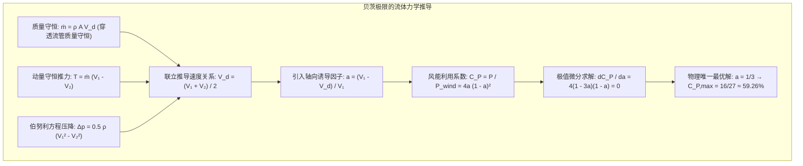
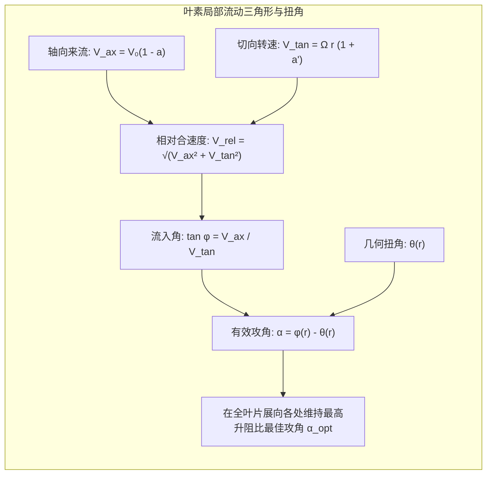

矗立在开阔丘陵或波涛汹涌的远海之上，三片修长的白色巨型叶片在天空中划出优雅的弧线。现代风力发电机（Wind Turbine）轮毂高度已突破150米，叶轮扫掠直径超过230米，单机容量达15兆瓦以上。

这台矗立于天际线上的庞然巨物绝非简单的放大版传统风车，而是融合了<strong>贝茨极限流体物理、叶素动量理论（BEM）、复合材料多轴疲劳力学与兆瓦级闭环机电控制</strong>的现代工业工程巅峰之作。

---

### 1. 为什么现代风力机几乎全为「三叶片水平轴」？

在各种几何构型（垂直轴达里厄型、萨沃纽斯阻力型、双叶片型）经过长期工程竞逐后，现代风电全面收敛为<strong>上风向水平轴三叶片风机</strong>：
1. <strong>升力型优于阻力型</strong>：
   阻力型风车（如传统风车）叶片速度受物理限制，无法超过风速（周速比 $\lambda < 1$），能量转化效率上限仅为 15%~20%。现代风机利用航空翼型产生垂直于相对来流的巨大<strong>升力（Lift Force）</strong>驱动旋转，叶尖线速度可达风速的 7~9 倍（时速高达 $280 \sim 320\,\mathrm{km/h}$）。高转速在同等功率下大幅减小了主轴转矩，显著减轻了传动链与发电机的体积重量，效率跃升至 45%~50%。
2. <strong>三叶片的陀螺力矩各向同性</strong>：
   在机舱偏航（Yawing）追踪风向旋转时，双叶片风机的转动惯量随叶片竖直或水平每转剧烈脉动两次（2P脉动），引发极其致命的周期性交变陀螺力矩，极易摧毁主轴与塔筒。而三叶片在圆周上互成 $120^\circ$ 对称分布，在数学上其绕偏航轴与俯仰轴的极转动惯量是<strong>完全恒定且各向同性</strong>的，偏航过程中完全不产生任何交变陀螺力矩，赋予了机械结构极长的疲劳寿命与平稳的运行姿态。

---

### 2. 贝茨极限（Betz's Law）：流体力学的第一原理约束

风力机能否将风能 100% 转化为电能？1919年德国物理学家阿尔伯特·贝茨（Albert Betz）基于一维致动盘动量理论，给出了严谨的物理否定。

如果试图 100% 提取风能，风机后方流速将降至零（$V_2 = 0$）。静止的气体将在风轮后方形成无法逾越的气塞，迫使后续来流完全绕道溢出，导致穿过风轮的流量降为零，最终输出功率为零。

为了持续做功，风机必须在减速提取动能的同时，允许排出的乏气以 $V_2 = \frac{1}{3} V_1$ 的速度顺畅向下游排出。这一平衡流动的极限就是著名的<strong>贝茨极限 $C_{P,max} = \frac{16}{27} \approx 59.26\%$</strong>。现代顶尖风机气动效率已高达 48%~50%，极为逼近这一物理天花板。

---

### 3. 叶素动量理论（BEM）与叶片复杂几何构型

风力机叶片从根部到叶尖呈现极其明显的<strong>剧烈扭绞（Twist）</strong>与<strong>大弦长向细长叶尖过渡的锥削（Taper）</strong>：

1. <strong>为什么叶片必须扭绞？</strong>
   在叶片根部（$r$ 较小），圆周旋转速度 $\Omega r$ 很慢，合成相对流速的流入角 $\phi$ 极大（高达 $40^\circ \sim 60^\circ$）。而在叶尖（$r \to R$），线速度高达 $80\,\mathrm{m/s}$ 以上，流入角 $\phi$ 变得极其平缓（仅 $3^\circ \sim 6^\circ$）。
   为了让全叶片从根到梢的每一处微元翼型都始终工作在最佳攻角（$\alpha_{opt} \approx 5^\circ \sim 8^\circ$，升阻比最高且无气流分离），叶片的安装角必须沿展向连续变化——根部立起、梢部极度躺平。
2. <strong>为什么根部粗壮、梢部细薄？</strong>
   - 气动上，叶尖动压与线速度平方成正比（$q \propto V_{rel}^2 \propto r^2$），狭窄的弦长即可提供巨大升力。
   - 结构上，长达百余米的悬臂梁承受数百吨米弯矩，根部必须膨胀为直径4~5米的厚壁圆筒以抵抗弯曲破裂，并与变桨轴承高强度螺栓法兰连接。

---

### 4. 变桨距控制与极端风况生存策略

风力发电机通过运行工况控制实现全生命周期安全运行：
- <strong>额定风速以下（微风到中风，3~11 m/s）</strong>：执行<strong>最大功率跟踪（MPPT）</strong>，桨距角固定在最佳微角度（$\theta \approx 0^\circ$），闭环调节发电机反抗转矩，使转速随风速线性浮动，死死锚定最佳周速比 $\lambda_{opt} \approx 8$，捕获功率随风速三次方（$P \propto V^3$）急剧爬升。
- <strong>额定风速以上（11~25 m/s）</strong>：发电机达到最大承载容量（如 15 MW）。伺服电机驱动叶片主动向顺桨方向转动（<strong>独立变桨控制 / IPC</strong>），减小迎角并故意倾覆多余升力，使输出功率平滑锁定在 15 MW 额定线上。
- <strong>切出暴风风速（> 25 m/s，超强台风）</strong>：桨距角驱动至 $90^\circ$ 完全顺桨，气动升力瞬间归零，风机安全刹车停机。

---

### 5. 尾流效应与海上深水浮体动力学

- <strong>尾流扩散损失（Wake Effect）</strong>：风机从气流中掠夺动能后，下游形成风速亏损且伴随强烈湍流的尾流锥。根据简森（Jensen）尾流衰减模型，下游风电场必须呈 8D~10D（间距 1.5~2 公里）菱形交错布局，甚至主动采用机舱偏航主动偏转尾流（Wake Steering），避免下游风机功率折损与湍流疲劳断裂。
- <strong>深远海浮式风电（Floating Offshore）</strong>：面对水深超过 60 米的海域，风机置于半潜式（Semi-Submersible）或单柱式（Spar）浮体平台上。通过主动变桨算法克服「负阻尼共振效应」，在凶险波涛与台风双重夹击下依然巍然屹立。

---

### 6. 传动链系统：齿轮箱增速与直驱永磁同步发电

风机轮毂捕获的机械动能通过两种主流架构转换为电力：
1. <strong>三级行星齿轮箱系统</strong>：
   叶轮转速极低（6~10 RPM），但轴转矩高达数兆牛米。齿轮箱将转速提升百倍至 1000~1500 RPM，从而匹配体积紧凑的高速双馈感应发电机（DFIG）。但齿轮箱承受高频脉动载荷，维护润滑成本高。
2. <strong>直驱永磁同步系统（Direct Drive PMSG）</strong>：
   完全淘汰机械齿轮箱，主轴直接驱动直径达 8~10 米的巨型多极永磁同步发电机。活动部件大幅减少，可靠性极高，已成为海上风电的黄金标配。

---

### 7. 叶片复合材料力学与前缘腐蚀（Leading Edge Erosion）

百米级叶片在 25 年全生命周期中承受超过 1 亿次疲劳交变载荷。主梁采用拉挤碳纤维（CFRP）以极高刚度防止极端阵风下叶片扫塔；外壳采用玻纤夹芯结构抵抗局部屈曲。在时速 $300\,\mathrm{km/h}$ 的叶尖线速度下，雨滴与沙尘的高速冲击会引发严重的前缘腐蚀，导致年发电量下降 2%~5%，现代风机通过聚氨酯抗冲蚀保护胶带（LEP）实现主动防护。
