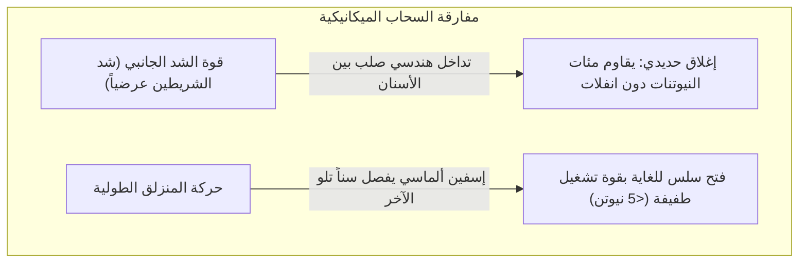
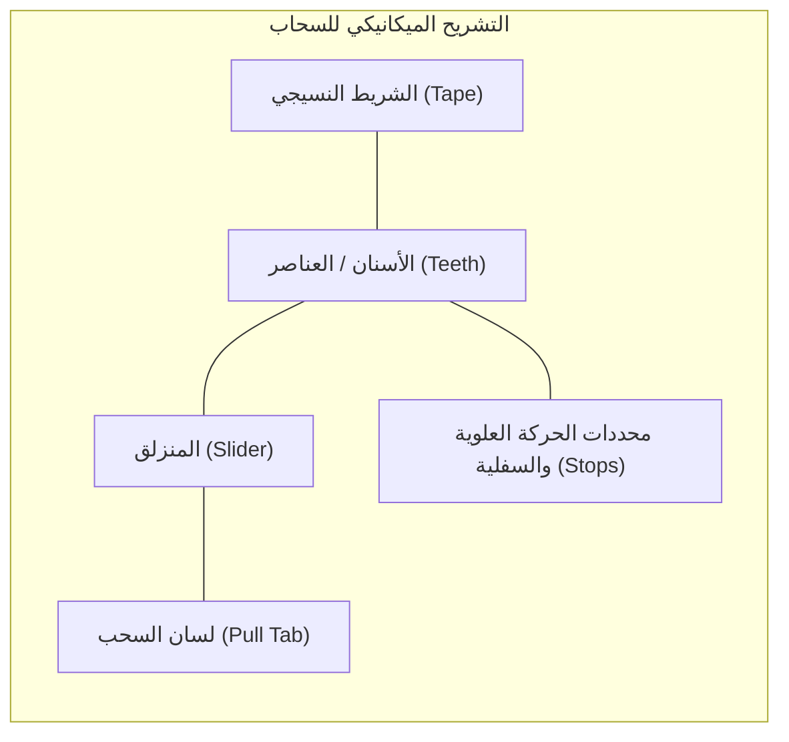
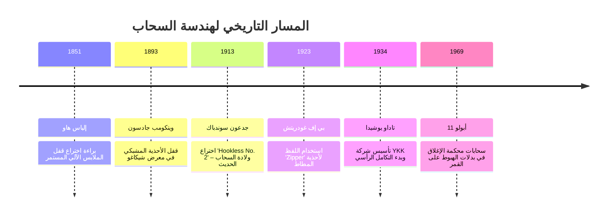
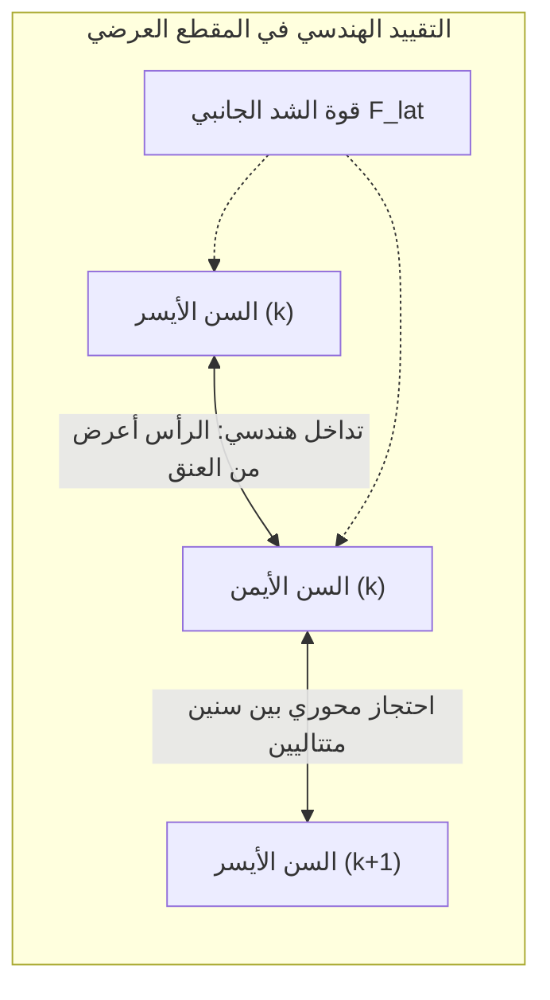
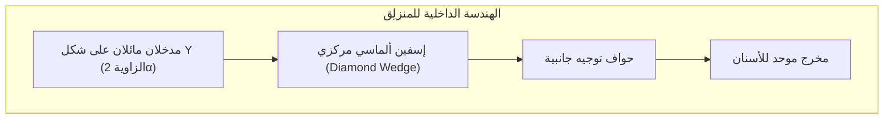

## مقدمة: مفارقة التعشيق الميكانيكي العكسي غير المتماثل

في تفاصيل حياتنا اليومية، ينتشر سحّاب الملابس (الزمام المنزلق أو السوستة) في كل مكان: السترات الشتوية، سراويل الجينز، حقائب الظهر، الخيام، وصولاً إلى بدلات المواد الكيميائية الخطرة ورواد الفضاء. ينتج العالم سنوياً عشرات المليارات من الأمتار من هذه الروابط الدقيقة.

من منظور الهندسة الميكانيكية، يمثل السحّاب ظاهرة فريدة تعرف باسم **لا تماثل التعشيق الميكانيكي (Mechanical Engagement Asymmetry)**.

إذا أمسكت بشريطي القماش وحاولت سحبهما جانباً بكل قوتك، فلن ينفصل السحّاب السليم أبداً. ومع ذلك، بمجرد الإمساك بالمنزلق المعدني الصغير وسحبه بأطراف الأصابع، تنفصل الأسنان بسلاسة تشبه انسياب الحرير. يكمن سر هذه الظاهرة في **التداخل الهندسي**، و**شروط القفل الذاتي للاحتكاك**، و**حركيات الكامات ثلاثية الأبعاد**، و**تفاوتات التصنيع الميكرومترية الدقيقة ($\pm 0.005\text{ مم}$)**.

---

## 1. تشريح السحّاب ومكوناته الجوهرية

| اسم الجزء | الوظيفة الهندسية | المواد وطرق التصنيع |
| :--- | :--- | :--- |
| **الأسنان (Elements)** | بروزات متبادلة تتعاشق لمقاومة قوى الشد المستعرضة | النحاس الأصفر، النيكل، البولي أسيتال (POM)، البوليستر (PET) |
| **الشريط النسيجي (Tape)** | وسيط نسيجي يثبت الأسنان بخطوة هندسية دقيقة | بوليستر منسوج عالي المتانة مع حبل حافة مقوى |
| **المنزلق (Slider)** | هيكل يوجه زاوية دخول أو انفصال الأسنان فراغياً | سبيكة الزنك المصبوبة (Zamak)، النحاس المضغوط |
| **لسان السحب (Pull Tab)** | ذراع رافعة مريح لنقل قوة الأصابع إلى المنزلق | سبائك الزنك، الصلب، الجلد، المطاط الصناعي |
| **المحددات (Stops)** | حواجز ميكانيكية تمنع خروج المنزلق عن المسار | مشابك معدنية مضغوطة، بوليمرات ملحومة بالموجات فوق الصوتية |

---

## 2. المحطات التاريخية: من إلياس هاو إلى جدعون سوندباك

في عام 1913، أحدث المهندس السويدي-الأمريكي **جدعون سوندباك (Gideon Sundback)** ثورة حقيقية عندما تخلى تماماً عن فكرة الخطاطيف البدائية، وابتكر نتوءات وتجاويف معدنية صغيرة تشبه الملاعق مثبتة بكثافة عالية على حواف شريط القماش (**Hookless No. 2**).

---

## 3. ميكانيكا التلامس: لماذا لا ينفتح السحّاب بالشد الجانبي؟

تترتب الأسنان على الجانبين بشكل **متناوب متعاقب (Staggered)** بفارق نصف خطوة ($p/2$).

### 3.1 شرط التداخل الهندسي
عرض رأس السن $W_h$ أكبر من عرض عنقه الضيق $W_n$:

$$W_h > W_n, \quad W_h > W_p - 2\delta$$

تحت تأثير قوة الشد المستعرض $F_{\text{lat}}$، يكون الإجهاد العمودي للتلامس:

$$N = \frac{F_{\text{lat}}}{\cos \theta_c}$$

للانفلات عرضياً، يجب على رأس السن توسيع عنق السن المقابل بالتشوه اللدن، وهو ما يستحيل حدوثه ضمن نطاق التشغيل الآمن لمواد عالية الجساءة مثل النحاس أو البولي أسيتال.

### 3.2 القفل الذاتي بالاحتكاك
عند تصميم السطح بزاوية انحدار عكسية $\beta$ أصغر من زاوية الاحتكاك السكوني $\phi = \arctan(\mu_s)$:

$$\sum F_x = F_{\text{lat}} - 2 \left( N \sin \beta + F_f \cos \beta \right) \le 0$$

كلما زادت قوة الشد الجانبي، زاد انضغاط الأسنان نحو خط المنتصف، مما يزيد من إحكام القفل تلقائياً.

---

## 4. حركيات المنزلق: ممرات Y والإسفين الألماسي

- **عملية الإغلاق**: تميل حواف المنزلق الأسنان في الفضاء ثلاثي الأبعاد بزاوية $10^\circ \sim 15^\circ$ لتسقط من الأعلى في تجاويف الجانب الآخر قبل تسويتها أفقياً عند المخرج.
- **عملية الفتح**: يقتحم **الإسفين الألماسي** المركزي خط التلاقي بين الأسنان. قوة الفصل العرضية $F_w$ الناتجة عن قوة السحب $F_{\text{pull}}$ هي:

$$F_w = \frac{F_{\text{pull}}}{2 (\tan \gamma + \mu_k)}$$

يقوم الإسفين بفصل **زوج واحد فقط من الأسنان في اللحظة الواحدة**، مما يتطلب شغلاً ميكانيكياً بالغ الضآلة.

---

## 5. مقارنة الأنواع الرئيسية الثلاثة للسحّابات

| الميزة | السحاب المعدني (Metal) | البلاستيك المصبوب (Vislon / POM) | الحلزوني النايلون (Coil / PET) |
| :--- | :--- | :--- | :--- |
| **الوزن** | ثقيل (المرجع 100%) | أخف بنسبة 40% | الأخف وزناً (-60%) |
| **المرونة** | منخفضة، للخطوط المستقيمة | متوسطة | فائقة المرونة مع المنحنيات |
| **مقاومة التآكل** | عرضة للأكسدة والصدأ | منيع تماماً ضد ماء البحر | مقاومة كيميائية ورطوبية تامة |
| **أبرز الاستخدامات** | الجينز، السترات الجلدية | الملابس البحرية وسترات التزلج | حقائب الظهر، الخيام، الملابس الرياضية |

---

## 6. إمبراطورية YKK: التكامل الرأسي المطلق

تسيطر شركة **YKK** اليابانية ومقرها في كورومي على أكثر من 40% من الإنتاج العالمي و80% من منتجات الرفاهية بفضل **التكامل الرأسي الصارم**:
- صهر سبائك النحاس الخاصة في مسابكها الذاتية؛
- بلمرة حبيبات البوليستر وغزل الخيوط داخلياً؛
- **تصميم وبناء 100% من آلات التجميع والقوالب داخل مصانعها** كصناديق سوداء سرية لا تباع لأي طرف خارجي.

---

## 7. البيئات القاسية وسحّابات بدلات فضاء أبولو

في بدلات رواد الفضاء (A7L) وبدلات الغوص العميق، يحقق السحاب عزلاً تاماً ضد ضغط الفراغ:
- **شفاه إحكام مطاطية مرنة**: حواف سميكة من النيوبرين تُضغط بشدة بواسطة المنزلق لتمنع تسرب جزيئات الهواء.
- **منع اللحام البارد في الفراغ**: لمنع التحام المعادن ذرية التلامس في الفضاء، تُطلى الأسنان بالذهب أو بطبقة تشحيم صلبة من ثنائي كبريتيد الموليبدينوم ($\text{MoS}_2$).

---

## الخلاصة

السحّاب هو أنجح واجهة ربط ميكانيكية عكسية ابتكرتها البشرية، حيث تجتمع في هذا الجزء الصغير فيزياء التلامس، وحركيات الكامات، ودقة التصنيع الميكرومترية لتوفير الأمان والراحة لحياتنا اليومية.
