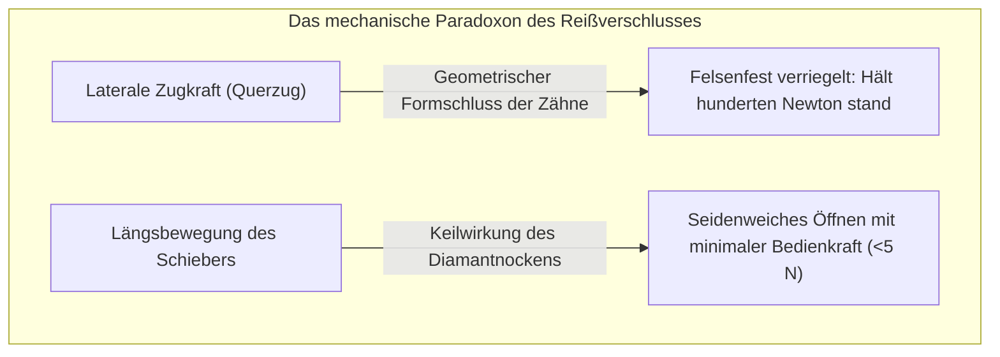
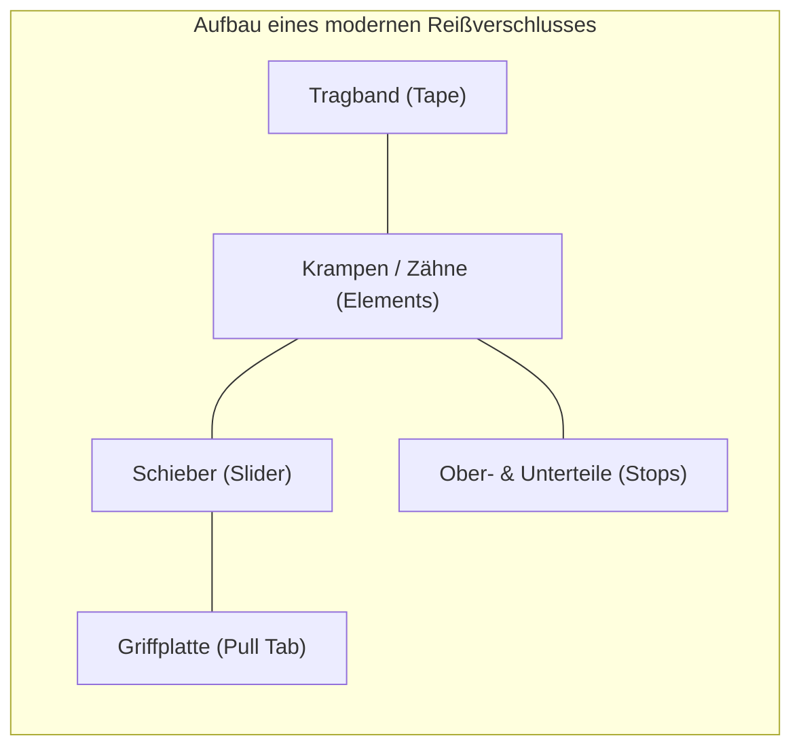
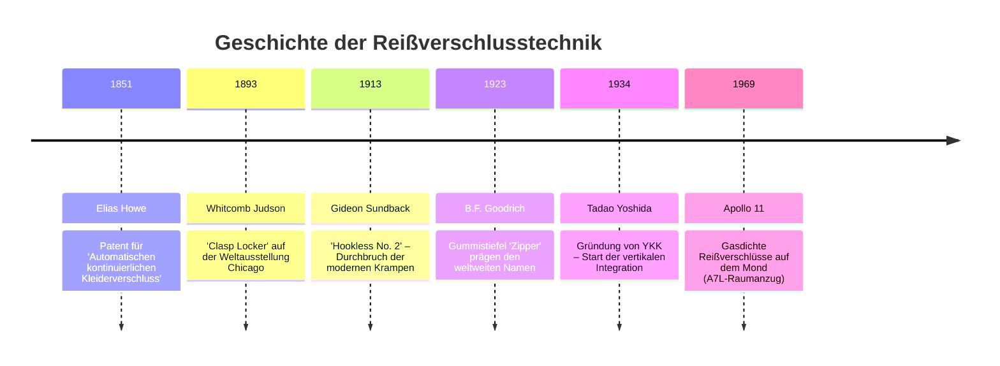
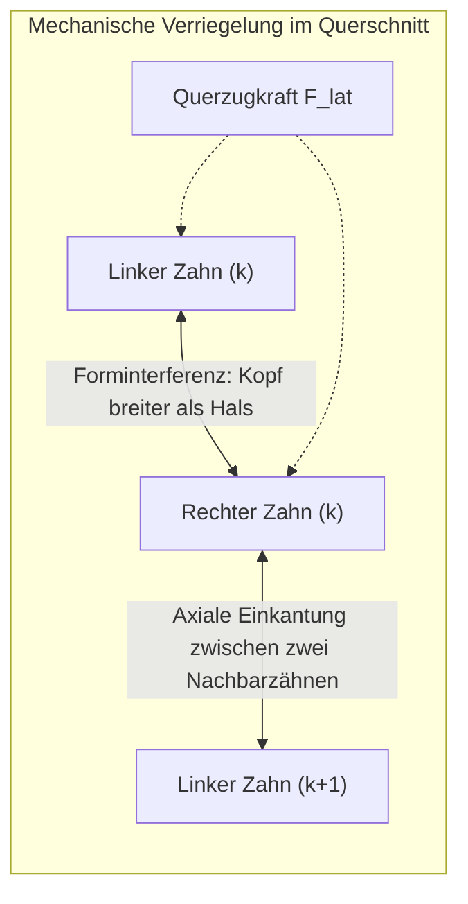

## Einleitung: Das alltägliche Paradoxon der asymmetrischen mechanischen Verbindung

Betrachten wir unsere Alltagskleidung: Winterjacken, Jeanshosen, Rucksäcke, Zelte bis hin zu Astronautenanzügen – überall finden sich Reißverschlüsse. Jährlich werden weltweit zig Milliarden Meter davon produziert.

Aus Sicht des Maschinenbaus weist der Reißverschluss ein bemerkenswertes physikalisches Phänomen auf: **die Asymmetrie der mechanischen Kopplung**.

Zieht man mit beiden Händen seitlich an den Tragbändern, widersteht ein intakter Reißverschluss selbst extremen Zugkräften. Greift man jedoch den winzigen Schieber und zieht ihn entlang der Kette, trennen sich die Zähne fast widerstandslos. Dieses Verhalten basiert auf **geometrischem Formschluss**, **Reibungswinkeln der Selbsthemmung**, **dreidimensionaler Nockenkinematik** und **Fertigungstoleranzen im Mikrometerbereich ($\pm 0,005\text{ mm}$)**.

---

## 1. Anatomie des Reißverschlusses: Die fünf Kernkomponenten

| Komponente | Technische Funktion | Material & Fertigungsverfahren |
| :--- | :--- | :--- |
| **Krampen / Zähne (Elements)** | Ineinandergreifende Glieder zur Aufnahme von Querzügen | Messing, Neusilber, Polyacetal (POM), Polyester (PET) |
| **Tragband (Tape)** | Textiler Träger zur präzisen Fixierung der Zähne | Gewebtes oder gewirktes Polyester mit Randwulst (Kordel) |
| **Schieber (Slider)** | Führt Zähne unter definiertem Raumwinkel zusammen/auseinander | Zink-Druckguss (Zamak), gestanztes Messing, POM-Spritzguss |
| **Griffplatte (Pull Tab)** | Hebel zur Übertragung der menschlichen Fingerkraft | Zinkdruckguss, Federstahl, Leder, Hypalon |
| **Stopper (Stops)** | Mechanische Anschläge gegen das Entgleisen des Schiebers | Geklemmte Metallklammern, ultraschallverschweißtes Polymer |

---

## 2. Historische Meilensteine: Von Howe zu Gideon Sundback

1913 gelang dem schwedisch-amerikanischen Ingenieur **Gideon Sundback** der entscheidende Durchbruch: Er ersetzte Haken und Ösen durch löffelförmige, metallene Zähne mit winzigen Vertiefungen und Vorsprüngen, die dicht an dicht an flexiblen Stoffkanten verklemmt wurden (**Hookless No. 2**).

---

## 3. Kontaktmechanik: Warum Querzug die Kette nicht trennen kann

Die Zähne auf den gegenüberliegenden Bändern sind um eine halbe Teilung ($p/2$) versetzt angeordnet.

### 3.1 Geometrische Überdeckung
Der Kopfdurchmesser $W_h$ ist deutlich größer als die Halsbreite $W_n$:

$$W_h > W_n, \quad W_h > W_p - 2\delta$$

Wirkt eine Querkraft $F_{\text{lat}}$ auf das Band, entsteht an den Kontaktflächen eine Normalkraft $N$:

$$N = \frac{F_{\text{lat}}}{\cos \theta_c}$$

Um die Zähne seitlich herauszuziehen, müsste der Kopf den Hals elastisch aufweiten. Aufgrund der hohen Steifigkeit von Messing ($E \approx 110\text{ GPa}$) oder Polyacetal ($E \approx 3\text{ GPa}$) ist dies unter Betriebsbedingungen unmöglich.

### 3.2 Selbsthemmung durch Hinterschnitt
Durch einen rückwärtigen Hinterschnittwinkel $\beta$ gilt bei Haftreibungswinkel $\phi = \arctan(\mu_s)$:

$$\sum F_x = F_{\text{lat}} - 2 \left( N \sin \beta + F_f \cos \beta \right) \le 0$$

Steigt der Querzug, pressen sich die Flanken noch fester aneinander – die Verbindung verriegelt sich selbsttätig.

---

## 4. Schieberkinematik: 3D-Nocken und Diamantkeil

- **Schließen**: Die Schieberflansche neigen die Zähne dreidimensional um $10^\circ \sim 15^\circ$, sodass sie von oben herab in die Taschen der Gegenseite eintauchen.
- **Öffnen**: Der zentrale **Diamantkeil** greift exakt zwischen die Zähne. Die resultierende Trennkraft beträgt:

$$F_w = \frac{F_{\text{pull}}}{2 (\tan \gamma + \mu_k)}$$

Der Keil trennt immer nur **ein einzelnes Zahnpaar gleichzeitig**, weshalb der Reißverschluss mit minimaler Fingerkraft öffnet.

---

## 5. Werkstoff- und Bauartenvergleich

| Merkmal | Metallreißverschluss | Kunststoff-Spritzguss (Vislon / POM) | Spiralreißverschluss (Coil / PET) |
| :--- | :--- | :--- | :--- |
| **Gewicht** | Schwer (Basis 100%) | -40% leichter | -60% am leichtesten |
| **Flexibilität** | Gering, ideal für gerade Linien | Mittel | Sehr hoch, folgt 3D-Konturen |
| **Korrosion** | Grünspan-/Rostrisiko | Völlig seewasserbeständig | Chemikalien- & witterungsbeständig |
| **Hauptanwendung** | Jeans, Lederjacken, Luxushandtaschen | Marinebekleidung, Skijacken, PSA | Sportswear, Zelte, Rucksäcke |

---

## 6. Die YKK-Philosophie: Totale vertikale Integration

Das japanische Unternehmen **YKK** beherrscht über 80% des weltweiten High-End-Marktes. Das Erfolgsgeheimnis liegt in der **konsequenten internen Fertigungstiefe**:
- Eigene Schmelzöfen für Sondermessinglegierungen;
- Eigene Kunststoffgranulatsynthese und Garnweberei;
- **Vollständiger Eigenbau aller Maschinen und Werkzeuge** in der Abteilung Maschinentechnologie in Kurobe.

---

## 7. Extrembedingungen: Druck- und gasdichte Raumfahrtreißverschlüsse

In den Raumanzügen der Apollo-Missionen (A7L) und in Tauchanzügen gewährleisten Reißverschlüsse hermetische Dichtigkeit:
- **Elastomer-Lippendichtung**: Chloropren-Gummilippen werden durch den Schieber mit hoher Flächenpressung aufeinandergepresst.
- **Schutz vor Kaltverschweißung**: Im Vakuum würden blanke Metalle verschweißen; daher werden Zähne mit $\text{MoS}_2$-Trockenschmierstoffen oder Goldbeschichtungen geschützt.

---

## Fazit

Der Reißverschluss ist das erfolgreichste reversible mechanische Verbindungselement der Menschheitsgeschichte – eine Synthese aus Kontaktmechanik, Nockengeometrie und ultrapräziser Serienfertigung.
