## Introduction: The Everyday Paradox of Asymmetric Reversible Mechanical Coupling

Look around your daily life: garments, insulated winter parkas, jeans fly fronts, backpacks, luggage cases, camping tents, and chemical hazard suits. Zippers are everywhere. Humanity produces tens of billions of meters of zippers each year—enough to circle the globe hundreds of times.

Yet, viewed through the lens of mechanical engineering, the zipper exhibits a profound physical contradiction: **Mechanical Engagement Asymmetry**.

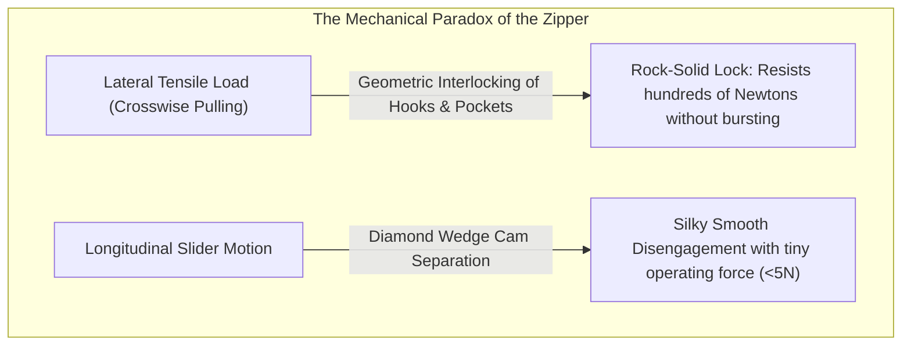

If you grasp the fabric tapes on either side and pull sideways with all your strength, a standard zipper will never yield. Even if subjected to hundreds of Newtons of lateral tension, the interlocking teeth (elements) remain rigidly coupled. Yet, pinch the minuscule metal slider between your thumb and forefinger and pull it along the chain, and the teeth disengage like liquid silk. Move it forward, and they align and interlock in flawless mathematical order.

Why does an interface resist tremendous normal and lateral loads while permitting frictionless disengagement when actuated perpendicularly? The secret lies in **geometric interference**, **contact angle self-locking mechanics**, **three-dimensional cam kinematics**, and **manufacturing tolerances tighter than $\pm 0.005\text{ mm}$**.

In this comprehensive treatise, we will dissect the mechanical marvel that is the modern slide fastener: its historical evolution from failed boot-hooks to Gideon Sundback’s breakthrough, the rigorous contact mechanics of interlocking teeth, the 3D cam dynamics inside the slider housing, the materials science of brass and polyacetal, the legendary vertical integration of YKK in Kurobe, and the hermetic engineering of spaceflight pressure suits.

---

## 1. Zipper Anatomy and Fundamental Components

A zipper is an intricate mechanical assembly comprising five principal structural elements working in dynamic synchronization:

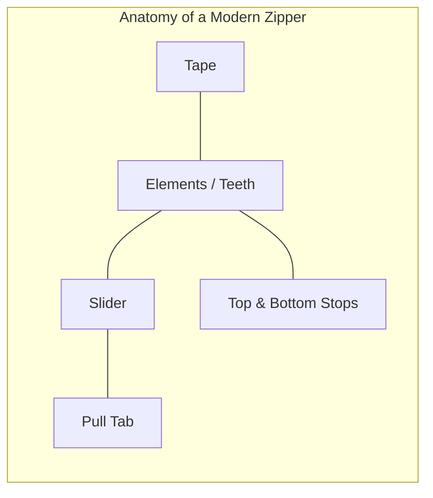

| Component | Engineering Function | Material & Manufacturing Process |
| :--- | :--- | :--- |
| **Elements (Teeth / Scoops)** | Protruding mating members that interlock sequentially | Brass, Red brass, Aluminum, Polyacetal (POM), Polyester (PET) |
| **Tape (Stringer Tape)** | Fabric substrate holding elements at an exact pitch | Woven/knitted multifilament polyester with reinforcing bead cord |
| **Slider Body** | Guided housing driving elements into engagement or separation | Die-cast zinc alloy (Zamak 3/5), stamped brass, molded POM |
| **Pull Tab (Puller)** | Ergonomic lever transmitting manual force to the slider | Die-cast zinc, stamped steel, leather, ballistic nylon |
| **Stops (Top & Bottom)** | Mechanical travel limiters preventing slider derailment | Crimped metal alloy, ultrasonic-welded polymer, pin-and-box box |

### Micro-anatomy of an Individual Element
Each element features precise sub-features designed for load transmission:
- **Head (Mating Dome)**: Spherical or ovular boss protruding forward into the pocket of the opposing tooth.
- **Neck (Constriction)**: Narrowed shank behind the head that catches the shoulders of adjacent teeth.
- **Shoulders**: Slanted lateral bearing surfaces that carry transverse tensile stresses.
- **Pocket (Cavity)**: Receptacle on the reverse side mating with the opposing tooth head.
- **Legs (Jaws)**: Dual clamp jaws crimped rigidly over the tape cord bead.

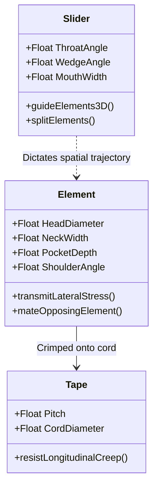

---

## 2. Historical Evolution: From Howe and Judson to Gideon Sundback

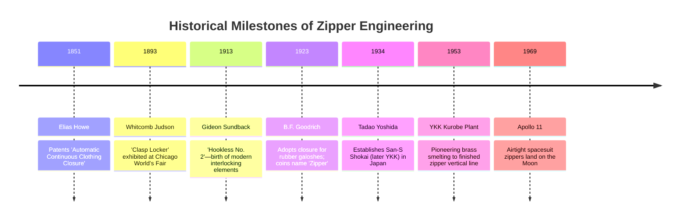

### The Clasp Locker Failure
In 1893, Chicago mechanical engineer Whitcomb L. Judson sought to relieve people from tedious shoe-buttoning by inventing the "Clasp Locker." Using hooked eyelets engaged by a sliding guide, it was clunky, jammed constantly, and would burst open during walking. The tolerance variations of manual iron-stamping in the 1890s could not ensure simultaneous engagement of dozens of delicate hooks.

### Gideon Sundback's Masterstroke (1913)
The real breakthrough arrived when Swedish-American electrical engineer **Gideon Sundback** discarded the hook-and-eye concept. He realized that closure must rely on **high-density, small, cup-shaped projections and matching depressions clamped along a flexible textile edge**.

Sundback’s **Hookless No. 2** (patented in 1914/1917) doubled the tooth count from 5 to 10–11 teeth per inch. Each tooth possessed a hollow cup on the underside and a rounded projection on the upper surface. This design forms the direct foundation of every modern interlocking zipper.

---

## 3. Contact Mechanics: Why Transverse Pulling Cannot Open the Chain

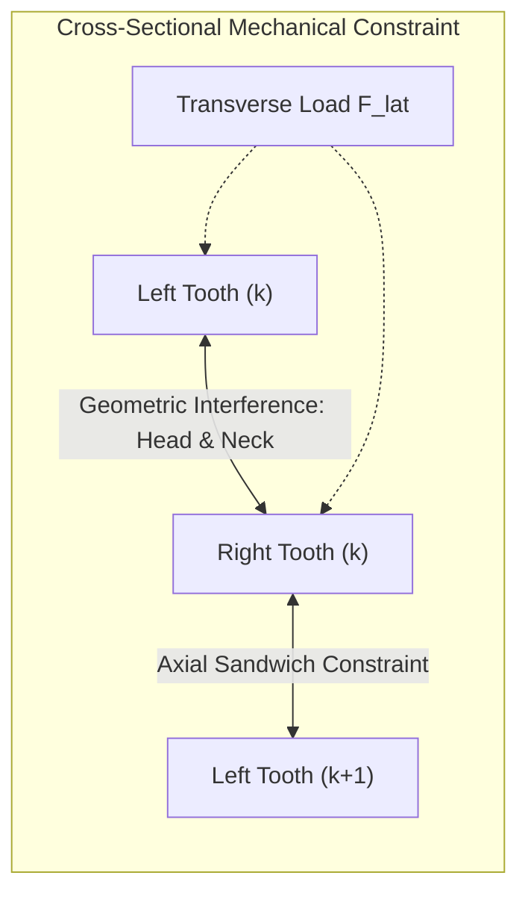

### 3.1 Geometric Interference and Staggered Pitch
The teeth on opposing tapes are staggered by half a pitch ($p/2$). The head diameter $W_h$ exceeds the neck width $W_n$:

$$W_h > W_n, \quad W_h > W_p - 2\delta$$

When a lateral tensile force $F_{\text{lat}}$ is applied to the tape, the contact normal stress between mating teeth is given by:

$$N = \frac{F_{\text{lat}}}{\cos \theta_c}$$

where $\theta_c$ is the contact angle relative to the pulling vector. For a tooth to escape laterally, the head must elastically or plastically expand the neck opening of the opposing elements. Because structural brass ($E \approx 110\text{ GPa}$) or polyacetal ($E \approx 3\text{ GPa}$) exhibits high stiffness within working ranges, geometric escape without destructive yielding is impossible.

### 3.2 Hertzian Contact Stress Analysis
Under high crosswise tension, the spherical head and concave pocket act as non-conformal contact bodies. The peak Hertzian contact pressure $p_0$ between the curved surfaces is expressed as:

$$p_0 = \left( \frac{6 F_{\text{contact}} E^{*2}}{\pi^3 R^{*2}} \right)^{1/3}$$

where $R^*$ is the equivalent relative radius of curvature:

$$\frac{1}{R^*} = \frac{1}{R_{\text{head}}} - \frac{1}{R_{\text{pocket}}}$$

and $E^*$ is the effective plane-strain modulus:

$$\frac{1}{E^*} = \frac{1 - \nu_1^2}{E_1} + \frac{1 - \nu_2^2}{E_2}$$

Because $R_{\text{pocket}}$ closely matches $R_{\text{head}}$ (conformal pocket geometry), $R^*$ is large, drastically mitigating stress concentrations and preventing local plastic yielding under normal tensile service loads.

### 3.3 Self-Locking Condition Under Friction
The contact interface is engineered with a reverse undercut angle $\beta$. Defining the static friction coefficient as $\mu_s$ and the friction angle as $\phi = \arctan(\mu_s)$:

$$\sum F_x = F_{\text{lat}} - 2 \left( N \sin \beta + F_f \cos \beta \right) \le 0$$

If $\beta \le \phi$, pulling sideways increases the interfacial normal force, driving elements inward and **strengthening the lock**.

---

## 4. Slider Kinematics: 3D Cam Motion and Diamond Wedge Dynamics

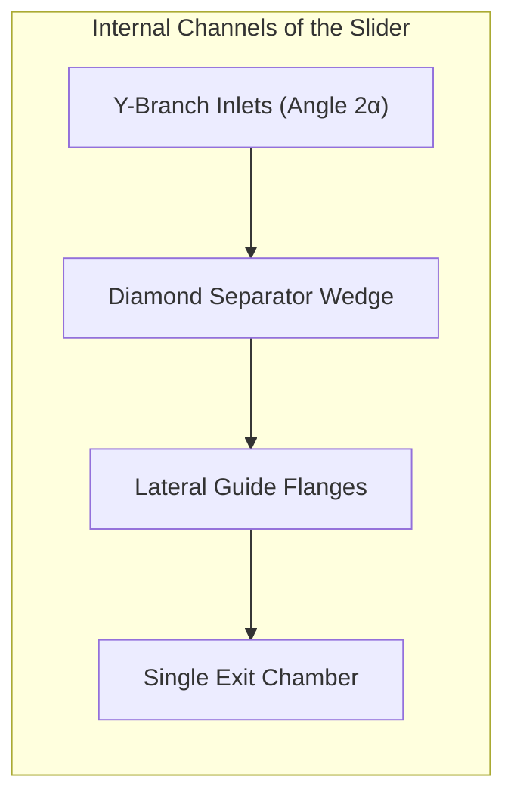

### 4.1 Engaging: Progressive Inclined Insertion
The slider does not push teeth straight together horizontally. The internal guide flanges tilt the teeth at an angle $\alpha$ ($10^\circ \sim 15^\circ$) in 3D space:
1. Teeth enter through dual angled channels.
2. The left tooth enters half a pitch ahead of the right tooth.
3. As the slider mouth narrows, the teeth tilt forward, dropping heads into pockets from above like puzzle pieces.
4. Upon exiting the mouth, teeth are leveled horizontally, locking all rotational degrees of freedom.

### 4.2 Disengaging: The Diamond Wedge Cam
Moving the slider in reverse drives the central **diamond wedge** directly between mated teeth. The lateral splitting force $F_w$ generated by slider pull force $F_{\text{pull}}$ is:

$$F_w = \frac{F_{\text{pull}}}{2 (\tan \gamma + \mu_k)}$$

where $\gamma$ is the half-angle of the diamond wedge and $\mu_k$ is the kinetic coefficient of friction between slider flange and tooth flanks.

Crucially, the wedge splits only **one pair of teeth at a time**, tilting them out of engagement successively. Instead of combating hundreds of teeth simultaneously, the user expends negligible work.

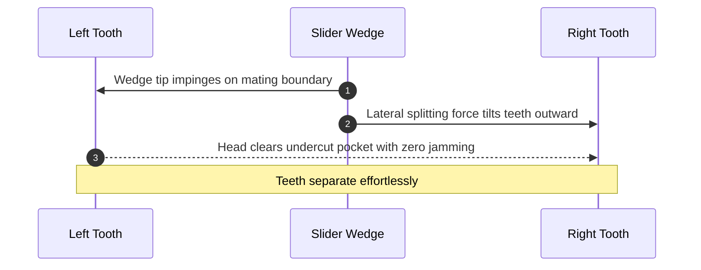

### 4.3 Automatic Locking Slider Mechanics
To prevent trousers or jackets from opening spontaneously, sliders incorporate an internal automatic cam-lock mechanism:
- A miniature tempered spring-steel leaf spring holds a locking pin directed into the tooth chain.
- When the pull tab is raised by the user's fingers, a cam lobe on the tab hub overcomes the spring preload, lifting the pin clear of the teeth.
- Releasing the tab allows the spring to snap the pin back into the gap between adjacent teeth, locking longitudinal travel dead in its tracks.

---

## 5. Zipper Categories: Metal, Molded Plastic, and Coil

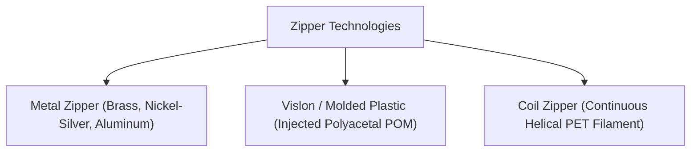

| Parameter | Metal Zipper | Vislon (POM Plastic) | Coil (PET / Nylon) |
| :--- | :--- | :--- | :--- |
| **Weight** | Heavy (Baseline 100%) | -40% lighter | -60% lightest |
| **Flexibility** | Rigid, best for straight runs | Semi-flexible blocks | Highly flexible in 3D contours |
| **Corrosion** | Susceptible to patina / tarnish | Completely immune to seawater | Immune to chemicals and moisture |
| **Burst Recovery** | Must be replaced if teeth shear | High tooth peel resistance | Self-healing via slider cycling |
| **Manufacturing** | Cold-heading & wire forming | High-speed multi-cavity injection | Spiral filament winding & sewing |
| **Prime Applications** | Jeans, leather jackets, luxury bags | Marine gear, ski jackets, workwear | Backpacks, luggage, sportswear |

---

## 6. The YKK Empire: Total Vertical Integration

Based in Kurobe, Toyama Prefecture, Japan, **YKK (Yoshida Kogyo Kabushikikaisha)** produces over 40% of the world's commercial zippers and over 80% of high-end luxury fashion closures.

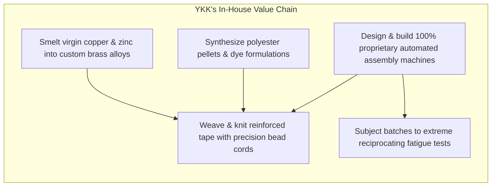

### The In-House Tooling Philosophy
Founder Tadao Yoshida held that "No one prospers unless he renders benefit to others" (The Cycle of Goodness). Mechanically, this meant that to guarantee infallible quality, **YKK must never depend on third-party suppliers for critical tooling**.

- **Alloy Smelting**: Raw copper ingots are melted on-site, cast into billets, and drawn into wire with custom metallurgical grain structures.
- **Machine Engineering**: YKK's Machine and Tooling Center designs and manufactures 100% of its high-speed assembly presses, optical vision sorters, and transfer dies in-house. A competitor buying off-the-shelf machinery can never match the speed, precision, and tool-wear longevity of YKK’s proprietary lines.

### ASTM D2061 and JIS S 3015 Standard Testing
Zippers must pass exhaustive mechanical torture tests before shipping:
1. **Chain Crosswise Strength**: Tensile testing machine clamps the tape and applies crosswise load until rupture. Typical #5 metal zippers must exceed $600\text{ N}$.
2. **Slider Lock Holding Strength**: Testing the locking pin resistance against longitudinal thrust without slippage.
3. **Reciprocating Durability**: Automated pneumatic fixtures cycle sliders up and down 10,000 times under continuous lateral tension.

---

## 7. Extreme Frontiers: Airtight, Waterproof, and Spaceflight Zippers

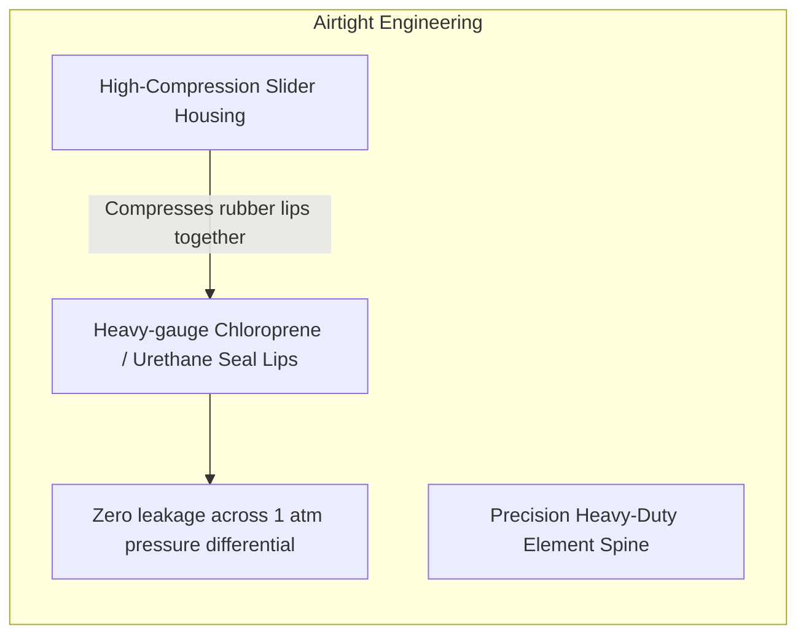

In Apollo spacesuits (A7L) and modern deep-sea drysuits, zippers maintain life-support pressure against vacuum and abyssal depths:
- **Elastomeric Lip Compression**: Elements are vulcanized inside neoprene sealing lips. The slider compresses opposing rubber edges into continuous elastic contact.
- **Cold Welding Immunity**: Vacuum strips metal oxide layers, causing clean metals to fuse on contact. Aerospace zipper teeth are coated with solid-film lubricants (gold flash or $\text{MoS}_2$) to prevent vacuum seizing.
- **Lunar Regolith Defense**: Abrasive lunar dust particles are shielded by external multi-layered Nomex/Kapton thermal micrometeoroid garment (TMG) flaps with hook-and-loop backups.

---

## 8. Failure Modes and Diagnostics

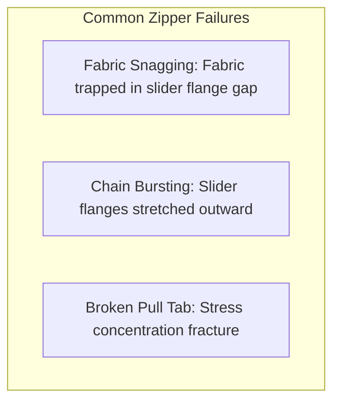

- **Fabric Snag**: Never yank violently. Pull the jammed textile gently outwards while backing the slider up slightly.
- **Center Bursting**: 90% of burst zippers are caused by deformed slider flanges widening the exit width $W_m$. Gently squeezing the rear of the slider with pliers restores proper tooth engagement depth.
- **Dry Lubrication**: Avoid liquid oils that attract grit and soil textiles. Use graphite (pencil lead) or paraffin candle wax on sticky metal teeth for silky action.

---

## 9. Future Trends: Circular Economy and Smart Connected Closures

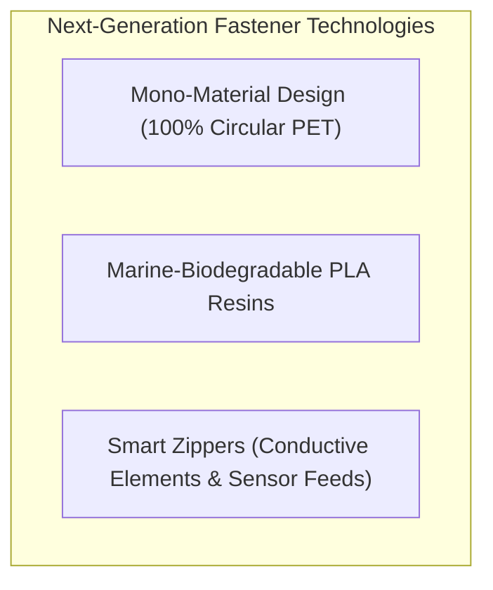

- **Mono-Material Zippers**: By engineering tape, cord, elements, and slider entirely from chemically compatible polyester (PET), garments can be recycled whole without labor-intensive manual zipper removal.
- **Smart Sensory Zippers**: Infusing elements with conductive carbon nanotubes creates digital switches that verify hazardous materials suits are fully sealed before workers enter toxic zones.

---

## Conclusion: A Microcosm of Precision Engineering

The zipper is arguably the world’s most successful **reversible mechanical coupling system**. It unites contact physics, high-speed stamping, polymer extrusion, and vertical manufacturing mastery into a seamless daily interface. Every time you pull a slider, you actuate a symphony of micrometer-scale mechanical harmony.
