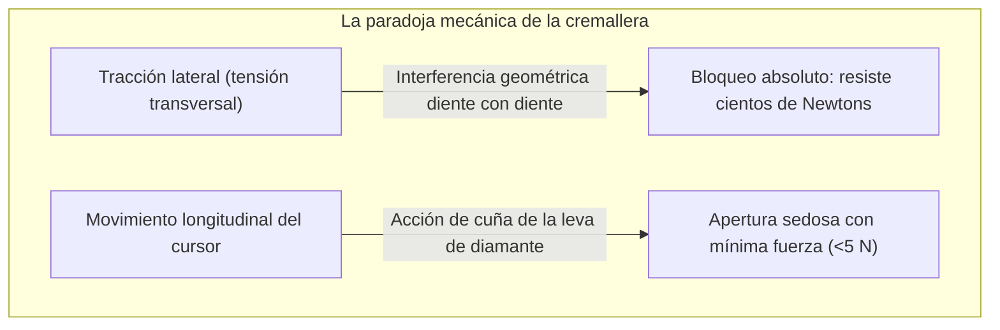
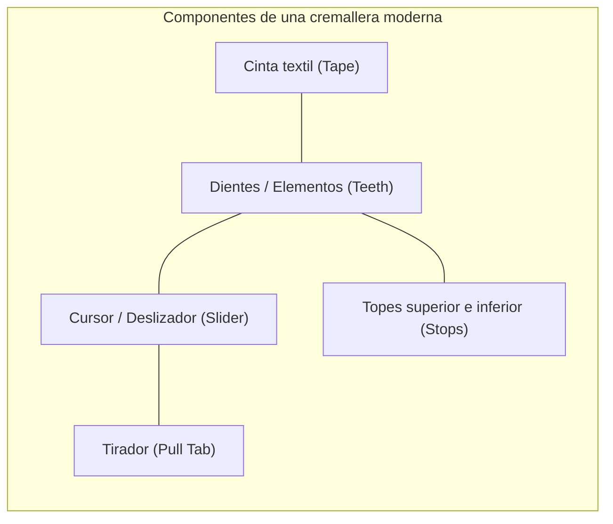
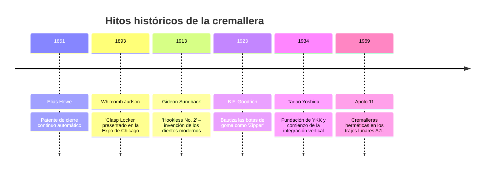
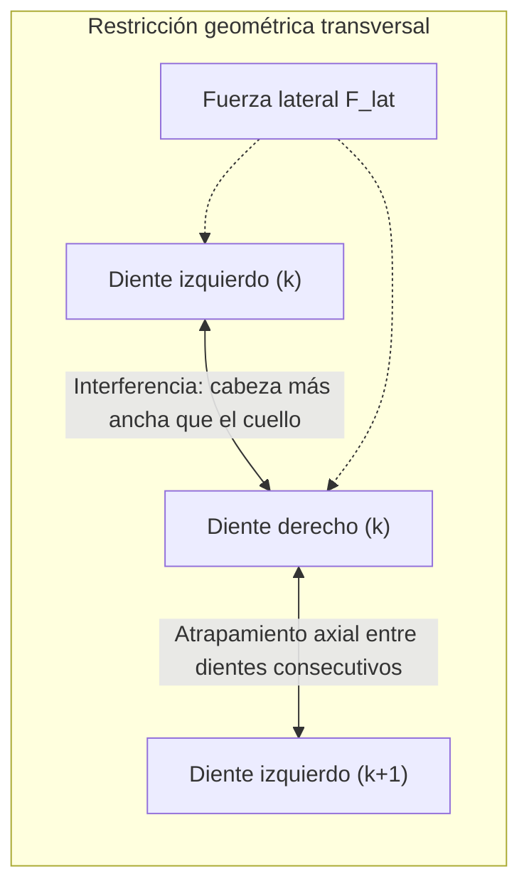

## Introducción: La paradoja del acoplamiento mecánico reversible

En la vida moderna, las cremalleras están en todas partes: chaquetas, pantalones vaqueros, mochilas, maletas y trajes estancos. Cada año se fabrican decenas de miles de millones de metros de este dispositivo en todo el planeta.

Desde la ingeniería mecánica, la cremallera plantea una paradoja fascinante: **la asimetría de acoplamiento mecánico**.

Si agarramos las cintas textiles por ambos lados y tiramos hacia afuera con toda nuestra fuerza, una cremallera normal jamás se abrirá. Sin embargo, con solo pellizcar el pequeño cursor metálico entre dos dedos, los dientes se liberan como por arte de magia. Esta dicotomía es el resultado de **la interferencia geométrica**, **el ángulo de fricción autoblocante**, **la cinemática de levas tridimensionales** y **tolerancias de fabricación más estrictas que $\pm 0,005\text{ mm}$**.

---

## 1. Anatomía y componentes de la cremallera

| Componente | Función en ingeniería | Material y método de fabricación |
| :--- | :--- | :--- |
| **Dientes (Elementos)** | Miembros salientes que encajan alternadamente | Latón, alpaca, poliacetal (POM), poliéster (PET) |
| **Cinta textil (Tape)** | Soporte flexible que fija el paso exacto entre dientes | Tejido de poliéster multifilamento con cordón de refuerzo |
| **Cursor (Slider)** | Carcasa que guía el ángulo de acoplamiento o separación | Zamak inyectado, latón estampado, POM inyectado |
| **Tirador (Pull Tab)** | Palanca ergonómica que transmite la fuerza de los dedos | Zamak, acero estampado, cuero, caucho |
| **Topes (Stops)** | Retenes mecánicos que evitan que el cursor descarrile | Grapas metálicas prensadas, polímero termosoldado |

---

## 2. Historia industrial: De Howe y Judson a Gideon Sundback

En 1913, el ingeniero sueco-estadounidense **Gideon Sundback** cambió la historia al sustituir los defectuosos ganchos por diminutas copas metálicas estampadas con precisión sobre una cinta flexible (**Hookless No. 2**).

---

## 3. Mecánica del contacto: Por qué la tracción lateral no puede abrir la cadena

Los dientes están dispuestos de forma alterna (al tresbolillo), desfasados medio paso ($p/2$).

### 3.1 Interferencia geométrica
El ancho de cabeza $W_h$ es mayor que el del cuello $W_n$:

$$W_h > W_n, \quad W_h > W_p - 2\delta$$

Ante una fuerza lateral $F_{\text{lat}}$, la tensión normal de contacto es:

$$N = \frac{F_{\text{lat}}}{\cos \theta_c}$$

Para soltarse transversalmente, la cabeza del diente tendría que deformar plásticamente el cuello del diente opuesto, lo que resulta imposible dentro de las cargas de servicio.

### 3.2 Autobloqueo por rozamiento
Con un ángulo de contrasalida $\beta$ menor que el ángulo de rozamiento estático $\phi = \arctan(\mu_s)$:

$$\sum F_x = F_{\text{lat}} - 2 \left( N \sin \beta + F_f \cos \beta \right) \le 0$$

Cuanto más se tira lateralmente de la cremallera, más fuertemente se aprietan los dientes entre sí.

---

## 4. Cinemática del cursor: Levas tridimensionales y cuña de diamante

- **Cierre**: Las pestañas del cursor inclinan los dientes $10^\circ \sim 15^\circ$ en el espacio, permitiéndoles caer desde arriba dentro de los bolsillos contrarios antes de nivelarse horizontalmente.
- **Apertura**: La **cuña de diamante** central incide entre los dientes. La fuerza lateral $F_w$ generada por la tracción del cursor $F_{\text{pull}}$ es:

$$F_w = \frac{F_{\text{pull}}}{2 (\tan \gamma + \mu_k)}$$

La cuña actúa sobre **un único par de dientes en cada instante**, permitiendo abrir la cremallera con una fuerza casi imperceptible.

---

## 5. Comparación de familias de cremalleras

| Tipo | Metálica (Metal) | Plástico inyectado (Vislon / POM) | Espiral de nailon (Coil / PET) |
| :--- | :--- | :--- | :--- |
| **Peso** | Pesada (Base 100%) | 40% más ligera | La más ligera (-60%) |
| **Flexibilidad** | Rígida, ideal para líneas rectas | Media | Excelente en curvas tridimensionales |
| **Corrosión** | Riesgo de óxido y cardenillo | Inmune al agua de mar | Totalmente inmune a la humedad |
| **Uso común** | Vaqueros, chaquetas de cuero, bolsos | Ropa náutica, esquí, buceo | Tiendas de campaña, mochilas |

---

## 6. El imperio YKK: Integración vertical absoluta

Con sede en Kurobe, Japón, **YKK** fabrica más del 40% de las cremalleras mundiales y el 80% de las de alta gama. Su secreto radica en la **integración vertical radical**:
- Fundición propia de aleaciones de latón;
- Síntesis de polímeros y tejeduría de cintas;
- **Diseño y fabricación interna del 100% de sus máquinas automáticas**, blindadas bajo riguroso secreto industrial.

---

## 7. Entornos extremos: Los trajes espaciales Apolo

En los trajes espaciales de la NASA y los trajes secos de buceo, la cremallera actúa como barrera hermética:
- **Labios de estanqueidad elastoméricos**: Labios de neopreno comprimidos entre sí por el cursor sellan la diferencia de presión de 1 atmósfera.
- **Prevención de soldadura en frío**: En el vacío espacial, las superficies metálicas limpias pueden fusionarse espontáneamente. Por ello, los dientes espaciales se recubren con oro o disulfuro de molibdeno ($\text{MoS}_2$).

---

## Conclusión

La cremallera es la interfaz mecánica reversible más ubicua e ingeniosa jamás creada por el ser humano: un microcosmos donde convergen la mecánica de contacto, la cinemática de levas y la microprecisión industrial.
