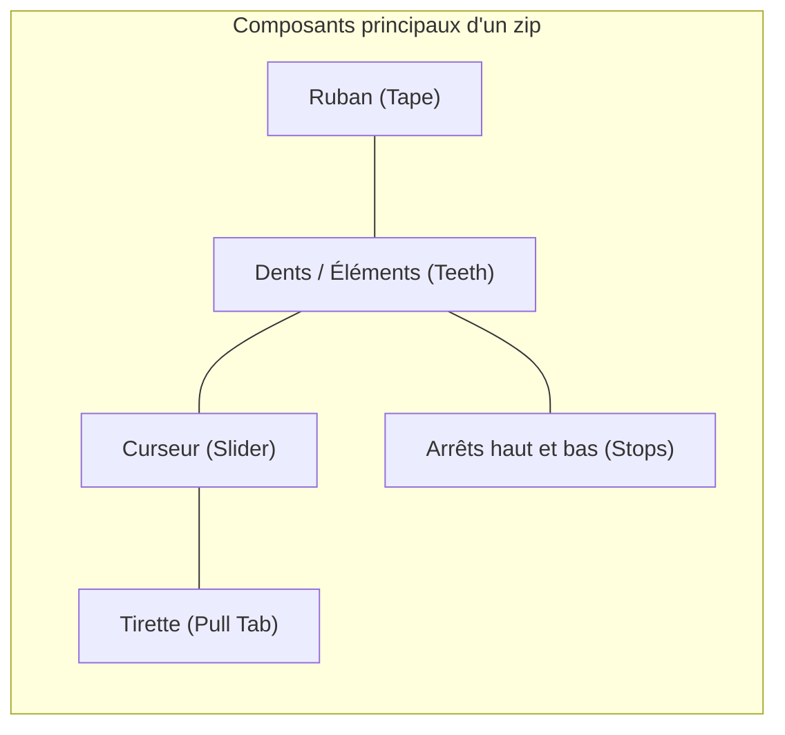
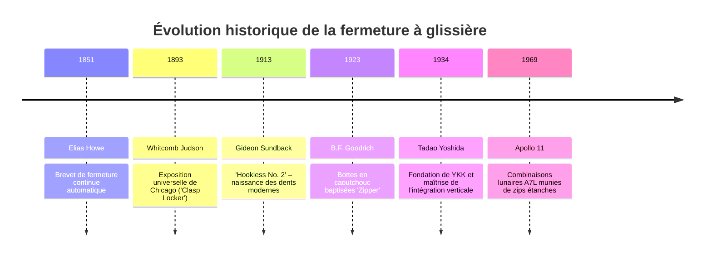
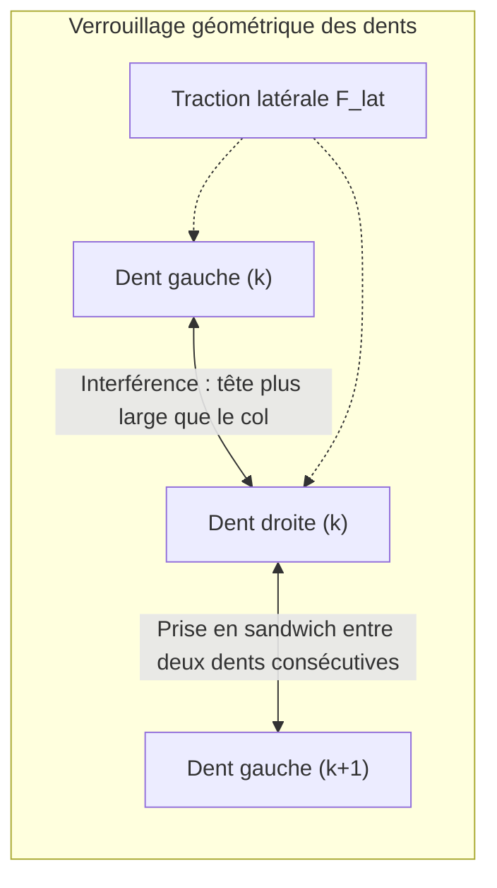

## Introduction : Le paradoxe de la liaison mécanique asymétrique et réversible

Dans notre quotidien, la fermeture à glissière (ou zip) est omniprésente : vestes d'hiver, jeans, sacs à dos, tentes et combinaisons de plongée. Les usines du monde entier en produisent des dizaines de milliards de mètres chaque année.

Du point de vue du génie mécanique, le zip présente une fascinante **asymétrie de liaison** :

```mermaid
flowchart TD
    subgraph Paradoxe["Le paradoxe mécanique du zip"]
        A["Traction latérale (effort transversal)"] -->|Verrouillage géométrique des dents| B["Solidité absolue : résiste à des centaines de Newtons"]
        C["Translation longitudinale du curseur"] -->|Coin séparateur losange (came)| D["Ouverture fluide avec un effort minime (<5 N)"]
    end
```

Si l'on tire latéralement de toutes ses forces sur les deux rubans textiles, une fermeture éclair intacte ne s'ouvre jamais. Pourtant, en saisissant le petit curseur métallique entre le pouce et l'index, les dents se désengrènent avec une douceur absolue. Ce prodige repose sur **l'interférence géométrique**, **l'angle d'auto-verrouillage par frottement**, **la cinématique de came en 3D** et **des tolérances d'usinage inférieures à $\pm 0,005\text{ mm}$**.

---

## 1. Anatomie de la fermeture à glissière



| Composant | Rôle mécanique | Matériaux et procédés |
| :--- | :--- | :--- |
| **Dents (Éléments)** | Pièces mâles/femelles s'engrenant pour résister à la traction | Laiton, maillechort, polyacétal (POM), polyester (PET) |
| **Ruban textile (Tape)** | Maintient les dents à un pas rigoureusement constant | Tissage/tricotage polyester multifilament avec cordonnet de bordure |
| **Curseur (Slider)** | Canalise l'engrènement ou la séparation par effet de coin | Zamak moulé sous pression, laiton matricé, POM injecté |
| **Tirette (Puller)** | Bras de levier ergonomique pour actionner le curseur | Alliage de zinc, acier embouti, cuir, élastomère |
| **Arrêtoirs (Stops)** | Butées mécaniques empêchant le déraillement du curseur | Métal serti, résine thermocollée, boîtier d'enclenchement |

---

## 2. Histoire industrielle : De Judson à Gideon Sundback



En 1913, l'ingénieur suédo-américain **Gideon Sundback** révolutionne le concept en remplaçant les crochets instables par de petites coupelles métalliques embouties, alternées avec une précision micrométrique sur le cordonnet du ruban (**Hookless No. 2**).

---

## 3. Mécanique du contact : Pourquoi la traction latérale ne peut pas l'ouvrir

Les dents sont disposées en quinconce, décalées d'un demi-pas ($p/2$).



### 3.1 Interférence géométrique
La tête de chaque dent ($W_h$) est plus large que son col ($W_n$) :

$$W_h > W_n, \quad W_h > W_p - 2\delta$$

Sous une traction latérale $F_{\text{lat}}$, la force normale de contact vaut :

$$N = \frac{F_{\text{lat}}}{\cos \theta_c}$$

Pour qu'une dent s'échappe, il faudrait déformer plastiquement le métal ou le polymère haute rigidité, ce qui est impossible dans les plages de charge nominales.

### 3.2 Arc-boutement et angle de frottement
La face d'appui présente une contre-dépouille $\beta$. Si l'angle est inférieur à l'angle de frottement statique $\phi = \arctan(\mu_s)$ :

$$\sum F_x = F_{\text{lat}} - 2 \left( N \sin \beta + F_f \cos \beta \right) \le 0$$

Plus la traction latérale augmente, plus les dents s'enfoncent fermement l'une dans l'autre : le système est **auto-verrouillant**.

---

## 4. Cinématique du curseur : Came tridimensionnelle et coin séparateur


- **Fermeture** : Les rebords du curseur inclinent les dents selon un angle tridimensionnel ($10^\circ \sim 15^\circ$), leur permettant de basculer par le haut dans les cavités opposées avant de s'aligner parallèlement en sortie.
- **Ouverture** : Le **coin en losange** s'immisce entre les dents. La force d'écartement latéral $F_w$ générée par la traction $F_{\text{pull}}$ vaut :

$$F_w = \frac{F_{\text{pull}}}{2 (\tan \gamma + \mu_k)}$$

Le coin n'agit que sur **une seule paire de dents à la fois**, dissipant un travail infime.

---

## 5. Comparatif des technologies de fermetures

| Critère | Métallique (Metal) | Plastique injecté (Vislon / POM) | Spirale nylon (Coil / PET) |
| :--- | :--- | :--- | :--- |
| **Masse** | Lourde (100%) | Allégée de 40% | La plus légère (-60%) |
| **Souplesse** | Faible, pour tracés rectilignes | Moyenne | Excellente, épouse les courbes |
| **Corrosion** | Sensible au vert-de-gris | Insensible à l'eau de mer | Résistance chimique totale |
| **Applications** | Jeans, blousons cuir, maroquinerie | Vestes de ski, nautisme, EPI | Tentes, bagagerie, sport |

---

## 6. Le modèle YKK : L'obsession de l'intégration verticale

La société japonaise **YKK** produit plus de 40% des fermetures mondiales et équipe 80% du prêt-à-porter haut de gamme. Sa puissance repose sur une intégration verticale totale :
- Fusion de ses propres alliages de laiton à Kurobe ;
- Synthèse des polymères et filature des rubans ;
- **Conception et fabrication en interne de 100% de ses machines d'assemblage**, protégées comme des secrets d'État absolus.

---

## 7. Applications extrêmes : Les combinaisons spatiales Apollo

Dans les combinaisons Apollo A7L et les tenues de plongée étanches, le zip empêche toute fuite de gaz :
- **Lèvres d'étanchéité élastomères** : Deux bourrelets de néoprène sont fortement comprimés l'un contre l'autre par le curseur.
- **Revêtements sous vide** : Pour éviter le soudage à froid des métaux dans le vide spatial, les dents sont plaquées or ou lubrifiées au bisulfure de molybdène ($\text{MoS}_2$).

---

## Conclusion

Du geste le plus machinal du matin jusqu'aux marches lunaires, la fermeture à glissière incarne l'alliance parfaite de la géométrie de contact, de la cinématique des cames et de la fabrication mécanique de haute précision.
