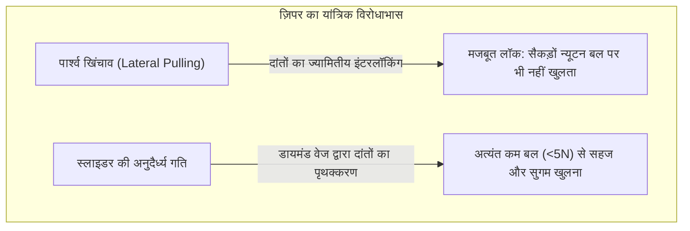
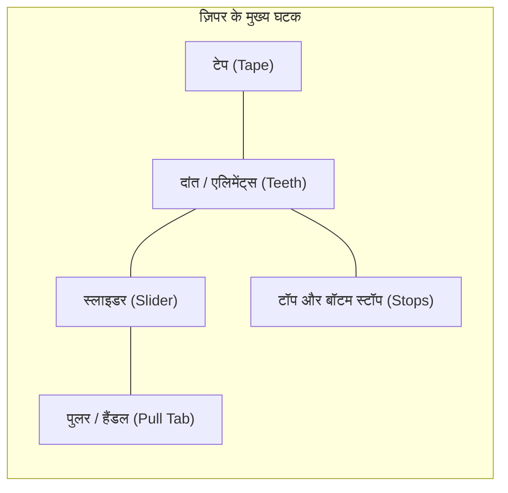
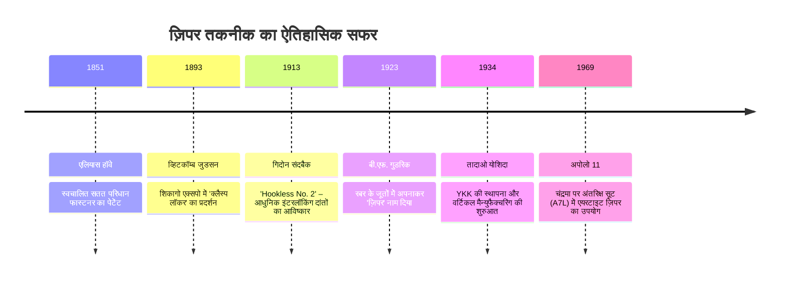
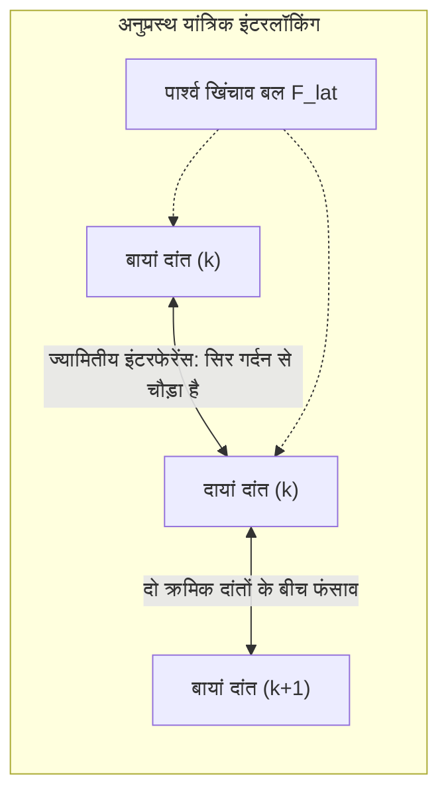
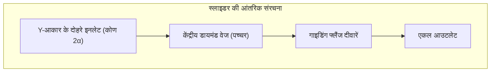

## प्रस्तावना: दैनिक जीवन में रिवर्सिबल मैकेनिकल कपलिंग का विरोधाभास

हमारे दैनिक परिधानों और उपकरणों में ज़िपर हर जगह मौजूद हैं: विंटर जैकेट, जींस, बैकपैक, कैंपिंग टेंट से लेकर खतरनाक रसायनों के सूट और अंतरिक्ष यात्रियों के स्पेससूट तक। दुनिया भर में हर साल अरबों मीटर ज़िपर का उत्पादन होता है।

मैकेनिकल इंजीनियरिंग के दृष्टिकोण से, ज़िपर एक अद्भुत भौतिक विरोधाभास प्रदर्शित करता है: **मैकेनिकल एंगेजमेंट विषमता (Mechanical Engagement Asymmetry)**।

यदि आप दोनों तरफ के कपड़े के फीते (टेप) को पकड़कर पूरी ताकत से आजू-बाजू खींचें, तो एक सामान्य ज़िपर कभी अलग नहीं होगा। लेकिन उसी ज़िपर के छोटे से स्लाइडर को उंगलियों से थोड़ा सा खींचें, तो सारे दांत पानी की तरह आसानी से अलग हो जाते हैं। यह जादू **ज्यामितीय इंटरफेरेंस**, **सेल्फ-लॉकिंग घर्षण कोण**, **त्रि-आयामी कैम गतिकी** और **$\pm 0.005\text{ mm}$ की सूक्ष्म सहनशीलता (टॉलरेंस)** का परिणाम है।

---

## 1. ज़िपर की शारीरिक संरचना (Anatomy)

| भाग का नाम | इंजीनियरिंग कार्य | प्रमुख सामग्री और निर्माण विधि |
| :--- | :--- | :--- |
| **दांत / एलिमेंट्स (Teeth)** | आपस में बारी-बारी से फंसकर अनुप्रस्थ भार झेलने वाले घटक | पीतल (Brass), एल्युमिनियम, पॉलीएसिटैल (POM), पॉलिएस्टर (PET) |
| **टेप (Tape)** | दांतों को सटीक दूरी (पिच) पर थामने वाला कपड़ा | पॉलिएस्टर मल्टीफिलामेंट बुनाई, मजबूत कॉर्ड किनारा |
| **स्लाइडर (Slider)** | दांतों को जोड़ने या अलग करने के लिए 3D कोण पर निर्देशित करने वाला भाग | डाई-कास्ट जिंक मिश्र धातु (Zamak), प्रेस पीतल |
| **पुल टैब (Pull Tab)** | उंगलियों का बल स्लाइडर तक पहुंचाने वाला लीवर | जिंक मिश्र धातु, स्टील प्लेट, चमड़ा, रबर |
| **स्टॉपर्स (Stops)** | स्लाइडर को बाहर निकलने से रोकने वाले यांत्रिक अवरोधक | क्रिम्प्ड मेटल क्लिप, अल्ट्रासोनिक वेल्डेड प्लास्टिक |

---

## 2. ऐतिहासिक विकास: एलियास हॉवे से गिदोन संदबैक तक

1913 में स्वीडिश-अमेरिकी इंजीनियर **गिदोन संदबैक (Gideon Sundback)** ने हुक-आई अवधारणा को पूरी तरह त्याग दिया। उन्होंने टेप के किनारे छोटे चम्मच के आकार के धातु के उभारों और गड्ढों को अत्यधिक सटीकता से सेट करने का तरीका खोजा (**Hookless No. 2**), जो आधुनिक ज़िपर की आधारशिला बना।

---

## 3. संपर्क यांत्रिकी: पार्श्व खिंचाव से ज़िपर क्यों नहीं खुलता?

दांत दोनों टेपों पर आधे पिच ($p/2$) के अंतर पर **ज़िगज़ैग (Staggered)** क्रम में लगे होते हैं।

### 3.1 ज्यामितीय इंटरफेरेंस की शर्त
दांत के सिर की चौड़ाई $W_h$ उसकी गर्दन $W_n$ से अधिक होती है:

$$W_h > W_n, \quad W_h > W_p - 2\delta$$

पार्श्व बल $F_{\text{lat}}$ लगने पर संपर्क नॉर्मल स्ट्रेस होता है:

$$N = \frac{F_{\text{lat}}}{\cos \theta_c}$$

दांत को बगल से निकलने के लिए विरोधी दांत की कठोर गर्दन को प्लास्टिक रूप से फैलाना होगा, जो सामान्य परिस्थितियों में धातु या POM के लिए असंभव है।

### 3.2 घर्षण द्वारा सेल्फ-लॉकिंग
यदि रिवर्स अंडरकट कोण $\beta$ स्थैतिक घर्षण कोण $\phi = \arctan(\mu_s)$ से कम हो:

$$\sum F_x = F_{\text{lat}} - 2 \left( N \sin \beta + F_f \cos \beta \right) \le 0$$

पार्श्व खिंचाव जितना अधिक होगा, दांत एक-दूसरे को केंद्र की ओर उतनी ही मजबूती से दबाएंगे।

---

## 4. स्लाइडर किनेमैटिक्स: 3D कैम और डायमंड वेज

- **बंद होना**: स्लाइडर के किनारे दांतों को $10^\circ \sim 15^\circ$ के 3D कोण पर झुकाकर ऊपर से सामने वाले दांत के पॉकेट में डालते हैं।
- **खुलना**: केंद्र का **डायमंड वेज** दांतों के बीच में प्रवेश करता है। स्लाइडर खींचने के बल $F_{\text{pull}}$ से उत्पन्न पार्श्व विभाजन बल $F_w$ है:

$$F_w = \frac{F_{\text{pull}}}{2 (\tan \gamma + \mu_k)}$$

वेज एक समय में **केवल एक जोड़ी दांतों को अलग करता है**, जिससे बहुत कम बल में काम हो जाता है।

---

## 5. ज़िपर के तीन प्रमुख प्रकार

| विशेषता | धातु ज़िपर (Metal) | मोल्डेड प्लास्टिक (Vislon / POM) | नायलॉन कॉइल (Coil / PET) |
| :--- | :--- | :--- | :--- |
| **वजन** | भारी (100% आधार) | 40% हल्का | सबसे हल्का (-60%) |
| **लचीलापन** | कम, सीधी रेखाओं के लिए | मध्यम | अत्यधिक लचीला, 3D घुमावों के अनुकूल |
| **जंग प्रतिरोध** | ऑक्सीकरण और जंग का जोखिम | समुद्री पानी से पूर्ण सुरक्षित | रसायन और नमी से पूर्ण सुरक्षित |
| **प्रमुख उपयोग** | जींस, लेदर जैकेट, बैग | स्की जैकेट, मरीन गियर | बैकपैक, टेंट, स्पोर्ट्सवियर |

---

## 6. YKK का साम्राज्य: पूर्ण वर्टिकल इंटीग्रेशन

जापानी कंपनी **YKK** दुनिया के 40% से अधिक और प्रीमियम फैशन के 80% ज़िपर बनाती है। इसकी सफलता का रहस्य है **पूर्ण आंतरिक वर्टिकल एकीकरण**:
- अपने संयंत्रों में कच्चे तांबे से पीतल बनाना;
- स्वयं प्लास्टिक पॉलीमर और कपड़े के फीते तैयार करना;
- **अपनी सभी स्वचालित मशीनें और डाई 100% अपनी इन-हाउस मशीनरी डिवीजन में बनाना**, जिन्हें कभी किसी बाहरी कंपनी को नहीं बेचा जाता।

---

## 7. चरम वातावरण: अपोलो स्पेससूट और एयरटाइट ज़िपर

अपोलो 11 के अंतरिक्ष सूट (A7L) और गहरे गोताखोरी सूट में ज़िपर पूर्ण निर्वात के खिलाफ सुरक्षा प्रदान करते हैं:
- **इलास्टोमेरिक सीलिंग लिप्स**: नियोप्रिन रबर के होठों को स्लाइडर द्वारा मजबूती से दबाया जाता है जिससे 1 वायुमंडलीय दबाव का अंतर सील हो जाता है।
- **कोल्ड वेल्डिंग की रोकथाम**: अंतरिक्ष के शून्य में धातुओं के परस्पर चिपकने से बचाने के लिए दांतों पर सोने की परत या $\text{MoS}_2$ सॉलिड लुब्रिकेंट का लेप लगाया जाता है।

---

## निष्कर्ष

ज़िपर मानव इतिहास का सबसे परिष्कृत और सफल रिवर्सिबल मैकेनिकल कपलिंग सिस्टम है, जो संपर्क भौतिकी, कैम गतिकी और माइक्रो-सटीक निर्माण का एक बेजोड़ चमत्कार है।
