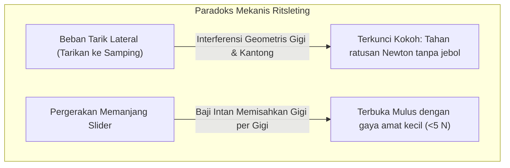
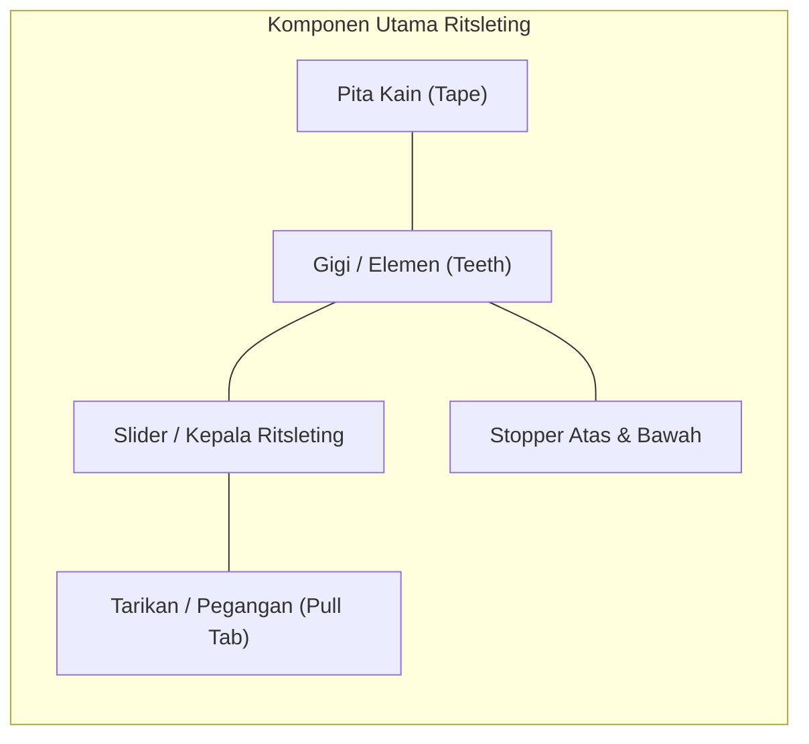
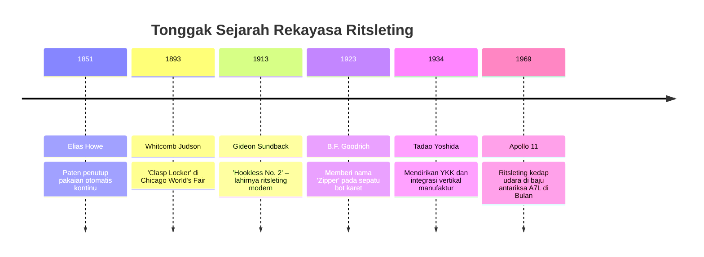
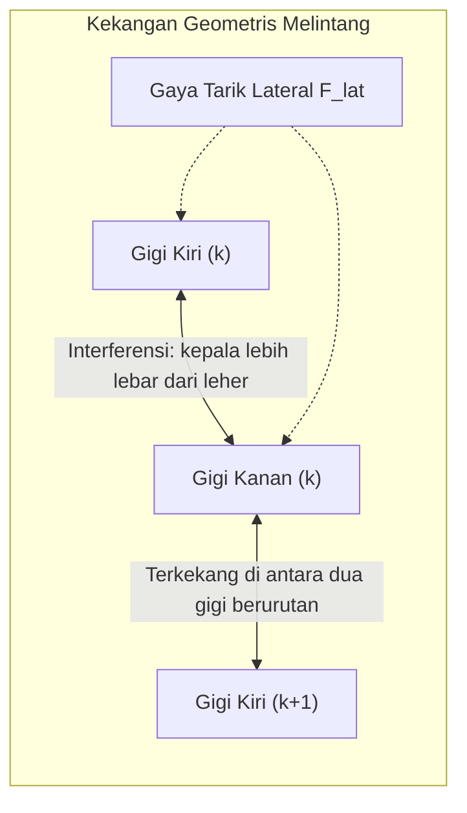
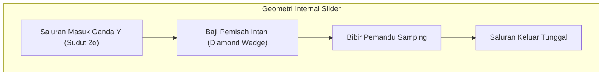

## Pendahuluan: Paradoks Sambungan Mekanis Bolak-Balik Asimetris

Dalam kehidupan sehari-hari, ritsleting (zipper) ada di mana-mana: jaket, celana jin, ransel, tenda hingga pakaian selam dan antariksa. Setiap tahun, puluhan miliar meter ritsleting diproduksi di seluruh dunia.

Dari sudut pandang teknik mesin, ritsleting menunjukkan keajaiban fisika: **Asimetri Sambungan Mekanis**.

Jika pita kain ditarik ke samping sekuat tenaga, ritsleting yang normal tidak akan pernah lepas. Namun, jika kepala slider ditarik memanjang, gigi-gigi terlepas semulus sutra. Paradoks ini diatur oleh **interferensi geometris**, **mekanika swakunci sudut gesek**, **kinematika nok tiga dimensi**, dan **toleransi pabrikasi lebih ketat dari $\pm 0,005\text{ mm}$**.

---

## 1. Anatomi dan Komponen Utama Ritsleting

| Komponen | Fungsi Keteknikan | Material & Proses Manufaktur |
| :--- | :--- | :--- |
| **Gigi (Elements)** | Tonjolan yang saling mengunci menahan beban transversal | Kuningan, nikel-perak, poliasetal (POM), poliester (PET) |
| **Pita Kain (Tape)** | Media tekstil penahan posisi gigi dengan pitch tepat | Anyaman poliester multifilamen dengan tali inti penguat |
| **Slider** | Rumah pemandu sudut pertemuan atau pemisahan gigi | Cetak tekan seng (Zamak), kuningan cap, cetak injeksi POM |
| **Pegangan (Pull Tab)** | Tuas ergonomis penyalur gaya jari ke slider | Logam zamak, pelat baja, kulit, karet |
| **Stopper (Stops)** | Pembatas mekanis pencegah terlepasnya slider | Logam klem presisi, polimer las ultrasonik |

---

## 2. Sejarah Evolusi: Dari Howe ke Gideon Sundback

Pada tahun 1913, insinyur Swedia-Amerika **Gideon Sundback** meninggalkan konsep kait-mata dan merancang deretan lekukan dan tonjolan berbentuk mangkuk kecil yang dijepit rapat di tepi pita kain (**Hookless No. 2**).

---

## 3. Mekanika Kontak: Mengapa Tarikan Lateral Tidak Dapat Membukanya

Gigi pada pita kiri dan kanan disusun berselang-seling (staggered) dengan selisih setengah pitch ($p/2$).

### 3.1 Syarat Interferensi Geometris
Lebar kepala gigi $W_h$ lebih besar dari lebar leher $W_n$:

$$W_h > W_n, \quad W_h > W_p - 2\delta$$

Tegangan normal akibat gaya tarik lateral $F_{\text{lat}}$ adalah:

$$N = \frac{F_{\text{lat}}}{\cos \theta_c}$$

Untuk terlepas menyamping, kepala gigi harus meregangkan leher kuningan atau POM secara plastis, yang mustahil terjadi dalam batas beban operasi.

### 3.2 Kondisi Swakunci (Self-Locking)
Dengan sudut miring $\beta$ lebih kecil dari sudut gesek statis $\phi = \arctan(\mu_s)$:

$$\sum F_x = F_{\text{lat}} - 2 \left( N \sin \beta + F_f \cos \beta \right) \le 0$$

Semakin kuat ritsleting ditarik ke samping, semakin rapat gigi-gigi tersebut menekan satu sama lain.

---

## 4. Kinematika Slider: Saluran Y dan Baji Intan

- **Menutup**: Flens slider memiringkan gigi pada sudut 3D sebesar $10^\circ \sim 15^\circ$, memasukkannya dari atas ke dalam lekukan lawan sebelum disejajarkan di pintu keluar.
- **Membuka**: **Baji intan** di tengah membelah batas pertemuan gigi. Gaya pemisah lateral $F_w$ bernilai:

$$F_w = \frac{F_{\text{pull}}}{2 (\tan \gamma + \mu_k)}$$

Baji hanya memisahkan **satu pasang gigi pada satu saat**, menuntut kerja mekanis yang amat kecil.

---

## 5. Tiga Kategori Utama Ritsleting

| Kategori | Logam (Metal) | Plastik Cetak (Vislon / POM) | Koil Nilon (Coil / PET) |
| :--- | :--- | :--- | :--- |
| **Bobot** | Berat (100%) | 40% lebih ringan | Paling ringan (-60%) |
| **Kelenturan** | Rendah, cocok untuk jalur lurus | Sedang | Sangat tinggi, mengikuti lekuk 3D |
| **Ketahanan Korosi** | Risiko karat & kerak tembaga | Kebal air laut sepenuhnya | Kebal bahan kimia dan air |
| **Aplikasi Utama** | Jin, jaket kulit, tas mewah | Busana bahari, pakaian ski, APD | Ransel, tenda, baju olahraga |

---

## 6. Filosofi YKK: Integrasi Vertikal Penuh

Perusahaan Jepang **YKK** memegang lebih dari 80% pasar ritsleting mewah dunia berkat **integrasi vertikal mutlak**:
- Melebur sendiri paduan kuningan di pabrik Kurobe;
- Melakukan polimerisasi plastik dan pertenunan pita secara mandiri;
- **Merancang dan membuat 100% mesin otomatis dan cetakan di divisi internal**, tanpa bergantung pada vendor luar.

---

## 7. Ritsleting Ekstrem Baju Antariksa Apollo

Pada pakaian astronot Apollo (A7L) dan pakaian selam komersial:
- **Bibir Penyegel Elastomer**: Karet neoprena tebal ditekan kuat oleh slider sehingga kedap udara pada perbedaan tekanan 1 atmosfer.
- **Pencegah Las Dingin (Cold Welding)**: Dalam kehampaan luar angkasa, logam dapat menyatu spontan; gigi ritsleting dilapisi emas atau pelumas padat $\text{MoS}_2$.

---

## Kesimpulan

Ritsleting adalah mahakarya antarmuka mekanis bolak-balik yang memadukan mekanika kontak, kinematika nok 3D, dan manufaktur presisi mikron menjadi komponen esensial peradaban modern.
