## はじめに：日常に隠された「100分の1ミリ」の可逆結合パラドックス

私たちの日常生活を見渡すと、身に着けている衣服、ダウンジャケット、デニムパンツのフロント、背負っているバックパック、財布のコインポケット、果ては精密機器の保護ケースやテントに至るまで、無数の「ファスナー（ジッパー・チャック）」が存在している。世界全体での年間生産量は実に**数百億メートル**に達し、地球を数百周するほどの長さが人類の生活圏で休むことなく開閉されている。

あまりにもありふれているため、私たちはその存在を意識することすら稀である。しかし、機械工学の視点からファスナーの挙動を冷静に観察すると、そこには極めて興味深い**「結合の非対称性（Asymmetry of Mechanical Engagement）」**という物理的パラドックスが存在していることに気づく。

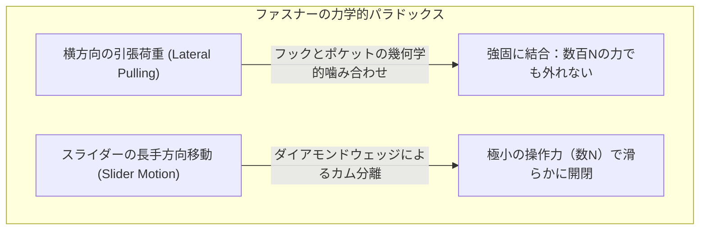

もし、左右の布地（テープ）を手で掴んで横方向に力いっぱい引っ張ったとしても、正常なファスナーであれば絶対に外れることはない。大人の男性が全体重をかけて横に引き裂こうとしても、エレメント（務歯）同士はガッチリと噛み合ったままビクともしない。それにもかかわらず、指先でわずか数ミリ角の小さな金属スライダーをつまみ、長手方向へと軽く引くだけで、まるで魔法のように左右の噛み合わせがスルスルと解け、あるいは完璧な整列を保って結合していく。

なぜ、ある方向からの外力に対しては岩盤のように堅牢にロックされ、直交する別の運動に対しては流体のように滑らかに解除されるのか？ 
そこには、**幾何学的拘束（Geometric Constraint）**、**摩擦角と自己ロック（Self-locking Condition）**、**三次元カム機構（3D Cam Kinematics）**、そして**100分の5ミリメートル（$\pm 0.05\text{ mm}$）以下の超精密公差**が完璧な調和をもって集約されている。

本稿では、日常の何気ない留め具に隠された機械工学の神髄、エジソンも実用化できなかったファスナー開発の苦難の歴史、エレメントとスライダーの厳密な物理法則、金属・樹脂・コイルの素材工学、そして世界シェアの頂点に君臨するYKK（吉田工業）の狂気的な垂直統合モノづくり哲学から宇宙服の超極限気密ファスナーまで、その全貌を徹底的に解明していく。

---

## 1. ファスナーの解剖学：各部名称と基本構造

ファスナーの物理を理解するためには、まずその精緻な構成要素と呼称を正確に把握する必要がある。ファスナーは主に以下の5つの基幹コンポーネントから構成されている。

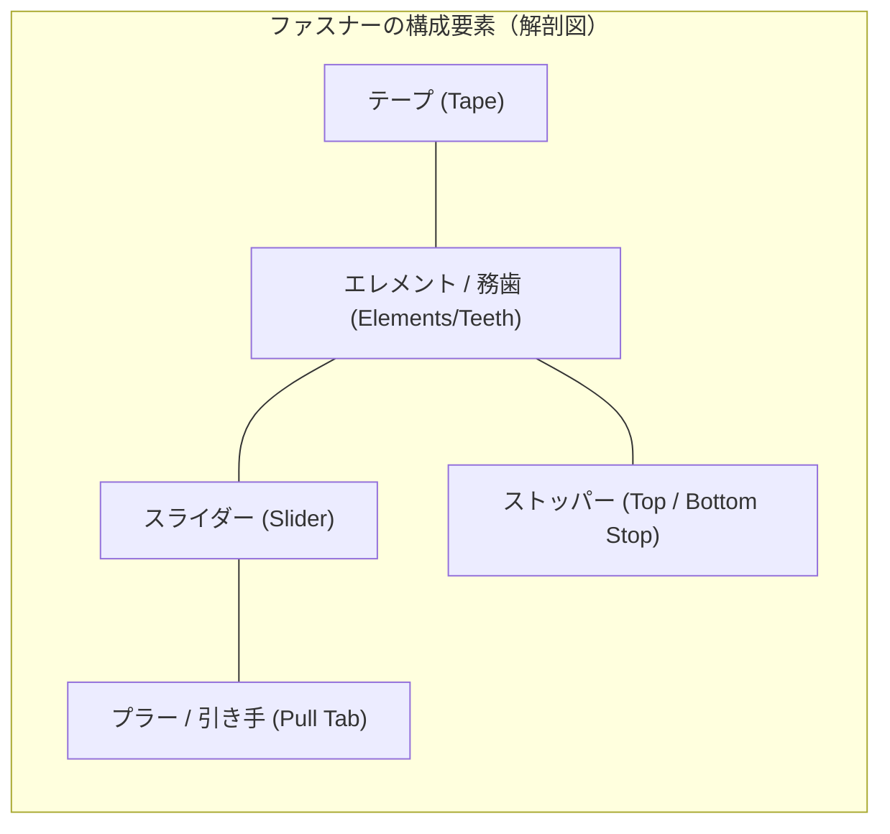

| 部品名称 | 工学的な役割と機能 | 主な材料・製造プロセス |
| :--- | :--- | :--- |
| **エレメント（務歯：むし）** | 互い違いに噛み合って左右を機械的に拘束する突起状の歯 | 丹銅・黄銅・アルミ合金、ポリアセタール（POM）、ポリエステル（PET） |
| **テープ（テープ布）** | エレメントを等ピッチで固定し、衣服や製品に縫着するための基材 | ポリエステルマルチフィラメント織物または編物、芯紐（コード） |
| **スライダー（Slider）** | エレメントを所定の進入角で噛み合わせ、またはウェッジで強制分離する移動体 | 亜鉛合金ダイカスト、黄銅プレス成形、ポリアセタール射出成形 |
| **プラー（引き手：Pull Tab）** | 人間の指が把持して操作力をスライダー本体へ伝達するレバー | 亜鉛ダイカスト、革、ステンレスワイヤー、ラバー |
| **上止め / 下止め（Top & Bottom Stop）** | スライダーがチェーンから脱落するのを防ぎ、開き限界を機械的に決定する止め具 | 金属プレス爪、超音波溶着樹脂、射出成形ピン＆ボックス |

### 務歯（エレメント）の微小構造
ファスナーの心臓部であるエレメント1個の幾何形状には、それぞれ明確な機能領域が存在する。
- **ヘッド（Head / 突起）**：前方に突き出た球状またはキノコ状の突出部。相手側エレメントのポケットに入り込む。
- **ネック（Neck / くびれ）**：ヘッドの根元に位置する細い胴体部。隣接するエレメントのショルダーがここに引っかかる。
- **ショルダー（Shoulder / 肩部）**：ヘッドの後方に広がる傾斜面。横方向の引張力を受けるベアリング面となる。
- **ポケット（Pocket / 凹部）**：エレメントの背面または側面に刻まれた凹み。反対側のエレメントヘッドを受け止める。
- **脚部（Legs / かしめ部）**：テープの縁にある芯紐（コード）を両側から強力に挟み込んで固定するクランプ部。

---

## 2. ファスナー発展史：エジソンも敗れた「壊れる留め具」の苦難

現代でこそ100円均一のポーチにも極めて高精度なファスナーが装着されているが、この仕組みの実用化には半世紀以上にわたる技術的苦闘と、無数の倒産劇が存在した。

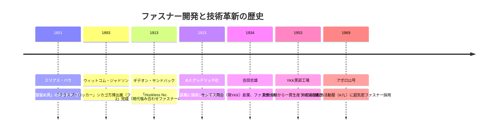

### 1851年：ミシン発明者エリアス・ハウの着想
ミシンの基本特許で巨万の富を得たエリアス・ハウ（Elias Howe）は、1851年に「自動連続衣服留め具（Automatic Continuous Clothing Closure）」の特許を取得した。しかし、彼の設計はゴム紐とフックを連動させる原始的なものであり、ミシン事業の成功で多忙を極めたこともあって、製品化への情熱は注がれなかった。

### 1893年：ウィットコム・ジャドソンと「クラスプ・ロッカー」
19世紀末、女性の長靴やコルセットには数十個ものボタンやホックが並んでおり、靴を脱ぎ履きするだけでフック棒を使って数十分の時間を要していた。
シカゴの機械技師ウィットコム・ジャドソン（Whitcomb L. Judson）は、腰痛持ちの友人をボタン締めの重労働から解放するため、ガイド付きスライダーでフックとアイ（目）を次々に引っ掛けていく「クラスプ・ロッカー（Clasp Locker）」を考案し、1893年のシカゴ万博に出品した。
しかし、当時の工作精度は極めて低く、留め具は頻繁に外れ、逆に一度噛み込むと二度と開かなくなる致命的な欠陥を抱えていた。郵便配達員用の長靴に採用されたものの、現場で突然パッカーンと弾け飛んで大不評を買い、事業は悲惨な赤字を垂れ流し続けた。

### 1913年：ギデオン・サンドバックによる決定的一歩「Hookless No. 2」
ジャドソンの会社（ユニバーサル・ファスニング社）に雇われたスウェーデン出身の天才電気機械技師、**ギデオン・サンドバック（Gideon Sundback）**こそが、現代ファスナーの真の生みの親である。
サンドバックは、従来の「フックと輪を引っ掛ける」という発想を完全に捨て去り、**「スプーン状の微小な金属突起と窪みを、布テープの縁に高密度で均一に固定し、互い違いに抱き合わせる」**という幾何学的転換に到達した。

1913年に彼が完成させた「Hookless No. 2」は、1インチあたり約10〜11個の微小な歯（エレメント）を正確に等間隔で配置し、ダイアモンド型のくさびを持つスライダーで誘導する構造を備えていた。この瞬間、現代のファスナーの基本力学構造が完成したのである。

### 「ジッパー（Zipper）」の誕生
1923年、米国の大手ゴムタイヤメーカーであったB.F.グッドリッチ社が、自社のゴム製防寒長靴「ミスティック・ブーツ」にサンドバックの留め具を採用した。
社長のバートラム・ワークは、スライダーを引き上げる際に鳴る軽快な音**「Zip!（シュッ！）」**に感銘を受け、このブーツを**「Zipper Boot」**と命名して大々的に宣伝した。この長靴が全米で大ヒットしたことから、「ジッパー」という商標名が留め具そのものの一般名詞として世界中に定着することになったのである（イギリス英語では Fastener / Zip、フランス語では Fermeture éclair と呼ばれる）。

---

## 3. 噛み合わせの幾何学と力学：なぜ横に引っ張っても外れないのか

ファスナー最大の工学的驚異は、**「エレメント同士が接着されているわけでも、ピンで貫通されているわけでもないのに、横方向の強大な引張力に耐える」**という点にある。その物理的根拠を、材料力学と接触幾何学の数式から解き明かそう。

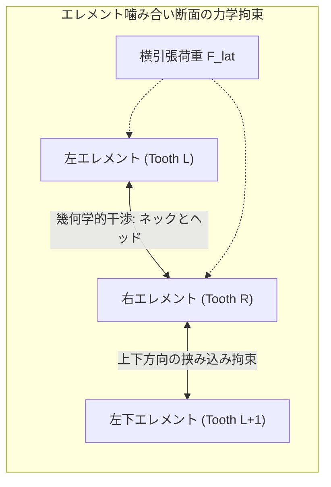

### 3.1 幾何学的拘束（Geometric Interference）
左右のエレメント列を上から見ると、エレメントは左右交互に**千鳥配置（Staggered arrangement）**されている。ピッチを $p$ とすると、右側エレメントの位置は左側エレメントに対して $p/2$ だけ長手方向にオフセットされている。

エレメントのヘッド幅を $W_h$、ネック幅を $W_n$、ポケット開口幅を $W_p$ とする。
正常な噛み合わせ状態において、幾何学的な寸法関係は以下のように厳密に設計されている。

$$W_h > W_n, \quad W_h > W_p - 2\delta$$

ここで $\delta$ はクリアランス（微小隙間）である。
エレメント同士が完全に噛み合っているとき、右側のヘッドは左側の2つのエレメント（第 $k$ 番目と第 $k+1$ 番目）のショルダーによって前後から挟み込まれている。

左右のテープを外側へ引っ張る横方向引張荷重を $F_{\text{lat}}$ とすると、右エレメントのヘッド球部と左エレメントの受動面との接触角を $\theta_c$（接触接触面法線ベクトルと引張方向のなす角度）としたとき、接触垂直応力 $N$ は以下のように生じる。

$$N = \frac{F_{\text{lat}}}{\cos \theta_c}$$

もしエレメントが水平方向にそのまま外れるためには、ヘッド部 $W_h$ がネックの狭窄部 $W_n$ を押し広げてすり抜ける必要がある。しかし、エレメントは高剛性の金属（ヤング率 $E \approx 100 \sim 110\text{ GPa}$ の黄銅）または結晶性エンジニアリングプラスチック（$E \approx 3\text{ GPa}$ のポリアセタール）で成形されており、降伏応力 $\sigma_y$ を超えない限り、弾性変形だけでこの幾何学的段差を乗り越えることは物理的に不可能である。

### 3.2 摩擦角と自己ロック条件（Self-Locking Mechanics）
さらに、エレメント接触面の傾斜角 $\beta$ と材料間の静止摩擦係数 $\mu_s$ には、力学的な**自己ロック条件**が成立している。

```mermaid
graph TD
    A["横引張力 F_lat の作用"] --> B["傾斜接触面に垂直抗力 N と摩擦力 F_f が発生"]
    B --> C{"接触角 β と摩擦角 φ の関係"}
    C -->|β ≤ φ = arctan(μ)| D["完全自己ロック：引張力が増すほど接触圧が上昇し絶対に滑り出さない"]
    C -->|β > φ| E["幾何学的アンダーカット（逆テーパー）により機械的噛み込みが発生"]
```

接触面の摩擦角を $\phi = \arctan(\mu_s)$ と置く。
接触面の幾何勾配が摩擦角より小さい（$\tan \beta \le \mu_s$）、あるいはエレメントの頭部がわずかに「返し（逆テーパー）」を持つ形状に設計されている場合、引張力 $F_{\text{lat}}$ が増大すればするほど、接触界面に生じる摩擦力 $F_f = \mu_s N$ と垂直抗力の反力成分が互いを内側（中心軸側）へ引き寄せる分力を生み出す。

$$\sum F_x = F_{\text{lat}} - 2 \left( N \sin \beta + F_f \cos \beta \right) \le 0$$

この結果、ファスナーは**「外から横に引っ張れば引っ張るほど、エレメント同士がより強固に食い込み合って結合を強固にする」**という自己拘束性を獲得しているのである。

---

## 4. スライダーの幾何学：Y字型流路と3次元カムのからくり

横からの力には絶対に外れないエレメントを、なぜスライダーは軽々と外すことができるのか？
その答えは、スライダー内部の**「3次元空間内での進入角・退出角の強制変化」**にある。

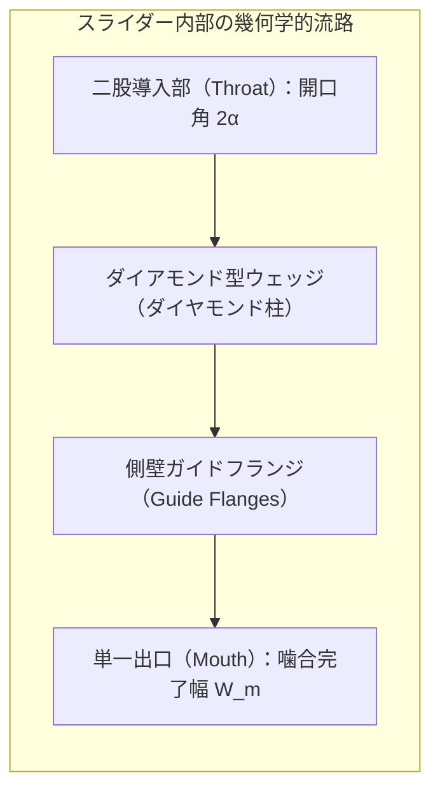

### 4.1 閉じる（Engaging）メカニズム：千鳥オフセット誘導
スライダーの内部空間は、上部が二股に分かれた「Y字型」のチャンネル構造（流路）になっている。

1. **進入領域（Throat）**：左右のテープは、スライダー上部の左右の流路から、中心線に対して角度 $\alpha$（通常 $10^\circ \sim 15^\circ$）の傾斜を持って進入する。
2. **千鳥オフセットの幾何学的保証**：スライダーの内部寸法は、左右のエレメントが同時に中央へ突入するのを防ぐため、内部のガイドフランジによって左右のエレメントの進入高さを長手方向に正確に $p/2$ だけずらす。
3. **回転・傾斜噛み合わせ（Rotational Incline Engagement）**：
   左右のエレメントは、平面上で真横から衝突するのではない。斜め上空から**「首を前傾させながら、相手のヘッドの背後へ潜り込む」**ように立体的な円弧軌道を描いて滑り込む。

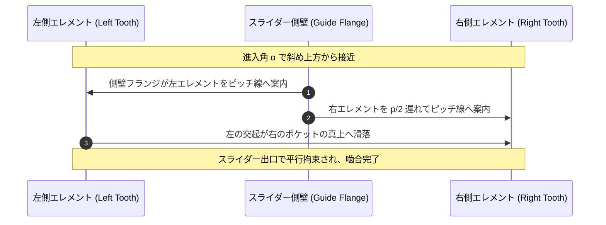

エレメント同士が完全に平行になった瞬間、もはや上下にも左右にも脱出する空間（自由度）はゼロになる。スライダーの狭い出口（Mouth）を通過した時点で、エレメント列は1本の強固なチェーンへと変貌している。

### 4.2 開く（Disengaging）メカニズム：くさびの破壊的分解力
スライダーを逆方向（下向き）に引いたとき、内部の中央に鎮座する**「ダイアモンド型ウェッジ（Diamond Wedge / Spreader）」**が決定的な働きをする。

ウェッジは、強固に噛み合った左右のエレメントの境界線に真っ向から突き刺さる三角柱または菱形の金属柱である。
ウェッジの先端角を $2\gamma$、スライダーを引く操作力を $F_{\text{pull}}$ とすると、ウェッジが左右のエレメントを外側へ押し広げる水平くさび力 $F_w$ は、理想接触状態（摩擦を無視した場合）において以下の式で表される。

$$F_w = \frac{F_{\text{pull}}}{2 \tan \gamma}$$


横方向から全体を一斉に引っ張った場合、数百個のエレメントが同時に抵抗するため全体荷重は数千ニュートンに達する。
しかし、スライダーのウェッジは**「噛み合っている最前線のエレメントたった1ペア」**に対してのみ、ピンポイントでくさび力を集中させる。
しかも、エレメントを真横に引き抜くのではなく、エレメントを斜め外側へ**傾斜・回転（Tilting）**させながら外すため、拘束アンダーカットを極小の抵抗で滑らかにクリアさせることができるのである。

### 4.3 スライダーのロック機構（オートマチックロックの物理）
ズボンのフロントファスナーが、歩行中の大腿部の動きで勝手に下がってしまったら大惨事である。これを防ぐため、現代のスライダーには高度なロック機構が内蔵されている。

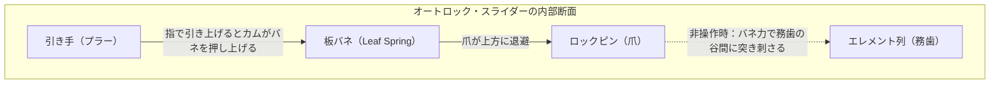

- **ノンロック（Free Slider）**：引き手に関係なくスライダーが自由に動く。バッグや寝袋などに使用。
- **ピンロック（Cam Lock）**：引き手を倒すと、引き手の根元にある突起（ピン）がエレメントの間に直接刺さる。
- **オートマチックロック（Automatic Lock）**：
  スライダー内部に極小の**板バネ**と**ロックピン（爪）**が組み込まれている。
  引き手を指で引っ張ると、引き手のヒンジ部分がカムとなって板バネを上方に押し上げ、ロックピンがエレメントの隙間から自動的に引き抜かれる。
  指を離すと、板バネの弾性復元力によってピンが瞬時にエレメントの間に下降し、務歯のピッチ溝に深く突き刺さって物理的に固定される。
  これにより、衣服の内側からどれほど強い横引張力や下向きの力が加わっても、スライダーは1ミリたりとも動かない。

---

## 5. ファスナーの3大分類と材料科学

現代のファスナーは、使用環境、意匠性、強度、柔軟性に応じて3つの巨大な材料系統に分化している。

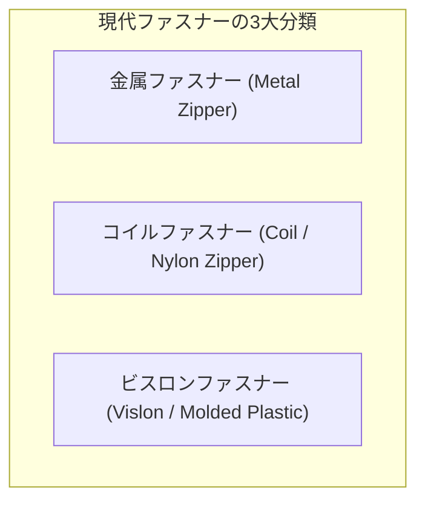

### 5.1 金属ファスナー（Metal Zipper）
最もクラシックでありながら、最高峰の質感と重厚な引張強度を誇るファスナー。

- **構成材料**：
  - **黄銅（真鍮：$\text{Cu}-\text{Zn}$ 合金）**：展延性に優れ、黄金の光沢を持つ。ジーンズや革ジャケットの標準。
  - **丹銅（レッドブラス）**：銅比率が高く耐食性に優れる。
  - **洋白（ニッケルシルバー：$\text{Cu}-\text{Ni}-\text{Zn}$ 合金）**：銀白色の美しい外観と高硬度。高級バッグ等。
  - **アルミニウム合金**：軽量だが、耐摩耗性と耐食性で真鍮に劣る。
- **製造工法**：
  平角ワイヤー（断面が長方形の金属線）を高速プレス機に送り込み、1分間に数千回の打抜きと曲げ加工を連続で行ってヘッドとポケットを冷間圧造する。その後、テープの芯紐を挟み込むように脚部を強固にかしめる（Clamping）。
  表面のバリを落とすため、数時間の回転バレル研磨（タンブリング）と化学研磨、防錆ワックス塗布が施される。

### 5.2 ビスロン / 射出成形ファスナー（Vislon / Injected Plastic Zipper）
樹脂の塊が規則正しく並んだ、軽量かつタフなファスナー。

- **構成材料**：**ポリアセタール（POM：ポリオキシメチレン）**。
  POMは「自己潤滑性」「耐疲労性」「高耐摩耗性」「耐薬品性」を極限レベルで兼ね備えた結晶性エンジニアリングプラスチックである。
- **製造工法**：
  特殊なスロットダイ金型を用い、織り上げたポリエステルテープの両縁に対して、溶融したPOM樹脂を**超高速インジェクション（射出成形）**によって直接一体射出する。テープの繊維間に樹脂がミクロに入り込んで固化（アンカー効果）するため、エレメントがテープから剥離する破壊強度は金属かしめ品を凌駕することもある。
  塩分による錆（塩害）が一切発生しないため、海洋スポーツウェア、救命胴衣、ミリタリーギア、アウトドアアウターのデファクトスタンダードとなっている。

### 5.3 コイルファスナー（Coil / Nylon Zipper）
現代世界で最も大量に生産され、最も柔軟性に富むファスナー。

- **構成材料**：**ポリエステル（PET）またはナイロンモノフィラメント**。
- **製造工法**：
  太さ $0.5 \sim 1.0\text{ mm}$ の透明なPET樹脂モノフィラメントを連続的に巻き上げ、加熱セットしながららせん状（ヘリカルコイル）に成形する。コイルの各折り返し部分を金型でプレスして平らにつぶし、噛み合わせ用の「ヘッド」を形成する。
  この連続コイルを、補強用の**芯紐（コード）**と共に特殊な二重環縫いミシンでポリエステルテープに超高速で縫着する。
- **力学的特徴**：
  エレメントが独立した個別の金属片ではなく、1本の連続したバネ構造になっているため、三次元的な屈曲に対して極めて柔軟に追従する。万一強い衝撃でエレメントが部分的に外れた（バーストした）としても、スライダーを往復させるだけで元通りに噛み合う「自己修復性」を持つ。

| 特性項目 | 金属ファスナー (Metal) | ビスロン (Vislon / POM) | コイルファスナー (Coil / PET) |
| :--- | :--- | :--- | :--- |
| **重量** | 重い（100%基準） | 軽い（金属比 -40%） | 最も軽量（金属比 -60%） |
| **柔軟性・追従性** | 低い（直線的配置に向く） | 中程度（ブロック状） | 極めて高い（曲面・曲線追従） |
| **耐候性・耐食性** | 酸化・塩害で緑青・錆リスク | 腐食フリー、海水に完全耐性 | 耐薬品性・耐水性に極めて優れる |
| **開閉フィーリング** | 金属同士の重厚なクリック感 | 樹脂特有の乾いた確実な感触 | 摩擦が極めて少なくシルキー |
| **主な用途** | ジーンズ、革ジャン、高級鞄 | スキーウェア、マリン、作業着 | スポーツウェア、テント、リュック |

---

## 6. YKKの圧倒的モノづくり哲学：黒部工場と狂気の垂直統合

ファスナーを語る上で、日本の富山県黒部市に本拠を置くグローバルジャイアント**「YKK（吉田工業株式会社）」**を避けて通ることはできない。
高級アパレル市場におけるYKKの世界シェアは**80%〜90%**、全世界のファスナー市場全体でも約40%の圧倒的シェアを誇る。ハイブランドのデザイナーからアウトドアメーカーの過酷な開発者まで、なぜ世界は「ファスナーといえばYKK」と絶対の信頼を寄せるのか？

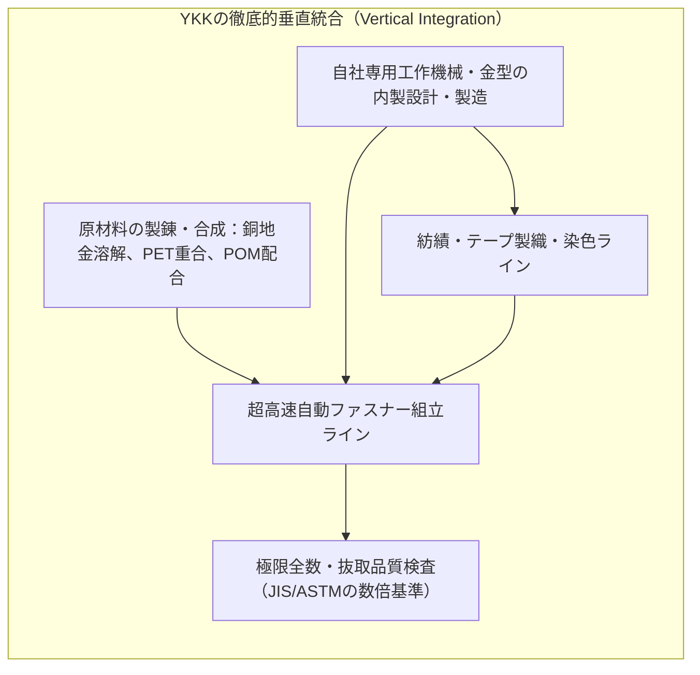

### 6.1 吉田忠雄の「善の巡り道」と技術内製思想
YKKの創業者・吉田忠雄が掲げた企業理念は「他人の利益を図らずして自らの繁栄はない」という**「善の巡り道」**であった。しかし、その崇高な哲学を現実の工業製品として具現化したのは、徹底して他社への依存を排除する**「狂気の垂直統合（Vertical Integration）」**である。

一般的な製造業では、原材料メーカーから金属ワイヤーや樹脂ペレットを購入し、機械メーカーから工作機械を買い、組み立てて出荷する。
しかしYKKは異なる。
- **金属製錬から自社で行う**：銅の地金を買い付け、富山県黒部の工場で独自の比率で合金を溶解・鋳造し、真鍮ワイヤーを自前で伸線する。
- **樹脂材料の重合からブレンド**：ポリエステル繊維の紡績、糸の撚糸、染料の配合、染色の水質管理まで自社で制御する。
- **工作機械そのものを一切市販品に頼らない**：ファスナーを組み立てる世界最速の自動機、超精密金型、検査センサー、ロボットに至るまで、すべて黒部工場内にある**「工機技術本部」**が自社設計・自社製作している。

外部の機械メーカーから機械を買えば、その瞬間に競合他社にも同じ機械が渡り、技術の優位性が失われる。ファスナーの加工機械そのものを完全なブラックボックスとして社内秘で内製し続けることこそが、他国の追随を許さない圧倒的なコスト競争力とミクロン精度の源泉なのである。

### 6.2 「1万回開閉しても壊れない」過酷な社内品質基準
衣服において、ファスナーの原価は全体の1%にも満たない。しかし、ファスナーが1本壊れた瞬間、10万円の高級ダウンジャケットもジーンズも、ただちに「着ることのできないゴミ」と化してしまう。
アパレルブランドにとって、ファスナーの不良はブランドの信用失墜に直結する。

YKKの社内検査規格は、日本産業規格（JIS S 3015）や米国試験材料協会（ASTM D2061）を遥かに超える過酷さで知られる。

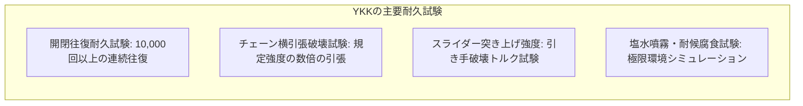

- **チェーン横引張強さ（Chain Crosswise Strength）**：噛み合ったチェーンを左右に引きちぎる試験。エレメントが外れる前にテープ生地が破断するレベルの結合力を保証。
- **スライダー突き上げ強さ（Slider Locking Strength）**：ロックされたスライダーを強制的に下から押し上げた際、内部ピンが破断する限界荷重を計測。
- **開閉往復耐久性（Reciprocating Durability）**：規定の荷重をスライダーにかけながら、毎分数十回の速度で**10,000回連続開閉**を繰り返し、務歯の摩耗量と操作トルクの変化を測定。

この狂気的なまでの品質管理があるからこそ、NASAの宇宙飛行士から過酷なエベレスト遠征隊、そして世界中のファストファッションに至るまで、全幅の信頼を勝ち得ているのである。

---

## 7. 極限環境のファスナー工学：水密・気密・宇宙服

日常のファスナーは「布と布をつなぐ」だけでよいが、特殊環境下では**「分子1個の漏洩も許されない」**究極の遮断壁として機能しなければならない。

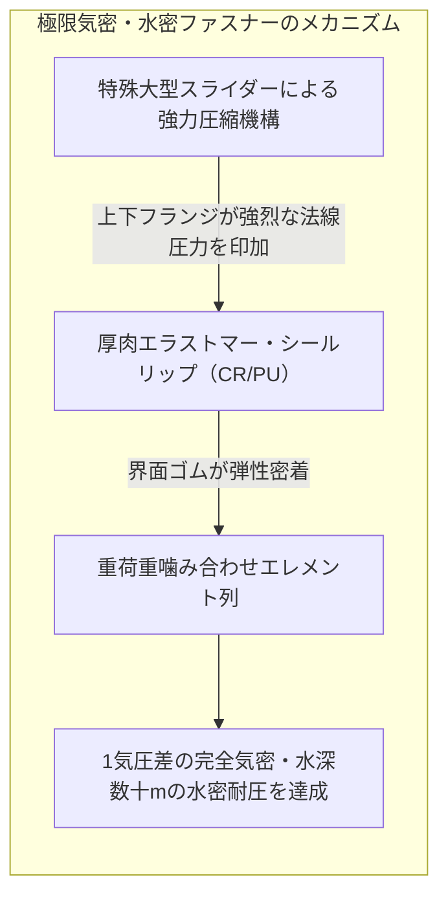

### 7.1 気密・水密ファスナー（Airtight / Watertight Zipper）
ダイビング用のドライスーツ、化学防護服（HAZMATスーツ）、災害用救命ボートなどに使用される。

- **構造の物理**：
  エレメントの外側を、クロロプレンゴム（ネオプレン）や高分子ポリウレタンの厚肉シーリングリップで完全に被覆する。
  スライダー内部のフランジが通過する際、エレメント同士を噛み合わせると同時に、左右のゴムリップ同士を強烈な法線応力で圧縮・密着させる。
- **性能限界**：
  内部と外部の圧力差が $100\text{ kPa}$（約1気圧）以上あっても、空気分子の透過を物理的に完全に遮断する。水密仕様では、水深数十メートルの水圧を受けても内部へ水滴を一切侵入させない。

### 7.2 アポロ宇宙服からアルテミス計画へ：宇宙空間のファスナー
1969年、人類が初めて月面に降り立ったアポロ11号の宇宙服（A7L）。船外活動服の背面には、宇宙飛行士の生命を維持するための超高信頼性気密ファスナー（Proseal Zipper）が採用されていた。

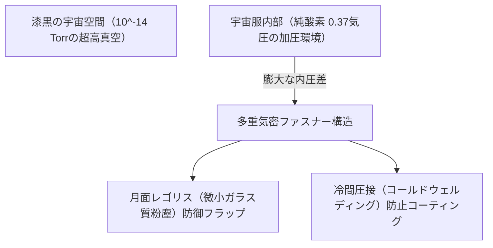

宇宙空間でファスナーを使用する場合、地上とは全く異なる極限の物理現象に対処しなければならない。
1. **真空による冷間圧接（Cold Welding）**：
   超高真空下では金属表面の酸化皮膜が失われ、金属同士が接触するだけで原子同士が結合して溶接されてしまう。これを防ぐため、エレメントには特殊な固体潤滑被膜（二硫化モリブデンや金コーティング）が施された。
2. **月面レゴリス（粉塵）の侵入対策**：
   月の砂（レゴリス）は風化していないためガラスのように鋭利であり、エレメントの隙間に数粒入るだけで噛み合わせがロックしてしまう。そのため、多重のベルクロ（面ファスナー）フラップとテフロン被覆による徹底的な防塵シーリングが施された。

---

## 8. トラブルシューティングの力学：なぜ噛み込み、外れ、壊れるのか

ファスナーを長年使っていると、誰もが「布を噛んで動かなくなる」「真ん中からパッカーンと開いてしまう（バースト）」「引き手が折れる」といったトラブルに遭遇する。これらの現象も、力学的な破綻プロセスとして完全に説明できる。

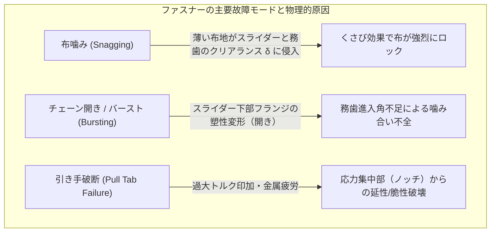

### 8.1 布噛み（Fabric Snagging）の力学と正しい外し方
スライダーが薄い裏地などの布を巻き込んで動かなくなる現象。
- **メカニズム**：スライダーのガイドフランジとエレメントの隙間 $\delta$（通常 $0.1 \sim 0.2\text{ mm}$）に、柔軟な織物繊維が引き込まれる。スライダーを進めようとすると、エレメントが閉じる際の強大な圧縮力で布が務歯の間に挟み込まれ、強烈な摩擦くさびとなってスライダーをロックする。
- **工学的な対処法**：
  **絶対に力任せにスライダーを引いてはならない。** 無理に引くと布の繊維が断裂するだけでなく、スライダーの金属フランジが外側に塑性変形して広がり、スライダー自体が永久に変形してしまう。
  正解は、**「挟まった布地を長手方向ではなく、ファスナーの進行方向と逆向き（水平外側）へ引っ張りながら、スライダーをわずかに逆方向へ小刻みに揺すって隙間を作る」**ことである。

### 8.2 ファスナーが真ん中から勝手に開く「バースト現象」の真因
「スライダーを閉めたはずなのに、後ろから口を開けてバラバラに外れてしまう」という現象。多くの人は「務歯（歯）がすり減って壊れた」と誤解するが、**真の原因の90%以上は「スライダー側壁（フランジ）の開き」**にある。

スライダーは数千回の開閉や洗濯の衝撃により、下部の出口フランジが外側へコンマ数ミリ押し広げられてしまう。
スライダー出口の幅 $W_m$ が正規の値より広がると、エレメントを中央線まで完全に押し込み切ることができなくなり、噛み合い深さ $h_{\text{engage}}$ が不足する。

$$h_{\text{engage}} < h_{\text{critical}}$$

この状態で外部からわずかな横引張力が加わると、臨界噛合深さを下回っているため、ドミノ倒しのように次々とエレメントが外れてしまう。
**応急処置**：ラジオペンチを用い、スライダーの後端（出口側）の左右フランジを、務歯を挟まない状態で**ほんのわずか（0.1mm程度）上下・左右から均等につまんで隙間を狭める**と、正常な噛み合い寸法が復活し、劇的に直ることが多い。

### 8.3 メンテナンス工学：固体潤滑剤の威力
金属ファスナーの動きが重くなった場合、機械油（5-56やミシン油など）をスプレーするのは避けるべきである。液体油は布テープに染み込んでシミを作るだけでなく、空気中のホコリや砂塵を吸着し、研磨剤となってエレメントを急速に摩耗させるからである。
最も安全で効果的なのは**「固体潤滑（Solid Lubrication）」**である。
- **鉛筆の芯（グラファイト / 黒鉛：$\text{C}$）**：エレメントの表面に鉛筆の芯をこすりつける。層状結晶構造を持つグラファイトが微小な劈開すべりを起こし、理想的なドライ潤滑膜を形成する。
- **パラフィンワックス（ロウソク）**：固形ロウをエレメントに塗り、スライダーを数回往復させる。衣類を汚さず、滑らかな開閉感が持続する。

---

## 9. ファスナーの未来：スマートマテリアルと循環経済

21世紀のファスナー工学は、単なる留め具を超えて、環境適応とエレクトロニクスの領域へと急速に進化している。

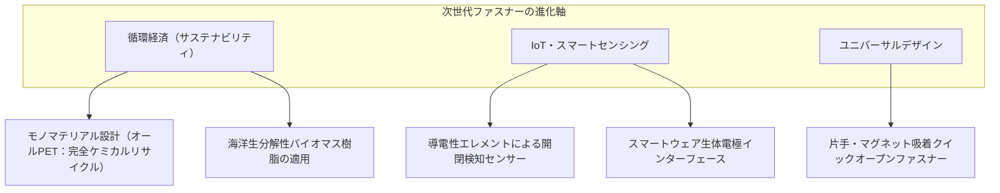

### 9.1 モノマテリアル化（単一素材化）による完全リサイクル
現代のアパレル産業における最大の課題は、衣服のリサイクル性である。従来の衣類は、生地がポリエステルでも、ファスナーに金属やPOM樹脂が混ざっているため、破砕・リサイクルの前に手作業でファスナーを切り落とさなければならなかった。
現在実用化が進んでいるのが、テープ、エレメント、芯紐、さらにはスライダーに至るまで、**部品の100%を同一素材（PET）のみで製造する「モノマテリアル・ファスナー」**である。これにより、衣服をファスナーごと丸ごと粉砕し、ケミカルリサイクルで新品の樹脂へと再生する完全なクローズドループ循環が可能となる。

### 9.2 デジタル連動・スマートファスナー
エレメントやテープに微細な導電性カーボンナノチューブや金属繊維を混練し、ファスナー自体を電気回路のスイッチやアンテナとして機能させる技術が開発されている。
ファスナーの開閉位置をミリ単位で検出し、作業員の防護服の着用状態を遠隔監視する安全管理システムや、スマートジャケットの開閉によって体温調節ファンやスマートフォンの音楽再生を直感的にコントロールするウェアラブルUIへの応用が進んでいる。

---

## 結論：小さき金属片と樹脂の連鎖が紡ぐ、人類の安全と日常の基盤

私たちが毎朝、何気なく引き上げているジーンズのファスナー。
そこには、100年以上前にエジソンやジャドソンが挑み、サンドバックが幾何学的ひらめきによって突破した機械工学の歴史が凝縮されている。

1. **幾何学的拘束と自己ロック**：横方向には数百ニュートンの外力にビクともせず、長手方向のスライダー移動には数ニュートンで可逆的に解放される美しい力学の非対称性。
2. **ミクロン精度の調和**：100分の5ミリメートルの公差で整列するエレメント、千鳥配置で三次元的に滑り込むカム運動。
3. **極限を支える信頼性**：宇宙服の真空封止から、日々の衣服を支えるYKKの徹底した垂直統合と品質の極致。

ファスナーは、人類が発明した最も小型で、最も安価で、最も信頼性の高い**「可逆的機械結合インターフェース」**である。次に指先でスライダーを引くとき、その小さな金属の箱の中で起きている、ミクロの幾何学と物理学の華麗なダンスに思いを馳せてみてほしい。
