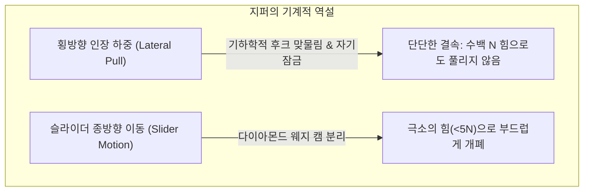
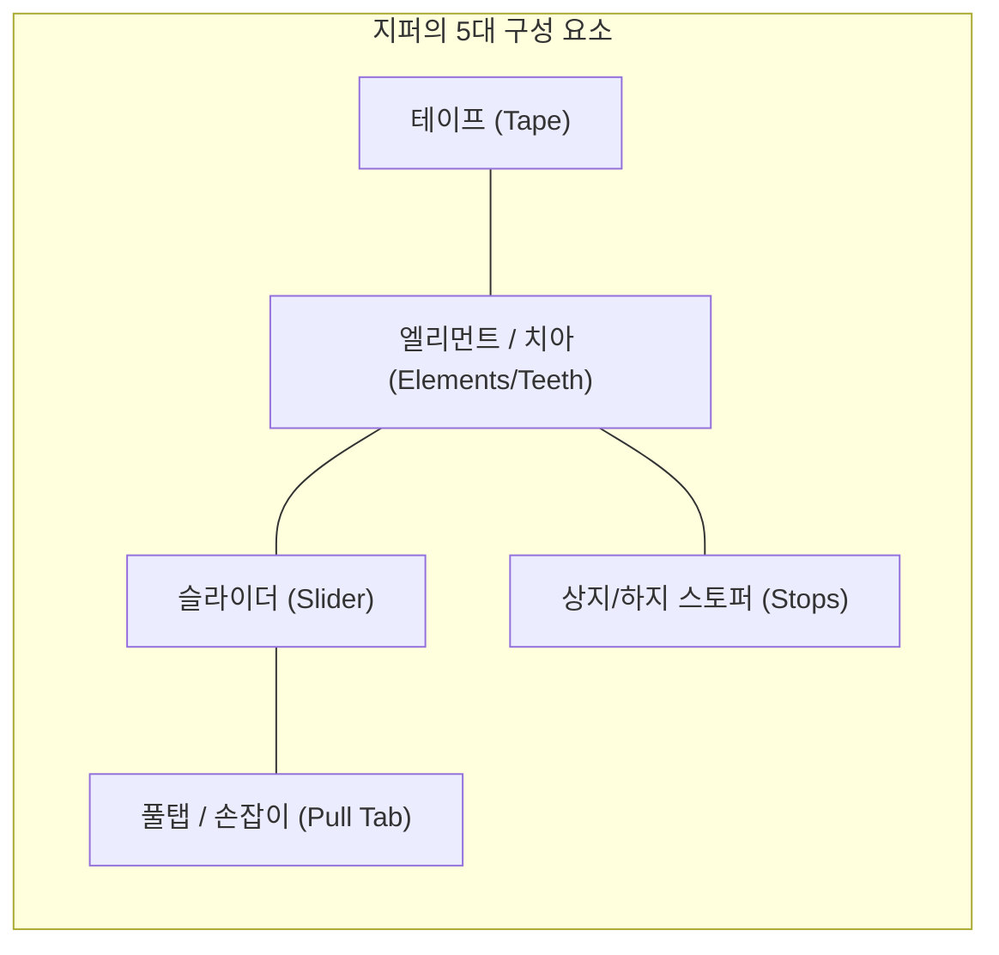
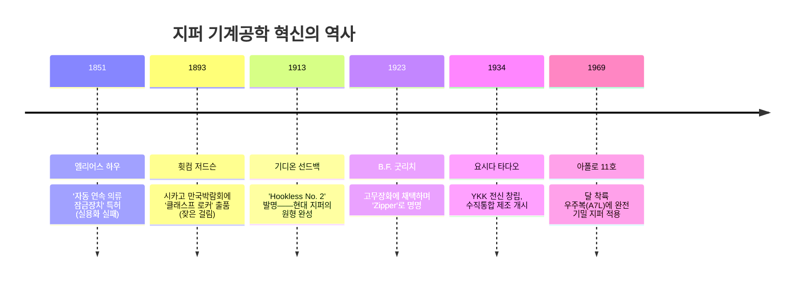
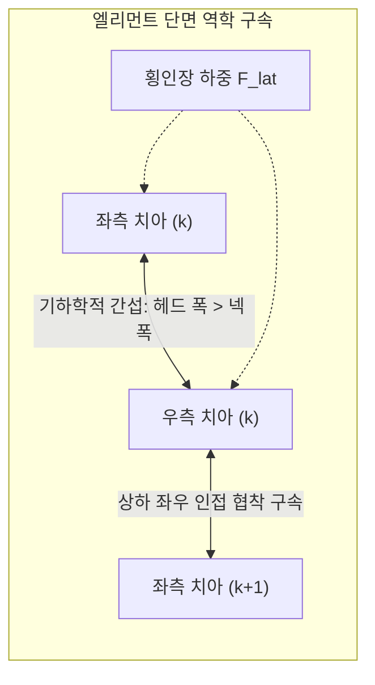

## 서론: 일상 속 가역적 기계 결합의 역설

우리가 매일 착용하는 다운 재킷, 청바지, 배낭, 텐트, 그리고 화학 방호복에 이르기까지 지퍼는 어디에나 존재합니다. 전 세계 연간 생산량은 수백억 미터에 달해 지구를 수백 바퀴 감을 수 있을 정도입니다.

기계공학적 관점에서 지퍼는 매우 흥미로운 **결합 비대칭성(Engagement Asymmetry)**을 보여줍니다.

좌우 테이프를 잡고 양옆으로 온 힘을 다해 잡아당겨도 정상적인 지퍼는 결코 풀리지 않습니다. 그러나 손가락으로 작은 슬라이더를 잡고 살짝 당기면, 거짓말처럼 부드럽게 풀리거나 완벽한 질서로 맞물립니다. 특정 방향의 힘에는 바위처럼 버티고 직교 방향의 미소한 힘에는 유체처럼 반응하는 이 메커니즘의 이면에는 **기하학적 간섭, 마찰각 자기잠금, 3차원 캠 운동학, 그리고 $\pm 0.005\text{ mm}$의 초정밀 공차**가 숨어 있습니다.

---

## 1. 지퍼의 구조와 5대 핵심 요소

| 부품명 | 공학적 기능 | 대표 재료 및 제조 공정 |
| :--- | :--- | :--- |
| **엘리먼트 (치아)** | 교대로 맞물려 횡방향 하중을 견디는 돌기 단위체 | 황동, 양백, 알루미늄, 폴리아세탈(POM), 폴리에스터(PET) |
| **테이프 (Tape)** | 엘리먼트를 정확한 피치로 고정하는 섬유 기재 | 고강도 폴리에스터 직물/편물, 심선(Cord) 일체화 |
| **슬라이더 (Slider)** | 엘리먼트를 3차원 각도로 유도하거나 분리하는 이동체 | 아연 합금 다이캐스팅(Zamak), 황동 프레스, 사출성형 POM |
| **풀탭 (Pull Tab)** | 손가락의 조작력을 슬라이더 본체로 전달하는 레버 | 아연 합금, 프레스 스틸, 가죽, 고무 |
| **스토퍼 (Stops)** | 슬라이더의 이탈을 방지하는 이동 한계 멈춤쇠 | 금속 압착 클램프, 초음파 융착 수지, 사출 핀/박스 |

---

## 2. 지퍼의 역사: 하우에서 선드백의 완성까지

1913년 스웨덴 출신 미국 엔지니어 **기디온 선드백(Gideon Sundback)**은 기존의 고리 연결 방식을 버리고, **"스푼 모양의 미세한 돌기와 오목 홈을 테이프 가장자리에 조밀하게 배열하는"** 기하학적 설계를 확립(Hookless No. 2)하며 현대 지퍼 역사의 문을 열었습니다.

---

## 3. 맞물림 역학: 왜 횡방향으로 당겨도 열리지 않는가

좌우 엘리먼트는 테이프 위에서 반 피치($p/2$)씩 어긋난 **지그재그(Staggered) 배열**을 이룹니다.

### 3.1 기하학적 간섭 조건
엘리먼트 헤드 폭 $W_h$는 넥 폭 $W_n$보다 큽니다:

$$W_h > W_n, \quad W_h > W_p - 2\delta$$

횡인장력 $F_{\text{lat}}$ 작용 시 접촉면 법선 응력은:

$$N = \frac{F_{\text{lat}}}{\cos \theta_c}$$

고강성 금속이나 엔지니어링 플라스틱(POM)이 항복응력을 넘지 않는 한, 탄성 변형만으로 헤드가 넥을 통과하는 것은 불가능합니다.

### 3.2 마찰각과 자기잠금 (Self-Locking)
접촉면에 역경사각 $\beta$가 적용되어 정지마찰각 $\phi = \arctan(\mu_s)$ 이하일 때, 횡방향으로 세게 당길수록 엘리먼트들이 서로를 중심축으로 더 강하게 끌어당기는 힘이 발생합니다:

$$\sum F_x = F_{\text{lat}} - 2 \left( N \sin \beta + F_f \cos \beta \right) \le 0$$

---

## 4. 슬라이더 기하학: Y자 유로와 다이아몬드 웨지

- **닫힘 과정**: 슬라이더 내부 플랜지가 엘리먼트를 $10^\circ \sim 15^\circ$의 각도로 3차원 회전시키며 반 피치 어긋나게 위에서 아래로 포켓에 밀어 넣습니다.
- **열림 과정**: 중앙의 **다이아몬드 웨지**가 맞물림 경계면에 쐐기로 작용합니다. 슬라이더 당김 힘 $F_{\text{pull}}$에 의한 분리력은:

$$F_w = \frac{F_{\text{pull}}}{2 \tan \gamma}$$

웨지는 수백 개의 치아가 아닌 **단 1쌍의 치아만을 집중적으로 비틀어 분리**하므로, 극히 적은 조작력으로 매끄럽게 열립니다.

---

## 5. 지퍼 3대 분류 비교

| 구분 | 금속 지퍼 (Metal) | 비슬론 지퍼 (Vislon / POM) | 코일 지퍼 (Coil / PET) |
| :--- | :--- | :--- | :--- |
| **무게** | 무거움 (기준) | 약 40% 경량화 | 가장 가벼움 (60% 경량화) |
| **유연성** | 낮음 (직선형에 적합) | 중간 | 매우 뛰어남 (곡면 추종) |
| **내식성** | 녹/부식 위험 존재 | 해수에 완전 내식 | 화학물질 및 수분에 완벽 내성 |
| **주요 용도** | 청바지, 가죽 재킷, 명품 가방 | 스키웨어, 해양 스포츠, 작업복 | 스포츠웨어, 텐트, 배낭, 침낭 |

---

## 6. YKK의 수직통합 제조 철학

세계 고급 지퍼 시장의 80% 이상을 장악한 **YKK**는 구리 제련부터 플라스틱 중합, 방적, 염색은 물론 **초고속 자동 조립 설비와 금형까지 사내 '공기기술본부'에서 100% 자체 설계·제작**합니다. 기계를 외부에 의존하지 않는 철저한 기술 블랙박스화가 $\pm 0.005\text{ mm}$의 균일한 초정밀 품질을 보장합니다.

---

## 7. 극한 환경: 우주복과 기밀 지퍼

아폴로 11호 우주복(A7L)과 심해 다이빙 드라이슈트에서는 단 하나의 공기 분자 유출도 허용되지 않습니다:
- **엘라스토머 실링 립**: 엘리먼트 외측을 두꺼운 네오프렌 러버로 감싸고 슬라이더의 강한 법선 압축력으로 밀착시켜 1기압 차의 진공 압력을 밀폐합니다.
- **진공 냉간압접 방지**: 우주 진공 속에서 금속 원자가 융착되는 현상을 막기 위해 금 도금이나 이황화몰리브덴($\text{MoS}_2$) 고체 윤활 코팅을 적용합니다.

---

## 결론

지퍼는 일상 속에 숨겨진 가장 성공적인 **가역적 기계 인터페이스**입니다. 접촉 역학, 3D 캠 기구학, 고분자 재료과학이 직조해 낸 마이크로미터 정밀공학의 기적을 매일의 옷깃에서 경험하고 있는 것입니다.
