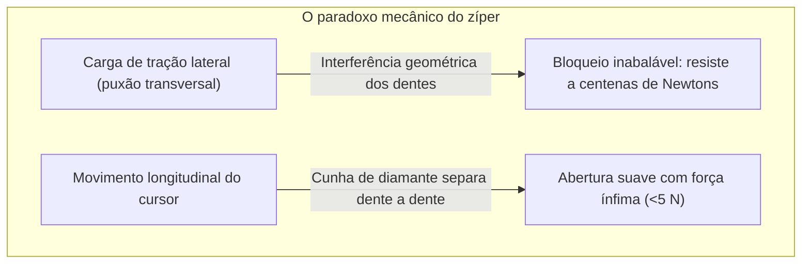
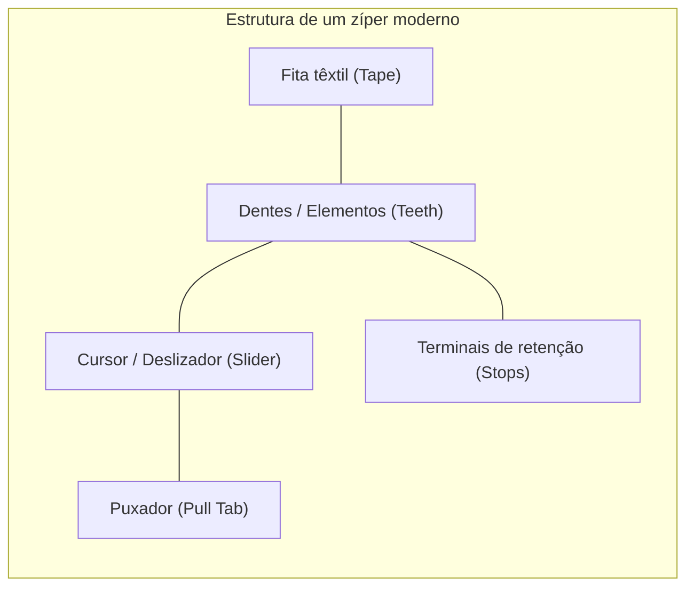
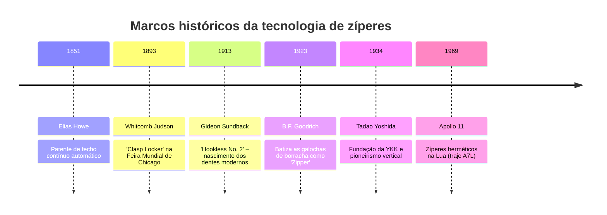
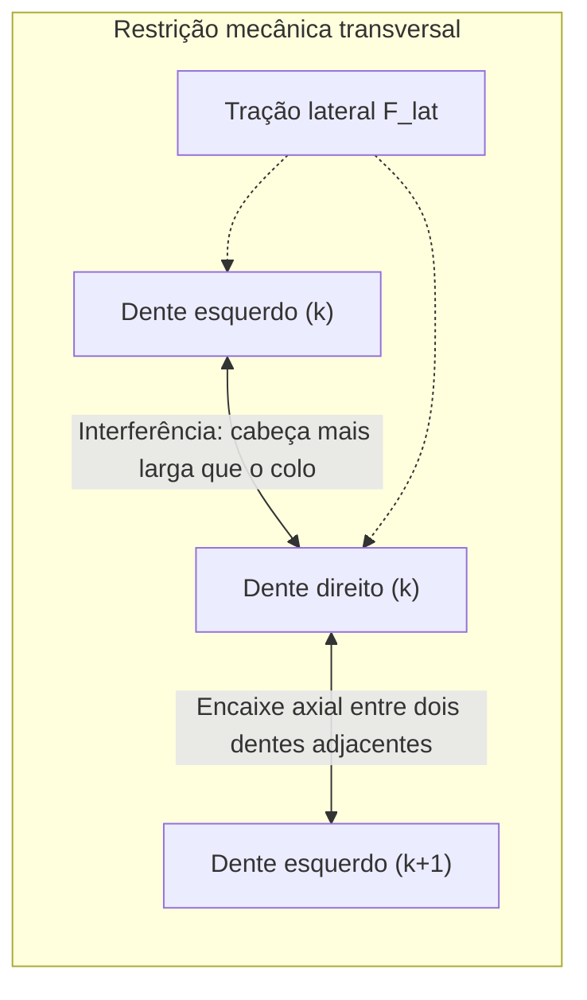
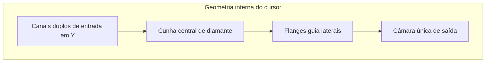

## Introdução: O paradoxo do acoplamento mecânico assimétrico e reversível

Em nosso dia a dia, os zíperes (fechos de correr) estão em toda parte: jaquetas, calças, mochilas, barracas de camping e até trajes de proteção química. Bilhões de metros de zíperes são movimentados todos os anos em todo o mundo.

Sob a ótica da engenharia mecânica, o zíper apresenta um fenômeno surpreendente: **a assimetria do acoplamento mecânico**.

Se puxarmos lateralmente as fitas de tecido com toda a nossa força, um zíper em bom estado jamais se abrirá. No entanto, ao segurar o minúsculo cursor entre os dedos e movê-lo, os dentes se soltam como seda. Essa dualidade resulta de **interferência geométrica**, **autobloqueio por atrito**, **cinemática de cames tridimensionais** e **tolerâncias de fabricação inferiores a $\pm 0,005\text{ mm}$**.

---

## 1. Anatomia e componentes essenciais

| Componente | Função de engenharia | Material e fabricação |
| :--- | :--- | :--- |
| **Dentes (Elementos)** | Ressaltos mecânicos que se acoplam alternadamente | Latão, alpaca, poliacetal (POM), poliéster (PET) |
| **Fita têxtil (Tape)** | Substrato que mantém o passo exato dos dentes | Poliéster multifilamento tecido com cordão de reforço |
| **Cursor (Slider)** | Canalizador que induz o ângulo de engate/desengate | Zamak injetado, latão estampado, POM moldado |
| **Puxador (Pull Tab)** | Alavanca ergonômica que transmite a força dos dedos | Zamak, aço estampado, couro, borracha |
| **Terminais (Stops)** | Batentes mecânicos que impedem o descarrilamento | Grampos metálicos prensados, polímero ultrassônico |

---

## 2. Evolução histórica: De Howe a Gideon Sundback

Em 1913, o engenheiro sueco-americano **Gideon Sundback** abandonou os ganchos convencionais e concebeu minúsculas saliências e cavidades em forma de concha montadas em alta densidade nas fitas têxteis (**Hookless No. 2**).

---

## 3. Mecânica do contato: Por que a tração transversal não abre o zíper

Os dentes são dispostos em padrão escalonado, defasados em meio passo ($p/2$).

### 3.1 Condição de interferência
A largura da cabeça $W_h$ é maior que a do colo $W_n$:

$$W_h > W_n, \quad W_h > W_p - 2\delta$$

Sob tração lateral $F_{\text{lat}}$, a tensão normal de contato é:

$$N = \frac{F_{\text{lat}}}{\cos \theta_c}$$

Para escapar transversalmente, a cabeça do dente teria que alargar plasticamente o colo de latão ou POM, o que é estruturalmente impossível sob cargas de uso.

### 3.2 Efeito autobloqueante
Com ângulo de rebaixo $\beta$ inferior ao ângulo de atrito estático $\phi = \arctan(\mu_s)$:

$$\sum F_x = F_{\text{lat}} - 2 \left( N \sin \beta + F_f \cos \beta \right) \le 0$$

Quanto maior a força lateral puxando a fita, mais os dentes se comprimem mutuamente.

---

## 4. Cinemática do cursor: Canais em Y e cunha de diamante

- **Fechamento**: O cursor inclina os dentes em um ângulo tridimensional de $10^\circ \sim 15^\circ$, permitindo que caiam por cima nos bolsões opostos antes de nivelarem horizontalmente.
- **Abertura**: A **cunha de diamante** atua entre os dentes. A força lateral $F_w$ gerada pela tração $F_{\text{pull}}$ é:

$$F_w = \frac{F_{\text{pull}}}{2 (\tan \gamma + \mu_k)}$$

A cunha atua sobre **apenas um par de dentes por vez**, permitindo a abertura com esforço mínimo.

---

## 5. Principais famílias de zíperes

| Característica | Metálico (Metal) | Plástico injetado (Vislon / POM) | Espiral de náilon (Coil / PET) |
| :--- | :--- | :--- | :--- |
| **Peso** | Elevado (100%) | 40% mais leve | O mais leve (-60%) |
| **Flexibilidade** | Rígido, ideal para linhas retas | Médio | Altíssima flexibilidade 3D |
| **Corrosão** | Sujeito a oxidação e azinhavre | Imune à água salgada | Totalmente imune à umidade |
| **Aplicações** | Jeans, jaquetas de couro, bolsas | Esportes náuticos, esqui, EPIs | Mochilas, barracas, agasalhos |

---

## 6. O império YKK: Integração vertical radical

A japonesa **YKK** produz mais de 40% dos zíperes mundiais e 80% do mercado de luxo. A chave do seu sucesso é a **verticalização absoluta**:
- Fundição própria de ligas de latão em Kurobe;
- Polimerização e fiação de poliéster;
- **Projeto e fabricação interna de 100% do maquinário e moldes**, operados como caixas-pretas proprietárias.

---

## 7. Ambientes extremos e trajes espaciais

Em trajes espaciais Apollo (A7L) e roupas de mergulho profundo:
- **Lábios de vedação elastoméricos**: Borracha de neoprene comprimida pelo cursor garante barreira contra 1 atm de vácuo.
- **Revestimento antissoldagem a frio**: No vácuo estelar, metais limpos soldam-se instantaneamente; dentes espaciais recebem banho de ouro ou filme lubrificante de $\text{MoS}_2$.

---

## Conclusão

O zíper é a interface mecânica reversível mais brilhante e disseminada do mundo moderno, unindo mecânica de contato, cinemática espacial e fabricação de extrema precisão.
