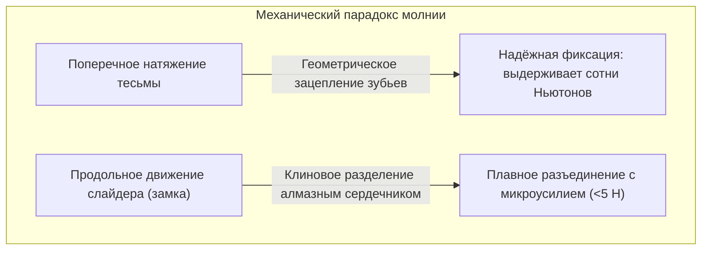
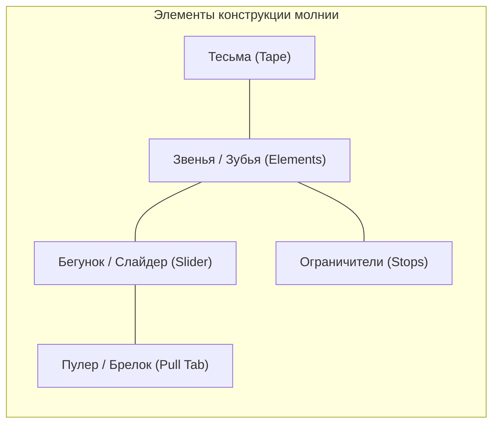
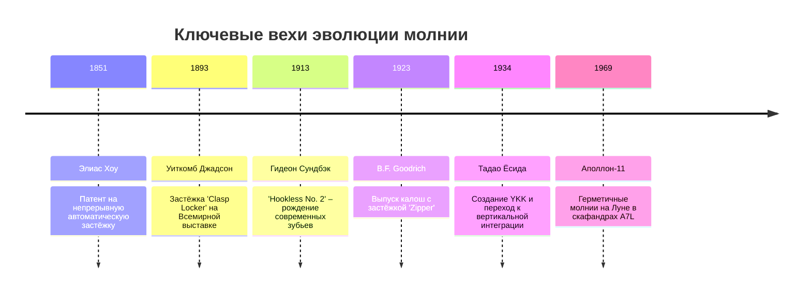
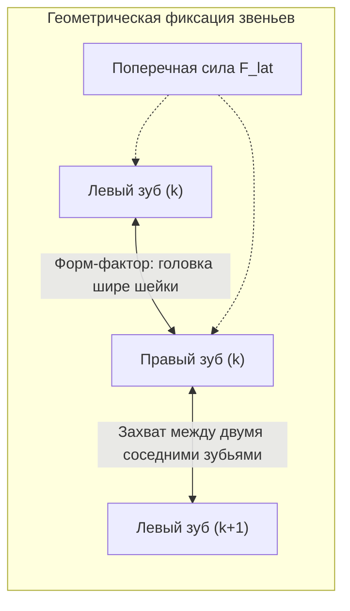
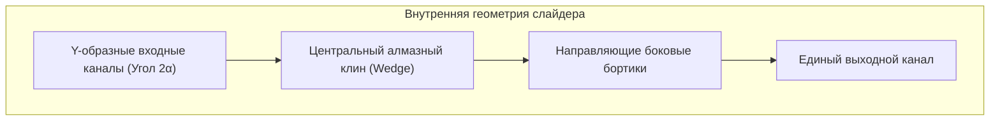

## Введение: Парадокс обратимого механического зацепления

Оглянитесь вокруг: куртки, джинсы, рюкзаки, палатки, защитные костюмы — везде работают застёжки-молнии. Каждый год мировая промышленность производит десятки миллиардов метров молний.

С точки зрения прикладной механики застёжка-молния демонстрирует поразительную **асимметрию зацепления**:

Если потянуть тесьму в стороны, исправная молния ни за что не расцепится. Однако стоит взяться за миниатюрный бегунок, как звенья распадаются без малейшего сопротивления. За этим стоят **геометрический форм-фактор**, **угол трения самоторможения**, **пространственная кулачковая кинематика** и **микропрокатные допуски порядка $\pm 0,005\text{ мм}$**.

---

## 1. Анатомия застёжки-молнии

| Компонент | Инженерная функция | Материалы и технологии |
| :--- | :--- | :--- |
| **Звенья (Зубья)** | Выступы, поочерёдно входящие в зацепление | Латунь, нейзильбер, полиацеталь (POM), полиэстер (PET) |
| **Тесьма (Tape)** | Текстильная основа с утолщённым кордом | Полиэфирное плетение с запрессованным шнуром |
| **Бегунок (Slider)** | Направляет звенья под заданным углом | Литьё цинкового сплава (Zamak), штампованная латунь |
| **Пулер (Pull Tab)** | Рычаг для приложения усилия пальцев | Цинковый сплав, пружинная сталь, кожа |
| **Ограничители (Stops)** | Стопоры, предотвращающие сход замка | Металлические зажимы, ультразвуковая пайка полимеров |

---

## 2. История изобретения: От Хоу до Гидеона Сундбэка

В 1913 году инженер шведского происхождения **Гидеон Сундбэк** предложил революционную схему: взамен капризных крючков он создал чашеобразные миниатюрные выступы и углубления, плотно посаженные вдоль текстильной тесьмы (**Hookless No. 2**).

---

## 3. Механика контакта: Почему поперечная сила не разрывает цепь

Звенья расположены на противоположных лентах в шахматном порядке с шагом $p/2$.

### 3.1 Геометрическое условие неразъёмности
Ширина головки $W_h$ превышает ширину шейки $W_n$:

$$W_h > W_n, \quad W_h > W_p - 2\delta$$

При поперечном натяжении $F_{\text{lat}}$ нормальная сила контакта равна:

$$N = \frac{F_{\text{lat}}}{\cos \theta_c}$$

Для разрыва потребовалось бы пластически деформировать металл зубьев, что невозможно при штатных нагрузках.

### 3.2 Эффект самоторможения
Благодаря обратному скосу $\beta < \phi = \arctan(\mu_s)$:

$$\sum F_x = F_{\text{lat}} - 2 \left( N \sin \beta + F_f \cos \beta \right) \le 0$$

Чем сильнее тянут застёжку поперек, тем плотнее звенья прижимаются к оси смыкания.

---

## 4. Кинематика слайдера: 3D-каналы и алмазный клин

- **Закрытие**: Бортики бегунка наклоняют звенья в пространстве на $10^\circ \sim 15^\circ$, направляя их сверху в карманы противоположных звеньев.
- **Открытие**: Центральный **алмазный клин** раздвигает звенья. Сила размыкания $F_w$ равна:

$$F_w = \frac{F_{\text{pull}}}{2 (\tan \gamma + \mu_k)}$$

Клин воздействует **только на одну пару звеньев единовременно**, сводя усилие руки к минимуму.

---

## 5. Основные типы застёжек-молний

| Тип | Металлическая (Metal) | Тракторная (Vislon / POM) | Спиральная (Coil / PET) |
| :--- | :--- | :--- | :--- |
| **Масса** | Тяжёлая (100%) | На 40% легче | Самая лёгкая (-60%) |
| **Гибкость** | Низкая, для прямых швов | Средняя | Исключительная гибкость |
| **Коррозия** | Риск окисления и патины | Полная стойкость к морской воде | Полная стойкость к влаге |
| **Сферы применения** | Джинсы, кожаные куртки | Лыжная и морская одежда | Рюкзаки, палатки, спорт |

---

## 6. Феномен YKK: Тотальная вертикальная интеграция

Японская корпорация **YKK** держит более 80% рынка качественной фурнитуры. Секрет её недосягаемости — **полная вертикальная независимость**:
- Собственная плавка латунных слитков в Куробе;
- Химический синтез полиэфирных гранул;
- **100% самостоятельная разработка и выпуск всех станков и штампов**, которые не продаются на сторону.

---

## 7. Экстремальные применения: Скафандры Apollo

В скафандрах Apollo A7L и глубоководных гидрокостюмах молния обеспечивает барьер против вакуума:
- **Эластомерные лепестки**: Неопреновые уплотнители обжимаются замком, исключая утечку воздуха.
- **Защита от холодной сварки**: В вакууме чистый металл схватывается диффузией, поэтому звенья покрывают золотом или твердой смазкой из $\text{MoS}_2$.

---

## Заключение

Застёжка-молния — это шедевр механики контакта, кинематики направляющих и прецизионного серийного машиностроения.
