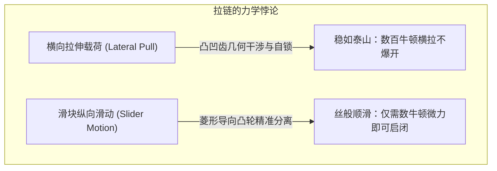
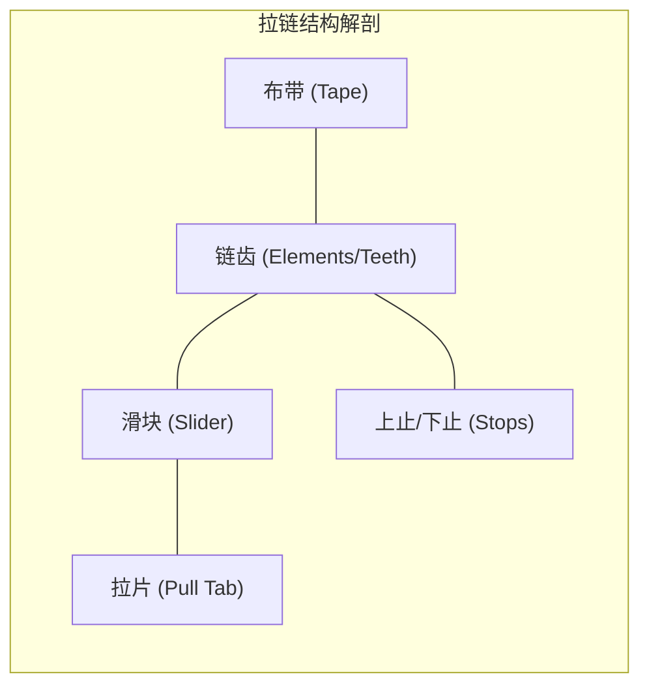
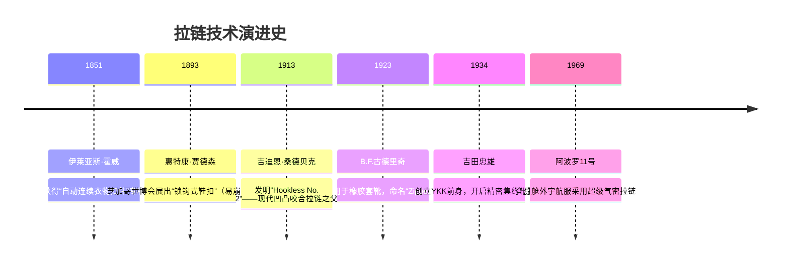
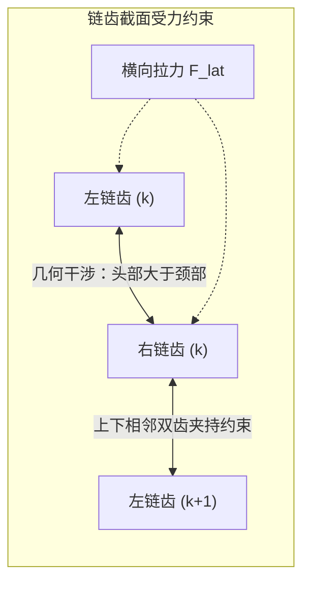

## 引言：日常衣物中的可逆机械结合悖论

环顾我们的衣着与装备：羽绒服前襟、牛仔裤裤档、双肩包、帐篷乃至宇航服，拉链无处不在。全球每年生产的拉链长达数百亿米，足以环绕地球上百圈。

在机械工程师眼中，拉链展现了一种令人叹为观止的物理特性——**结合非对称性（Mechanical Engagement Asymmetry）**。

双手抓住拉链左右布带向两侧用力拉扯，正常的拉链绝不会松脱；然而，只需两指捏住几毫米大小的滑块轻轻一拉，链齿便瞬间依次解开或精确咬合。这种对某一方向载荷极度抗拒、对另一垂直方向微小驱动却顺从解脱的机制，凝聚了**接触力学、自锁摩擦角、三维凸轮运动学**以及**微米级加工公差**的完美平衡。

---

## 1. 拉链的解剖学：五大核心构造

| 部件名称 | 工程功能 | 典型材料与工艺 |
| :--- | :--- | :--- |
| **链齿（Elements）** | 凸起与凹槽相嵌、承受横向拉力的机械咬合单元 | 黄铜、白铜、聚甲醛（POM）、聚酯（PET） |
| **布带（Tape）** | 以精准节距固定链齿，供缝合于衣物的基础承载体 | 聚酯长丝机织或经编织带，边缘织入加强筋芯线 |
| **滑块（Slider）** | 引导链齿按特定空间倾角咬合或强行分离的移动壳体 | 锌合金压铸（Zamak）、冲压黄铜、注塑POM |
| **拉片（Pull Tab）** | 传递手指操作力的力臂杠杆 | 锌合金、冲压钢板、皮革、防撕裂尼龙 |
| **止挡（Stops）** | 限制滑块行程，防止脱轨的机械止动件 | 冲压金属爪、超声波熔接树脂、注塑插销方块 |

---

## 2. 发展简史：从霍威的构想到桑德贝克的飞跃

1913年，瑞典裔美国工程师**吉迪恩·桑德贝克（Gideon Sundback）**彻底抛弃了钩眼钩套的思路，转而采用“杯状凸起与小凹坑在布带边缘交替嵌合”的全新几何，制成了现代拉链的雏形**Hookless No. 2**。

---

## 3. 咬合力学：为什么横向拉扯绝对拉不开

左右链齿在布带上呈**交错排列（Staggered arrangement）**，左右错开半个节距（$p/2$）。

### 3.1 几何干涉条件
链齿头部宽度 $W_h$ 大于颈部狭窄区 $W_n$：

$$W_h > W_n, \quad W_h > W_p - 2\delta$$

当外力 $F_{\text{lat}}$ 横向拉伸布带时，链齿间的接触正应力为：

$$N = \frac{F_{\text{lat}}}{\cos \theta_c}$$

要想在横向拉脱，必须强行拉开金属或POM的高刚性颈部，在屈服极限内这是绝对无法发生的。

### 3.2 摩擦自锁与倒锥设计
接触面带有反向倾角 $\beta$。若接触角小于静摩擦角 $\phi = \arctan(\mu_s)$，横向拉力越大，界面法向压力越大，摩擦力反而将链齿牢牢压向咬合中心线，形成绝对自锁：

$$\sum F_x = F_{\text{lat}} - 2 \left( N \sin \beta + F_f \cos \beta \right) \le 0$$

---

## 4. 滑块凸轮机构：Y型流道与菱形劈刀

- **闭合时**：滑块内部侧翼引导链齿呈 $10^\circ \sim 15^\circ$ 的三维倾角，从斜上方旋转扣入对方口袋，在出口处锁定自由度。
- **开启时**：滑块中心的**菱形劈刀**插入链齿结合面。拉力 $F_{\text{pull}}$ 产生的横向分力为：

$$F_w = \frac{F_{\text{pull}}}{2 \tan \gamma}$$

劈刀每次**只对最前线的一对链齿**施加微小旋转力矩，使其脱出嵌合区，实现极低阻力开锁。

---

## 5. 三大拉链门类对比

| 类别 | 金属拉链 (Metal) | 树脂注塑 (Vislon / POM) | 尼龙线圈 (Coil / PET) |
| :--- | :--- | :--- | :--- |
| **重量** | 重（基准） | 减轻约 40% | 最轻（减轻 60%） |
| **弯曲柔韧性** | 较低，适合直线配置 | 中等 | 极佳，适合三维曲线与曲面 |
| **耐候抗腐蚀** | 有氧化铜绿与锈蚀风险 | 完全耐海水与盐雾腐蚀 | 耐化学品与水解，弹性好 |
| **典型用途** | 牛仔裤、皮夹克、高档箱包 | 滑雪服、救生衣、户外工装 | 运动服、帐篷、背包、睡袋 |

---

## 6. YKK与极致垂直整合制造

日本富山县黑部市的 **YKK** 占据全球拉链高端市场80%以上份额。其核心护城河是**“彻底的端到端垂直整合”**：
- 自行采购铜锭熔炼特种合金；
- 自行聚合聚酯切片并精控染色水质；
- **绝不在市面上购买成型机**，全厂上万台超高速自动化组装机、精密模具与光学检测设备，全部由内部“工机技术本部”研发制造，筑起坚不可摧的技术黑匣子壁垒。

---

## 7. 极端环境与宇航服气密拉链

在阿波罗登月服（A7L）与深海潜水干衣中，拉链必须充当抗衡真空气压的绝对屏障：
- **弹性唇形密封面**：在链齿外部包裹厚氯丁橡胶密封唇，滑块通过法向强压迫使橡胶弹性贴合，阻断空气泄漏。
- **防冷焊涂层**：超高真空中金属接触极易发生原子级“冷焊”，太空拉链齿表面必须镀金或涂覆二硫化钼（$\text{MoS}_2$）固体润滑膜。

---

## 结论

一根小小的拉链，是微米级接触力学、空间凸轮运动学、高分子材料科学与现代精密制造的集大成者。它是人类工商业史上最精妙、最普及的可逆机械连接奇迹。
