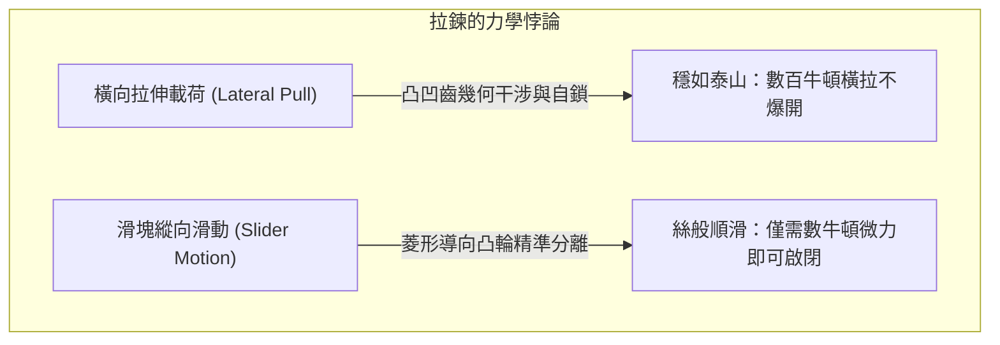
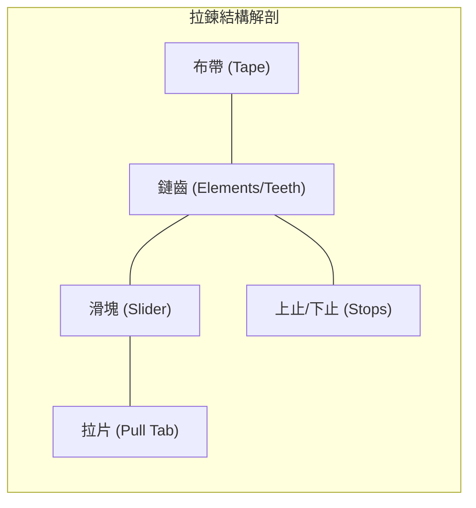
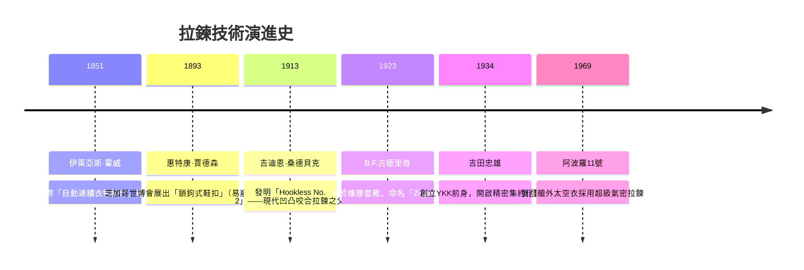
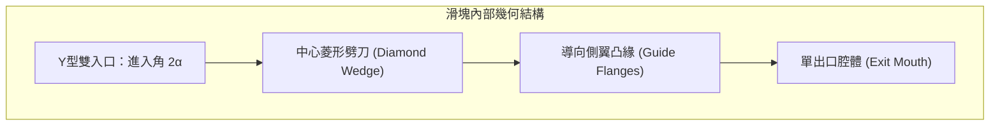

## 引言：日常衣物中的可逆機械結合悖論

環顧我們的衣著與裝備：羽絨外套前襟、牛仔褲褲檔、雙肩背包、帳篷乃至太空衣，拉鍊無處不在。全球每年生產的拉鍊長達數百億公尺，足以環繞地球上百圈。

在機械工程師眼中，拉鍊展現了一種令人嘆為觀止的物理特性——**結合非對稱性（Mechanical Engagement Asymmetry）**。

雙手抓住拉鍊左右布帶向兩側用力拉扯，正常的拉鍊絕不會鬆脫；然而，只需兩指捏住幾毫米大小的滑塊輕輕一拉，鏈齒便瞬間依次解開或精確咬合。這種對某一方向載荷極度抗拒、對另一垂直方向微小驅動卻順從解脫的機制，凝聚了**接觸力學、自鎖摩擦角、三維凸輪運動學**以及**微米級加工公差**的完美平衡。

---

## 1. 拉鍊的解剖學：五大核心構造

| 部件名稱 | 工程功能 | 典型材料與工藝 |
| :--- | :--- | :--- |
| **鏈齒（Elements）** | 凸起與凹槽相嵌、承受橫向拉力的機械咬合單元 | 黃銅、白銅、聚甲醛（POM）、聚酯（PET） |
| **布帶（Tape）** | 以精準節距固定鏈齒，供縫合於衣物的基礎承載體 | 聚酯長絲機織或經編織帶，邊緣織入加強筋芯線 |
| **滑塊（Slider）** | 引導鏈齒按特定空間傾角咬合或強行分離的移動殼體 | 鋅合金壓鑄（Zamak）、沖壓黃銅、注塑POM |
| **拉片（Pull Tab）** | 傳遞手指操作力的力臂槓桿 | 鋅合金、沖壓鋼板、皮革、防撕裂尼龍 |
| **止擋（Stops）** | 限制滑塊行程，防止脫軌的機械止動件 | 沖壓金屬爪、超聲波熔接樹脂、注塑插銷方塊 |

---

## 2. 發展簡史：從霍威的構想到桑德貝克的飛躍

1913年，瑞典裔美國工程師**吉迪恩·桑德貝克（Gideon Sundback）**徹底拋棄了鉤眼鉤套的思路，轉而採用「杯狀凸起與小凹坑在布帶邊緣交替嵌合」的全新幾何，製成了現代拉鍊的雛形**Hookless No. 2**。

---

## 3. 咬合力學：為什麼橫向拉扯絕對拉不開

左右鏈齒在布帶上呈**交錯排列（Staggered arrangement）**，左右錯開半個節距（$p/2$）。

### 3.1 幾何干涉條件
鏈齒頭部寬度 $W_h$ 大於頸部狹窄區 $W_n$：

$$W_h > W_n, \quad W_h > W_p - 2\delta$$

當外力 $F_{\text{lat}}$ 橫向拉伸布帶時，鏈齒間的接觸正應力為：

$$N = \frac{F_{\text{lat}}}{\cos \theta_c}$$

要想在橫向拉脫，必須強行拉開金屬或POM的高剛性頸部，在降伏極限內這是絕對無法發生的。

### 3.2 摩擦自鎖與倒錐設計
接觸面帶有反向傾角 $\beta$。若接觸角小於靜摩擦角 $\phi = \arctan(\mu_s)$，橫向拉力越大，界面法向壓力越大，摩擦力反而將鏈齒牢牢壓向咬合中心線，形成絕對自鎖：

$$\sum F_x = F_{\text{lat}} - 2 \left( N \sin \beta + F_f \cos \beta \right) \le 0$$

---

## 4. 滑塊凸輪機構：Y型流道與菱形劈刀

- **閉合時**：滑塊內部側翼引導鏈齒呈 $10^\circ \sim 15^\circ$ 的三維傾角，從斜上方旋轉扣入對方口袋，在出口處鎖定自由度。
- **開啟時**：滑塊中心的**菱形劈刀**插入鏈齒結合面。拉力 $F_{\text{pull}}$ 產生的橫向分力為：

$$F_w = \frac{F_{\text{pull}}}{2 \tan \gamma}$$

劈刀每次**只對最前線的一對鏈齒**施加微小旋轉力矩，使其脫出嵌合區，實現極低阻力開鎖。

---

## 5. 三大拉鍊門類對比

| 類別 | 金屬拉鍊 (Metal) | 樹脂注塑 (Vislon / POM) | 尼龍線圈 (Coil / PET) |
| :--- | :--- | :--- | :--- |
| **重量** | 重（基準） | 減輕約 40% | 最輕（減輕 60%） |
| **彎曲柔韌性** | 較低，適合直線配置 | 中等 | 極佳，適合三維曲線與曲面 |
| **耐候抗腐蝕** | 有氧化銅綠與銹蝕風險 | 完全耐海水與鹽霧腐蝕 | 耐化學品與水解，彈性好 |
| **典型用途** | 牛仔褲、皮夾克、高檔箱包 | 滑雪服、救生衣、戶外工裝 | 運動服、帳篷、背包、睡袋 |

---

## 6. YKK與極致垂直整合製造

日本富山縣黑部市的 **YKK** 佔據全球拉鍊高端市場80%以上份額。其核心護城河是**「徹底的端到端垂直整合」**：
- 自行採購銅錠熔煉特種合金；
- 自行聚合聚酯切片並精控染色水質；
- **絕不在市面上購買成型機**，全廠上萬台超高速自動化組裝機、精密模具與光學檢測設備，全部由內部「工機技術本部」研發製造，築起堅不可摧的技術黑盒子壁壘。

---

## 7. 極端環境與太空衣氣密拉鍊

在阿波羅登月服（A7L）與深海潛水乾衣中，拉鍊必須充當抗衡真空氣壓的絕對屏障：
- **彈性唇形密封面**：在鏈齒外部包裹厚氯丁橡膠密封唇，滑塊通過法向強壓迫使橡膠彈性貼合，阻斷空氣洩漏。
- **防冷焊塗層**：超高真空中金屬接觸極易發生原子級「冷焊」，太空拉鍊齒表面必須鍍金或塗覆二硫化鉬（$\text{MoS}_2$）固體潤滑膜。

---

## 結論

一根小小的拉鍊，是微米級接觸力學、空間凸輪運動學、高分子材料科學與現代精密製造的集大成者。它是人類工商業史上最精妙、最普及的可逆機械連接奇蹟。
