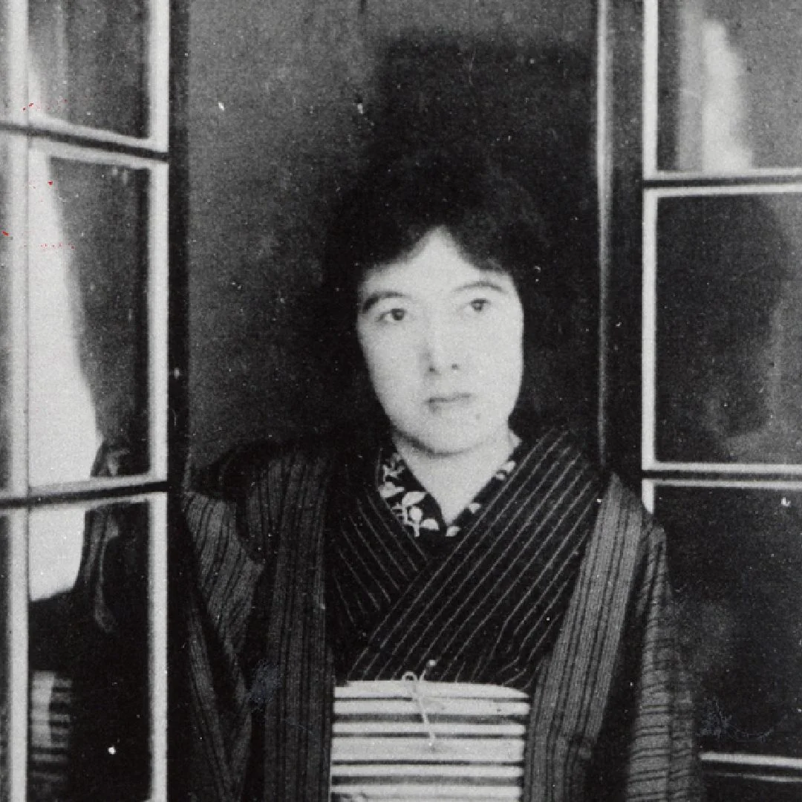

# 与谢野晶子

**“请君勿死”**

——叹在旅顺口包围军中的弟弟

啊，弟弟呀，我为你哭泣，
请你不要死，
你是家里最小的孩子
父母对你的疼爱自然胜过他人，
可是父母难道让你手握刀刃
教你去杀人吗，
为了杀人然后去送死
才把你养育到二十四岁吗。

作为堺市街上商人的
引以为傲的旧家主人
你是要继承父母名号的人，
请你不要死，
旅顺的城池就算被攻陷，
就算没被攻陷，又算得了什么，
你大概不知道吧，这在商人的
家规里可是没有的。

请你不要死，
天皇陛下，在战争中
并没有亲自出征，
让人们互相流血，
死于如同野兽的行径，
还将死亡视为人的荣誉，
若是圣心深厚
本来又怎会作此想法。

啊，弟弟呀，在战争中
请你不要死，
在逝去的秋天里
母亲失去了父亲，
在悲叹之中，又痛心地
看着自己的孩子被征召，独自守家，
在这号称安泰的太平盛世
母亲的白发反而增添了许多。

躲在暖帘阴影下伏地哭泣的
娇弱年轻的新婚妻子，
你是忘记了，还是在挂念，
连十个月都没相伴就分别的
少女的心思你且想一想，
这世上除了唯一的你之外
啊，她又能去依靠谁呢，
请你不要死。

## 背景与解读

这首诗发表于日俄战争期间的1904年9月《明星》杂志，副题意为“哀叹身在旅顺口包围军中的弟弟”。诗的核心是姐姐对正在旅顺战场服役的弟弟发出的恳切呼唤。作品表达了家人的悲痛，也质疑未亲赴前线的掌权者与被要求献出生命的人之间的反差，以及把战死视为荣誉的观念。

晶子后来在公开信《ひらきぶみ》中也为“不愿弟弟战死”的心情辩护，并质疑将战场死亡视为理所当然的荣誉话语。这首诗常被视为反战诗；本文将其置于1904年的家庭与社会背景中介绍。

## 参考资料

- [日本国立国会图书馆：与谢野晶子](https://www.ndl.go.jp/portrait/datas/347)
- [青空文库：与谢野晶子《ひらきぶみ》](https://www.aozora.gr.jp/cards/000885/files/3629_48834.html)
