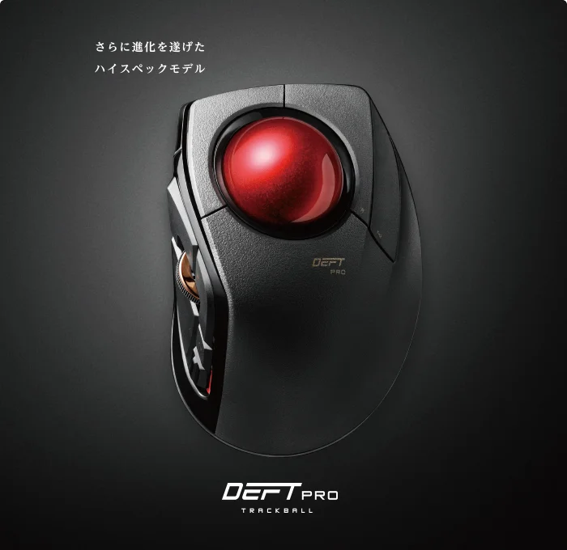

# 現役エンジニアおすすめ＆ほしいPC周辺機器

この記事の所有状況と使用感は、初回公開日の2023年2月28日時点のものです。Amazonリンクの現在の遷移先や在庫は確認できていません。型番・配列・価格・販売地域を購入前に確認し、現行モデルの仕様はメーカー公式ページもご覧ください。使用感は人や用途によって異なります。

## キーボード

なんといってもキーボードは、壊れにくい静電容量無接点方式のものがおすすめです。

初回公開時点では10年以上[REALFORCE](https://amzn.to/3IzOOFO)を所有し、継続して使用していました。
所有しているキーボードの正確な型番は記録していません。REALFORCEには複数の現行シリーズがあるため、購入時は配列・静音性・キー荷重を確認してください。[REALFORCE公式ラインアップ（英語）](https://www.realforce.co.jp/en/products/)

当時使っていたのは英語配列の静音モデルです。

初回公開時に気になっていたのはMX Keysです。2026年時点でLogitech公式ストアに掲載されている現行モデルはMX Keys Sですが、私は実機で試していません。仕様は[Logitech公式ページ（英語）](https://www.logitech.com/en-us/shop/p/mx-keys-s?crid=27)で確認できます。 [元のAmazonリンク](https://amzn.to/3Z5skmR).

## トラックボール

トラックボールは本体を大きく動かさずにポインターを操作できます。私はこの操作感が好みですが、手や用途に合うかは人それぞれです。

私が使っていたのは初回公開時のMX Ergoです。更新モデルMX Ergo Sの仕様は[Logitech公式ページ（英語）](https://www.logitech.com/en-us/shop/p/mx-ergo-s-wireless-trackball-mouse.910-007249)にありますが、私はMX Ergo Sを試していません。 [元のAmazonリンク](https://amzn.to/3IYOwtf).

人差し指で操作するELECOM DEFT PRO（M-DPT1MRXBK）も候補です。メーカー仕様ではボール径は約44mmです。[ELECOM公式製品ページ](https://www.elecom.co.jp/products/M-DPT1MRXBK.html) [元のAmazonリンク](https://amzn.to/3Zu5tB8).

## ディスプレイ

4Kやウルトラワイドは作業領域を広げたい場合の選択肢です。必要な解像度や画面サイズは用途、視距離、OSの拡大率、PC端子で変わるため、購入前に確認してください。

初回公開時点では[DELLの4Kディスプレイ](https://amzn.to/3y0ViIW)を使っていました。

当時はワイドディスプレイの[EIZO](https://amzn.to/3kz7BZH)または[DELL](https://amzn.to/3xZleo1)の製品も候補にしていました。

現行製品の例：[Dell 4Kモニター](https://www.dell.com/en-us/shop/monitors/ar/all-monitor/appref%3D4k-uhd-3840-x-2160-screen-resolution) ／ [EIZO FlexScanシリーズ（英語）](https://www.eizo.com/products/flexscan/flexscan_ev.html/)。この記事のAmazonリンクが指す具体的な型番は確認できていません。
