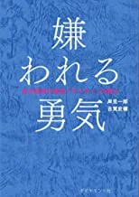

هذه اختياراتي الشخصية، وليست ترتيبًا أو ادعاءً بأن على كل قارئ قراءتها.

تؤدي روابط المنتجات إلى الطبعات اليابانية على Amazon.co.jp. يشارك kenji.blog في برنامج شركاء Amazon وقد يحصل على دخل من المشتريات المؤهلة.

## كيف تكسب الأصدقاء وتؤثر في الناس

[Amazon.co.jp (الطبعة اليابانية)](https://amzn.to/3YTv0Dr)

## الشجاعة لتكون غير محبوب

[Amazon.co.jp (الطبعة اليابانية)](https://amzn.to/3n3SVCQ)

## تحول الحياة: استراتيجية الحياة لعصر المائة عام

[Amazon.co.jp (الطبعة اليابانية)](https://amzn.to/3TtKUDf)

## العادات السبع للناس الأكثر فعالية

[Amazon.co.jp (الطبعة اليابانية)](https://amzn.to/3TqfjSO)

