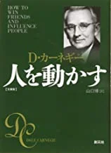
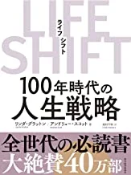

---

title: "비즈니스·자기계발서 중에서 고른 책 4권"
slug: "추천の경영서"
date: 2023-03-19T18:13:14+09:00
lastmod: 2026-11-24T00:00:00+09:00
tags: ["비즈니스 서적", "서적"]
draft: false
image: "img.webp"
categories: ["lifestyle-miscellaneous"]
description: "비즈니스와 자기계발 분야에서 개인적으로 고른 책 4권입니다. 모든 상품 링크는 Amazon.co.jp의 일본어판으로 연결되며, 적격 구매로 kenji.blog가 수수료를 받을 수 있습니다."
---

개인적인 선택 목록이며 순위가 아니고 모든 독자에게 필독서라는 뜻도 아닙니다.

상품 링크는 Amazon.co.jp 일본어판으로 연결됩니다. kenji.blog는 Amazon 제휴 프로그램을 통해 적격 구매에서 수익을 얻을 수 있습니다.

## 사람을 움직이는 법

[Amazon.co.jp (일본어판)](https://amzn.to/3YTv0Dr)

## 미움받을 용기

[Amazon.co.jp (일본어판)](https://amzn.to/3n3SVCQ)

## LIFE SHIFT 100세 시대의 인생 전략

[Amazon.co.jp (일본어판)](https://amzn.to/3TtKUDf)

## 7가지 습관

[Amazon.co.jp (일본어판)](https://amzn.to/3TqfjSO)

