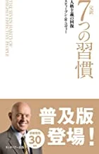

以下は、私が選んだ本の一覧です。順位付けや、すべての読者に必読だという主張ではありません。

商品リンクはAmazon.co.jpの日本語版商品ページです。kenji.blogはAmazonのアソシエイトとして、適格販売により収入を得ています。

## 人を動かす

[Amazon.co.jp（日本語版）](https://amzn.to/3YTv0Dr)

## 嫌われる勇気

[Amazon.co.jp（日本語版）](https://amzn.to/3n3SVCQ)

## LIFE SHIFT 人生100年時代の人生戦略

[Amazon.co.jp（日本語版）](https://amzn.to/3TtKUDf)

## 7つの習慣

[Amazon.co.jp（日本語版）](https://amzn.to/3TqfjSO)

