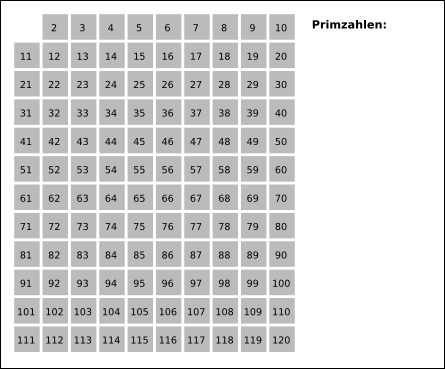

Das Sieb des Eratosthenes listet alle Primzahlen bis zu einer oberen Grenze `n` einschließlich auf. Hier geben Rust-Programme die 168 Primzahlen bis einschließlich 1000 aus. Die Grenze gehört dazu; 0 und 1 sind keine Primzahlen.

## Siebschritte und der Beginn beim Quadrat

1. Reservieren Sie `n + 1` boolesche Elemente für die Indizes 0 bis `n`. Die Grundversion initialisiert sie mit wahr und markiert 0 und 1 als falsch. Bei einer Grenze unter 2 gibt sie ein leeres Ergebnis zurück, bevor sie auf Index 1 zugreift.
2. Prüfen Sie die Kandidaten `p` in aufsteigender Reihenfolge ab 2. Ist die Markierung noch wahr, ist `p` eine Primzahl: Markieren Sie ihre Vielfachen ab $p^2$ in Schritten von `p` als falsch. Markieren Sie `p` selbst nicht.
3. Das Streichen von Vielfachen ist nur für Kandidaten mit $p^2\le n$ nötig, denn jede zusammengesetzte Zahl hat einen Primfaktor, der höchstens ihrer Quadratwurzel entspricht.
4. Durchlaufen Sie abschließend 2 bis `n` und geben Sie alle noch als wahr markierten Zahlen aus. Der Ausgabebereich ist nicht auf die Quadratwurzel beschränkt.

Ein Vielfaches $kp$ unterhalb von $p^2$ mit $2\le k<p$ wurde bereits durch einen Primfaktor von `k` gestrichen, der kleiner als `p` ist. Das bedeutet nicht, dass bereits alle kleineren Zahlen aufgelistet wurden.



Bild: SKopp, von Suricata aktualisierte Fassung, [Wikimedia Commons](https://commons.wikimedia.org/wiki/File:Animation_Sieb_des_Eratosthenes.gif), [CC BY-SA 3.0](https://creativecommons.org/licenses/by-sa/3.0/). Die Datei wurde nicht verändert. Die Abbildung umfasst 2 bis 120; die folgenden Programme verwenden die Grenze 1000.

## Grundimplementierung in Rust

```rust
fn sieve(n: usize) -> Vec<usize> {
    if n < 2 {
        return Vec::new();
    }
    let len = n.checked_add(1).expect("n + 1 is too large");
    let mut is_prime = vec![true; len];
    is_prime[0] = false;
    is_prime[1] = false;

    let mut p = 2;
    while p <= n / p {
        if is_prime[p] {
            let mut multiple = p * p;
            loop {
                is_prime[multiple] = false;
                if n - multiple < p {
                    break;
                }
                multiple += p;
            }
        }
        p += 1;
    }

    (2..=n).filter(|&i| is_prime[i]).collect()
}

fn main() {
    for prime in sieve(1000) {
        println!("{}", prime);
    }
}
```

Speichern Sie als `sieve.rs` und kompilieren Sie mit `rustc --edition=2021 sieve.rs -o sieve`. Verwenden Sie unter Windows `sieve.exe` als Namen der ausführbaren Datei. Das Programm gibt 168 Zeilen aus, beginnend mit 2 und endend mit 997. Die Beispiele wurden mit Rust 1.90.0 ausgeführt.

`sieve(0)` und `sieve(1)` liefern einen leeren Vektor, `sieve(2)` liefert `[2]`. Durch `p <= n / p` wird `p * p` nur berechnet, wenn das Quadrat innerhalb der Grenze liegt. Vor dem Addieren des nächsten Vielfachen wird der verbleibende Abstand geprüft. Eine Quadratwurzelberechnung mit Gleitkommazahlen ist nicht nötig.

## Eine Version zum Streichen ungerader Kandidaten

Gerade Zahlen über 2 sind zusammengesetzt. Deshalb lässt sich 2 als wahr markieren, während nur ungerade Zahlen als Kandidaten initialisiert werden. Für eine ungerade Primzahl `p` ist auch ihr Quadrat ungerade; Schritte der Größe $2p$ ab diesem Quadrat besuchen nur ungerade Vielfache.

```rust
fn sieve_odd(n: usize) -> Vec<usize> {
    if n < 2 {
        return Vec::new();
    }
    let len = n.checked_add(1).expect("n + 1 is too large");
    let mut is_prime = vec![false; len];
    is_prime[2] = true;
    for i in (3..=n).step_by(2) {
        is_prime[i] = true;
    }

    let mut p = 3;
    while p <= n / p {
        if is_prime[p] {
            let step = 2 * p;
            let mut multiple = p * p;
            loop {
                is_prime[multiple] = false;
                if n - multiple < step {
                    break;
                }
                multiple += step;
            }
        }
        p += 2;
    }

    (2..=n).filter(|&i| is_prime[i]).collect()
}

fn main() {
    for prime in sieve_odd(1000) {
        println!("{}", prime);
    }
}
```

Speichern Sie diese Version in einer anderen Datei und kompilieren Sie sie. Sie gibt dieselben 168 Primzahlen aus, liefert für 0 und 1 ein leeres Ergebnis und für 2 den Vektor `[2]`. Fassen Sie die beiden `main`-Funktionen nicht in einer Datei zusammen.

Diese Version spart einen Teil der Arbeit mit geraden Zahlen. Eine Initialisierung mit falsch garantiert jedoch keine höhere Geschwindigkeit. Die Laufzeit hängt von Initialisierung, Schreibzugriffen, Speicherzugriffen, Compiler und Zielrechner ab. Hier wurden keine Laufzeiten gemessen oder verglichen. Das Array hat weiterhin `n + 1` Elemente, damit die Indizes direkt den Zahlen entsprechen.

## Komplexität und mögliche Grenzen

Im üblichen RAM-Modell benötigt das Sieb $O(n\log\log n)$ Zeit und $O(n)$ Speicher für die Markierungen. Dies sind asymptotische Abschätzungen von Operationen und Speicherbedarf, keine gemessenen Laufzeiten oder Bitkomplexität für beliebig genaue ganze Zahlen. Die Siebaufgabe in [Princetons Analysematerial](https://introcs.cs.princeton.edu/java/41analysis/) nennt ebenfalls diese Wachstumsrate.

Rusts [`bool`](https://doc.rust-lang.org/reference/types/boolean.html) belegt ein Byte, und [`Vec<T>`](https://doc.rust-lang.org/std/vec/struct.Vec.html#guarantees) speichert seine Elemente zusammenhängend. Dieser `Vec<bool>` ist kein bitgepacktes Array. Die logische Zahl der Markierungselemente ist `n + 1`; Vektormetadaten, reservierte Kapazität und der zurückgegebene `Vec<usize>` benötigen ebenfalls Speicher.

Ist `n + 1` nicht darstellbar, liefert `checked_add` den Wert `None`, und der folgende Aufruf von `expect` führt zu einem `panic`. Auch sonst muss genügend Speicher verfügbar sein; beliebig große Grenzen werden nicht unterstützt. Für große Intervalle kommt ein segmentiertes Sieb infrage. Die Auflistung von Primzahlen in einem Bereich erfüllt einen anderen Zweck als der Test einer einzelnen großen ganzen Zahl.
