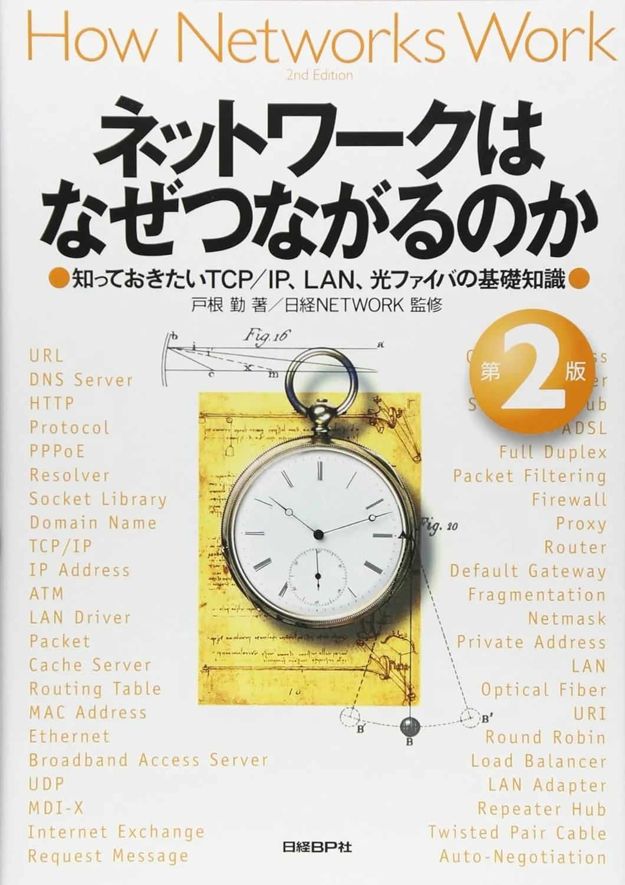

1. Lesbarer Code

2. Prinzipien der Programmierung

3. Der Pragmatische Programmierer

4. Technologien, die das Web unterstützen

5. Erstellen sicherer Webanwendungen

6. Wie Netzwerke verbinden

7. Umfassendes SQL-Handbuch von Experten

8. Praktischer [Docker](https://kenji.blog/de/p/docker-container-namespace-cgroups-layers/)-Leitfaden

9. Vollständiges [Kubernetes](https://kenji.blog/de/p/kubernetes-k8s-architecture-pod-service-ingress/)-Handbuch

10. Code Complete 2. Auflage

11. Clean Code: Agile Software-Handwerkskunst

12. Clean Architecture: Softwarestruktur und -design

13. Technologien, die Sie kennen sollten, bevor Sie Spieleprogrammierer werden

14. Being Geek

15. Warum [objektorientiert](https://kenji.blog/de/p/oop-vs-fp-vs-dop/) entwickeln?

