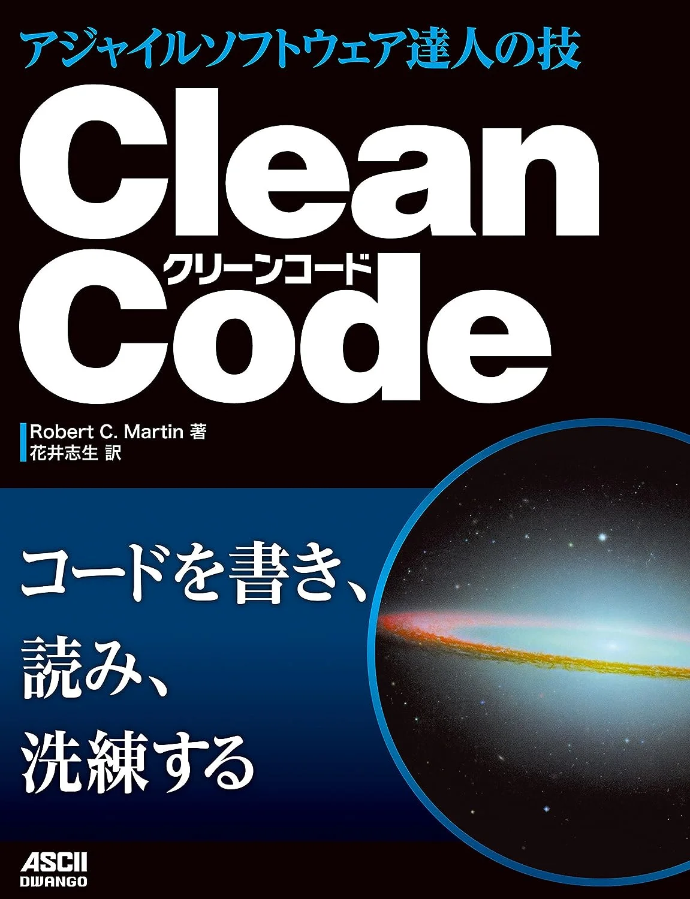

1. The Art of Readable Code

2. Principle of Programming

3. The Pragmatic Programmer

4. Technologies Supporting the Web

5. How to Build Secure Web Applications

6. How Networks Work

7. Thorough SQL Guide Learned from Masters

8. [Docker](https://kenji.blog/en/p/docker-container-namespace-cgroups-layers/) Practical Guide

9. [Kubernetes](https://kenji.blog/en/p/kubernetes-k8s-architecture-pod-service-ingress/) Complete Guide

10. Code Complete 2nd Edition

11. Clean Code: A Handbook of Agile Software Craftsmanship

12. Clean Architecture: A Craftsman's Guide to Software Structure and Design

13. Technologies to Learn Before Becoming a Game Programmer

14. Being Geek

15. Why [Object-Oriented](https://kenji.blog/en/p/oop-vs-fp-vs-dop/) Programming?

