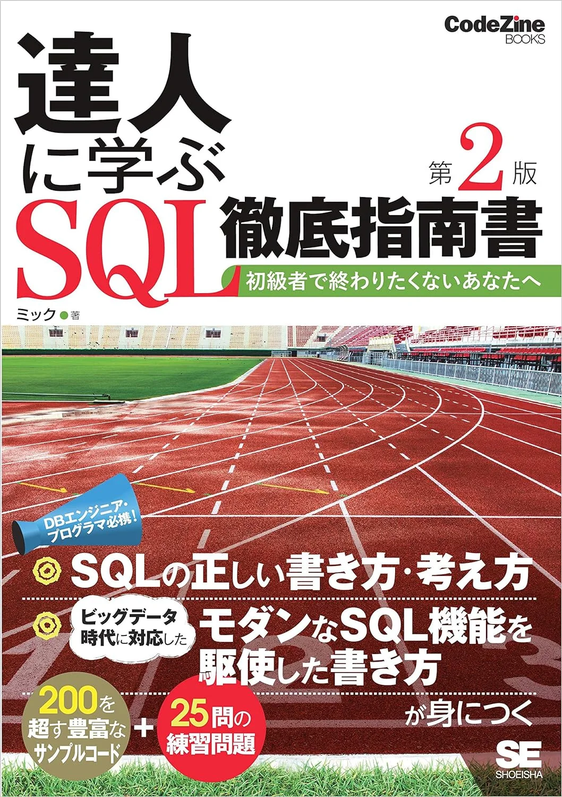
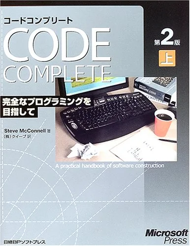

1. रीडेबल कोड

2. प्रिंसिपल्स ऑफ प्रोग्रामिंग

3. द प्रैगमैटिक प्रोग्रामर

4. वेब का समर्थन करने वाली तकनीकें

5. सुरक्षित वेब एप्लिकेशन कैसे बनाएं

6. नेटवर्क कैसे जुड़ते हैं

7. विशेषज्ञों से SQL संपूर्ण गाइड

8. [डॉकर](/hi/p/docker-container-namespace-cgroups-layers/) प्रैक्टिकल गाइड

9. [कुबेरनेट्स](/hi/p/kubernetes-k8s-architecture-pod-service-ingress/) संपूर्ण गाइड

10. कोड कम्प्लीट दूसरा संस्करण

11. क्लीन कोड: चपल सॉफ्टवेयर शिल्प कौशल

12. क्लीन आर्किटेक्चर: सॉफ्टवेयर संरचना और डिजाइन

13. गेम प्रोग्रामर बनने से पहले जानने योग्य तकनीकें

14. बीइंग गीक

15. [ऑब्जेक्ट-ओरिएंटेड प्रोग्रामिंग](/hi/p/object-oriented-programming-oop-solid-principles/) क्यों?

