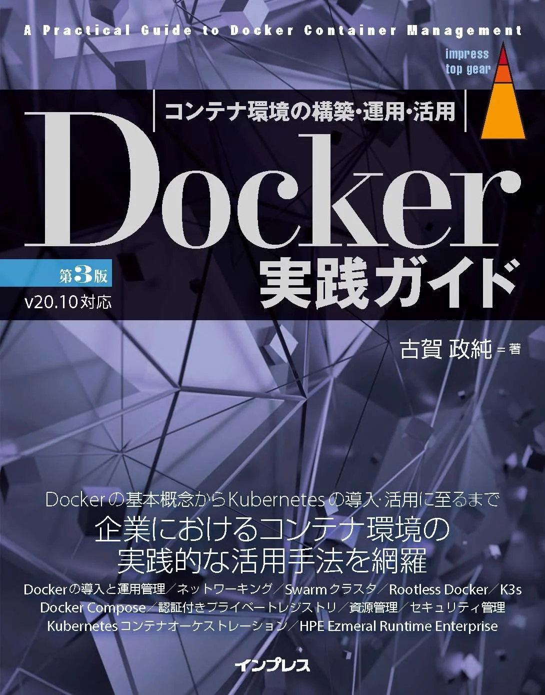
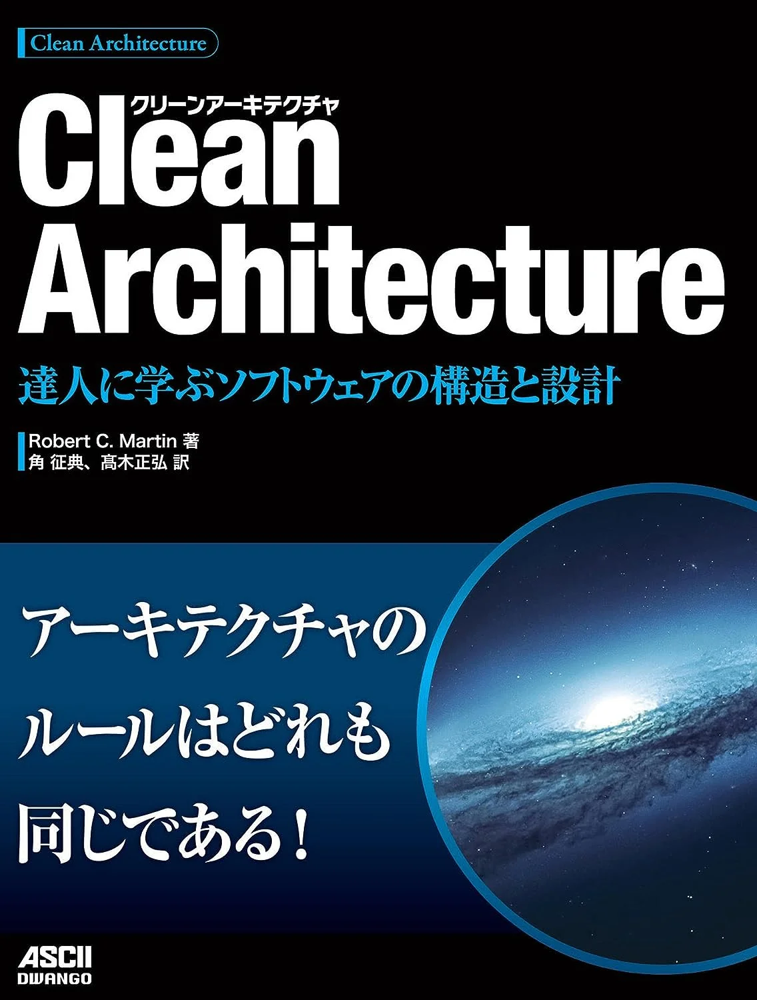

1. The Art of Readable Code

2. Prinsip Pemrograman

3. The Pragmatic Programmer

4. Teknologi yang Mendukung Web

5. Cara Membuat Aplikasi Web yang Aman

6. Cara Kerja Jaringan

7. Panduan Lengkap SQL dari Para Ahli

8. Panduan Praktis [Docker](https://kenji.blog/id/p/docker-container-namespace-cgroups-layers/)

9. Panduan Lengkap [Kubernetes](https://kenji.blog/id/p/kubernetes-k8s-architecture-pod-service-ingress/)

10. CODE COMPLETE Edisi Kedua

11. Clean Code: Keahlian Perangkat Lunak Agile

12. Clean Architecture: Panduan Struktur dan Desain Perangkat Lunak

13. Teknologi yang Harus Diketahui Sebelum Menjadi Pemrogram Game

14. Being Geek

15. Mengapa Kita Membangun dengan [Berorientasi Objek](https://kenji.blog/id/p/oop-vs-fp-vs-dop/)

