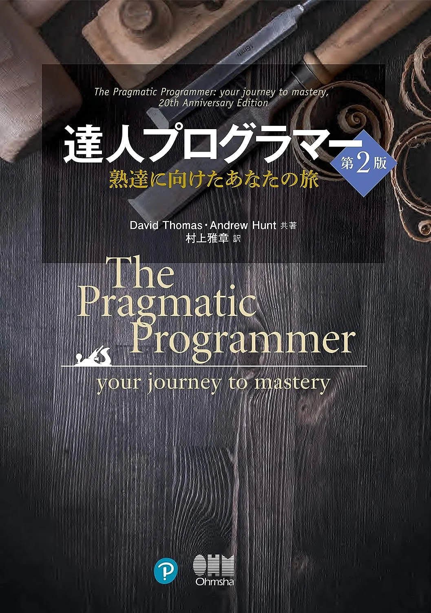
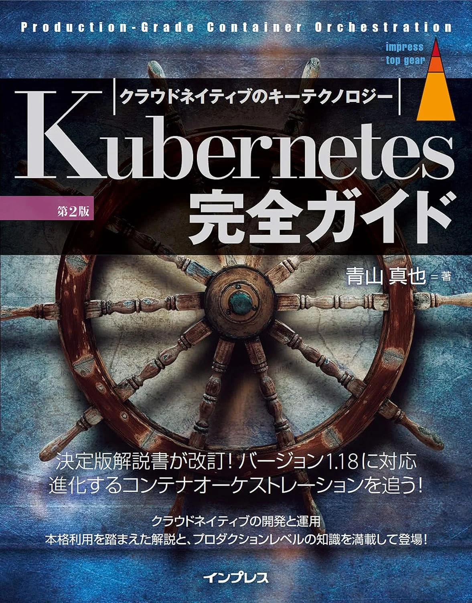

1. リーダブルコード

2. プリンシプルオブプログラミング

3. 達人プログラマー

4. Webを支える技術

5. 安全なWebアプリケーションの作り方

6. ネットワークはなぜつながるのか

7. 達人に学ぶSQL徹底指南書

8. [Docker](https://kenji.blog/p/docker-container-namespace-cgroups-layers/)実践ガイド

9. [Kubernetes](https://kenji.blog/p/kubernetes-k8s-architecture-pod-service-ingress/)完全ガイド

10. CODE COMPLETE 第2版

11. Clean Code アジャイルソフトウェア達人の技

12. Clean Architecture 達人に学ぶソフトウェアの構造と設計

13. ゲームプログラマになる前に覚えておきたい技術

14. Being Geek

15. [オブジェクト指向](https://kenji.blog/p/oop-vs-fp-vs-dop/)でなぜつくるのか

