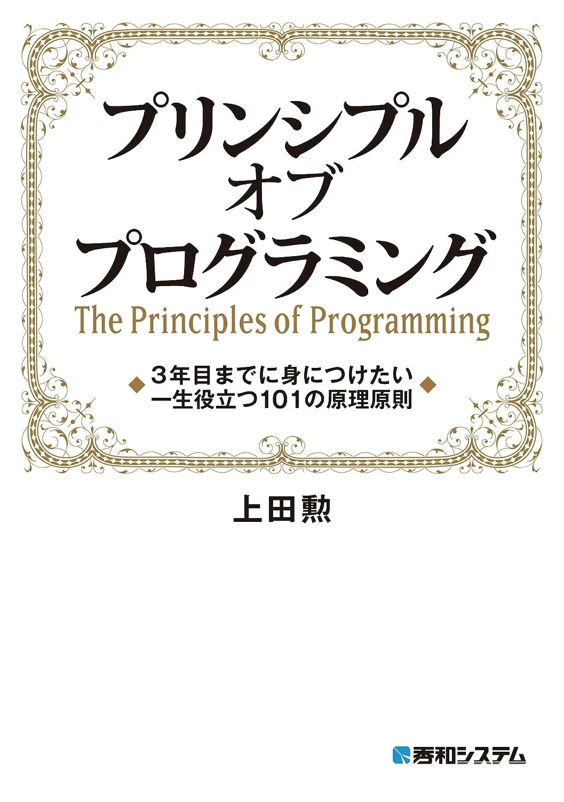
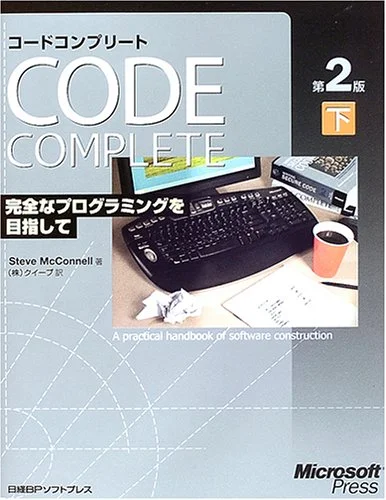

1. Читаемый код (The Art of Readable Code)

2. Принципы программирования (Principles of Programming)

3. Программист-прагматик (The Pragmatic Programmer)

4. Технологии, поддерживающие Web

5. Как создавать безопасные веб-приложения

6. Как работают сети

7. Исчерпывающее руководство по SQL от экспертов

8. Практическое руководство по [Docker](https://kenji.blog/ru/p/docker-container-namespace-cgroups-layers/)

9. Полное руководство по [Kubernetes](https://kenji.blog/ru/p/kubernetes-k8s-architecture-pod-service-ingress/)

10. CODE COMPLETE Второе издание

11. Clean Code: Мастерство Agile-разработчика

12. Clean Architecture: Структура и дизайн ПО

13. Технологии, которые нужно знать, прежде чем стать программистом игр

14. Being Geek

15. Почему мы создаем с использованием [ООП](https://kenji.blog/ru/p/oop-vs-fp-vs-dop/)

