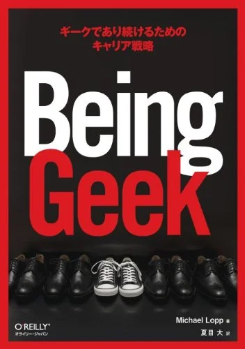

1. 编写可读代码的艺术

2. 编程的原则

3. 程序员修炼之道

4. 支撑Web的技术

5. 构建安全的Web应用

6. 网络是怎样连接的

7. SQL进阶教程

8. [Docker](https://kenji.blog/zh-cn/p/docker-container-namespace-cgroups-layers/)实践指南

9. [Kubernetes](https://kenji.blog/zh-cn/p/kubernetes-k8s-architecture-pod-service-ingress/)完全指南

10. CODE COMPLETE 代码大全 第2版

11. Clean Code 代码整洁之道

12. Clean Architecture 架构整洁之道

13. 成为游戏程序员前需要掌握的技术

14. Being Geek

15. 为什么用[面向对象编程](https://kenji.blog/zh-cn/p/oop-vs-fp-vs-dop/)

