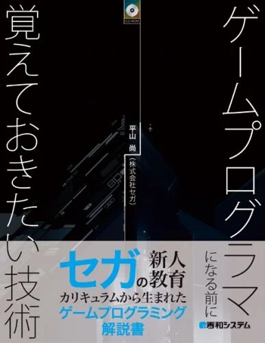
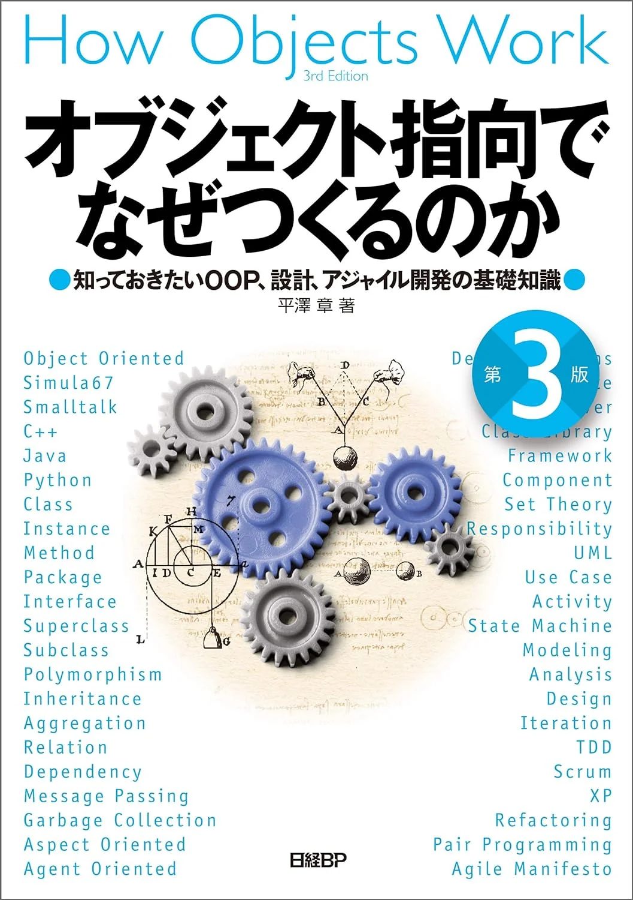

1. 可讀的程式碼 (Readable Code)

2. 程式設計原理 (Principles of Programming)

3. 程式設計師修煉之道 (The Pragmatic Programmer)

4. 支撐 Web 的技術

5. 安全 Web 應用程式建立指南

6. 網路為何能連接

7. 向達人學習 SQL 徹底指南

8. [Docker](https://kenji.blog/zh-tw/p/docker-container-namespace-cgroups-layers/) 實踐指南

9. [Kubernetes](https://kenji.blog/zh-tw/p/kubernetes-k8s-architecture-pod-service-ingress/) 完全指南

10. CODE COMPLETE 第2版

11. Clean Code 無瑕的程式碼

12. Clean Architecture 無瑕的程式碼：整潔的軟體設計與架構篇

13. 成為遊戲程式設計師前必須知道的技術

14. 成為極客 (Being Geek)

15. 為什麼要用[物件導向](https://kenji.blog/zh-tw/p/oop-vs-fp-vs-dop/)？

