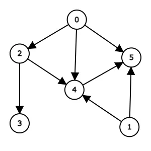

# Crear grafos con CS Academy Graph Editor

[CS Academy Graph Editor](https://csacademy.com/app/graph_editor/) es una herramienta en el navegador para visualizar vértices y aristas de teoría de grafos.

La imagen siguiente es un ejemplo guardado con este artículo. Introduce los datos del grafo en la página, selecciona `Directed` para crear un grafo dirigido, ajusta con el ratón la posición de los vértices y guarda la imagen con `Download as PNG`.

> **Nota de revisión (24 de noviembre de 2026):** La página de la herramienta respondió con un aviso para habilitar JavaScript. No fue posible verificar con navegación automatizada de solo texto la interfaz actual ni el funcionamiento de sus opciones. Los pasos anteriores se basan en la imagen guardada y en la explicación anterior del artículo; la página actual puede ser distinta.

## Referencias

- [CS Academy Graph Editor](https://csacademy.com/app/graph_editor/)
- [Anuncio de CS Academy sobre Graph Editor en Codeforces](https://codeforces.com/blog/entry/45758)
