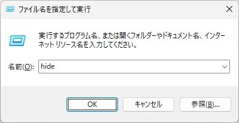

## Я покажу, как запустить редактор Hidemaru с помощью команды «hide».

Примечание: этот метод протестирован на `Windows 10/11`.

1. Откройте редактор реестра.
2. Перейдите в `HKEY_CURRENT_USER\SOFTWARE\Microsoft\Windows\CurrentVersion\App Paths`.
3. Создайте ключ с именем `hide.exe` в `App Paths`. ※ Часть имени ключа перед `.exe` будет названием команды.
4. Установите путь к исполняемому файлу редактора Hidemaru в значение `(По умолчанию)` ключа `hide.exe`. В моей среде это было `"C:\Program Files (x86)\Hidemaru\Hidemaru.exe"`.
5. Значение Path необязательно. Добавляйте его только при необходимости дополнительных каталогов DLL; ShellExecuteEx добавляет их в PATH процесса.
6. Введите hide в окне «Выполнить» (Win + R). В командной строке используйте start hide; ввод только hide не является описанным способом.

```reg
Windows Registry Editor Version 5.00

[HKEY_CURRENT_USER\SOFTWARE\Microsoft\Windows\CurrentVersion\App Paths\hide.exe]
@="C:\\Program Files (x86)\\Hidemaru\\Hidemaru.exe"
```
Если вы сохраните приведенное выше содержимое в файл `.reg` и запустите его, настройки будут добавлены в реестр.

Этот .reg регистрирует приложение только для текущего пользователя. Замените путь фактическим путем к файлу. Для всех пользователей замените HKEY_CURRENT_USER на HKEY_LOCAL_MACHINE и импортируйте с правами администратора.


## Источники

- [Microsoft: Application Registration and App Paths](https://learn.microsoft.com/en-us/windows/win32/shell/app-registration)
- [Microsoft: start command](https://learn.microsoft.com/en-us/windows-server/administration/windows-commands/start)


